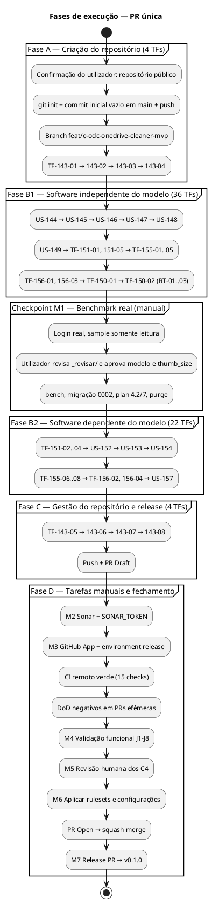

# Plano de Execução: OneDrive Cleaner — Backlog completo em PR única

- **Status:** Aprovado (2026-11-17)
- **Data:** 2026-11-17
- **Artefatos de origem (aprovados):** [`spec.md`](spec.md) · [`plan.md`](plan.md) · [`tasks.md`](tasks.md)
- **Executor:** skill `/scrapforge:scrapforge-forge` (orquestração via `mimic-loop`, estado no `mcp-saga`)
- **Escopo:** 15 User Stories (US-143..US-157) e 66 Tarefas (TF), todas na mesma branch e na mesma Pull Request

## 1. Decisões do utilizador

| # | Decisão |
|---|---|
| D1 | `main` nasce com **commit inicial vazio**; TF-143-01 (governança + `docs/`) e todas as demais TFs entram na PR única |
| D2 | Rulesets da `main` (TF-143-08) aplicados **antes do merge** da PR única — a própria PR prova os gates |
| D3 | Execução **sequencial** em ordem topológica, **1 commit por TF**, sem worktrees nem branches auxiliares |
| D4 | **Commits assinados não são exigidos** no MVP (não há signing key configurada) |
| D5 | Ordem: **criação do repositório → implementação do software → gerenciamento do repositório/release**; tarefas manuais ao final |
| D6 | Exceção a D5: benchmark real do modelo de visão (TF-150-02, RT-04/05) **no meio do fluxo**, o mais tarde possível, porque 22 TFs dependem do modelo escolhido |
| D7 | Self-review via `multi-spec-review` (forge §8) **dispensado** |
| D8 | **Toda TF é executada por subagent**, cada um com o **modelo e esforço sugeridos no `tasks.md`** para aquela TF; a sessão principal apenas orquestra |

## 2. Estratégia de branch, commits e PR

| Item | Definição |
|---|---|
| Estratégia | Trunk-based (plan 11.1) — `BASE_BRANCH = main` |
| Branch única | `feat/e-odc-onedrive-cleaner-mvp` |
| Commits | 1 por TF; Conventional Commits (tipo e escopo em inglês conforme plan 11.4, descrição PT-BR); `git add` explícito dos arquivos da TF (nunca `git add .`/`-A`); sem trailer `Co-Authored-By`; correções posteriores em commits novos `fix(<escopo>): ...` |
| Push | Ao fim de cada US (backup remoto). CI só dispara em `pull_request`, portanto não roda antes da PR |
| PR | Única, aberta como **Draft** ao fim da Fase C; título `feat: entrega o MVP do OneDrive Cleaner` (válido para o job `pr-title`) |
| Merge | Squash (plan 11.2) → um commit em `main` → release-please gera `v0.1.0` |

## 3. Overrides sobre os artefatos aprovados

Os artefatos `spec.md`, `plan.md` e `tasks.md` não são editados; os desvios abaixo valem para esta execução e são registrados no `mcp-saga` (`note_save` tipo `override`).

| # | Artefato / regra | Override |
|---|---|---|
| O1 | `tasks.md` — "um PR por TF; título do PR = mensagem do squash" | PR única (D1, D3) |
| O2 | forge §8 — `multi-spec-review` obrigatório | Dispensado (D7) |
| O3 | TF-143-01 critério "commit assinado"; TF-143-08 regra `required_signatures` e DoD "commit não assinado bloqueia merge"; `CONTRIBUTING.md` "commits assinados"; plan 11.2 "Commits assinados: exigidos" | Removidos no MVP (D4) |
| O4 | Sequenciamento da US-143 | TF-143-01..04 na Fase A; TF-143-05..08 na Fase C (D5) |
| O5 | TF-143-01 passo 5 (habilitar Issues e private vulnerability reporting; desabilitar Wiki e Projects) | Executado junto com a aplicação de configurações da TF-143-08 (Fase D, M6) |
| O6 | TF-150-02 | Execução em duas partes: RT-01..03 automáticos; RT-04/05 no checkpoint manual M1 (D6) |
| O7 | DoD negativos da TF-143-05 (título `update`, dependência GPL-2.0-only, segredo fake) e da TF-143-08 (PR com check vermelho) | Validados em PRs efêmeras, fechadas sem merge e com branch apagada; não são entrega de implementação |
| O8 | forge §9 — PR Draft somente após self-review | PR Draft aberta ao fim da Fase C, porque os DoD da TF-143-05..08 exigem PR com CI |

## 4. Pré-requisitos

| # | Pré-requisito | Quando | Responsável |
|---|---|---|---|
| P1 | Token do MCP `mcp-github` válido (hoje retorna HTTP 401) — usado para PR e polling de CI | Antes da Fase C | Utilizador |
| P2 | `pnpm` disponível (`corepack enable pnpm`; hoje ausente) | Antes da TF-143-03 | `/scrapforge:baseline-assessment` |
| P3 | Docker ativo (Rancher Desktop presente) | Antes da TF-145-04 | `/scrapforge:baseline-assessment` |
| P4 | App registrado no Microsoft Entra (contas pessoais, plataforma "Mobile and desktop", redirect `http://localhost`) e `ODC_CLIENT_ID` local | Antes do checkpoint M1 | Utilizador |
| P5 | `mcp-sonar` não configurado → scan Sonar local pulado; o job `sonar-quality-gate` do CI cobre | — | — |

Ferramentas verificadas em 2026-11-17: git 2.50, gh 2.95 (autenticado), uv 0.10.8, Python 3.12.8, Node 22.22, Docker 29.6, make 3.81. O diretório ainda não é repositório git. O `gh` CLI é usado apenas onde o próprio `tasks.md` o prescreve como entregável (`scripts/github/apply-repo-settings.sh`, validações `gh api`, criação do repositório se o MCP estiver indisponível); operações de PR e CI usam `/scrapforge:github`.

## 5. Fases e ordem de execução

### 5.1 Ordem canônica com modelo por TF

A tabela é a **fonte canônica** de ordem e modelo para o orquestrador. Ordem validada: toda dependência da coluna "Depende de" do `tasks.md` aparece antes da TF dependente. Modelo e esforço copiados do campo `Modelo sugerido` de cada TF (nenhuma RT declara `[model: ...]`, logo o nível TF vale para a TF inteira).

| # | Fase | TF | Título | US | C | `model` | `effort` | Escalonar para |
|---|---|---|---|---|---|---|---|---|
| 1 | A | TF-143-01 | Criar repositório público e arquivos de governança | US-143 | C1 | `haiku` | — | sonnet |
| 2 | A | TF-143-02 | Esqueleto do projeto Python e gates de qualidade | US-143 | C2 | `sonnet` | `medium` | opus |
| 3 | A | TF-143-03 | Esqueleto do front-end e gates de qualidade | US-143 | C2 | `sonnet` | `medium` | opus |
| 4 | A | TF-143-04 | Hooks locais de pre-commit e prevenção de segredos | US-143 | C1 | `haiku` | — | sonnet |
| 5 | B1 | TF-144-01 | Configuração da aplicação e diretórios locais | US-144 | C1 | `haiku` | — | sonnet |
| 6 | B1 | TF-144-02 | Schema SQLite e migração inicial | US-144 | C2 | `sonnet` | `medium` | opus |
| 7 | B1 | TF-144-03 | Repositórios de dados por agregado | US-144 | C2 | `sonnet` | `medium` | opus |
| 8 | B1 | TF-144-04 | Camada web base segura e contrato OpenAPI | US-144 | C3 | `sonnet` | `high` | opus |
| 9 | B1 | TF-144-05 | CLI `odc` e sequência de inicialização | US-144 | C1 | `haiku` | — | sonnet |
| 10 | B1 | TF-144-06 | Casco da interface (layout, rotas, tema, cliente API) | US-144 | C2 | `sonnet` | `medium` | opus |
| 11 | B1 | TF-145-01 | Bootstrap do OpenTelemetry e instrumentações automáticas | US-145 | C2 | `sonnet` | `medium` | opus |
| 12 | B1 | TF-145-02 | Redaction de dados sensíveis e logs estruturados | US-145 | C3 | `sonnet` | `high` | opus |
| 13 | B1 | TF-145-03 | Catálogo de métricas canônico | US-145 | C2 | `sonnet` | `medium` | opus |
| 14 | B1 | TF-145-04 | Stack local, dashboards e alertas | US-145 | C2 | `sonnet` | `medium` | opus |
| 15 | B1 | TF-146-01 | Serviço de autenticação MSAL com cache no Keychain | US-146 | C3 | `sonnet` | `high` | opus |
| 16 | B1 | TF-146-02 | Rotas de login, callback e logout | US-146 | C2 | `sonnet` | `medium` | opus |
| 17 | B1 | TF-146-03 | Tela de login e tratamento de sessão expirada | US-146 | C1 | `haiku` | — | sonnet |
| 18 | B1 | TF-147-01 | Modelos de resposta da Graph (Zero Trust) | US-147 | C1 | `haiku` | — | sonnet |
| 19 | B1 | TF-147-03 | Limitador de concorrência adaptativo (AIMD) | US-147 | C3 | `sonnet` | `high` | opus |
| 20 | B1 | TF-147-02 | Política de retry, backoff e renovação de token | US-147 | C3 | `sonnet` | `high` | opus |
| 21 | B1 | TF-147-04 | Operações de alto nível do OneDrive | US-147 | C2 | `sonnet` | `medium` | opus |
| 22 | B1 | TF-147-05 | Graph fake (in-process e servidor HTTP) | US-147 | C3 | `sonnet` | `high` | opus |
| 23 | B1 | TF-148-01 | Fila persistida: enfileirar, claim atômico, heartbeat e payloads | US-148 | C3 | `sonnet` | `high` | opus |
| 24 | B1 | TF-148-02 | Runner assíncrono com retries, pausas e executores | US-148 | C4 | `opus` | `high` | utilizador (revisão humana) |
| 25 | B1 | TF-149-01 | Pastas de varredura: padrão Camera Roll e seleção | US-149 | C2 | `sonnet` | `medium` | opus |
| 26 | B1 | TF-149-02 | Scanner incremental com checkpoints e transições de estado | US-149 | C4 | `opus` | `high` | utilizador (revisão humana) |
| 27 | B1 | TF-149-03 | API de varreduras e jobs | US-149 | C1 | `haiku` | — | sonnet |
| 28 | B1 | TF-149-04 | Tela de primeira configuração (pastas e modo) | US-149 | C2 | `sonnet` | `medium` | opus |
| 29 | B1 | TF-149-05 | Tela de Varreduras (jobs, progresso, falhas) | US-149 | C2 | `sonnet` | `medium` | opus |
| 30 | B1 | TF-151-01 | Extrator de features de metadados | US-151 | C1 | `haiku` | — | sonnet |
| 31 | B1 | TF-151-05 | Serviço de limpeza e uso de disco | US-151 | C2 | `sonnet` | `medium` | opus |
| 32 | B1 | TF-155-01 | Pastas da aplicação no OneDrive | US-155 | C2 | `sonnet` | `medium` | opus |
| 33 | B1 | TF-155-02 | Diário de operações e reconciliação | US-155 | C4 | `opus` | `high` | utilizador (revisão humana) |
| 34 | B1 | TF-155-03 | Mover para a quarentena | US-155 | C3 | `sonnet` | `high` | opus |
| 35 | B1 | TF-155-04 | Restaurar da quarentena | US-155 | C3 | `sonnet` | `high` | opus |
| 36 | B1 | TF-155-05 | Exclusão com confirmação para a lixeira | US-155 | C3 | `sonnet` | `high` | opus |
| 37 | B1 | TF-156-01 | Serviço e API de configurações | US-156 | C1 | `haiku` | — | sonnet |
| 38 | B1 | TF-156-03 | Página de Configurações | US-156 | C1 | `haiku` | — | sonnet |
| 39 | B1 | TF-150-01 | Script de benchmark de modelos de visão | US-150 | C3 | `sonnet` | `high` | opus |
| 40 | B1 + M1 | TF-150-02 | Coleta automática da amostra no OneDrive, execução, decisão e migração do modelo escolhido | US-150 | C3 | `sonnet` | `high` | opus |
| 41 | B2 | TF-151-02 | Embedder local de imagem e texto | US-151 | C3 | `sonnet` | `high` | opus |
| 42 | B2 | TF-151-03 | Embedder fake determinístico | US-151 | C1 | `haiku` | — | sonnet |
| 43 | B2 | TF-151-04 | Handler de extração em lote | US-151 | C3 | `sonnet` | `high` | opus |
| 44 | B2 | TF-152-01 | Classificador zero-shot | US-152 | C2 | `sonnet` | `medium` | opus |
| 45 | B2 | TF-152-02 | Treinador supervisionado e serialização segura | US-152 | C3 | `sonnet` | `high` | opus |
| 46 | B2 | TF-152-03 | Avaliação em holdout, promoção e gate Evolutivo | US-152 | C4 | `opus` | `high` | utilizador (revisão humana) |
| 47 | B2 | TF-152-04 | Handlers de treino e classificação | US-152 | C2 | `sonnet` | `medium` | opus |
| 48 | B2 | TF-152-05 | Suíte de testes de qualidade do modelo | US-152 | C4 | `opus` | `high` | utilizador (revisão humana) |
| 49 | B2 | TF-153-01 | API de revisão, rótulos, miniaturas e modelos | US-153 | C2 | `sonnet` | `medium` | opus |
| 50 | B2 | TF-153-02 | Página de Revisão | US-153 | C3 | `sonnet` | `high` | opus |
| 51 | B2 | TF-154-01 | Serviço e API de categorias | US-154 | C2 | `sonnet` | `medium` | opus |
| 52 | B2 | TF-154-02 | Página de Categorias | US-154 | C1 | `haiku` | — | sonnet |
| 53 | B2 | TF-155-06 | Política de automação e restauração automática | US-155 | C4 | `opus` | `high` | utilizador (revisão humana) |
| 54 | B2 | TF-155-07 | API de quarentena | US-155 | C2 | `sonnet` | `medium` | opus |
| 55 | B2 | TF-155-08 | Página de Quarentena e ação de mover na Revisão | US-155 | C3 | `sonnet` | `high` | opus |
| 56 | B2 | TF-156-02 | Serviço e API de resumo de métricas e alertas | US-156 | C2 | `sonnet` | `medium` | opus |
| 57 | B2 | TF-156-04 | Página de Métricas | US-156 | C2 | `sonnet` | `medium` | opus |
| 58 | B2 | TF-157-01 | Harness E2E (launcher, fakes, Playwright) | US-157 | C3 | `sonnet` | `high` | opus |
| 59 | B2 | TF-157-03 | Testes de resiliência kill-and-resume | US-157 | C3 | `sonnet` | `high` | opus |
| 60 | B2 | TF-157-04 | Teste de volumetria e SLAs | US-157 | C2 | `sonnet` | `medium` | opus |
| 61 | B2 | TF-157-05 | Varredura de privacidade da telemetria ponta a ponta | US-157 | C2 | `sonnet` | `medium` | opus |
| 62 | B2 | TF-157-02 | Cenários E2E das jornadas e acessibilidade | US-157 | C3 | `sonnet` | `high` | opus |
| 63 | C | TF-143-05 | Workflows de CI, segurança e análise | US-143 | C3 | `sonnet` | `high` | opus |
| 64 | C | TF-143-06 | Integração SonarQube Cloud | US-143 | C2 | `sonnet` | `medium` | opus |
| 65 | C | TF-143-07 | Release automatizado com SemVer | US-143 | C3 | `sonnet` | `high` | opus |
| 66 | C | TF-143-08 | Proteção da `main` e configurações do repositório como código | US-143 | C2 | `sonnet` | `medium` | opus |

Totais: Fase A 4 · Fase B1 36 · Fase B2 22 · Fase C 4 = **66**. Modelos: `haiku` 12 · `sonnet`/`medium` 26 · `sonnet`/`high` 22 · `opus`/`high` 6.

### 5.2 Detalhamento das fases

**Fase A — Criação do repositório.** O orquestrador obtém a confirmação do utilizador para criar o repositório público `EarthW0rm/one-drive-cleaner`. O subagent da TF-143-01 cria o repositório, executa `git init -b main`, faz o commit inicial vazio em `main` e o push (D1), cria a branch única e comita os arquivos de governança e `docs/` nela. TF-143-02..04 seguem na branch. Após TF-143-02/03, reexecutar `baseline-assessment assess` (o Makefile e as suítes passam a existir).

**Fase B1 — Software independente do modelo.** 36 TFs na ordem da tabela. TF-150-02 executa apenas RT-01..03 (subcomandos `sample`/`purge` e ajuste do loader do `bench`, testados com Graph fake).

**Checkpoint M1 — Benchmark real.** Requer P4. TF-150-02 RT-04/05: login real, `sample` somente leitura no Camera Roll, revisão de `_revisar/` pelo utilizador (≥ 30 por categoria), `bench`, apresentação do `RESULT.md`, **aprovação explícita** do modelo e do `thumb_size`, migração `0002`, atualização do plan 4.2 e 7, `purge` com confirmação de remoção.

**Fase B2 — Software dependente do modelo.** 22 TFs na ordem da tabela.

**Fase C — Gerenciamento do repositório e release (parte automatizável).** TF-143-05 (workflows, `dependabot.yml`, `license_check.py`, `actionlint`/`zizmor` locais), TF-143-06 (`sonar-project.properties`, job `sonar-quality-gate`), TF-143-07 (release-please, `verify_dist.py`, `release.yml`), TF-143-08 (rulesets JSON sem `required_signatures`, script com `--dry-run`, `test_rulesets.py`). Ao final: push e abertura da PR Draft via `/scrapforge:github`.

**Fase D — Tarefas manuais e fechamento.**

| Passo | Ação | TF | Responsável |
|---|---|---|---|
| D.1 | M2 — Criar organização/projeto no SonarQube Cloud, quality gate e `SONAR_TOKEN` em GitHub Secrets | TF-143-06 | Utilizador |
| D.2 | M3 — Criar GitHub App (`contents: write`, `pull-requests: write`), instalar, environment `release` restrito a `main`, `RELEASE_APP_ID` e `RELEASE_APP_PRIVATE_KEY` | TF-143-07 | Utilizador |
| D.3 | Loop de CI remoto (forge §10, máx. 3 tentativas de correção) até os 15 checks obrigatórios do plan 11.2 ficarem verdes | — | Subagents |
| D.4 | DoD negativos em PRs efêmeras (O7) | TF-143-05, 143-08 | Subagents |
| D.5 | M4 — Validação funcional J1–J8 e jornada de interrupção em conta real, pasta de teste (forge §7, spec 5.1) | — | Utilizador |
| D.6 | M5 — Revisão humana dos commits C4: TF-148-02, 149-02, 152-03, 152-05, 155-02, 155-06 | — | Utilizador |
| D.7 | M6 — Revisar o `--dry-run`, aplicar rulesets e configurações do repositório (inclui O5); verificar rejeição de push direto e force push em `main`; reexecução sem duplicar rulesets | TF-143-08 | Utilizador confirma; subagent aplica |
| D.8 | PR Draft → Open; squash merge | — | Utilizador |
| D.9 | M7 — Release PR do release-please → checks verdes → merge → `v0.1.0`; validar `SHA256SUMS` (`shasum -a 256 -c`), `gh attestation verify` e `odc --version` | TF-143-07 | Utilizador faz merge; subagent valida |
| D.10 | Verificação final, relatório de conclusão, métricas e lições no `mcp-saga` | — | Orquestrador |

## 6. Execução por TF via subagent (D8)

### 6.1 Papéis

| Papel | Responsabilidade | Não faz |
|---|---|---|
| Orquestrador (sessão principal) | Lê o `mcp-saga`, despacha 1 subagent por TF na ordem da seção 5.1, confere resultado e modelo, conduz checkpoints com o utilizador | Não implementa TF |
| Subagent de TF | Contexto limpo (`mimic-loop`); executa a TF inteira, comita e atualiza o saga | Não despacha outros subagents; não interage com o utilizador |

### 6.2 Garantia do modelo sugerido

1. Na criação das tasks no saga, cada TF recebe `comment_add` com `model: <haiku|sonnet|opus>` e `effort: <medium|high|->`, copiados da seção 5.1.
2. Todo despacho do Agent tool passa **explicitamente** `model` e `effort` lidos do saga para aquela TF (`effort` omitido apenas nas TFs C1, que não o declaram). Nunca usar `subagent_type: fork` (o fork ignora `model`).
3. O prompt do subagent declara o modelo esperado; o subagent registra no saga o modelo efetivo; o orquestrador confere com a seção 5.1 antes de marcar `done`. Divergência → TF reexecutada com o modelo correto.
4. Escalonamento (coluna "Escalonar para"; gatilho do `tasks.md`: 2 tentativas consecutivas sem atingir o mesmo critério de 4.6) **somente com autorização do utilizador**, registrado como override no saga. TFs C4 não escalonam: falha vai direto ao utilizador.
5. O relatório de conclusão traz o modelo efetivo de cada uma das 66 TFs.

### 6.3 TFs com etapa humana

| TF | Tratamento |
|---|---|
| TF-143-01 | Orquestrador obtém a confirmação de criação do repositório público antes do despacho; subagent `haiku` executa |
| TF-150-02 | Subagent A (`sonnet`/`high`): RT-01..03 na Fase B1 e `sample` real no M1. Orquestrador conduz a revisão de `_revisar/` e a aprovação do modelo. Subagent B (`sonnet`/`high`): `bench`, migração `0002`, atualização do plan, `purge` |
| TF-143-06, 143-07, 143-08 | Subagent implementa a parte automatizável na Fase C; após M2, M3 e M6, subagent da mesma TF (mesmo modelo) faz ajustes e validações |
| Correções na Fase D (CI, validação funcional, revisão humana) | Subagent com o modelo da TF dona do arquivo corrigido; correção que atravessa várias TFs usa o maior modelo entre elas |

Consolidação por US (forge §6) e o loop de CI não são TFs: usam subagent que herda o modelo da sessão.

### 6.4 Passos de cada subagent de TF

1. `baseline-check.sh report` — `scripts`, `runner`, `linter`, `overrides_active`, `category_effective`.
2. `task_get` no saga + leitura integral do bloco da TF no `tasks.md` e das seções citadas do `plan.md`/`spec.md`.
3. Ciclo TDAD (`/scrapforge:test-driven-agentic-development`): IMPLEMENT → IMPACT → VERIFY → CORRECT → COBERTURA → SUBMIT; `/scrapforge:expert-lsp` em TS; `/scrapforge:systematic-debugging` em comportamento inesperado. TFs de infra/config seguem o DoD.
4. Comando de validação 4.3 da TF + `make lint` + testes do alvo (cobertura ≥ 90% linhas / ≥ 85% branches nos arquivos tocados).
5. Commit via `/scrapforge:commit-message` com `git add` explícito; capturar o SHA.
6. Validação pós-commit (≤ 10 ciclos): aderência à TF, tipagem estrita, validação na borda, resiliência, testes e lint verdes, sem hardcode, SPDX, telemetria sem dados sensíveis; correções por `git commit --amend`.
7. Gate `baseline-check.sh verify-diff --scope=commit` (exit 1 → corrigir em commit novo).
8. Saga: `task_update` → `done`, `comment_add` com SHA, modelo efetivo e notas.

### 6.5 Consolidação por US

Ao concluir a última TF de cada US: subagent de consolidação executa `make lint`, `make test`, `make test-integration` e, quando já existirem, `make test-model` e `make test-e2e`; verifica integração entre as TFs da US; correções em commit `fix(<escopo>): corrigir integração entre TFs da US-XXX`; máximo 3 tentativas, depois escala ao utilizador. Push da branch após consolidação verde.

## 7. Estado no `mcp-saga`

| Entidade | Conteúdo |
|---|---|
| Projeto | `exec:one-drive-cleaner:E-ODC` |
| Epics | 1 por US (US-143..US-157) |
| Tasks | 1 por TF, `depends_on` conforme a coluna "Depende de" do `tasks.md`; comments `model:` e `effort:` |
| Notes `context` | `branching_strategy: trunk-based`, `base_branch: main`, decisões D1–D8 |
| Notes `override` | O1–O8 e qualquer override de baseline, escalonamento ou CI autorizado pelo utilizador |
| Notes `progress` / `metrics` / `lesson` | Ao fim de cada fase e na conclusão |

## 8. Checkpoints com o utilizador

| Momento | Conteúdo |
|---|---|
| Início | Relatório de risco (forge §4.3) e confirmação de criação do repositório público |
| Fim das Fases A, B1, B2 e C | Resumo: TFs `done`, SHAs, modelos efetivos, pendências |
| M1 | Benchmark real e aprovação do modelo |
| Fase D | M2–M7 |
| Exceções | Escalonamento de modelo, falha de TF C4, limites de iteração esgotados, bloqueio externo |

Fora desses pontos, a execução é autônoma.

## 9. Riscos

| Risco | Mitigação |
|---|---|
| 6 TFs C4 (movimentação/perda de arquivos do utilizador, consistência após falha, ML que decide ações) | `opus`/`high`, testes extensos, revisão humana obrigatória (M5) |
| Checkpoint M1 bloqueia 22 TFs | Posicionado após todas as 40 TFs independentes do modelo |
| PR única com 66 commits | 1 commit por TF, consolidação por US, revisão humana focada nos C4 |
| Squash merge → CHANGELOG da `v0.1.0` com uma única entrada | Corpo da PR lista as 15 US entregues |
| CI remoto só valida na Fase D | Gates locais (`make lint`, `make test`, pre-commit da TF-143-04) desde a Fase A |
| Status checks `strict` com rulesets antes do merge | `main` contém apenas o commit vazio; a branch permanece atualizada |
| MCP `mcp-github` com HTTP 401 | Pré-requisito P1, antes da Fase C |
| Contexto longo da sessão orquestradora | Estado canônico no saga; subagents com contexto limpo por TF |

## 10. Rastreabilidade fase → US

| Fase | US (TFs) | Qtde |
|---|---|---|
| A | US-143 (01–04) | 4 |
| B1 | US-144 (01–06), US-145 (01–04), US-146 (01–03), US-147 (01–05), US-148 (01–02), US-149 (01–05), US-151 (01, 05), US-155 (01–05), US-156 (01, 03), US-150 (01–02) | 36 |
| B2 | US-151 (02–04), US-152 (01–05), US-153 (01–02), US-154 (01–02), US-155 (06–08), US-156 (02, 04), US-157 (01–05) | 22 |
| C | US-143 (05–08) | 4 |
| **Total** | 15 US | **66** |
