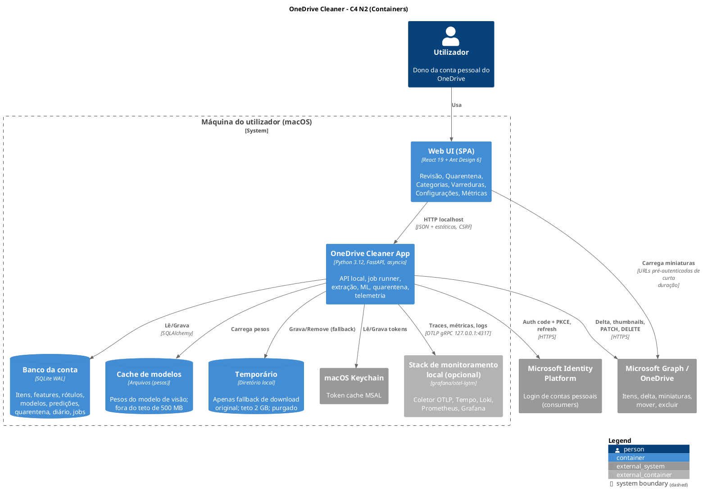
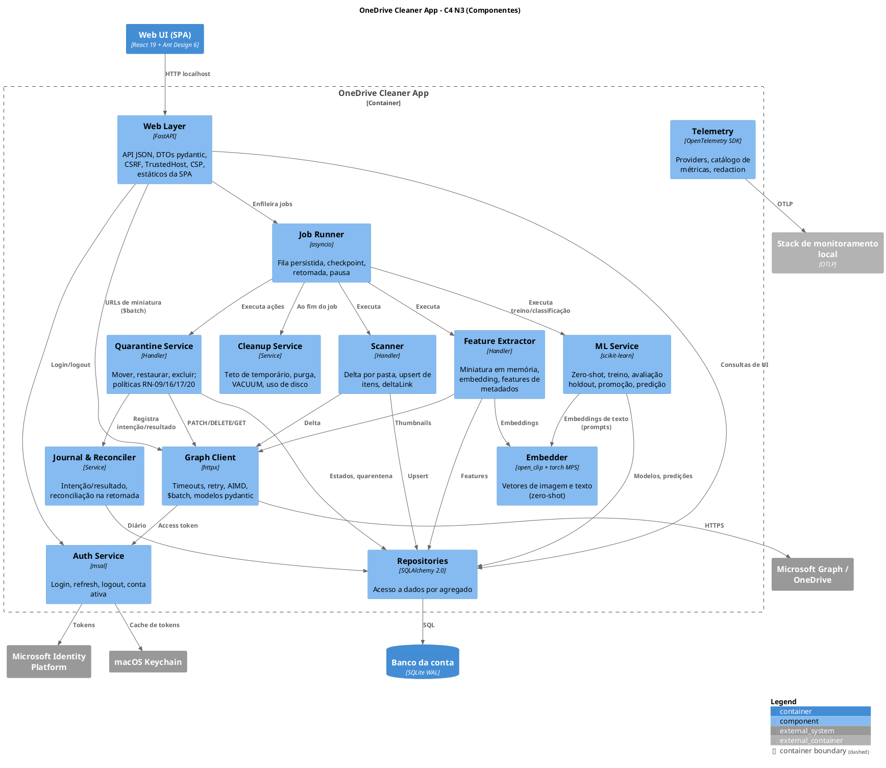
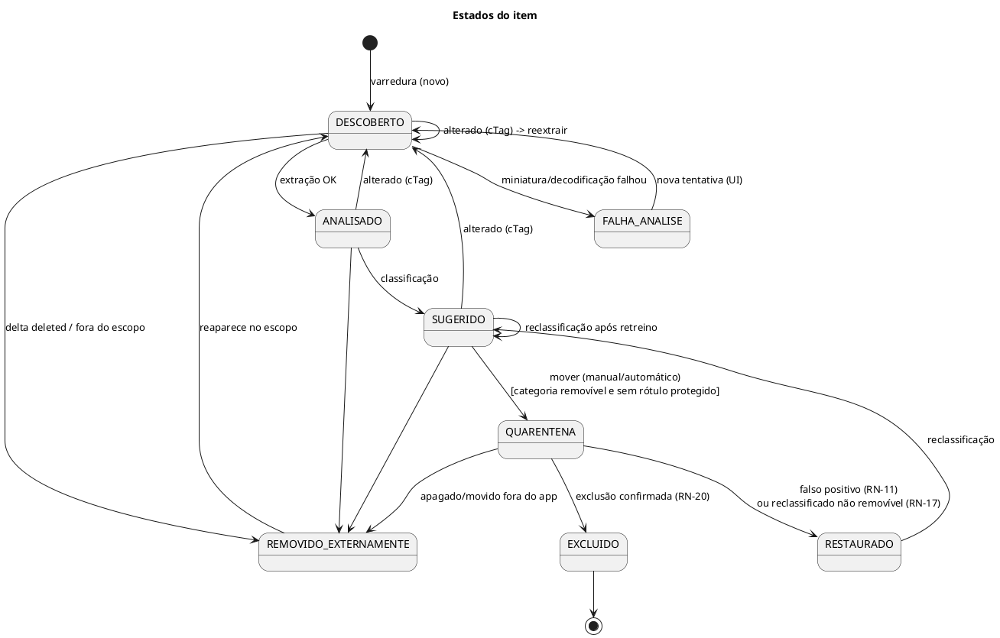
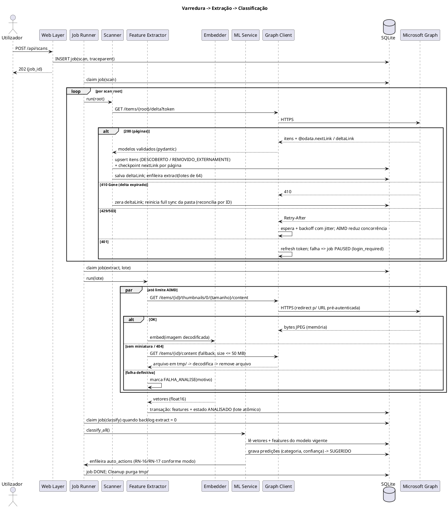
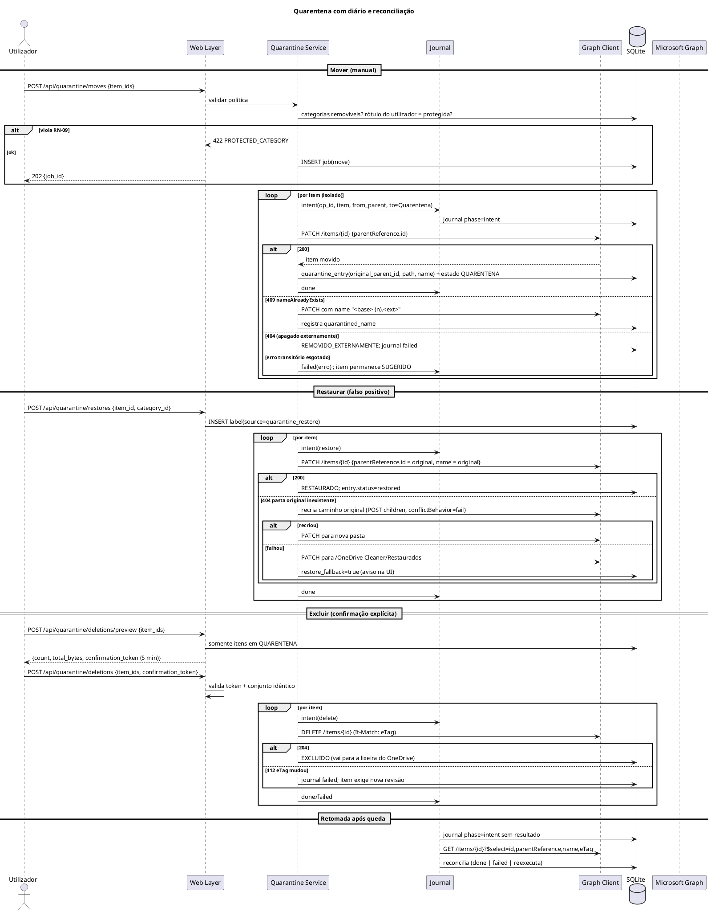
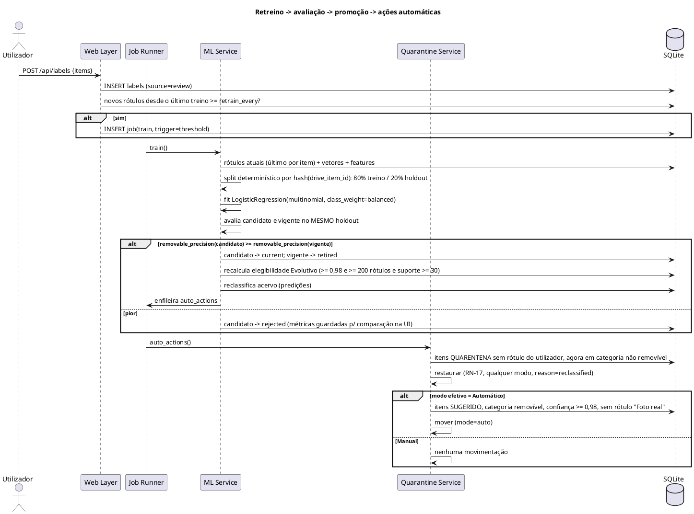
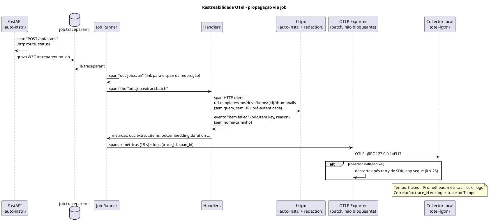
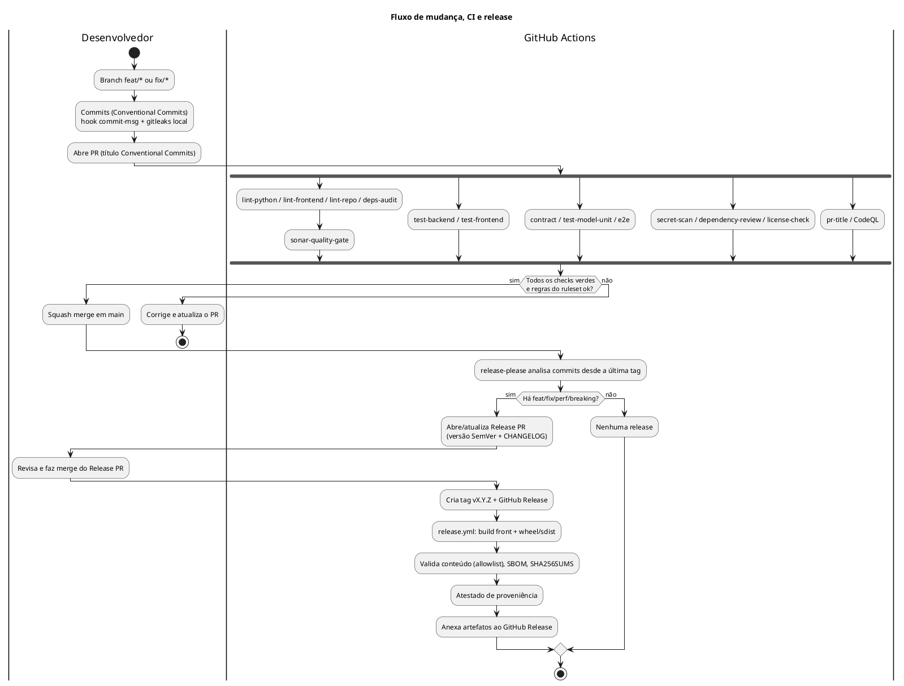

# Planejamento Técnico: OneDrive Cleaner — Identificação e Quarentena de Imagens Não-Foto

- **Status:** Aprovado (2026-11-17)
- **Data:** 2026-11-17
- **Spec (aprovada):** [`spec.md`](spec.md)
- **Design de origem:** [`docs/plans/2026-11-17-onedrive-cleaner-design.md`](../../plans/2026-11-17-onedrive-cleaner-design.md)

## 1. Visão Geral da Arquitetura

- **Decisão Principal:** Monolito modular em um único processo Python local, com UI SPA (React + Ant Design) compilada para estáticos e servida pelo próprio FastAPI em `127.0.0.1`, worker de jobs em background no mesmo processo e persistência em SQLite (um arquivo por conta). Node.js é necessário apenas para build e testes do front, não em runtime.
- **Abordagem:** Pipeline assíncrono interno orientado a jobs persistidos (fila em SQLite, com checkpoint e retomada). Integração com o OneDrive via Microsoft Graph (REST) com throttling adaptativo. Classificação por embeddings locais + metadados + regressão logística retreinada a partir dos rótulos do utilizador (abordagem A); zero-shot enquanto não há rótulos suficientes.
- **Repositório:** `github.com/EarthW0rm/one-drive-cleaner` (**público**; a criar — seção 11). Diretório local atual ainda não inicializado em git.
- **Sem mensageria externa:** aplicação local de um único utilizador. A fila de jobs persistida em SQLite cumpre o papel de desacoplamento (UI ↔ processamento) e retomada.

### 1.1 Stack

| Camada | Tecnologia | Observações |
|---|---|---|
| Runtime | Python 3.12 | `mypy --strict`; proibido `Any` explícito, exceto na borda com `object` + validação |
| Empacotamento | `uv` + `pyproject.toml` | Entry point de console `odc` |
| API web | FastAPI + Uvicorn | Bind exclusivo em `127.0.0.1`; serve a API JSON e os estáticos da SPA |
| Front-end | React 19 + TypeScript (strict, sem `any`) + Vite 8 | SPA; build embarcado no pacote Python (`src/odc/web/static/`), sem CDN |
| Design system | Ant Design 6 (`antd`), `@ant-design/icons`, `@ant-design/charts` | `ConfigProvider` com locale `pt_BR`, tema claro/escuro (algoritmo do antd) |
| Dados no front | TanStack Query 5, React Router 7 | Cache/polling de jobs; rotas client-side |
| Contrato front ↔ API | `openapi-typescript` | Tipos TS gerados do OpenAPI do FastAPI; teste falha se desatualizados |
| Validação | Pydantic v2 | DTOs da API local e modelos das respostas da Graph (Zero Trust) |
| Autenticação | `msal` + `msal-extensions` | Authority `https://login.microsoftonline.com/consumers`; cache no Keychain |
| HTTP | `httpx` (async) | Timeouts explícitos por tipo de chamada |
| Persistência | SQLite (WAL) via SQLAlchemy 2.0 + Alembic | Um banco por conta |
| Imagem | Pillow + `pillow-heif` | Decodificação em memória; HEIC apenas no fallback |
| ML | `torch` (MPS/CPU), `open_clip_torch`, `scikit-learn`, `numpy` | Modelo de visão definido pelo spike (seção 7) |
| Observabilidade | OpenTelemetry SDK (traces, métricas, logs) + OTLP | Instrumentações FastAPI, httpx, logging, system-metrics |
| Stack local de monitoramento (opcional) | `grafana/otel-lgtm` via Docker Compose | Grafana + Tempo + Loki + Prometheus |
| Diretórios locais | `platformdirs` | Ver 3.4 |
| Qualidade backend | `pytest`, `pytest-asyncio`, `pytest-cov`, `respx`, `ruff`, `mypy --strict` | Gate de cobertura (seção 10) |
| Qualidade front | Vitest 5 + React Testing Library 16 + MSW, ESLint, `tsc --noEmit` | Gate de cobertura (seção 10) |
| E2E | Playwright 1.6x + `@axe-core/playwright` | Chromium e WebKit; Graph fake + identidade fake |
| Toolchain front | Node.js 22 LTS + `pnpm` | Apenas build/teste |

### 1.2 Estrutura do repositório

```
one-drive-cleaner/
  .github/
    workflows/             # ci.yml, codeql.yml, release-please.yml, release.yml, scorecard.yml, secret-scan.yml
    ISSUE_TEMPLATE/  pull_request_template.md  CODEOWNERS  dependabot.yml
  .pre-commit-config.yaml  # gitleaks, ruff, commitizen (commit-msg), check de arquivos grandes
  .gitleaks.toml           # regras + allowlist de fixtures fake
  .gitignore
  release-please-config.json  .release-please-manifest.json
  CHANGELOG.md  LICENSE  README.md  SECURITY.md  CONTRIBUTING.md  CODE_OF_CONDUCT.md
  Makefile
  pyproject.toml
  src/odc/
    cli.py                 # entry point `odc`
    config.py              # Settings (pydantic-settings)
    web/                   # FastAPI: rotas JSON, segurança (CSRF, host, CSP), static/ (build da SPA)
    auth/                  # MSAL, token cache Keychain, sessão de conta
    graph/                 # cliente Graph, modelos pydantic, throttling AIMD, batching
    scanning/              # delta query, upsert de itens, checkpoints
    features/              # fetch de miniatura, embedder, features de metadados
    ml/                    # zero-shot, treino, avaliação, registro de versões, predição
    jobs/                  # fila persistida, runner, handlers
    quarantine/            # mover/restaurar/excluir, diário, reconciliação, pastas do app
    storage/               # engine, tabelas, repositórios, migrações Alembic
    cleanup/               # política de disco e limpeza
    telemetry/             # setup OTel, catálogo de métricas, redaction
  tests/
    unit/                  # espelha src/odc/ (1 arquivo de teste por módulo)
    integration/  resilience/  volume/  telemetry/
    model/                 # testes do aprendizado (seção 10.3)
    fakes/
      graph_fake.py        # Graph fake in-process (respx)
      graph_server.py      # Graph fake HTTP (E2E)
      identity_fake.py     # provedor de identidade fake (E2E)
      embedder_fake.py     # embedder determinístico (E2E/integração)
  frontend/
    package.json  vite.config.ts  tsconfig.json
    src/
      api/                 # cliente tipado (tipos gerados do OpenAPI) + hooks TanStack Query
      app/                 # App, rotas, ConfigProvider (pt_BR, tema), layout
      pages/               # Review, Quarantine, Categories, Scans, Settings, Metrics, Login
      components/          # ThumbnailGrid, CategoryTag, ConfidenceBadge, DeleteConfirmModal, FolderTreeSelect, JobProgress ...
      test/                # setup Vitest, handlers MSW
    (testes unitários co-localizados: *.test.tsx)
  e2e/
    playwright.config.ts
    fixtures/              # sobe odc em modo E2E + Graph fake + identidade fake
    specs/                 # J1..J8, interrupção, acessibilidade
  spikes/embedding_benchmark/
  deploy/observability/    # docker-compose otel-lgtm + dashboards Grafana (JSON)
  docs/
```

## 2. Diagramas de Solução

### 2.1 C4 — Nível 2 (Containers)



### 2.2 C4 — Nível 3 (Componentes do App)



### 2.3 Máquina de estados do item



### 2.4 Sequência — Varredura, extração e classificação (sucesso e falha)



### 2.5 Sequência — Quarentena: mover, restaurar e excluir (sucesso e falha)



### 2.6 Sequência — Retreino, promoção e ações automáticas



### 2.7 Rastreabilidade (traces, logs e métricas por etapa)



## 3. Modelagem de Dados e Persistência

SQLite em modo WAL, `foreign_keys=ON`, `synchronous=NORMAL`. Um arquivo por conta (isolamento RN-01). Timestamps em UTC ISO-8601 (`TEXT`). Consultas sempre com colunas explícitas (nunca `SELECT *`).

### 3.1 Tabelas

**`app_meta`** — metadados do banco

| Campo | Tipo | Obrigatório | Descrição |
|---|---|---|---|
| `key` | TEXT PK | Sim | `account_key`, `drive_id`, `quarantine_folder_id`, `restored_folder_id`, `app_root_folder_id` |
| `value` | TEXT | Sim | Valor |

**`setting`** — configurações do utilizador

| Campo | Tipo | Obrigatório | Descrição |
|---|---|---|---|
| `key` | TEXT PK | Sim | `automation_mode` (`manual`/`auto`/`evolutive`, padrão `evolutive`), `auto_threshold` (0,98), `retrain_every` (20), `gate_precision` (0,98), `gate_min_labels` (200), `gate_min_support` (30), `temp_cap_bytes` (2 GiB), `otel_enabled` (true), `otel_endpoint` |
| `value` | TEXT (JSON) | Sim | Valor validado por pydantic na leitura |
| `updated_at` | TEXT | Sim | |

**`scan_root`** — pastas selecionadas

| Campo | Tipo | Obrigatório | Descrição |
|---|---|---|---|
| `id` | INTEGER PK | Sim | |
| `drive_item_id` | TEXT UNIQUE | Sim | ID da pasta no OneDrive |
| `display_path` | TEXT | Sim | Caminho para exibição na UI (nunca em telemetria) |
| `is_default` | INTEGER (0/1) | Sim | Camera Roll |
| `delta_link` | TEXT | Não | Checkpoint de delta concluído |
| `next_link` | TEXT | Não | Checkpoint de paginação em andamento |
| `last_full_scan_at` / `last_delta_at` | TEXT | Não | |
| `enabled` | INTEGER | Sim | |

**`item`** — imagem do acervo

| Campo | Tipo | Obrigatório | Descrição |
|---|---|---|---|
| `id` | INTEGER PK | Sim | Chave interna (`odc.item.key` na telemetria) |
| `drive_item_id` | TEXT UNIQUE | Sim | ID estável no OneDrive (mantido ao mover) |
| `scan_root_id` | INTEGER FK | Sim | |
| `parent_id` | TEXT | Sim | Pasta atual no OneDrive |
| `name` | TEXT | Sim | Nome atual |
| `mime_type` | TEXT | Sim | `image/*` (RN-06) |
| `size_bytes` | INTEGER | Sim | |
| `width` / `height` | INTEGER | Não | Facet `image` |
| `camera_make` / `camera_model` | TEXT | Não | Facet `photo` |
| `taken_at` | TEXT | Não | Facet `photo.takenDateTime` |
| `has_location` | INTEGER | Sim | Facet `location` presente |
| `remote_created_at` / `remote_modified_at` | TEXT | Sim | |
| `ctag` / `etag` | TEXT | Sim | Detecção de mudança de conteúdo / precondição de DELETE |
| `state` | TEXT | Sim | Enum de estados (2.3) |
| `failure_reason` | TEXT | Não | `no_thumbnail`, `decode_error`, `too_large`, `unsupported_format`, `http_error` |
| `failure_count` | INTEGER | Sim | |
| `created_at` / `updated_at` | TEXT | Sim | |

**`embedding_model`**

| Campo | Tipo | Obrigatório | Descrição |
|---|---|---|---|
| `id` | INTEGER PK | Sim | |
| `name` | TEXT | Sim | Ex.: `ViT-B-32/laion2b_s34b_b79k` |
| `dim` | INTEGER | Sim | |
| `thumb_size` | TEXT | Sim | Ex.: `c384x384` |
| `is_active` | INTEGER | Sim | Troca de modelo exige reextração |

**`feature`** — resultado da análise (1:1 com item)

| Campo | Tipo | Obrigatório | Descrição |
|---|---|---|---|
| `item_id` | INTEGER PK FK | Sim | |
| `embedding_model_id` | INTEGER FK | Sim | |
| `embedding` | BLOB | Sim | float16, L2-normalizado (`dim × 2` bytes) |
| `meta_features` | BLOB | Sim | float32, vetor de features de metadados (versão em `meta_version`) |
| `meta_version` | INTEGER | Sim | Versão do extrator de metadados |
| `source_ctag` | TEXT | Sim | cTag no momento da extração |
| `extracted_at` | TEXT | Sim | |

Features de metadados (`meta_version=1`): `is_png`, `is_heic`, `has_camera`, `has_taken_at`, `has_location`, `log_width`, `log_height`, `aspect_ratio`, `matches_phone_screen_ratio` (tabela de resoluções/proporções de tela conhecidas), `name_screenshot` (`Screenshot`, `Captura de Tela`, `Screen Shot`), `name_whatsapp` (`-WA\d{4}`), `name_camera` (`IMG_`, `PXL_`, `DSC`), `log_size_bytes`, `bytes_per_pixel`.

**`category`**

| Campo | Tipo | Obrigatório | Descrição |
|---|---|---|---|
| `id` | INTEGER PK | Sim | |
| `slug` | TEXT UNIQUE | Sim | `screenshot`, `real_photo`, `meme_sticker`, `document_receipt`, ... |
| `name` | TEXT | Sim | Nome exibido |
| `description` | TEXT | Sim | Base do prompt zero-shot |
| `zero_shot_prompts` | TEXT (JSON) | Sim | Lista de prompts em inglês |
| `removable` | INTEGER | Sim | RN-08 |
| `protected` | INTEGER | Sim | `real_photo` = 1 (RN-09); CHECK `NOT (protected = 1 AND removable = 1)` |
| `archived_at` | TEXT | Não | Proibido quando `protected = 1` |
| `created_at` | TEXT | Sim | |

**`label`** — rótulos do utilizador (histórico; o vigente é o mais recente por item)

| Campo | Tipo | Obrigatório | Descrição |
|---|---|---|---|
| `id` | INTEGER PK | Sim | |
| `item_id` | INTEGER FK | Sim | Mantido após exclusão do item (RN-26) |
| `category_id` | INTEGER FK | Sim | |
| `source` | TEXT | Sim | `review`, `quarantine_restore` |
| `created_at` | TEXT | Sim | |

**`model_version`**

| Campo | Tipo | Obrigatório | Descrição |
|---|---|---|---|
| `id` | INTEGER PK | Sim | |
| `strategy` | TEXT | Sim | `zero_shot`, `logreg` |
| `embedding_model_id` | INTEGER FK | Sim | |
| `status` | TEXT | Sim | `candidate`, `current`, `rejected`, `retired` |
| `labels_count` | INTEGER | Sim | Rótulos usados |
| `categories` | TEXT (JSON) | Sim | Ordem das classes |
| `params` | BLOB | Sim | `.npz` (coef, intercept, scaler mean/scale) — sem pickle |
| `metrics` | TEXT (JSON) | Não | Precisão/recall por categoria, `removable_precision`, suporte, matriz de confusão |
| `trigger` | TEXT | Sim | `threshold`, `manual`, `bootstrap` |
| `created_at` | TEXT | Sim | |

Restrição: índice único parcial garante no máximo uma versão `current`.

**`prediction`** — predição vigente (1:1 com item)

| Campo | Tipo | Obrigatório | Descrição |
|---|---|---|---|
| `item_id` | INTEGER PK FK | Sim | |
| `model_version_id` | INTEGER FK | Sim | |
| `category_id` | INTEGER FK | Sim | |
| `confidence` | REAL | Sim | 0–1 |
| `margin` | REAL | Sim | Top1 − Top2 (ordenação por incerteza) |
| `predicted_at` | TEXT | Sim | |

**`quarantine_entry`**

| Campo | Tipo | Obrigatório | Descrição |
|---|---|---|---|
| `id` | INTEGER PK | Sim | |
| `item_id` | INTEGER FK | Sim | |
| `original_parent_id` | TEXT | Sim | |
| `original_parent_path` | TEXT | Sim | Para recriar a pasta (RN-19) |
| `original_name` | TEXT | Sim | |
| `quarantined_name` | TEXT | Sim | Pode diferir em conflito |
| `mode` | TEXT | Sim | `manual`, `auto` |
| `status` | TEXT | Sim | `active`, `restored`, `deleted`, `external_removed` |
| `restore_reason` | TEXT | Não | `false_positive`, `reclassified`, `manual` |
| `restore_fallback` | INTEGER | Sim | 1 se foi para `Restaurados` |
| `moved_at` / `restored_at` / `deleted_at` | TEXT | Não | |

**`journal`** — diário de operações (RN-22)

| Campo | Tipo | Obrigatório | Descrição |
|---|---|---|---|
| `id` | INTEGER PK | Sim | |
| `op_id` | TEXT UNIQUE | Sim | UUID (idempotência) |
| `item_id` | INTEGER FK | Não | |
| `operation` | TEXT | Sim | `move`, `restore`, `delete`, `ensure_folder` |
| `from_parent_id` / `to_parent_id` | TEXT | Não | |
| `from_name` / `to_name` | TEXT | Não | |
| `phase` | TEXT | Sim | `intent`, `done`, `failed`, `reconciled` |
| `error_code` | TEXT | Não | |
| `created_at` / `updated_at` | TEXT | Sim | |

**`job`** — fila persistida

| Campo | Tipo | Obrigatório | Descrição |
|---|---|---|---|
| `id` | INTEGER PK | Sim | |
| `type` | TEXT | Sim | `scan`, `extract`, `classify`, `train`, `auto_actions`, `move`, `restore`, `delete`, `reconcile`, `cleanup` |
| `payload` | TEXT (JSON) | Sim | Validado por schema por tipo (4.3) |
| `status` | TEXT | Sim | `queued`, `running`, `paused`, `done`, `failed` |
| `priority` | INTEGER | Sim | Ações do utilizador > background |
| `attempts` | INTEGER | Sim | |
| `checkpoint` | TEXT (JSON) | Não | Progresso intra-job |
| `pause_reason` | TEXT | Não | `login_required`, `temp_cap`, `user`, `network` |
| `traceparent` | TEXT | Não | W3C trace context da requisição de origem |
| `error_code` | TEXT | Não | |
| `created_at` / `started_at` / `finished_at` / `heartbeat_at` | TEXT | Não | `heartbeat_at` detecta job órfão após queda |

### 3.2 Índices

| Índice | Campos | Tipo | Justificativa |
|---|---|---|---|
| `ux_item_drive_id` | `item(drive_item_id)` | Único | Upsert da delta e reconciliação |
| `ix_item_state` | `item(state)` | Simples | Backlog por etapa, contadores por estado |
| `ix_item_root_state` | `item(scan_root_id, state)` | Composto | Progresso por pasta |
| `ix_label_item_created` | `label(item_id, created_at DESC)` | Composto | Rótulo vigente por item |
| `ix_pred_cat_margin` | `prediction(category_id, margin)` | Composto | Fila de revisão ordenada por incerteza |
| `ix_pred_cat_conf` | `prediction(category_id, confidence)` | Composto | Seleção do Automático por limiar |
| `ux_model_current` | `model_version(status) WHERE status='current'` | Único parcial | Uma versão vigente |
| `ix_qe_status` | `quarantine_entry(status, item_id)` | Composto | Tela de quarentena, RN-17 |
| `ix_journal_phase` | `journal(phase, created_at)` | Composto | Reconciliação |
| `ix_job_claim` | `job(status, priority DESC, created_at)` | Composto | Claim do próximo job |

### 3.3 Volumetria e disco (50 mil itens)

| Componente | Estimativa |
|---|---|
| `feature.embedding` (dim 512 → 1 KB; dim 1152 → 2,3 KB) | 50–115 MB |
| `item` + `prediction` + `label` + demais | ~40–60 MB |
| Logs locais (rotação 3 × 20 MB) | ≤ 60 MB |
| **Total (sem pesos do modelo)** | **~150–235 MB** (meta ≤ 500 MB) |
| Pesos do modelo de visão | 350 MB–1,6 GB (fora da meta, RN-03) |

`VACUUM` executado pelo Cleanup quando o espaço livre interno do banco excede 20%.

### 3.4 Diretórios locais (macOS, via `platformdirs`)

| Uso | Caminho |
|---|---|
| Banco por conta | `~/Library/Application Support/OneDriveCleaner/accounts/<account_key>/odc.db` |
| Logs | `~/Library/Logs/OneDriveCleaner/` |
| Temporário (fallback) | `~/Library/Caches/OneDriveCleaner/tmp/` |
| Pesos de modelo | `~/Library/Caches/OneDriveCleaner/models/` |

`account_key` = SHA-256 do `id` da conta Microsoft (o e-mail não é persistido nem usado em caminhos).

### 3.5 Migrações

Projeto greenfield. Alembic com migração inicial `0001_initial` criando todas as tabelas, índices e o seed das 4 categorias iniciais (RN-08) e da `embedding_model` escolhida pelo spike. Migrações aplicadas automaticamente no startup, com backup do arquivo `.db` antes de qualquer migração não inicial.

## 4. Contratos de Integração

### 4.1 API local (FastAPI — consumida pela Web UI)

Regras gerais:
- Base `http://127.0.0.1:{port}` (porta padrão `8765`, configurável). `TrustedHostMiddleware` aceita apenas `127.0.0.1` e `localhost`.
- Mutações exigem header `X-CSRF-Token` igual ao token da sessão (cookie `HttpOnly`, `SameSite=Strict`).
- Todos os bodies validados por modelos pydantic com `extra="forbid"`. Limites de tamanho de lista explícitos.
- A SPA é servida em `/` (estáticos com hash no nome); qualquer rota não-`/api` e não-`/auth` devolve `index.html` (roteamento client-side: `/review`, `/quarantine`, `/categories`, `/scans`, `/settings`, `/metrics`).
- O OpenAPI gerado pelo FastAPI (`/api/openapi.json`) é a fonte dos tipos TypeScript do front (`openapi-typescript`).

**Erro padrão:**
```json
{
  "error": {
    "code": "string — enum: VALIDATION_ERROR | PROTECTED_CATEGORY | NOT_IN_QUARANTINE | INVALID_CONFIRMATION | LOGIN_REQUIRED | CONFLICT | NOT_FOUND | INTERNAL",
    "message": "string — PT-BR, sem dados sensíveis",
    "details": "object | null"
  }
}
```

| Método e rota | Request | Response (sucesso) | Erros |
|---|---|---|---|
| `GET /auth/login` | — | 302 para Microsoft (auth code + PKCE) | — |
| `GET /auth/callback` | query `code`, `state` | 302 para `/review` | 400 `state` inválido |
| `POST /auth/logout` | — | 204; limpa cache de token da conta | — |
| `GET /api/session` | — | `{"csrf_token":"str","auth_state":"authenticated \| login_required","account":{"display_name":"str"}\|null}` | — |
| `GET /api/folders` | query `parent_id?: str` | `{"folders":[{"id":"str","name":"str","child_count":"int"}]}` | 401 `LOGIN_REQUIRED` |
| `PUT /api/scan-roots` | `{"folder_ids":["str (1..50 itens)"]}` | `{"scan_roots":[{"id":"int","display_path":"str","is_default":"bool"}]}` | 422 |
| `POST /api/scans` | `{"mode":"auto \| full"}` | 202 `{"job_id":"int"}` | 409 varredura em andamento |
| `GET /api/jobs` | query `status?`, `type?`, `limit<=100` | `{"jobs":[{"id":"int","type":"str","status":"str","progress":{"done":"int","total":"int"},"pause_reason":"str\|null"}]}` | — |
| `POST /api/jobs/{id}/pause` / `resume` | — | 204 | 404, 409 |
| `GET /api/review` | query `category_id?`, `order=uncertainty\|confidence`, `cursor?`, `limit<=100` | `{"items":[{"item_id":"int","suggested_category_id":"int","confidence":"float","user_category_id":"int\|null"}],"next_cursor":"str\|null"}` | — |
| `POST /api/thumbnails` | `{"item_ids":["int (1..100)"]}` | `{"urls":{"<item_id>":"str (pré-autenticada, expira)"}}` | 401 |
| `POST /api/labels` | `{"labels":[{"item_id":"int","category_id":"int"}] (1..500)}` | `{"saved":"int","train_job_id":"int\|null"}` | 422 categoria arquivada/inexistente |
| `POST /api/models/train` | — | 202 `{"job_id":"int"}` | 409 treino em andamento |
| `GET /api/models` | — | `{"current":{"id":"int","metrics":"object"},"candidates":[...],"auto_eligible":"bool","gate":{"precision":"float","labels":"int","support":"int"}}` | — |
| `POST /api/quarantine/moves` | `{"item_ids":["int (1..1000)"]}` | 202 `{"job_id":"int"}` | 422 `PROTECTED_CATEGORY` |
| `GET /api/quarantine` | query `category_id?`, `cursor?`, `limit<=100` | `{"items":[{"item_id":"int","category_id":"int","moved_at":"str","mode":"str"}],"total_bytes":"int","next_cursor":"str\|null"}` | — |
| `POST /api/quarantine/restores` | `{"restores":[{"item_id":"int","category_id":"int"}] (1..500)}` | 202 `{"job_id":"int"}` | 422 `NOT_IN_QUARANTINE` |
| `POST /api/quarantine/deletions/preview` | `{"item_ids":["int (1..5000)"]}` | `{"count":"int","total_bytes":"int","confirmation_token":"str","expires_at":"str"}` | 422 `NOT_IN_QUARANTINE` |
| `POST /api/quarantine/deletions` | `{"item_ids":["int"],"confirmation_token":"str"}` | 202 `{"job_id":"int"}` | 422 `INVALID_CONFIRMATION` (expirado ou conjunto diferente) |
| `GET /api/categories` | — | `{"categories":[{"id":"int","slug":"str","name":"str","removable":"bool","protected":"bool","archived":"bool","labels":"int"}]}` | — |
| `POST /api/categories` | `{"name":"str 1..60","description":"str 1..300","removable":"bool"}` | 201 categoria | 409 nome duplicado |
| `PATCH /api/categories/{id}` | `{"name?":"str","description?":"str","removable?":"bool","archived?":"bool"}` | 200 categoria | 422 `PROTECTED_CATEGORY` |
| `GET /api/settings` / `PUT /api/settings` | `{"automation_mode":"manual\|auto\|evolutive","auto_threshold":"float 0.5..0.999","retrain_every":"int 5..500","temp_cap_bytes":"int >= 256 MiB","otel_enabled":"bool","otel_endpoint":"url loopback"}` | 200 settings | 422 (endpoint OTel fora de loopback é rejeitado) |
| `GET /api/metrics/summary` | — | `{"by_state":"object","backlog":"object","quarantine":{"items":"int","bytes":"int"},"false_positive_rate":"float","disk":"object","alerts":["object"]}` | — |
| `GET /healthz` | — | `{"status":"ok","db":"ok","graph_auth":"ok\|login_required"}` | — |

### 4.2 Microsoft Graph (consumida)

Base `https://graph.microsoft.com/v1.0`. Scopes `Files.ReadWrite offline_access`. Todas as respostas validadas por modelos pydantic (campos ausentes ou malformados → tratados como ausentes, nunca como evidência).

| Uso | Chamada | Timeout (connect/read) |
|---|---|---|
| Drive da conta | `GET /me/drive?$select=id,driveType,owner` (exige `driveType=personal`) | 5 s / 15 s |
| Pasta padrão | `GET /me/drive/special/cameraroll?$select=id,name,parentReference` | 5 s / 15 s |
| Seletor de pastas | `GET /me/drive/items/{id}/children?$select=id,name,folder&$filter=folder ne null&$top=200` | 5 s / 15 s |
| Varredura | `GET /me/drive/items/{root}/delta?$select=id,name,file,image,photo,location,size,parentReference,cTag,eTag,createdDateTime,lastModifiedDateTime,deleted` (+ `nextLink`/`deltaLink`) | 5 s / 30 s |
| Miniatura p/ embedding | `GET /me/drive/items/{id}/thumbnails/0/{thumb_size}/content` | 5 s / 30 s |
| Fallback original | `GET /me/drive/items/{id}/content` (somente `size <= 50 MB`) | 5 s / 120 s |
| URLs para UI | `POST /$batch` (até 20 × `GET /me/drive/items/{id}/thumbnails/0/medium?$select=url`) | 5 s / 30 s |
| Pastas do app | `POST /me/drive/root/children` `{name, folder:{}, "@microsoft.graph.conflictBehavior":"fail"}`; 409 → `GET /me/drive/root:/OneDrive Cleaner/{nome}` | 5 s / 15 s |
| Mover/restaurar | `PATCH /me/drive/items/{id}` `{parentReference:{id}, name?}`; 409 → retry com sufixo `" (n)"` | 5 s / 30 s |
| Excluir | `DELETE /me/drive/items/{id}` com `If-Match: {eTag}` → lixeira | 5 s / 30 s |
| Reconciliação | `GET /me/drive/items/{id}?$select=id,name,parentReference,eTag,deleted` | 5 s / 15 s |

Política de retry (Graph Client): 429/503/504 e erros de rede → respeitar `Retry-After` quando presente; senão backoff exponencial `min(60 s, 1 s × 2^n) + jitter(0–1 s)`; máximo 5 tentativas. 401 → um refresh de token e uma nova tentativa; falha → `LOGIN_REQUIRED` (pausa jobs). 4xx demais → sem retry.

Concorrência adaptativa (AIMD): limite inicial 4, mínimo 1, máximo 16. Cada 429/503 → `limite = max(1, limite // 2)`. A cada 50 respostas 2xx consecutivas → `limite + 1`.

Delta em pasta não-raiz é suportado no OneDrive pessoal (justifica RN-01 e o uso de delta por `scan_root`).

### 4.3 Fila interna de jobs (payloads)

Não há broker. Cada `job.payload` é validado por schema pydantic por `type` antes da execução (Zero Trust na leitura do banco). Claim atômico: `UPDATE ... SET status='running', heartbeat_at=now WHERE id = (SELECT ... ORDER BY priority DESC, created_at LIMIT 1) AND status='queued'`. Job `running` com `heartbeat_at` > 2 min no startup → volta a `queued` (`odc.jobs.resumed`).

```json
{
  "scan":         { "mode": "auto | full", "scan_root_ids": ["int"] },
  "extract":      { "item_ids": ["int (1..64)"] },
  "classify":     { "scope": "all | item_ids", "item_ids": ["int"] },
  "train":        { "trigger": "threshold | manual" },
  "auto_actions": { "model_version_id": "int" },
  "move":         { "item_ids": ["int"], "mode": "manual | auto" },
  "restore":      { "item_ids": ["int"], "reason": "false_positive | reclassified | manual" },
  "delete":       { "item_ids": ["int"], "confirmation_id": "str" },
  "reconcile":    {},
  "cleanup":      { "trigger": "job_end | startup" }
}
```

Retry por job: 3 tentativas para falhas transitórias não absorvidas pelo Graph Client; após isso `failed` com `error_code` visível na UI e botão de reexecução. Itens individuais com falha não falham o job (isolamento por item).

## 5. Resiliência, Segurança e Tratamento de Erros

### 5.1 Matriz de falhas

| Componente | Tipo de falha | Estratégia | Impacto no utilizador |
|---|---|---|---|
| Graph | 429/503/504 | `Retry-After` + backoff com jitter + AIMD | Varredura mais lenta; progresso continua |
| Graph | Rede indisponível | Retry 5×; persistindo, job `paused(network)` com retomada automática a cada 60 s | Aviso na UI; nada perdido |
| Graph | 410 na delta | Full resync da pasta, reconciliação por `drive_item_id` | Varredura completa extra |
| Graph | 404 em item | Estado `REMOVIDO_EXTERNAMENTE` | Item some das listas |
| Graph | 409 ao mover | Renomeia com sufixo e registra `quarantined_name` | Nenhum |
| Graph | 412 ao excluir (eTag mudou) | Não exclui; item volta para revisão | Item exige nova confirmação |
| Identity | Refresh falha | Jobs `paused(login_required)`; banner de login | Precisa refazer login |
| Embedder | MPS indisponível/erro | Fallback para CPU; métrica `device=cpu` | Análise mais lenta |
| Embedder | Imagem corrompida | `FALHA_ANALISE(decode_error)` | Item listado em falhas, com nova tentativa |
| Processo | Queda/kill | Lote atômico; heartbeat → requeue; diário → reconciliação no startup | Retoma; no máximo 1 lote refeito |
| SQLite | `database is locked` | WAL + `busy_timeout=5000` + transações curtas; escrita serializada pelo runner | Nenhum |
| SQLite | Disco cheio | Interrompe jobs com `error_code=DISK_FULL`; transação abortada, sem corrupção | Mensagem clara |
| Disco | Temporário no teto | Pausa extração (`temp_cap`), aciona Cleanup | Pausa curta |
| ML | Candidato pior | `rejected`; vigente mantido | Comparação exibida |
| ML | Gate Evolutivo cai abaixo da meta | Modo efetivo volta a Manual | Aviso na UI |
| OTel | Collector indisponível | Export assíncrono em batch; falha só em log local de debug (RN-25) | Nenhum |

### 5.2 Segurança

- **Superfície de rede:** Uvicorn em `127.0.0.1` apenas; `TrustedHostMiddleware` (anti DNS rebinding); sem CORS; cookies `HttpOnly` + `SameSite=Strict`.
- **CSRF:** token por sessão (obtido em `GET /api/session`) exigido em toda mutação via header `X-CSRF-Token`, enviado pelo cliente API do front.
- **CSP:** `default-src 'self'; img-src 'self' https: data:; script-src 'self'; style-src 'self' 'unsafe-inline'; connect-src 'self'; frame-ancestors 'none'` (`'unsafe-inline'` em estilos é exigido pelo CSS-in-JS do Ant Design; `img-src https:` permite as URLs pré-autenticadas de miniaturas).
- **Autenticação Microsoft:** public client (sem secret), auth code + PKCE, `state` e `nonce` validados, authority `consumers`. Registro do app no Entra: "Personal Microsoft accounts only", plataforma "Mobile and desktop", redirect `http://localhost`. `client_id` em configuração (não é segredo).
- **Tokens:** apenas no Keychain via `msal-extensions`; nunca em banco, log ou telemetria.
- **Validação:** pydantic `extra="forbid"` em todas as entradas; IDs internos inteiros; `drive_item_id` validado contra o banco antes de qualquer chamada à Graph (o browser nunca envia IDs da Graph para mutação).
- **Proteções de negócio aplicadas no serviço** (não só na UI): RN-09 (bloqueio de "Foto real"), RN-20 (somente da quarentena, token de confirmação de uso único, 5 min, vinculado ao conjunto exato de itens).
- **Modelos persistidos:** parâmetros em `.npz` (sem pickle).
- **Dados sensíveis:** nomes de arquivo, caminhos, URLs pré-autenticadas, tokens e e-mail nunca em logs ou telemetria (5.3.1).
- **Privacidade (RN-02):** nenhuma chamada de rede além de Microsoft Identity, Graph, download dos pesos do modelo (uma vez) e o endpoint OTLP de loopback.

### 5.3 Observabilidade (OpenTelemetry)

#### 5.3.1 Setup e regras

- Resource: `service.name=onedrive-cleaner`, `service.version`, `deployment.environment=local`, `host.arch`.
- Providers: `TracerProvider` (BatchSpanProcessor, sampler `parentbased_always_on`, configurável via `OTEL_TRACES_SAMPLER`), `MeterProvider` (PeriodicExportingMetricReader, 15 s), `LoggerProvider` (BatchLogRecordProcessor) + `LoggingHandler` no logging padrão.
- Export OTLP gRPC para `http://127.0.0.1:4317` (setting `otel_endpoint`, restrito a loopback). `otel_enabled=false` → SDK desativado.
- Instrumentações: FastAPI (excluindo `/healthz` e estáticos), httpx, logging, system-metrics (`process.cpu.*`, `process.memory.*`).
- **Redaction obrigatória:**
  - Hook de request/response do httpx substitui `url.full` por `url.template` (ex.: `/me/drive/items/{id}/thumbnails/{size}/content`), remove query string e, para hosts que não sejam `graph.microsoft.com` (URLs pré-autenticadas), registra apenas `server.address`.
  - `logging.Filter` remove padrões de token (`Bearer`, `access_token`, `tempauth`), URLs com query e e-mails.
  - Itens identificados somente por `odc.item.key` (ID interno inteiro). Pastas por `odc.folder.key` (ID interno de `scan_root`).
- **Cardinalidade:** atributos de métrica restritos a enums fechados; `category` limitado às categorias ativas; nunca `model_version_id`, `item`, `folder` como atributo de métrica.
- **Propagação:** `traceparent` gravado em `job` na criação; o span do job usa link para o span da requisição de origem.

#### 5.3.2 Traces

| Span | Quando | Atributos |
|---|---|---|
| `POST /api/...` (auto) | Requisições da UI | `http.route`, `http.response.status_code` |
| `odc.job.scan` | Início/fim da varredura | `odc.scan.mode`, `odc.folder.key`, `odc.scan.items` |
| `odc.job.extract.batch` | Por lote | `odc.batch.size`, `odc.batch.failed`, `odc.embedding.device` |
| `odc.job.classify` | Reclassificação | `odc.items.count`, `odc.model.strategy` |
| `odc.model.train` | Retreino | `odc.labels.count`, `odc.train.outcome` |
| `odc.job.auto_actions` | Após promoção | `odc.automation.mode_effective`, `odc.moved`, `odc.restored` |
| `odc.quarantine.move` / `.restore` / `.delete` | Por lote de ação | `odc.action.mode`, `odc.action.result` |
| `odc.journal.reconcile` | Startup / retomada | `odc.reconcile.pending`, `odc.reconcile.outcome` |
| `odc.cleanup` | Fim de job / startup | `odc.cleanup.trigger`, `odc.cleanup.freed_bytes` |
| HTTP client (auto, redigido) | Chamadas Graph | `http.request.method`, `http.response.status_code`, `url.template`, `odc.graph.operation` |

Eventos de span: `item.failed {odc.item.key, reason}`, `graph.throttled {retry_after_s}`, `job.paused {reason}`.

#### 5.3.3 Catálogo de métricas (canônico)

Prefixo `odc.`; unidades UCUM.

**Integração Graph / autenticação**

| Métrica | Tipo | Unidade | Atributos | Quando emitir |
|---|---|---|---|---|
| `odc.graph.requests` | Counter | `{request}` | `operation`, `status_code` | Cada resposta da Graph |
| `odc.graph.request.duration` | Histogram | `s` | `operation`, `status_code` | Cada resposta |
| `odc.graph.throttled` | Counter | `{response}` | `operation`, `status_code` | 429/503 recebido |
| `odc.graph.retry_after` | Histogram | `s` | `operation` | `Retry-After` aplicado |
| `odc.graph.retries` | Counter | `{retry}` | `operation`, `outcome` (`success`/`exhausted`) | Fim de sequência de retry |
| `odc.graph.concurrency.limit` | Gauge | `{request}` | — | Mudança no AIMD |
| `odc.graph.inflight` | UpDownCounter | `{request}` | — | Início/fim de request |
| `odc.auth.token_refresh` | Counter | `{refresh}` | `result` | Cada refresh |
| `odc.auth.login_required` | Counter | `{event}` | `reason` (`expired`/`revoked`/`missing`) | Pausa por login |

`operation` ∈ `drive`, `special`, `children`, `delta`, `thumbnail_content`, `content`, `batch_thumbnail_urls`, `create_folder`, `move`, `delete`, `get_item`.

**Varredura**

| Métrica | Tipo | Unidade | Atributos | Quando emitir |
|---|---|---|---|---|
| `odc.scan.items` | Counter | `{item}` | `change` (`new`/`updated`/`deleted`), `mode` | Por item processado na delta |
| `odc.scan.duration` | Histogram | `s` | `mode`, `result` | Fim de varredura por pasta |
| `odc.scan.pages` | Counter | `{page}` | `mode` | Por página da delta |
| `odc.scan.delta_resets` | Counter | `{reset}` | — | 410 recebido |
| `odc.scan.last_success` | Observable Gauge | `s` | — | Epoch da última varredura OK |

**Pipeline / jobs**

| Métrica | Tipo | Unidade | Atributos | Quando emitir |
|---|---|---|---|---|
| `odc.items.by_state` | Observable Gauge | `{item}` | `state` | Coleta periódica |
| `odc.pipeline.backlog` | Observable Gauge | `{item}` | `stage` (`extract`/`classify`/`review`) | Coleta periódica |
| `odc.jobs` | Counter | `{job}` | `type`, `result` (`done`/`failed`/`paused`) | Fim de job |
| `odc.job.duration` | Histogram | `s` | `type`, `result` | Fim de job |
| `odc.jobs.resumed` | Counter | `{job}` | `type` | Requeue por heartbeat |
| `odc.extract.items` | Counter | `{item}` | `result`, `failure_reason` | Por item extraído |
| `odc.extract.batch.duration` | Histogram | `s` | `result` | Por lote |
| `odc.extract.thumbnail.size` | Histogram | `By` | `source` (`thumbnail`/`original`) | Por download |
| `odc.embedding.duration` | Histogram | `s` | `device` (`mps`/`cpu`) | Por lote de inferência |
| `odc.embedding.items` | Counter | `{item}` | `device` | Por lote |

**Classificação / aprendizado**

| Métrica | Tipo | Unidade | Atributos | Quando emitir |
|---|---|---|---|---|
| `odc.model.train.duration` | Histogram | `s` | `outcome` | Fim de treino |
| `odc.model.trainings` | Counter | `{training}` | `outcome` (`promoted`/`rejected`), `trigger` | Fim de treino |
| `odc.model.precision` | Gauge | `1` | `category`, `role` (`current`/`candidate`) | Após avaliação |
| `odc.model.recall` | Gauge | `1` | `category`, `role` | Após avaliação |
| `odc.model.removable_precision` | Gauge | `1` | `role` | Após avaliação |
| `odc.model.labels` | Observable Gauge | `{label}` | `category` | Coleta periódica |
| `odc.model.auto_mode_eligible` | Gauge | `1` | — | Após avaliação (0/1) |
| `odc.predictions` | Counter | `{prediction}` | `category`, `strategy` (`zero_shot`/`logreg`) | Classificação |
| `odc.prediction.confidence` | Histogram | `1` | `category` | Classificação |
| `odc.review.decisions` | Counter | `{decision}` | `outcome` (`confirmed`/`corrected`), `predicted_category`, `final_category` | Cada rótulo |
| `odc.review.queue` | Observable Gauge | `{item}` | — | Coleta periódica |

**Quarentena / ações**

| Métrica | Tipo | Unidade | Atributos | Quando emitir |
|---|---|---|---|---|
| `odc.quarantine.moves` | Counter | `{item}` | `mode` (`manual`/`auto`), `result` | Por item movido |
| `odc.quarantine.restores` | Counter | `{item}` | `reason`, `result`, `fallback` | Por item restaurado |
| `odc.quarantine.deletes` | Counter | `{item}` | `result` | Por item excluído |
| `odc.quarantine.items` | Observable Gauge | `{item}` | `category` | Coleta periódica |
| `odc.quarantine.bytes` | Observable Gauge | `By` | — | Coleta periódica |
| `odc.journal.pending` | Observable Gauge | `{operation}` | `operation` | Coleta periódica |
| `odc.journal.reconciled` | Counter | `{operation}` | `outcome` (`done`/`failed`/`reexecuted`) | Reconciliação |
| `odc.automation.mode_effective` | Gauge | `1` | `mode` (0/1 por modo) | Mudança de modo efetivo |
| `odc.quarantine.auto_capped` | Counter | `{item}` | — | Itens não movidos pelo limite da RN-27 |

**Recursos locais**

| Métrica | Tipo | Unidade | Atributos | Quando emitir |
|---|---|---|---|---|
| `odc.disk.usage` | Observable Gauge | `By` | `component` (`temp`/`db`/`model`/`logs`) | Coleta periódica |
| `odc.disk.cleanup.freed` | Counter | `By` | `trigger` | Cada limpeza |
| `odc.disk.temp_cap.pauses` | Counter | `{pause}` | — | Pausa por teto |
| `process.cpu.*`, `process.memory.*` (auto) | — | — | — | System metrics |
| `http.server.request.duration` (auto) | Histogram | `s` | `http.route`, `http.request.method`, `http.response.status_code` | Requisições da UI |

Derivadas (dashboard): taxa de falso positivo = `rate(odc.quarantine.restores{reason="false_positive"}) / rate(odc.quarantine.moves)`; throughput de extração = `rate(odc.embedding.items)`.

#### 5.3.4 Logs

| Nível | Evento (`event.name`) | Quando | Finalidade |
|---|---|---|---|
| INFO | `job.started` / `job.finished` | Ciclo de vida de job | Auditoria |
| INFO | `model.promoted` / `model.rejected` | Fim de treino | Auditoria do aprendizado |
| INFO | `quarantine.moved` / `restored` / `deleted` (agregado por lote) | Ações | Auditoria (detalhe no diário) |
| WARN | `graph.throttled`, `job.paused`, `restore.fallback`, `scan.delta_reset` | Degradação | Diagnóstico |
| ERROR | `item.extract_failed`, `journal.reconcile_failed`, `job.failed`, `disk.full` | Falhas | Alerta |

JSON estruturado com `trace_id`/`span_id`; arquivo local com rotação (3 × 20 MB) e export OTLP para o Loki.

#### 5.3.5 Dashboards e alertas

Provisionados em `deploy/observability/` (JSON do Grafana), carregados pelo container `grafana/otel-lgtm`:

- **Operação:** itens por estado, backlog por etapa, throughput de extração, requests e 429 por operação, latência p95 da Graph, limite AIMD, jobs por resultado, disco por componente.
- **Modelo:** precisão/recall por categoria (current vs candidate), `removable_precision` vs meta 0,98, rótulos por categoria, elegibilidade, distribuição de confiança, confirmações vs correções, taxa de falso positivo.

| Alerta | Condição | Também na UI |
|---|---|---|
| Diário pendente | `odc.journal.pending > 0` por 5 min | Sim |
| Falso positivo alto | Taxa de falso positivo > 2% (janela 1 h) com `mode_effective=auto` | Sim |
| Temporário no limite | `odc.disk.usage{component="temp"}` ≥ 90% do teto | Sim |
| Login exigido | `increase(odc.auth.login_required[5m]) > 0` | Sim |
| Disco final acima da meta | `sum(odc.disk.usage{component!="model"})` > 500 MB | Sim |
| Rodada automática limitada (RN-27) | `increase(odc.quarantine.auto_capped[24h]) > 0` | Sim |

A tela Métricas da UI calcula os mesmos alertas a partir do banco (funciona sem a stack de monitoramento).

## 6. Classificação — detalhes

- **Zero-shot (bootstrap):** embeddings de texto dos `zero_shot_prompts` de cada categoria ativa; probabilidade = softmax(similaridade × escala do modelo). Usado enquanto não houver ≥ 5 rótulos em ≥ 2 categorias.
- **Treino supervisionado:** entrada = `[embedding L2 (dim)] ⊕ [meta_features padronizadas (StandardScaler)]`; `LogisticRegression(multinomial, C via grid {0.1, 1, 10} em validação interna, class_weight="balanced", max_iter=2000)`. Treina somente com rótulos vigentes (último por item) de categorias ativas.
- **Holdout determinístico:** item no holdout se `sha256(drive_item_id) mod 5 == 0` (20%), estável entre versões; nunca usado em treino.
- **`removable_precision`:** no holdout, entre itens com predição em categoria removível e `confidence >= auto_threshold`, proporção cujo rótulo vigente também é removível. Exige suporte ≥ 30 itens para ser válido.
- **Gate Evolutivo (RN-15):** `removable_precision(current) >= 0,98` e rótulos totais ≥ 200 e suporte ≥ 30.
- **Promoção (RN-13):** candidato promovido se `removable_precision(candidato) >= removable_precision(vigente)` no mesmo holdout; com suporte insuficiente nos dois, promove se `macro-F1` não cair.
- **Ordem de revisão:** `margin` crescente (menor diferença top1−top2 primeiro); itens com rótulo do utilizador saem da fila.
- **Movimentação manual não cria rótulo:** apenas classificações explícitas (Revisão) e restaurações criam rótulos. Itens movidos sem rótulo podem ser restaurados por RN-17.
- **RN-17:** após promoção, itens `QUARENTENA` cujo rótulo vigente não seja removível **ou** que, sem rótulo, passaram a ter predição em categoria não removível → `restore(reason=reclassified)`. Itens com rótulo vigente removível nunca são restaurados pelo modelo (RN-11).
- **Limite por rodada (RN-27):** `auto_actions` move no máximo 30% do acervo ativo (itens não `EXCLUIDO`/`REMOVIDO_EXTERNAMENTE`) por rodada, priorizando maior confiança; o excedente fica `SUGERIDO` e é registrado o alerta `AUTO_MOVE_CAPPED`.
- **Nova categoria:** entra no zero-shot imediatamente; entra no supervisionado quando tiver ≥ 5 rótulos.
- **Evolução futura (B):** rótulos e `drive_item_id` bastam para re-baixar miniaturas e fazer fine-tuning; fora do escopo.

## 7. Spike de benchmark (pré-requisito da extração)

| Item | Definição |
|---|---|
| Candidatos | `ViT-B-32` (`laion2b_s34b_b79k`) e `ViT-SO400M-14-SigLIP-384` (`webli`) via `open_clip` |
| Amostra | ~400 imagens do Camera Roll baixadas **automaticamente** (subcomando `sample`: Graph somente leitura, amostragem estratificada por metadados com `seed`, miniaturas reais `c384x384` e `large`, nomes anonimizados, pré-classificação sugerida por metadados); o utilizador revisa as pastas de categoria (~300 rotuladas). Mantidas apenas na máquina, fora do repositório, e removidas (`purge`) após a decisão |
| Tamanhos de miniatura | `c384x384` e `large` (800 px) |
| Medições | Acurácia e `removable_precision` com regressão logística em validação cruzada 5-fold; tempo extrapolado para 5 mil imagens no M3 (download + embedding, MPS); pico de memória; tamanho dos pesos; disco dos vetores para 50 mil |
| Critério de escolha | Maior `removable_precision`; empate técnico (≤ 1 p.p.) → menor tempo/disco |
| Saída | `spikes/embedding_benchmark/RESULT.md` com tabela de resultados; valor de `embedding_model` e `thumb_size` no seed da migração |

## 8. Justificativa e Trade-offs

| Decisão | Alternativa descartada | Justificativa |
|---|---|---|
| Monolito modular, processo único | UI separada do worker / microsserviços | Um utilizador, uma máquina; menos superfície operacional; módulos isolados por pacote |
| Fila de jobs em SQLite | Celery/RQ + Redis, RabbitMQ | Sem infraestrutura extra; checkpoint e retomada no mesmo banco transacional; volume de jobs baixo |
| SQLite (um arquivo por conta) | PostgreSQL/DuckDB | Zero configuração; volume de 50 mil itens é trivial; isolamento por conta simples |
| SQLAlchemy 2.0 + Alembic | `sqlite3` puro com SQL manual | Migrações versionadas e tipagem; padrão de mercado para dev pleno |
| Embeddings + regressão logística | Fine-tuning de CNN | Retreino em segundos vs 10–25 min; não exige reter imagens (design, seção 2) |
| Miniatura em memória | Pasta temporária para todos os itens | Elimina escrita em disco no caminho principal; temporário apenas no fallback de original (refinamento do design aprovado) |
| Miniaturas da UI por URL pré-autenticada | Proxy de imagens pelo app | Nada vai para o disco; menor latência; URLs nunca registradas em logs/telemetria |
| SPA React + Ant Design 6 | HTMX + Jinja2 | Decisão do utilizador: design system Ant Design (componentes prontos de grade, tabela, modal, formulário, árvore, gráficos, locale pt_BR). Custo: toolchain Node para build/testes e contrato tipado via OpenAPI |
| Estáticos servidos pelo FastAPI | Servidor de front separado (Vite dev server / Node) | Um único processo e origem em runtime; sem CORS; Node só em build |
| Holdout determinístico por hash | Validação cruzada a cada treino | Comparação justa e estável entre versões; custo constante |
| Parâmetros do modelo em `.npz` | `joblib`/pickle | Sem execução arbitrária ao carregar |
| OTLP para stack local opcional | Exportar para SaaS | Privacidade (RN-02/RN-24); app funciona sem a stack (RN-25) |
| release-please (Release PR) | python-semantic-release / semantic-release (push direto de commit + tag) | Compatível com a proteção da `main` sem bypass: a versão entra via PR revisável e passa pelos checks; suporta Python + `package.json` no mesmo repo |
| Squash merge + validação do título do PR | Validar cada commit da branch | Um commit por PR na `main`; o título validado é a única mensagem que o release-please lê |
| Delta por pasta | Listagem recursiva de children | Incremental nativo; pastas não-raiz suportadas no OneDrive pessoal |
| AIMD + `Retry-After` | Concorrência fixa | Maximiza throughput sem violar throttling em 50 mil itens |

### 8.1 Estimativa de throughput (50 mil itens, M3)

| Etapa | Estimativa |
|---|---|
| Delta inicial (200 itens/página) | ~250 páginas, 2–5 min |
| Download de miniaturas (~8 concorrentes, ~0,3 s/req) | ~25 itens/s → ~35 min |
| Embeddings (ViT-B-32 MPS) | ~10 min; SigLIP ~40–80 min (gargalo passa a ser o modelo) |
| Treino (≤ 5 mil rótulos) | ≤ 10 s |
| Reclassificação (50 mil) | ≤ 5 s |

Valores a confirmar no spike (seção 7); os SLAs da spec (5.2) permanecem como critério de aceite.

## 9. Interface (Ant Design 6)

### 9.1 Fundação

- `ConfigProvider` com `locale={ptBR}`, tema via `theme.algorithm` (`defaultAlgorithm` / `darkAlgorithm`, segue `prefers-color-scheme` com alternância manual) e tokens customizados mínimos (cor primária).
- `App` do antd como provedor de `message`, `notification` e `modal` (API estática proibida — dificulta teste e ignora o tema).
- Layout: `Layout` + `Layout.Sider` com `Menu` (Revisão, Quarentena, Categorias, Varreduras, Métricas, Configurações) + `Layout.Header` com conta, modo efetivo de automação (`Tag`) e `Badge` de alertas.
- Erros da API (`error.code`) mapeados para `message.error` / `Alert` com texto PT-BR; `LOGIN_REQUIRED` redireciona para a tela de login (`Result` + `Button`).

### 9.2 Telas e componentes

| Tela | Componentes Ant Design | Comportamento |
|---|---|---|
| Login / primeira configuração (J1) | `Result`, `Button`, `Steps`, `TreeSelect` (carga assíncrona `loadData`), `Segmented` (modo de automação) | Camera Roll pré-selecionada; cria pastas do app |
| Revisão (J3) | `Card` em grade (`Row`/`Col` responsivo) com `Image` (preview), `Checkbox` (seleção múltipla), `Tag` (categoria sugerida), `Progress type="circle"` pequeno (confiança), `Select` (categoria), `Segmented` (ordem: incerteza/confiança), `Pagination`, `FloatButton`/`Affix` com ações em lote, `Skeleton` no carregamento, `Empty` | Atalhos de teclado para confirmar/corrigir; após salvar, `notification` com progresso para o próximo retreino; miniatura expirada → `onError` refaz `POST /api/thumbnails` |
| Quarentena (J5) | `Table` (seleção por linha, filtro por categoria, coluna de miniatura), `Statistic` (itens, volume), `Button` Restaurar/Excluir, `Modal` de confirmação de exclusão com quantidade e volume (`confirmation_token`), `Tag` para `mode` e `restore_reason`, `Alert` para restaurações em fallback | Exclusão exige digitar a quantidade de itens no `Modal` para habilitar o botão (RN-20) |
| Categorias (J6) | `Table`, `Drawer` + `Form` (`Input`, `Input.TextArea`, `Switch` removível), `Popconfirm` (arquivar), `Tooltip` | "Foto real" com ações desabilitadas e `Tooltip` explicando RN-09 |
| Varreduras (J2/J7) | `Table` de jobs, `Progress`, `Button` pausar/retomar, `Descriptions` (última varredura), `Alert` (pausa por `login_required`/`temp_cap`/`network`), `List` de falhas de análise com "tentar novamente" | Polling de jobs via TanStack Query (2 s enquanto houver job ativo) |
| Métricas (J8) | `Statistic`, `Card`, `@ant-design/charts` (`Column` itens por estado, `Line` precisão por versão, `Gauge` precisão removível vs 0,98, `Pie` quarentena por categoria), `Alert` para alertas ativos, `Progress` para uso de disco vs 500 MB | Dados de `GET /api/metrics/summary` e `GET /api/models` |
| Configurações | `Form`, `Segmented` (modo), `Slider` + `InputNumber` (limiar, retreino), `Switch` (OTel), `Input` (endpoint loopback), `Button` logout | Validação no form espelha os limites da API |

### 9.3 Acessibilidade e responsividade

- Navegação completa por teclado na Revisão e na Quarentena; `aria-label` em ações de ícone; contraste conforme tokens do antd.
- Grade responsiva (`xs`–`xxl`); viewport mínimo suportado 1280×720 (uso desktop).

## 10. Estratégia de Testes

Regra: **todo código de produção possui teste unitário**. O gate de qualidade falha se qualquer critério abaixo não for atendido.

### 10.1 Gates

| Gate | Backend (Python) | Front (TypeScript) |
|---|---|---|
| Cobertura de linhas | ≥ 90% (`pytest-cov`, `--cov-fail-under`) | ≥ 90% (Vitest `coverage.thresholds`) |
| Cobertura de ramificações | ≥ 85% | ≥ 85% |
| Teste por módulo | Script `scripts/check_test_pairs.py`: todo `src/odc/**/x.py` exige `tests/unit/**/test_x.py` | Lint customizado: todo `src/**/X.tsx`/`x.ts` exige `X.test.tsx`/`x.test.ts` co-localizado |
| Exceções | Lista explícita em `pyproject.toml` (`cli.py` bootstrap, migrações Alembic geradas) | Lista explícita em `vitest.config.ts` (tipos gerados do OpenAPI, `main.tsx`) |
| Análise estática | Zero violações nas ferramentas da seção 10.6 | Zero violações nas ferramentas da seção 10.6 |
| Contrato | Teste regenera OpenAPI e compara com o versionado | Teste falha se os tipos gerados divergirem do OpenAPI versionado |

Comandos: `make test` (unitários backend + front), `make test-integration`, `make test-model`, `make test-e2e`, `make test-all` (todos + gates). Os mesmos comandos rodam no CI (seção 11.5) como status checks obrigatórios da branch `main`.

### 10.2 Backend

| Camada | Escopo |
|---|---|
| Unitários | Todos os módulos: features de metadados, máquina de estados, AIMD/backoff, políticas RN-09/16/17/20, diário, repositórios (SQLite em memória), validação de payloads de job, redaction de telemetria, CSRF/TrustedHost/CSP, settings |
| Integração | Graph fake in-process (`respx`): delta com paginação, 410, 429 + `Retry-After`, 401 + refresh, 409 ao mover, 404, 412 ao excluir, item apagado no meio do lote |
| Resiliência | Kill do processo em varredura, extração e movimentação (subprocesso + SIGKILL); retomada sem duplicação/perda; reconciliação do diário |
| Volumetria | 50 mil itens fake: tempo de varredura, pico de temporário ≤ 2 GB, disco final ≤ 500 MB (sem modelo) |
| Telemetria | `InMemorySpanExporter`/`InMemoryMetricReader`/`InMemoryLogExporter`: nomes, unidades e atributos do catálogo 5.3.3; ausência de nomes de arquivo, caminhos, URLs pré-autenticadas, tokens e e-mail; app funciona com collector indisponível |

### 10.3 Modelo (aprendizado)

| Tipo | Marcador | Escopo |
|---|---|---|
| Unitários (rápidos, vetores sintéticos) | padrão | Softmax zero-shot; split holdout determinístico e estável; treino determinístico com seed; `removable_precision` e suporte mínimo; regras de promoção (RN-13) e gate Evolutivo (RN-15); seleção RN-17 (respeita rótulo do utilizador — RN-11); exclusão de categoria com < 5 rótulos; round-trip `.npz` produzindo predições idênticas |
| Contrato do embedder | `model` | Dimensão esperada; vetor L2-normalizado; determinismo (mesma entrada → cosseno ≥ 0,9999); equivalência MPS vs CPU (cosseno ≥ 0,999); equivalência lote vs individual |
| Qualidade em conjunto de referência | `model` | Conjunto de referência sem fotos pessoais: prints sintéticos gerados programaticamente (telas de chat, apps, teclados) + fotos CC0 baixadas por script com manifesto SHA-256 (não versionadas). Metas: zero-shot print vs foto real ≥ 90% de acurácia; supervisionado `removable_precision` ≥ 0,98 |
| Metamórficos / robustez | `model` | Redimensionar, recomprimir JPEG, recortar 10% → mesma classe em ≥ 95% dos casos. Renomear foto real para padrão de WhatsApp/print → nunca vira removível (RN-10) |
| Desempenho | `perf` | Treino com 50 mil vetores sintéticos ≤ 30 s; reclassificação de 50 mil ≤ 10 s (SLAs da spec 5.2) |
| Regressão | `model` | `tests/model/golden_metrics.json`; falha se a precisão de qualquer categoria cair mais de 2 p.p. em relação ao golden |

### 10.4 Interface — unitários (Vitest + React Testing Library + MSW)

| Alvo | Casos mínimos |
|---|---|
| Cliente API e hooks | Envio de `X-CSRF-Token`; mapeamento de `error.code`; redirecionamento em `LOGIN_REQUIRED`; polling de jobs para ao concluir |
| Revisão | Renderiza sugestão e confiança; seleção múltipla e ação em lote; correção de categoria envia `POST /api/labels`; ordenação; estado vazio/carregando/erro; refetch de miniatura expirada |
| Quarentena | Restaurar com categoria correta; modal de exclusão mostra quantidade/volume e só habilita após digitar a quantidade; token expirado exibe erro; itens com fallback exibem `Alert` |
| Categorias | Criar/editar/arquivar; "Foto real" com ações desabilitadas; validação de nome duplicado |
| Varreduras | Progresso, pausar/retomar, motivos de pausa, nova tentativa de falhas |
| Métricas | Renderização de gráficos com dados mockados; alertas ativos; disco vs meta |
| Configurações | Limites de formulário (limiar 0,5–0,999, retreino 5–500, endpoint loopback) |
| Layout/tema | Locale pt-BR; alternância claro/escuro; menu e rotas |

### 10.5 Interface — E2E (Playwright)

Ambiente: `e2e/fixtures` sobe o `odc` com Graph fake HTTP (`tests/fakes/graph_server.py`), identidade fake e embedder determinístico, em banco temporário. O modo E2E só existe no pacote de testes (o launcher de E2E injeta as dependências fake); o pacote distribuído não contém esse modo. Navegadores: Chromium e WebKit.

| Cenário | Cobre |
|---|---|
| Login e primeira configuração | J1, criação das pastas do app |
| Varredura completa com progresso, pausa e retomada | J2 |
| Revisão, classificação e retreino automático ao atingir 20 rótulos | J3, RN-12 |
| Mover manual; bloqueio de "Foto real" | J4, RN-09 |
| Modo Automático liberado pelo gate (dataset fake calibrado) | J4, RN-15/RN-16 |
| Restaurar falso positivo, restaurar com pasta original apagada (fallback) | J5, RN-19 |
| Restauração automática após retreino | RN-17 |
| Excluir com confirmação | J5, RN-20 |
| Criar categoria e vê-la sugerida após retreino | J6 |
| Varredura incremental com item apagado externamente | J7, F8 |
| Tela de métricas e alertas | J8 |
| Throttling (429) durante varredura: progresso continua | Casos de borda (seção 4) |
| Kill do servidor durante movimentação e retomada | Jornada de interrupção |
| Acessibilidade (`@axe-core/playwright`) em todas as telas: zero violações `serious`/`critical` | 9.3 |

### 10.6 Análise estática e qualidade de código

Toda ferramenta roda localmente (`make lint`, e as rápidas no `pre-commit`) e no CI como status check obrigatório. Avisos são tratados como erro; supressões só pontuais (`# noqa: <regra>` / `// eslint-disable-next-line <regra>`) com justificativa no comentário, contadas e reportadas no CI.

**Python (`lint-python`)**

| Ferramenta | Configuração / gate |
|---|---|
| `ruff check` | Regras `E`, `W`, `F`, `I`, `B`, `UP`, `SIM`, `C4`, `PL`, `RUF`, `N`, `ANN`, `S` (segurança, equivalente ao Bandit), `PT`, `ASYNC`, `PERF`, `ERA`, `T20` (sem `print`); `C901` com complexidade máx. 10 |
| `ruff format --check` | Formatação obrigatória |
| `mypy --strict` | Zero erros; `disallow_any_explicit` e `disallow_any_generics` ativos (equivalente ao "sem `any`") |
| `import-linter` | Contratos de camadas do monolito modular: `web` → serviços; `graph`/`storage` não importam `web`; `ml` não importa `graph`; módulos de domínio sem dependência cruzada fora dos contratos |
| `deptry` | Sem dependência não declarada, não usada ou transitiva usada diretamente |
| `vulture` | Código morto (confiança ≥ 80%) |
| `pip-audit` (job `deps-audit`) | Zero vulnerabilidades conhecidas altas/críticas nas dependências resolvidas (`uv.lock`) |

**Front-end (`lint-frontend`)**

| Ferramenta | Configuração / gate |
|---|---|
| ESLint (flat config) | `typescript-eslint` `strict-type-checked` + `stylistic-type-checked`, `react`, `react-hooks`, `jsx-a11y` (strict), `import` (ordem e ciclos), `sonarjs` (complexidade cognitiva máx. 15), `vitest`, `testing-library`, `playwright` (no diretório `e2e/`); `no-explicit-any`, `no-console` = erro |
| Prettier | `--check` obrigatório |
| `tsc --noEmit` | `strict`, `noUncheckedIndexedAccess`, `exactOptionalPropertyTypes` |
| `knip` | Sem arquivos, exports ou dependências não utilizados |
| `pnpm audit` (job `deps-audit`) | Zero vulnerabilidades altas/críticas |

**Repositório (`lint-repo`)**

| Ferramenta | Escopo |
|---|---|
| `actionlint` + `zizmor` | Sintaxe e segurança dos workflows (injeção de expressões, permissões excessivas, actions sem pin) |
| `yamllint`, `markdownlint-cli2`, `taplo` | YAML, Markdown (docs/specs) e TOML |
| Verificação SPDX | Todo arquivo-fonte com `SPDX-License-Identifier: GPL-3.0-only` |
| PlantUML `-checkonly` | Diagramas dos artefatos SDD válidos |

**Qualidade consolidada (`sonar-quality-gate`) — SonarQube Cloud**

| Item | Definição |
|---|---|
| Plano | SonarQube Cloud gratuito para repositório público |
| Entrada | Relatórios de cobertura (Python `coverage.xml`, front `lcov`) e resultados de ruff/ESLint importados |
| Quality gate (código novo) | Cobertura ≥ 90%; duplicação ≤ 3%; ratings de Reliability, Security e Maintainability = A; 100% dos Security Hotspots revisados; zero issues novas bloqueantes/críticas |
| Segredo | `SONAR_TOKEN` em GitHub Secrets. Workflows de PRs de forks não recebem segredos: nesses PRs a análise roda após aprovação do mantenedor para executar workflows |

Complementam a análise estática: CodeQL (11.5), gitleaks (11.3), `dependency-review-action` e `license-check`.

## 11. Repositório, Proteção de Branch, Segredos e Release

### 11.1 Criação do repositório

| Item | Definição |
|---|---|
| Repositório | `github.com/EarthW0rm/one-drive-cleaner`, **público** (nome livre no GitHub, verificado em 2026-11-17) |
| Criação | `gh repo create EarthW0rm/one-drive-cleaner --public` + `git init -b main`; primeiro commit apenas com esqueleto e arquivos de governança |
| Licença do projeto | **GPL-3.0** (SPDX `GPL-3.0-only`): `LICENSE` com texto integral, campo `license` no `pyproject.toml` e no `frontend/package.json`, cabeçalho `SPDX-License-Identifier` nos arquivos-fonte (verificado no CI) |
| Branch padrão | `main` (trunk-based; branches curtas `feat/*`, `fix/*`, `chore/*`) |
| Merge | Somente **squash merge**; mensagem do commit = título do PR (Conventional Commits); branches apagadas após merge |
| Arquivos de governança | `README.md` (instalação, registro do app no Entra, privacidade), `LICENSE`, `SECURITY.md` (reporte privado de vulnerabilidade), `CONTRIBUTING.md` (fluxo, Conventional Commits, testes), `CODE_OF_CONDUCT.md`, `CODEOWNERS`, templates de issue/PR |
| Funcionalidades de segurança do GitHub | Secret scanning + **push protection**, Dependabot alerts + security updates, Dependabot version updates (`uv`/pip, npm, github-actions — semanal), CodeQL (Python, JavaScript/TypeScript, Actions), private vulnerability reporting, OpenSSF Scorecard |
| Actions | Permissão padrão do `GITHUB_TOKEN` = somente leitura (escrita declarada por job); actions de terceiros fixadas por SHA; PRs de forks exigem aprovação para rodar workflows; proibido `pull_request_target` |

### 11.2 Proteção da branch `main` (GitHub Rulesets)

| Regra | Valor |
|---|---|
| Alvo | `main` (ruleset de branch) e tags `v*` (ruleset de tag) |
| Exigir pull request | Sim; **0 aprovações** (mantenedor único — o gate são os status checks); exigir resolução de conversas |
| Status checks obrigatórios (strict — branch atualizada) | `lint-python`, `lint-frontend`, `lint-repo`, `deps-audit`, `sonar-quality-gate`, `test-backend`, `test-frontend`, `contract`, `test-model-unit`, `e2e`, `secret-scan`, `dependency-review`, `license-check`, `pr-title`, `CodeQL` |
| Histórico linear | Sim (squash) |
| Force push / exclusão da branch | Bloqueados |
| Commits assinados | **Exigidos** (SSH ou GPG do mantenedor). Squash merges pela UI e commits do release-please via API do GitHub App são assinados pelo GitHub |
| Bypass | Nenhum (inclui administradores) |
| Tags `v*` | Criação/alteração/exclusão bloqueadas, exceto para o GitHub App de release |

A configuração dos rulesets e das opções de segurança é versionada como script idempotente (`scripts/github/apply-repo-settings.sh`, via `gh api`), para ser reaplicável e auditável.

### 11.3 Prevenção de exposição de segredos

O app foi desenhado para **não possuir segredos**: client público MSAL (sem client secret), tokens apenas no Keychain, nenhum dado de usuário no repositório. Camadas de proteção:

| Camada | Controle |
|---|---|
| Design | Sem client secret; `client_id` lido de `ODC_CLIENT_ID` ou do arquivo de config do usuário (`~/Library/Application Support/OneDriveCleaner/config.toml`), **não versionado**; README documenta o registro do app no Entra por quem compilar/instalar |
| `.gitignore` | `.env*`, `*.db`, `*.sqlite*`, `config.toml` local, `*.pem`, `*.key`, pesos de modelo, `spikes/**/data/`, `tests/model/data/` (baixado), relatórios do Playwright/coverage, `node_modules/`, `dist/`, `src/odc/web/static/` (gerado no build) |
| Local (pre-commit) | `gitleaks protect --staged`; bloqueio de arquivos > 1 MB e de extensões de imagem fora de `frontend/src/assets/` |
| CI | `gitleaks detect` no histórico completo em todo PR e semanalmente; `dependency-review-action` (bloqueia dependência com vulnerabilidade alta/crítica ou licença proibida) |
| GitHub | Secret scanning + push protection ativos |
| Fixtures de teste | Tokens fake com prefixo `FAKE-` declarados na allowlist do `.gitleaks.toml`; nenhum token real em fixtures |
| Dados pessoais | Amostra do spike e qualquer foto real ficam fora do repositório (diretório local ignorado); conjunto de referência do modelo baixado por script com manifesto SHA-256 |
| Artefatos de release | Job valida o conteúdo do wheel/sdist contra uma allowlist de caminhos (falha se houver `.env`, `.db`, imagens fora de assets, `tests/`) |
| Workflows | Segredos apenas em GitHub Secrets, nunca em código: chave privada do GitHub App de release (environment `release`, somente `main`) e `SONAR_TOKEN` (seção 10.6). Artefatos publicados apenas no GitHub Releases, com `GITHUB_TOKEN` de escopo `contents: write` somente no job de upload |

### 11.4 Conventional Commits e SemVer

| Tipo / marcador | Efeito na versão | Seção no CHANGELOG |
|---|---|---|
| `feat` | MINOR | Funcionalidades |
| `fix`, `perf` | PATCH | Correções / Desempenho |
| `!` no tipo ou rodapé `BREAKING CHANGE:` | MAJOR (em `0.x`: MINOR, via `bump-minor-pre-major`) | Mudanças incompatíveis |
| `docs`, `refactor`, `test`, `build`, `ci`, `chore`, `style`, `revert` | Sem release | Ocultas (exceto `revert`) |

- Formato: tipo e escopo em inglês, descrição em PT-BR (padrão do utilizador). Escopos: `auth`, `graph`, `scan`, `features`, `ml`, `jobs`, `quarantine`, `storage`, `web`, `ui`, `telemetry`, `ci`, `release`, `deps`.
- Validação: hook `commit-msg` local (`commitizen check`) e, no CI, o job `pr-title` (`amannn/action-semantic-pull-request`) valida o título do PR, que vira a mensagem do squash.
- Versão inicial `0.1.0`. Fonte única da versão: `pyproject.toml`; `frontend/package.json` sincronizado pelo release-please (`extra-files`); a versão em runtime vem de `importlib.metadata` e é exposta em `/healthz` e em `service.version` (OTel).

### 11.5 Pipelines (GitHub Actions)

| Workflow | Gatilho | Jobs |
|---|---|---|
| `ci.yml` | `pull_request`, `push` em `main` | `lint-python`, `lint-frontend`, `lint-repo`, `deps-audit` (seção 10.6), `test-backend` (unit + integração + resiliência + telemetria, gate de cobertura), `test-frontend` (Vitest + cobertura), `contract` (drift OpenAPI ↔ tipos TS), `test-model-unit` (testes rápidos do modelo), `e2e` (Playwright Chromium + WebKit), `license-check` (allowlist compatível com GPL-3.0: MIT, BSD-2/3, Apache-2.0, ISC, PSF, MPL-2.0, Unlicense, LGPL-2.1+/3.0, GPL-3.0; bloqueia GPL-2.0-only, licenças proprietárias/comerciais, SSPL e cláusulas não comerciais; verifica cabeçalhos SPDX), `pr-title` |
| `ci-model.yml` | PR que altera `src/odc/ml/**`, `src/odc/features/**` ou `tests/model/**`; agendado semanal | Testes `model` e `perf` com pesos em cache do Actions (equivalência MPS vs CPU só roda local — runners sem MPS) |
| `secret-scan.yml` | `pull_request`, agendado semanal | `gitleaks detect` com histórico completo |
| `codeql.yml` | `pull_request`, `push` em `main`, semanal | Análise Python, JS/TS e Actions |
| `scorecard.yml` | `push` em `main`, semanal | OpenSSF Scorecard (SARIF) |
| `release-please.yml` | `push` em `main` | Abre/atualiza o **Release PR** (versão + CHANGELOG); ao ser mergeado cria tag `vX.Y.Z` e GitHub Release. Usa token do GitHub App (PRs criados pelo `GITHUB_TOKEN` não disparam o CI obrigatório) |
| `release.yml` | `release: published` | Build do front (`pnpm build`) → `uv build` (wheel + sdist com front embutido) → validação de conteúdo (allowlist) → SBOM CycloneDX (Python + npm) → `SHA256SUMS` → atestado de proveniência (`actions/attest-build-provenance`) → upload dos artefatos no GitHub Release (**único canal de publicação**) |



### 11.6 Pacote de release

| Item | Definição |
|---|---|
| Nome do pacote | `onedrive-cleaner` (nome de distribuição Python; não publicado no PyPI); comando `odc` |
| Artefatos | `onedrive_cleaner-X.Y.Z-py3-none-any.whl`, `onedrive_cleaner-X.Y.Z.tar.gz`, `sbom-python.cdx.json`, `sbom-frontend.cdx.json`, `SHA256SUMS` |
| Conteúdo do wheel | Código Python + build estático da SPA; sem testes, fixtures, dados ou pesos de modelo (baixados no primeiro uso) |
| Instalação | `uv tool install https://github.com/EarthW0rm/one-drive-cleaner/releases/download/vX.Y.Z/onedrive_cleaner-X.Y.Z-py3-none-any.whl` |
| Verificação | `gh attestation verify <arquivo> --repo EarthW0rm/one-drive-cleaner` e conferência do `SHA256SUMS` |
| Notas de versão | CHANGELOG gerado pelo release-please, seções em PT-BR |

### 11.7 Riscos registrados

| Risco | Descrição | Mitigação |
|---|---|---|
| Marca "OneDrive" | "OneDrive" é marca da Microsoft; repositório e pacote públicos com o nome podem sugerir afiliação | Nome mantido (decisão do utilizador); README e tela "Sobre" com aviso de não afiliação à Microsoft |
| `client_id` | ID de app público não é segredo, mas um ID compartilhado no repo expõe o registro do mantenedor ao uso de terceiros | Não versionar; cada instalação registra o próprio app (documentado) |
| Licença dos pesos do modelo | Pesos baixados de terceiros têm licença própria (não são distribuídos no pacote) | Spike registra a licença do modelo escolhido e descarta pesos com cláusula não comercial ou incompatível; README lista |
| Dados pessoais em PR | Contribuição acidental de fotos/DB | Hooks + CI bloqueiam imagens fora de assets, `*.db` e arquivos grandes |
