# Backlog de Execução: OneDrive Cleaner — Identificação e Quarentena de Imagens Não-Foto

- **Status:** Aprovado (2026-11-17)
- **Data:** 2026-11-17
- **Spec (aprovada):** [`spec.md`](spec.md) · **Plan (aprovado):** [`plan.md`](plan.md)
- **Sistema:** `one-drive-cleaner` (`github.com/EarthW0rm/one-drive-cleaner`)

## Épico de Referência

**Épico:** E-ODC — OneDrive Cleaner MVP (projeto pessoal; sem épico cadastrado por PM)

---

## Convenções deste backlog

### Escala de complexidade e modelo de IA sugerido

Cada Tarefa declara **Complexidade**, **Modelo sugerido** (família Claude 5) e **Escalonamento**. O modelo sugerido é o menor com capacidade esperada de concluir a TF com sucesso dentro do DoD; o escalonamento indica para qual modelo subir se o critério de parada (4.6) falhar.

| Nível | Critérios objetivos (atende a maioria) | Modelo sugerido | Escalonar para |
|---|---|---|---|
| **C1 — Baixa** | 1–3 arquivos; padrão conhecido e totalmente especificado; sem concorrência, I/O de rede real ou decisões de design; testes diretos | **Claude Haiku 5.5** (`claude-haiku-5-5`) | Sonnet 5.5 |
| **C2 — Média** | 3–6 arquivos em um domínio; lógica com 2–4 caminhos; integração externa apenas mockada; UI com estados padrão | **Claude Sonnet 5.5** (`claude-sonnet-5-5`), esforço médio | Opus 5.5 |
| **C3 — Alta** | Vários componentes; async/concorrência; integração externa com falhas (retry, throttling); segurança; UI com interação rica; suíte de testes extensa | **Claude Sonnet 5.5** (`claude-sonnet-5-5`), esforço alto | Opus 5.5 |
| **C4 — Muito alta** | Correção crítica (risco de perda/movimentação indevida de arquivos do utilizador), consistência após falha, regras de ML que decidem ações automáticas, decisões abertas que exigem julgamento | **Claude Opus 5.5** (`claude-opus-5-5`), esforço alto | Revisão humana obrigatória antes do merge |

Regra de escalonamento: 2 tentativas consecutivas sem atingir o mesmo critério de 4.6 → executar novamente com o modelo de escalonamento; 3 falhas no modelo de escalonamento → escalar ao utilizador.

### Regras transversais (valem para toda TF)

- **Todo código de produção tem teste unitário** (plan 10.1): cada `src/odc/**/x.py` tem `tests/unit/**/test_x.py`; cada `frontend/src/**/X.tsx|x.ts` tem `X.test.tsx|x.test.ts`. Cobertura ≥ 90% linhas e ≥ 85% branches nos arquivos tocados.
- Análise estática sem violações (plan 10.6): `make lint` verde (ruff, mypy strict, import-linter, deptry, vulture; ESLint, Prettier, tsc, knip).
- Cabeçalho `SPDX-License-Identifier: GPL-3.0-only` em todo arquivo-fonte novo.
- Telemetria: métricas e spans conforme catálogo canônico (plan 5.3.3), sem nomes de arquivo, caminhos, URLs pré-autenticadas, tokens ou e-mail.
- Commits em Conventional Commits (tipo em inglês, descrição em PT-BR); um PR por TF; título do PR = mensagem do squash.
- Skills obrigatórias em toda TF de código: `test-driven-agentic-development` (testes antes/junto do código, verificação de impacto) e `commit-message`. TFs de front: `expert-lsp` para navegação/impacto em TS.
- Nenhum teste acessa o OneDrive real nem usa fotos pessoais.

### Comandos padrão

| Comando | Efeito |
|---|---|
| `make lint` | Toda a análise estática (Python, front, repositório) |
| `make test` | Unitários backend + front com gates de cobertura |
| `make test-integration` | Integração backend (Graph fake in-process) |
| `make test-model` | Testes do modelo (`model`, `perf`) |
| `make test-e2e` | Playwright (Chromium + WebKit) |
| `uv run pytest <caminho> -q` | Testes Python de um alvo |
| `pnpm --dir frontend vitest run <caminho>` | Testes de front de um alvo |

---

## Rastreabilidade

| Regra/Requisito (spec.md) | Decisão Arquitetural (plan.md) | User Story | Tarefas |
|---|---|---|---|
| 5.5 — código público sem segredos, linha principal protegida, SemVer | 11.1–11.7 | US-143 | TF-143-01..08 |
| 5.5 — análise estática e testes obrigatórios | 10.1, 10.6 | US-143 | TF-143-02, 03, 05, 06 |
| RN-04, RN-23 | 3 (SQLite por conta), 4.1, 5.2 | US-144 | TF-144-01..06 |
| RN-24, RN-25, 5.4 | 5.3 | US-145 | TF-145-01..04 |
| RN-01 | 4.2, 5.2 (MSAL consumers, Keychain) | US-146 | TF-146-01..03 |
| RN-02, casos de borda (throttling, rede, 401) | 4.2 (retry, AIMD) | US-147 | TF-147-01..05 |
| Jornada de interrupção | 4.3 (fila persistida) | US-148 | TF-148-01..02 |
| RN-05, RN-06, RN-07, J1, J2, J7, F8 | 2.4, 4.2 (delta) | US-149 | TF-149-01..05 |
| Escolha do modelo de visão; RN-21 (coleta somente leitura) | 4.2, 7 | US-150 | TF-150-01..02 |
| RN-02, RN-03, RN-10 | 2.4, 3.1 (`feature`), 3.3 | US-151 | TF-151-01..05 |
| RN-11, RN-12, RN-13, RN-15, 5.3 | 6, 2.6 | US-152 | TF-152-01..05 |
| J3, RN-11, RN-12 | 4.1, 9.2 | US-153 | TF-153-01..02 |
| RN-08, RN-09, J6 | 3.1 (`category`), 4.1 | US-154 | TF-154-01..02 |
| RN-14..RN-22, RN-27, J4, J5 | 2.5, 2.6, 3.1 (`quarantine_entry`, `journal`) | US-155 | TF-155-01..08 |
| J8, RN-14 (configuração), 5.4 | 4.1, 5.3.5, 9.2 | US-156 | TF-156-01..04 |
| 5.1, 5.2, jornada de interrupção, J1–J8 | 10.2, 10.5 | US-157 | TF-157-01..05 |

---

## Visão Geral das User Stories

| # | User Story | Entrega de Valor | SP | Prioridade | Depende de |
|---|---|---|---|---|---|
| US-143 | Repositório público protegido com qualidade e release automatizados | Toda mudança entra validada e toda versão é publicada com SemVer, sem expor segredos | 13 | P0 | — |
| US-144 | Aplicação local inicializável com persistência e interface base segura | O utilizador executa `odc` e acessa a interface local com dados persistidos por conta | 8 | P0 | US-143 |
| US-145 | Observabilidade local com OpenTelemetry | Comportamento da aplicação monitorável localmente sem vazar dados pessoais | 5 | P0 | US-144 |
| US-146 | Login com conta Microsoft pessoal | O utilizador conecta sua conta pessoal de forma segura | 5 | P0 | US-144, US-145 |
| US-147 | Integração resiliente com o OneDrive | Operações no OneDrive toleram throttling, quedas e respostas inválidas | 8 | P0 | US-146 |
| US-148 | Processamento em segundo plano com retomada | Trabalhos longos sobrevivem a interrupções sem perder progresso | 8 | P0 | US-144, US-145 |
| US-149 | Seleção de pastas e varredura incremental | O utilizador escolhe pastas e vê o acervo inventariado, com atualizações incrementais | 8 | P1 | US-147, US-148 |
| US-150 | Escolha do modelo de visão por benchmark | Decisão de modelo baseada em medição real no Mac M3, com amostra coletada automaticamente do OneDrive | 5 | P1 | US-143, US-146, US-147 |
| US-151 | Análise local das imagens | Cada imagem é analisada na máquina, sem deixar arquivos temporários | 8 | P1 | US-149, US-150 |
| US-152 | Classificação com aprendizado a partir do utilizador | O sistema sugere categorias e melhora a cada correção, com métricas confiáveis | 13 | P1 | US-151 |
| US-153 | Revisão e classificação pelo utilizador | O utilizador revisa primeiro os casos duvidosos e ensina o sistema | 5 | P1 | US-152 |
| US-154 | Categorias extensíveis | O utilizador cria categorias próprias com "Foto real" protegida | 3 | P2 | US-152 |
| US-155 | Quarentena reversível e exclusão segura | Itens não-foto saem do acervo sem risco de perder fotos reais | 13 | P1 | US-152, US-153 |
| US-156 | Configurações e painel de métricas | O utilizador controla a automação e acompanha precisão, quarentena e disco | 5 | P2 | US-155 |
| US-157 | Validação ponta a ponta, resiliência e volumetria | Jornadas e SLAs comprovados automaticamente antes da primeira release | 8 | P1 | US-149..US-156 |

---

## US-143: Repositório público protegido com qualidade e release automatizados

**Épico:** E-ODC — OneDrive Cleaner MVP
**Sistema:** one-drive-cleaner
**Estimativa:** 13 Story Points
**Prioridade:** P0

### Narrativa de Valor

> **Eu como** mantenedor do projeto open source,
> **Eu quero** um repositório público em que toda mudança passe por validação automática e toda versão seja publicada com versionamento semântico,
> **Para que** o código permaneça confiável, nenhum segredo ou dado pessoal seja exposto e cada release seja instalável e verificável.

### Contexto de Negócio

O repositório será público (GPL-3.0). O risco principal é a exposição de segredos ou de fotos/dados pessoais do utilizador e a entrada de código sem testes. Esta US estabelece, antes de qualquer funcionalidade, a fundação de governança, qualidade, proteção da `main` e release automatizado descrita no plan (seções 10.1, 10.6 e 11).

### Critérios de Aceitação (Nível de Negócio)

- [ ] Repositório `EarthW0rm/one-drive-cleaner` público, com licença GPL-3.0 e arquivos de governança.
- [ ] Um PR de teste com segredo fake é bloqueado (local e CI); um PR com título fora do Conventional Commits é bloqueado.
- [ ] `main` aceita mudanças apenas via PR com todos os checks obrigatórios verdes e commits assinados; force push e exclusão bloqueados.
- [ ] Um commit `feat:` na `main` gera Release PR; o merge do Release PR cria a tag `v0.1.0` e um GitHub Release com wheel, sdist, SBOMs, `SHA256SUMS` e atestado verificável.
- [ ] Quality gate do SonarQube Cloud ativo e obrigatório.

### Regras de Negócio Aplicáveis

| # | Regra | Tipo |
|---|---|---|
| spec 5.5 | Código-fonte público sem segredos, dados pessoais, bancos locais ou fotos | Restritiva |
| spec 5.5 | Mudanças apenas por revisão com verificações automáticas aprovadas | Restritiva |
| spec 5.5 | Versionamento semântico derivado das mensagens de mudança | Obrigatória |
| spec 5.5 | Análise estática e testes como condição de integração | Obrigatória |

### Diagramas

**C4 N2 — Entrega (repositório, CI e release)**

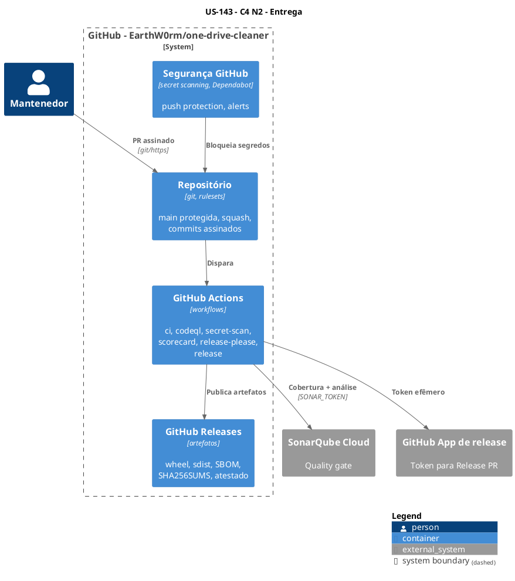

**Sequência — PR até release (sucesso e falha)**

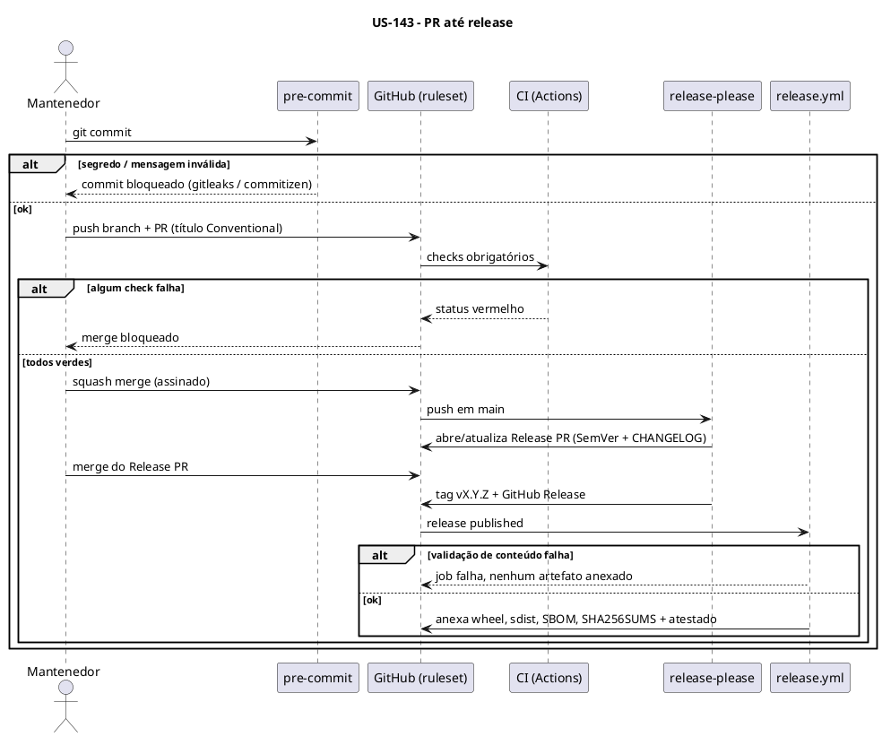

### Sequenciamento de Tarefas

| # | Tarefa | Escopo | Depende de |
|---|---|---|---|
| TF-143-01 | Criar repositório público e arquivos de governança | Governança | — |
| TF-143-02 | Esqueleto do projeto Python e gates de qualidade | Build Python | TF-143-01 |
| TF-143-03 | Esqueleto do front-end e gates de qualidade | Build front | TF-143-01 |
| TF-143-04 | Hooks locais de pre-commit e prevenção de segredos | Segurança local | TF-143-02, TF-143-03 |
| TF-143-05 | Workflows de CI, segurança e análise | CI | TF-143-04 |
| TF-143-06 | Integração SonarQube Cloud | Qualidade | TF-143-05 |
| TF-143-07 | Release automatizado com SemVer | Release | TF-143-05 |
| TF-143-08 | Proteção da `main` e configurações do repositório como código | Governança | TF-143-05, 06, 07 |

### Tarefas

#### TF-143-01: [one-drive-cleaner] Criar repositório público e arquivos de governança

**User Story:** US-143 · **Épico:** E-ODC · **Sistema:** one-drive-cleaner · **Prioridade:** P0
**Complexidade:** C1 — Baixa · **Modelo sugerido:** Claude Haiku 5.5 (`claude-haiku-5-5`) · **Escalonar para:** Sonnet 5.5
**Justificativa:** arquivos de texto padronizados e comandos `gh`/`git` determinísticos; sem lógica de código.

##### 1. Descrição e Objetivo

> **Eu como** mantenedor,
> **Eu quero** criar o repositório público com licença, documentação de governança e `.gitignore` restritivo,
> **Para que** o projeto nasça com regras claras de contribuição e sem risco de versionar dados pessoais.

*Contexto Arquitetural:* plan 11.1 e 11.3. O diretório local já contém `docs/` (spec, plan, tasks, design) e ainda não é repositório git.

##### 2. Especificação Técnica

**2.1 Pontos de Interceptação**
- `LICENSE` — texto integral GPL-3.0.
- `README.md` — objetivo, aviso de não afiliação à Microsoft, privacidade (análise 100% local), pré-requisitos (macOS, Python 3.12, uv, Node 22 + pnpm para build), registro do app no Microsoft Entra (contas pessoais, plataforma "Mobile and desktop", redirect `http://localhost`) e configuração `ODC_CLIENT_ID`, instalação via URL do wheel do Release.
- `SECURITY.md` — reporte via private vulnerability reporting; versões suportadas.
- `CONTRIBUTING.md` — fluxo trunk-based, Conventional Commits (tipo em inglês, descrição PT-BR, escopos do plan 11.4), commits assinados, testes obrigatórios, comandos `make`.
- `CODE_OF_CONDUCT.md` — Contributor Covenant 2.1 (PT-BR).
- `.github/CODEOWNERS` (`* @EarthW0rm`), `.github/pull_request_template.md` (checklist: testes, lint, sem dados pessoais, SPDX), `.github/ISSUE_TEMPLATE/bug.yml` e `feature.yml`.
- `.gitignore` — padrões do plan 11.3 (`.env*`, `*.db`, `*.sqlite*`, `config.toml`, `*.pem`, `*.key`, pesos de modelo, `spikes/**/data/`, `tests/model/data/`, `playwright-report/`, `test-results/`, `coverage/`, `htmlcov/`, `node_modules/`, `dist/`, `src/odc/web/static/`, `.venv/`, `__pycache__/`).

**2.2 Dados e Persistência:** não se aplica.

**2.3 Contrato de Dados:** não se aplica.

**2.4 Resiliência e Zero Trust**

| Cenário de Falha | Estratégia | Impacto |
|---|---|---|
| Nome do repositório já existe | Abortar e escalar ao utilizador | Nenhuma criação |
| Arquivo sensível no diretório antes do primeiro commit | `git status --ignored` revisado; nenhum `git add` não explícito | Primeiro commit limpo |

##### 3. Modelagem Visual
Coberta pelo C4 N2 da US-143.

##### 4. Orientação de Execução

**4.1 Contexto de Entrada:** `docs/specs/onedrive-cleaner/plan.md` (seções 11.1, 11.3, 11.4); `docs/specs/onedrive-cleaner/spec.md` (RN-02, 5.5).

**4.2 Passos de Implementação**
1. Confirmar com o utilizador a execução de `gh repo create EarthW0rm/one-drive-cleaner --public --description "<descrição>"` (ação externa e pública).
2. `git init -b main`; configurar `remote origin`.
3. Criar os arquivos de 2.1.
4. `git add` explícito apenas dos arquivos criados e de `docs/`; commit assinado `chore(repo): cria estrutura inicial de governança`; push.
5. Habilitar no repositório: Issues, private vulnerability reporting; desabilitar Wiki e Projects.

**4.3 Comando de Validação**
```bash
gh repo view EarthW0rm/one-drive-cleaner --json visibility,licenseInfo,defaultBranchRef && git ls-files
```

**4.4 Restrições Negativas**
- NÃO usar `git add .`/`-A`.
- NÃO versionar arquivos fora de 2.1 e `docs/`.
- NÃO incluir `client_id` real em nenhum arquivo.

**4.5 Skills Obrigatórias:** `commit-message` (mensagem e stage determinístico); `regra-git-github`.

**4.6 Critérios de Saída**
- [ ] Repositório público com `licenseInfo.spdxId = GPL-3.0`.
- [ ] `git ls-files` contém apenas os arquivos de 2.1 e `docs/`.
- [ ] Commit assinado (`git log --show-signature -1` válido).

##### 5. Testes de Aceitação (DoD)
- [ ] README cobre registro do app no Entra, privacidade e aviso de não afiliação.
- [ ] `.gitignore` ignora um `teste.db`, `.env` e `spikes/embedding_benchmark/data/x.jpg` criados temporariamente (`git check-ignore -v`).
- [ ] Templates de PR/issue renderizam no GitHub.

---

#### TF-143-02: [one-drive-cleaner] Esqueleto do projeto Python e gates de qualidade

**User Story:** US-143 · **Épico:** E-ODC · **Sistema:** one-drive-cleaner · **Prioridade:** P0
**Complexidade:** C2 — Média · **Modelo sugerido:** Claude Sonnet 5.5 (`claude-sonnet-5-5`), esforço médio · **Escalonar para:** Opus 5.5
**Justificativa:** muitas ferramentas a configurar de forma coerente (uv, ruff, mypy, import-linter, deptry, vulture, pytest-cov) e script próprio com testes; sem lógica de domínio.

##### 1. Descrição e Objetivo

> **Eu como** desenvolvedor,
> **Eu quero** o pacote `odc` estruturado com todas as ferramentas de qualidade configuradas e um script que exige teste para cada módulo,
> **Para que** todo código Python novo nasça sujeito aos gates de lint, tipagem, arquitetura e cobertura.

*Contexto Arquitetural:* plan 1.1, 1.2, 10.1 e 10.6. Monolito modular com pacotes `web`, `auth`, `graph`, `scanning`, `features`, `ml`, `jobs`, `quarantine`, `storage`, `cleanup`, `telemetry`.

##### 2. Especificação Técnica

**2.1 Pontos de Interceptação**
- `pyproject.toml` — projeto `onedrive-cleaner`, versão `0.1.0`, `license = "GPL-3.0-only"`, `requires-python = ">=3.12,<3.13"`, script `odc = "odc.cli:main"`, grupos de dependência `dev`; configurações `[tool.ruff]` (regras do plan 10.6, `C901` máx. 10), `[tool.mypy]` (`strict`, `disallow_any_explicit`, `disallow_any_generics`), `[tool.pytest.ini_options]` (marcadores `model`, `perf`, `integration`, `resilience`, `volume`; `--cov=odc --cov-branch --cov-fail-under=90`), `[tool.coverage]` (exclusões explícitas: `odc/cli.py` bootstrap, `odc/storage/migrations/versions/*`), `[tool.importlinter]` (contratos de camadas do plan 10.6), `[tool.deptry]`, `[tool.vulture]` (min-confidence 80).
- `uv.lock` — gerado.
- `src/odc/__init__.py` e `__init__.py` vazios de cada subpacote listado no contexto, com cabeçalho SPDX.
- `scripts/check_test_pairs.py` — percorre `src/odc/**/*.py` (exceto `__init__.py` e exclusões) e falha listando módulos sem `tests/unit/<mesmo caminho>/test_<nome>.py`.
- `scripts/check_spdx.py` — falha se arquivo `.py`/`.ts`/`.tsx` versionado não tiver `SPDX-License-Identifier: GPL-3.0-only` nas 3 primeiras linhas.
- `tests/unit/scripts/test_check_test_pairs.py`, `tests/unit/scripts/test_check_spdx.py`.
- `Makefile` — alvos `lint-python`, `test-python`, `lint`, `test`, `test-integration`, `test-model`, `test-e2e`, `test-all` (alvos de front delegados a `pnpm --dir frontend`; inexistentes viram no-op com aviso até TF-143-03).

**2.2 Dados e Persistência:** não se aplica.

**2.3 Contrato de Dados:** saída de `check_test_pairs.py` em falha: uma linha por módulo `MISSING_TEST <caminho do módulo> -> <caminho esperado do teste>`, exit code 1.

**2.4 Resiliência e Zero Trust**

| Cenário de Falha | Estratégia | Impacto |
|---|---|---|
| Pacote sem módulos ainda | `check_test_pairs.py` sai 0 com "0 módulos" | CI verde no esqueleto |
| pytest sem testes coletados (exit 5) | Alvos `make` tratam exit 5 como sucesso apenas para suítes vazias marcadas | CI não quebra antes das suítes existirem |

##### 3. Modelagem Visual
Não se aplica (configuração).

##### 4. Orientação de Execução

**4.1 Contexto de Entrada:** plan 1.1, 1.2, 10.1, 10.6.

**4.2 Passos de Implementação**
1. `uv init --package` e ajuste do `pyproject.toml` conforme 2.1.
2. Adicionar dependências de dev: `ruff`, `mypy`, `pytest`, `pytest-asyncio`, `pytest-cov`, `respx`, `import-linter`, `deptry`, `vulture`, `pip-audit`.
3. Criar subpacotes vazios com SPDX.
4. Implementar e testar `check_test_pairs.py` e `check_spdx.py` (testes com diretórios temporários).
5. Criar `Makefile`.

**4.3 Comando de Validação**
```bash
make lint-python && make test-python && uv run python scripts/check_test_pairs.py && uv run python scripts/check_spdx.py
```

**4.4 Restrições Negativas**
- NÃO adicionar dependências de runtime ainda (entram nas TFs que as usam).
- NÃO relaxar regras do ruff/mypy para fazer o esqueleto passar.

**4.5 Skills Obrigatórias:** `test-driven-agentic-development`, `commit-message`.

**4.6 Critérios de Saída**
- [ ] Validação 4.3 verde.
- [ ] `import-linter` com contratos declarados (mesmo com pacotes vazios).
- [ ] Scripts com cobertura ≥ 90%.

##### 5. Testes de Aceitação (DoD)
- [ ] `check_test_pairs.py` falha para um módulo fake sem teste e passa após criar o teste.
- [ ] `check_spdx.py` falha para arquivo sem cabeçalho.
- [ ] `uv run mypy src` e `uv run ruff check` sem erros.

---

#### TF-143-03: [one-drive-cleaner] Esqueleto do front-end e gates de qualidade

**User Story:** US-143 · **Épico:** E-ODC · **Sistema:** one-drive-cleaner · **Prioridade:** P0
**Complexidade:** C2 — Média · **Modelo sugerido:** Claude Sonnet 5.5 (`claude-sonnet-5-5`), esforço médio · **Escalonar para:** Opus 5.5
**Justificativa:** configuração integrada de Vite 8, React 19, TS strict, ESLint flat com vários plugins, Vitest com thresholds e regra de pareamento de testes.

##### 1. Descrição e Objetivo

> **Eu como** desenvolvedor,
> **Eu quero** o projeto `frontend/` com Ant Design 6 e todas as ferramentas de qualidade e teste configuradas,
> **Para que** toda tela nasça tipada, testada e analisada estaticamente.

*Contexto Arquitetural:* plan 1.1, 1.2, 9.1, 10.1, 10.4, 10.6. Build gerado em `src/odc/web/static/` (ignorado no git, incluído no wheel).

##### 2. Especificação Técnica

**2.1 Pontos de Interceptação**
- `frontend/package.json` — `private: true`, `license: "GPL-3.0-only"`, `version: "0.1.0"`, `packageManager: pnpm@<versão>`, `engines.node: ">=22"`; dependências `react@19`, `react-dom@19`, `antd@6`, `@ant-design/icons@6`, `@tanstack/react-query@5`, `react-router-dom@7`; dev: `vite@8`, `typescript`, `vitest@5`, `@vitest/coverage-v8`, `@testing-library/react`, `@testing-library/user-event`, `@testing-library/jest-dom`, `jsdom`, `msw`, `eslint` + plugins do plan 10.6, `prettier`, `knip`, `openapi-typescript`.
- `frontend/pnpm-lock.yaml`.
- `frontend/tsconfig.json` — `strict`, `noUncheckedIndexedAccess`, `exactOptionalPropertyTypes`, `noImplicitOverride`.
- `frontend/vite.config.ts` — `build.outDir = ../src/odc/web/static`, `emptyOutDir`, proxy de dev `/api` e `/auth` → `http://127.0.0.1:8765`.
- `frontend/vitest.config.ts` — ambiente `jsdom`, setup `src/test/setup.ts`, cobertura v8 com thresholds 90/85 (linhas/branches), exclusões explícitas (`src/main.tsx`, `src/api/schema.gen.ts`).
- `frontend/eslint.config.js` — flat config do plan 10.6 + regra local `require-colocated-test` (arquivo `.ts/.tsx` de produção sem `*.test.ts(x)` co-localizado = erro).
- `frontend/eslint-rules/require-colocated-test.js` + teste da regra.
- `frontend/.prettierrc`, `frontend/knip.json`.
- `frontend/src/main.tsx`, `frontend/src/app/App.tsx` (renderiza `ConfigProvider` pt_BR com uma página placeholder) + `App.test.tsx`.
- `frontend/src/test/setup.ts` (jest-dom, MSW server).
- `Makefile` — alvos `lint-frontend`, `test-frontend`, `build-frontend` reais.

**2.2 Dados e Persistência:** não se aplica.

**2.3 Contrato de Dados:** não se aplica nesta TF (tipos gerados entram na TF-144-04).

**2.4 Resiliência e Zero Trust**

| Cenário de Falha | Estratégia | Impacto |
|---|---|---|
| Versão de Node diferente | `engines` + `packageManager` com `pnpm` estrito | Build falha cedo com mensagem clara |
| Dependência com CDN | Proibido: tudo empacotado pelo Vite | Funciona offline |

##### 3. Modelagem Visual
Não se aplica.

##### 4. Orientação de Execução

**4.1 Contexto de Entrada:** plan 9.1, 10.1, 10.4, 10.6.

**4.2 Passos de Implementação**
1. Criar o projeto Vite React-TS em `frontend/` com pnpm.
2. Configurar tsconfig, Vite (outDir e proxy), Vitest e ESLint conforme 2.1.
3. Implementar a regra `require-colocated-test` com teste (RuleTester).
4. Criar `App.tsx` mínimo com `ConfigProvider` (`locale` pt_BR) e teste que verifica o locale.
5. Integrar alvos no `Makefile`.

**4.3 Comando de Validação**
```bash
pnpm --dir frontend lint && pnpm --dir frontend exec tsc --noEmit && pnpm --dir frontend exec knip && pnpm --dir frontend vitest run --coverage && pnpm --dir frontend build
```

**4.4 Restrições Negativas**
- NÃO usar a API estática `message.*`/`Modal.*` do antd (usar `App.useApp`).
- NÃO desativar regras com `eslint-disable` de arquivo inteiro.

**4.5 Skills Obrigatórias:** `test-driven-agentic-development`, `expert-lsp`, `commit-message`.

**4.6 Critérios de Saída**
- [ ] Validação 4.3 verde.
- [ ] Build gera `src/odc/web/static/index.html`.

##### 5. Testes de Aceitação (DoD)
- [ ] Criar `src/x.ts` sem teste faz o ESLint falhar com `require-colocated-test`.
- [ ] Cobertura abaixo do threshold faz o Vitest falhar.
- [ ] `any` explícito faz o ESLint falhar.

---

#### TF-143-04: [one-drive-cleaner] Hooks locais de pre-commit e prevenção de segredos

**User Story:** US-143 · **Épico:** E-ODC · **Sistema:** one-drive-cleaner · **Prioridade:** P0
**Complexidade:** C1 — Baixa · **Modelo sugerido:** Claude Haiku 5.5 (`claude-haiku-5-5`) · **Escalonar para:** Sonnet 5.5
**Justificativa:** configuração declarativa de hooks conhecidos e allowlist; validação por cenários simples.

##### 1. Descrição e Objetivo

> **Eu como** mantenedor,
> **Eu quero** que segredos, imagens fora de assets, bancos locais e mensagens fora do padrão sejam barrados antes do commit,
> **Para que** nada sensível chegue ao repositório público.

*Contexto Arquitetural:* plan 11.3 (camada local) e 11.4 (validação de mensagem).

##### 2. Especificação Técnica

**2.1 Pontos de Interceptação**
- `.pre-commit-config.yaml` — hooks: `gitleaks` (`protect --staged`), `check-added-large-files` (`--maxkb=1024`), `forbid-binary`/regex bloqueando `*.db`, `*.sqlite*`, `*.jpg|jpeg|png|heic|webp|gif` fora de `frontend/src/assets/` e `tests/fixtures/images/`, `ruff` + `ruff-format`, `commitizen` (`commit-msg`), `check-yaml`, `end-of-file-fixer`, `trailing-whitespace`.
- `.gitleaks.toml` — regras padrão + allowlist para valores com prefixo `FAKE-` e caminhos `tests/fakes/**`.
- `pyproject.toml` — `[tool.commitizen]` com `name = "cz_conventional_commits"` e escopos permitidos do plan 11.4.
- `CONTRIBUTING.md` — seção "Instalação dos hooks" (`uv run pre-commit install --hook-type pre-commit --hook-type commit-msg`).

**2.2 Dados e Persistência:** não se aplica.

**2.3 Contrato de Dados:** padrão de mensagem aceito: `<tipo>(<escopo>)!?: <descrição PT-BR>`; tipos do plan 11.4.

**2.4 Resiliência e Zero Trust**

| Cenário de Falha | Estratégia | Impacto |
|---|---|---|
| Hook não instalado pelo contribuidor | Mesmas verificações rodam no CI (TF-143-05) | Bloqueio no PR |
| Falso positivo do gitleaks | Allowlist explícita e revisada no `.gitleaks.toml` | Sem bypass global |

##### 3. Modelagem Visual
Coberta pela sequência da US-143 (ramo "commit bloqueado").

##### 4. Orientação de Execução

**4.1 Contexto de Entrada:** plan 11.3, 11.4; `.gitignore` (TF-143-01).

**4.2 Passos de Implementação**
1. Adicionar `pre-commit` e `commitizen` ao grupo dev.
2. Criar `.pre-commit-config.yaml` (hooks fixados por versão/rev) e `.gitleaks.toml`.
3. Documentar instalação no `CONTRIBUTING.md`.
4. Validar com os cenários de 5 em um diretório temporário clonado.

**4.3 Comando de Validação**
```bash
uv run pre-commit run --all-files && uv run cz check --message "feat(scan): adiciona varredura incremental"
```

**4.4 Restrições Negativas**
- NÃO usar `--no-verify` em nenhum fluxo documentado.
- NÃO colocar segredos reais nos testes do hook (usar `FAKE-`).

**4.5 Skills Obrigatórias:** `commit-message`.

**4.6 Critérios de Saída**
- [ ] Validação 4.3 verde no repositório.
- [ ] Os 4 cenários de bloqueio de 5 reproduzidos.

##### 5. Testes de Aceitação (DoD)
- [ ] Commit com um token no formato de chave AWS de exemplo (não `FAKE-`) é bloqueado.
- [ ] Commit de `x.db` ou `foto.jpg` fora de assets é bloqueado.
- [ ] Mensagem `update stuff` é rejeitada; `fix(graph): trata 410 na delta` é aceita.
- [ ] Fixture com `FAKE-token-123` passa.

---

#### TF-143-05: [one-drive-cleaner] Workflows de CI, segurança e análise

**User Story:** US-143 · **Épico:** E-ODC · **Sistema:** one-drive-cleaner · **Prioridade:** P0
**Complexidade:** C3 — Alta · **Modelo sugerido:** Claude Sonnet 5.5 (`claude-sonnet-5-5`), esforço alto · **Escalonar para:** Opus 5.5
**Justificativa:** vários workflows com permissões mínimas, pin por SHA, caches, jobs que precisam tolerar suítes ainda vazias e segurança de supply chain validada por `zizmor`.

##### 1. Descrição e Objetivo

> **Eu como** mantenedor,
> **Eu quero** que todo PR execute lint, tipagem, testes, auditoria de dependências, licenças, segredos e CodeQL,
> **Para que** os status checks obrigatórios da `main` existam e reflitam a qualidade real do código.

*Contexto Arquitetural:* plan 10.1, 10.6, 11.1, 11.3, 11.5. Nomes de jobs são contrato com o ruleset (TF-143-08): `lint-python`, `lint-frontend`, `lint-repo`, `deps-audit`, `test-backend`, `test-frontend`, `contract`, `test-model-unit`, `e2e`, `license-check`, `pr-title`, `dependency-review`, `secret-scan`.

##### 2. Especificação Técnica

**2.1 Pontos de Interceptação**
- `.github/workflows/ci.yml` — gatilhos `pull_request` e `push` em `main`; `permissions: contents: read`; jobs de 2.3; `concurrency` por ref com cancelamento; caches `uv` e `pnpm`.
- `.github/workflows/ci-model.yml` — `paths` do plan 11.5 + `schedule` semanal; cache de pesos de modelo.
- `.github/workflows/secret-scan.yml` — `gitleaks detect` com `fetch-depth: 0`; `pull_request` + semanal.
- `.github/workflows/codeql.yml` — linguagens `python`, `javascript-typescript`, `actions`.
- `.github/workflows/scorecard.yml` — OpenSSF Scorecard com upload SARIF.
- `.github/dependabot.yml` — ecossistemas `uv`/pip (raiz), `npm` (`/frontend`), `github-actions`; semanal; agrupamento de minor/patch.
- `scripts/license_check.py` + teste — lê licenças (`pip-licenses --format=json` e `pnpm licenses list --json`) e valida contra a allowlist do plan 11.5.
- `Makefile` — alvos `lint-repo` (actionlint, zizmor, yamllint, markdownlint-cli2, taplo, `check_spdx.py`, PlantUML `-checkonly` nos `.md` de `docs/`), `deps-audit` (`pip-audit`, `pnpm audit --audit-level high`), `license-check`.

**2.2 Dados e Persistência:** não se aplica.

**2.3 Contrato de Dados — jobs**

| Job | Comando | Observação |
|---|---|---|
| `lint-python` | `make lint-python` | ruff, format, mypy, import-linter, deptry, vulture, `check_test_pairs.py` |
| `lint-frontend` | `make lint-frontend` | ESLint, Prettier, tsc, knip |
| `lint-repo` | `make lint-repo` | Workflows, YAML, Markdown, TOML, SPDX, PlantUML |
| `deps-audit` | `make deps-audit` | Vulnerabilidades altas/críticas |
| `test-backend` | `make test-python test-integration` | Gera `coverage.xml` (artefato) |
| `test-frontend` | `make test-frontend` | Gera `lcov.info` (artefato) |
| `contract` | `make contract` | No-op até TF-144-04 |
| `test-model-unit` | `uv run pytest tests/model -m "not model and not perf"` | Suíte vazia tolerada |
| `e2e` | `make test-e2e` | No-op até TF-157-01 |
| `license-check` | `make license-check` | Allowlist GPL-3.0-compatível |
| `pr-title` | `amannn/action-semantic-pull-request` | Somente em `pull_request` |
| `dependency-review` | `actions/dependency-review-action` (`fail-on-severity: high`, `deny-licenses` incompatíveis) | Somente em `pull_request` |

**2.4 Resiliência e Zero Trust**

| Cenário de Falha | Estratégia | Impacto |
|---|---|---|
| Action de terceiro comprometida | Pin por SHA completo + Dependabot `github-actions` | Mitiga supply chain |
| Injeção via título de PR/branch em `run:` | Nunca interpolar `${{ github.event.* }}` em shell; usar `env:` | `zizmor` sem achados |
| PR de fork | `pull_request` (sem segredos); proibido `pull_request_target` | Sem exposição |
| Flakiness de E2E | Retries do Playwright = 1 apenas no CI, com trace salvo | Diagnóstico sem mascarar falha |

##### 3. Modelagem Visual
Coberta pelo C4 N2 e pela sequência da US-143.

##### 4. Orientação de Execução

**4.1 Contexto de Entrada:** plan 10.6, 11.5; `Makefile`; `.pre-commit-config.yaml`.

**4.2 Passos de Implementação**
1. Criar alvos `make` faltantes e `license_check.py` com testes.
2. Criar os 5 workflows e o `dependabot.yml` com `permissions` mínimas por job.
3. Fixar todas as actions por SHA (comentário com a versão).
4. Rodar `actionlint` e `zizmor` localmente até zero achados.
5. Abrir PR de teste e confirmar a execução de todos os jobs.

**4.3 Comando de Validação**
```bash
make lint-repo && make license-check && gh pr checks --watch
```

**4.4 Restrições Negativas**
- NÃO usar `pull_request_target`, `secrets: inherit` ou `permissions: write-all`.
- NÃO usar tags mutáveis (`@v4`) em actions.

**4.5 Skills Obrigatórias:** `test-driven-agentic-development` (script de licenças), `commit-message`, `regra-git-github`.

**4.6 Critérios de Saída**
- [ ] Todos os jobs de 2.3 executam e ficam verdes no PR de teste.
- [ ] `zizmor` e `actionlint` sem achados.
- [ ] CodeQL e Scorecard publicam resultados na aba Security.

##### 5. Testes de Aceitação (DoD)
- [ ] PR com título `update` falha em `pr-title`.
- [ ] PR adicionando dependência GPL-2.0-only falha em `license-check`/`dependency-review`.
- [ ] PR com segredo fake fora da allowlist falha em `secret-scan`.
- [ ] `license_check.py` com cobertura ≥ 90%.

---

#### TF-143-06: [one-drive-cleaner] Integração SonarQube Cloud

**User Story:** US-143 · **Épico:** E-ODC · **Sistema:** one-drive-cleaner · **Prioridade:** P1
**Complexidade:** C2 — Média · **Modelo sugerido:** Claude Sonnet 5.5 (`claude-sonnet-5-5`), esforço médio · **Escalonar para:** Opus 5.5
**Justificativa:** integração de relatórios de cobertura de duas linguagens, configuração de quality gate e tratamento de PRs de forks sem segredo.

##### 1. Descrição e Objetivo

> **Eu como** mantenedor,
> **Eu quero** um quality gate consolidado de cobertura, duplicação, confiabilidade, segurança e manutenibilidade no código novo,
> **Para que** a qualidade não degrade a cada PR.

*Contexto Arquitetural:* plan 10.6 (`sonar-quality-gate`). Pré-requisito manual: o utilizador cria a organização/projeto no SonarQube Cloud (plano gratuito para repositório público) e cadastra `SONAR_TOKEN` em GitHub Secrets.

##### 2. Especificação Técnica

**2.1 Pontos de Interceptação**
- `sonar-project.properties` — `sonar.projectKey`, `sonar.organization`, `sonar.sources=src/odc,frontend/src`, `sonar.tests=tests,frontend/src`, `sonar.test.inclusions=**/test_*.py,**/*.test.ts,**/*.test.tsx`, `sonar.exclusions=**/schema.gen.ts,src/odc/web/static/**,src/odc/storage/migrations/versions/**`, `sonar.python.version=3.12`, `sonar.python.coverage.reportPaths=coverage.xml`, `sonar.javascript.lcov.reportPaths=frontend/coverage/lcov.info`, `sonar.python.ruff.reportPaths`, `sonar.eslint.reportPaths`.
- `.github/workflows/ci.yml` — job `sonar-quality-gate` dependente de `test-backend`, `test-frontend`, `lint-python`, `lint-frontend` (baixa artefatos de cobertura e relatórios), executa a action oficial de scan fixada por SHA e aguarda o quality gate; `if:` pula com status neutro quando o PR vem de fork sem aprovação.
- `Makefile` — `lint-python` e `lint-frontend` exportam relatórios (`ruff --output-format json`, ESLint `--format json`).

**2.2 Dados e Persistência:** não se aplica.

**2.3 Contrato de Dados:** quality gate (código novo): cobertura ≥ 90%, duplicação ≤ 3%, Reliability/Security/Maintainability = A, 100% hotspots revisados.

**2.4 Resiliência e Zero Trust**

| Cenário de Falha | Estratégia | Impacto |
|---|---|---|
| SonarQube Cloud indisponível | Job falha (check obrigatório); reexecução manual | Merge aguarda |
| PR de fork sem segredo | Execução após aprovação do mantenedor para rodar workflows | Sem exposição do token |
| Token exposto em log | Token só via `env` do step; nunca ecoado | — |

##### 3. Modelagem Visual
Coberta pelo C4 N2 da US-143.

##### 4. Orientação de Execução

**4.1 Contexto de Entrada:** `.github/workflows/ci.yml` (TF-143-05); plan 10.6.

**4.2 Passos de Implementação**
1. Solicitar ao utilizador a criação do projeto no SonarQube Cloud, a definição do quality gate de 2.3 e o cadastro de `SONAR_TOKEN`.
2. Criar `sonar-project.properties`.
3. Exportar relatórios de lint em JSON e cobertura como artefatos.
4. Adicionar o job `sonar-quality-gate`.

**4.3 Comando de Validação**
```bash
gh pr checks --watch | grep sonar-quality-gate
```

**4.4 Restrições Negativas**
- NÃO usar a "Automatic Analysis" do SonarQube Cloud (sem cobertura); análise sempre via CI.
- NÃO imprimir o token.

**4.5 Skills Obrigatórias:** `commit-message`.

**4.6 Critérios de Saída**
- [ ] `sonar-quality-gate` verde em PR de teste com cobertura importada (Python e TS visíveis no painel).

##### 5. Testes de Aceitação (DoD)
- [ ] PR com código duplicado artificialmente > 3% falha no gate.
- [ ] Cobertura Python e TS exibidas no SonarQube Cloud.

---

#### TF-143-07: [one-drive-cleaner] Release automatizado com SemVer

**User Story:** US-143 · **Épico:** E-ODC · **Sistema:** one-drive-cleaner · **Prioridade:** P0
**Complexidade:** C3 — Alta · **Modelo sugerido:** Claude Sonnet 5.5 (`claude-sonnet-5-5`), esforço alto · **Escalonar para:** Opus 5.5
**Justificativa:** cadeia de supply chain (token de GitHub App, proveniência, SBOM, validação de conteúdo do pacote) e sincronização de versão entre Python e front.

##### 1. Descrição e Objetivo

> **Eu como** mantenedor,
> **Eu quero** que versões sejam calculadas a partir dos Conventional Commits e publicadas automaticamente como GitHub Release verificável,
> **Para que** cada release seja reproduzível, rastreável e sem conteúdo sensível.

*Contexto Arquitetural:* plan 11.4, 11.5, 11.6. Pré-requisito manual: o utilizador cria um GitHub App com permissões `contents: write` e `pull-requests: write`, instala no repositório e cadastra `RELEASE_APP_ID` (variável) e `RELEASE_APP_PRIVATE_KEY` (secret) no environment `release` (restrito a `main`).

##### 2. Especificação Técnica

**2.1 Pontos de Interceptação**
- `release-please-config.json` — pacote raiz `release-type: python`, `bump-minor-pre-major: true`, `bump-patch-for-minor-pre-major: false`, `changelog-sections` em PT-BR (Funcionalidades, Correções, Desempenho, Reversões; demais ocultas), `extra-files`: `frontend/package.json` (`$.version`).
- `.release-please-manifest.json` — `{ ".": "0.1.0" }`.
- `.github/workflows/release-please.yml` — `push` em `main`; `actions/create-github-app-token` → `googleapis/release-please-action`; environment `release`.
- `.github/workflows/release.yml` — `release: published`; jobs: `build` (pnpm build → `uv build`), `verify` (`scripts/verify_dist.py`), `sbom` (`cyclonedx-py` e `@cyclonedx/cyclonedx-npm`), `checksums` (`SHA256SUMS`), `attest` (`actions/attest-build-provenance`, `permissions: id-token: write, attestations: write`), `upload` (`gh release upload`, `contents: write`).
- `scripts/verify_dist.py` + teste — inspeciona wheel/sdist e falha se houver caminhos fora da allowlist (`odc/**`, `odc/web/static/**`, metadados) ou padrões proibidos (`.env`, `*.db`, `tests/`, imagens fora de `odc/web/static/assets/`, `*.pem`, `*.key`) ou se `odc/web/static/index.html` estiver ausente.
- `src/odc/__init__.py` — `__version__` via `importlib.metadata.version("onedrive-cleaner")` + teste.

**2.2 Dados e Persistência:** não se aplica.

**2.3 Contrato de Dados — artefatos do Release**

| Arquivo | Conteúdo |
|---|---|
| `onedrive_cleaner-X.Y.Z-py3-none-any.whl` | Pacote + SPA |
| `onedrive_cleaner-X.Y.Z.tar.gz` | sdist |
| `sbom-python.cdx.json`, `sbom-frontend.cdx.json` | CycloneDX |
| `SHA256SUMS` | Hash de todos os anteriores |

**2.4 Resiliência e Zero Trust**

| Cenário de Falha | Estratégia | Impacto |
|---|---|---|
| Conteúdo proibido no wheel | `verify_dist.py` falha antes do upload | Release sem artefatos; corrigir e reexecutar |
| Release PR criado com `GITHUB_TOKEN` | Proibido: usar token do App para disparar checks obrigatórios | Release PR validado como qualquer PR |
| Falha no upload | Job idempotente (`--clobber` apenas para o mesmo tag) | Reexecução segura |
| Chave do App vazada | Secret apenas no environment `release`; rotação documentada no `SECURITY.md` | Escopo mínimo |

##### 3. Modelagem Visual
Coberta pela sequência da US-143 (ramo release).

##### 4. Orientação de Execução

**4.1 Contexto de Entrada:** plan 11.4–11.6; `pyproject.toml`; `frontend/package.json`.

**4.2 Passos de Implementação**
1. Solicitar ao utilizador o GitHub App e o environment `release`.
2. Criar a configuração do release-please e o manifesto.
3. Implementar e testar `verify_dist.py` (wheels sintéticos em diretório temporário).
4. Criar `release-please.yml` e `release.yml` com permissões mínimas por job e actions fixadas por SHA.
5. Validar com um `feat:` de teste: Release PR → merge → `v0.1.0` com artefatos.

**4.3 Comando de Validação**
```bash
uv run pytest tests/unit/scripts/test_verify_dist.py -q && gh release view v0.1.0 --json assets && gh attestation verify onedrive_cleaner-0.1.0-py3-none-any.whl --repo EarthW0rm/one-drive-cleaner
```

**4.4 Restrições Negativas**
- NÃO publicar no PyPI.
- NÃO criar tags manualmente.

**4.5 Skills Obrigatórias:** `test-driven-agentic-development`, `commit-message`, `regra-git-github`.

**4.6 Critérios de Saída**
- [ ] `v0.1.0` publicado com os 5 tipos de artefato e atestado verificável.
- [ ] `frontend/package.json` com a mesma versão do `pyproject.toml`.

##### 5. Testes de Aceitação (DoD)
- [ ] `fix:` gera PATCH; `feat:` gera MINOR; `feat!:` em `0.x` gera MINOR.
- [ ] `verify_dist.py` falha com wheel contendo `x.db` ou `.env`.
- [ ] `SHA256SUMS` confere com `shasum -a 256 -c`.
- [ ] `odc --version` (após TF-144-05) exibe a versão do release.

---

#### TF-143-08: [one-drive-cleaner] Proteção da `main` e configurações do repositório como código

**User Story:** US-143 · **Épico:** E-ODC · **Sistema:** one-drive-cleaner · **Prioridade:** P0
**Complexidade:** C2 — Média · **Modelo sugerido:** Claude Sonnet 5.5 (`claude-sonnet-5-5`), esforço médio · **Escalonar para:** Opus 5.5
**Justificativa:** script idempotente sobre a API REST do GitHub (rulesets, segurança, merge) com payloads JSON precisos; erro de configuração pode travar o fluxo de merge.

##### 1. Descrição e Objetivo

> **Eu como** mantenedor,
> **Eu quero** aplicar rulesets e configurações de segurança por um script versionado e reaplicável,
> **Para que** a proteção da `main` seja auditável e não dependa de cliques manuais.

*Contexto Arquitetural:* plan 11.1 e 11.2. Os nomes dos status checks vêm de TF-143-05 e TF-143-06.

##### 2. Especificação Técnica

**2.1 Pontos de Interceptação**
- `scripts/github/apply-repo-settings.sh` — usa `gh api`; idempotente (cria ou atualiza por nome do ruleset); modo `--dry-run` imprime os payloads.
- `scripts/github/rulesets/main.json` — alvo `~DEFAULT_BRANCH`; regras: `pull_request` (`required_approving_review_count: 0`, `required_review_thread_resolution: true`, `allowed_merge_methods: ["squash"]`), `required_status_checks` (`strict_required_status_checks_policy: true`, lista do plan 11.2), `required_linear_history`, `required_signatures`, `non_fast_forward`, `deletion`; `bypass_actors: []`.
- `scripts/github/rulesets/tags.json` — alvo `refs/tags/v*`; regras `creation`, `update`, `deletion`; `bypass_actors` = somente o GitHub App de release.
- `scripts/github/repo-settings.json` — `allow_squash_merge: true`, `allow_merge_commit: false`, `allow_rebase_merge: false`, `squash_merge_commit_title: PR_TITLE`, `squash_merge_commit_message: PR_BODY`, `delete_branch_on_merge: true`, `security_and_analysis` (secret scanning e push protection ativos).
- Chamadas complementares: habilitar Dependabot alerts/security updates, private vulnerability reporting; `actions/permissions/workflow` (`default_workflow_permissions: read`, `can_approve_pull_request_reviews: false`); aprovação para workflows de forks (`first-time contributors`).
- `scripts/github/test_rulesets.py` (em `tests/unit/scripts/`) — valida os JSON (campos obrigatórios, lista de checks igual ao plan 11.2, bypass vazio na `main`).

**2.2 Dados e Persistência:** não se aplica.

**2.3 Contrato de Dados:** JSON dos rulesets conforme REST API `repos/{owner}/{repo}/rulesets`.

**2.4 Resiliência e Zero Trust**

| Cenário de Falha | Estratégia | Impacto |
|---|---|---|
| Nome de check divergente do job real | Teste compara a lista do JSON com os jobs dos workflows (parse YAML) | Evita `main` travada |
| Execução repetida | Atualiza ruleset existente por nome (PUT) | Idempotente |
| Usuário sem permissão de admin | Script aborta com mensagem clara antes de qualquer alteração | Nenhuma alteração parcial |

##### 3. Modelagem Visual
Coberta pelo C4 N2 da US-143.

##### 4. Orientação de Execução

**4.1 Contexto de Entrada:** plan 11.2; `.github/workflows/*.yml`.

**4.2 Passos de Implementação**
1. Criar os JSON e o teste de consistência com os workflows.
2. Implementar o script com `--dry-run`.
3. Confirmar com o utilizador antes de aplicar (alteração de configuração pública).
4. Aplicar e verificar com `gh api repos/EarthW0rm/one-drive-cleaner/rulesets`.

**4.3 Comando de Validação**
```bash
uv run pytest tests/unit/scripts/test_rulesets.py -q && bash scripts/github/apply-repo-settings.sh --dry-run && gh api repos/EarthW0rm/one-drive-cleaner/rulesets --jq '.[].name'
```

**4.4 Restrições Negativas**
- NÃO adicionar bypass para administradores.
- NÃO aplicar sem `--dry-run` revisado.

**4.5 Skills Obrigatórias:** `test-driven-agentic-development`, `regra-git-github`, `commit-message`.

**4.6 Critérios de Saída**
- [ ] Rulesets `main` e `tags` ativos (`enforcement: active`).
- [ ] Teste de consistência verde.

##### 5. Testes de Aceitação (DoD)
- [ ] `git push --force` em `main` é rejeitado.
- [ ] Push direto em `main` é rejeitado.
- [ ] Commit não assinado em PR bloqueia o merge.
- [ ] PR com check vermelho não pode ser mergeado.
- [ ] Reexecutar o script não cria rulesets duplicados.

---

## US-144: Aplicação local inicializável com persistência e interface base segura

**Épico:** E-ODC — OneDrive Cleaner MVP
**Sistema:** one-drive-cleaner
**Estimativa:** 8 Story Points
**Prioridade:** P0

### Narrativa de Valor

> **Eu como** utilizador,
> **Eu quero** executar `odc` e acessar a interface no navegador da minha máquina, com dados guardados localmente por conta,
> **Para que** eu tenha um ponto de entrada seguro, acessível apenas por mim, sobre o qual as funcionalidades serão entregues.

### Contexto de Negócio

Base de execução de todas as jornadas: configuração, banco local por conta (RN-04), API protegida (RN-23) e o casco da interface (Ant Design 6, pt-BR, tema claro/escuro).

### Critérios de Aceitação (Nível de Negócio)

- [ ] `odc` aplica migrações, sobe o servidor em `127.0.0.1:8765` e abre o navegador na interface.
- [ ] Requisições com `Host` diferente de `localhost`/`127.0.0.1` são rejeitadas; mutações sem CSRF retornam 403.
- [ ] `/healthz` informa banco OK; a interface exibe menu com as 6 telas e alterna tema.
- [ ] Banco criado em `~/Library/Application Support/OneDriveCleaner/accounts/<account_key>/odc.db` com as 13 tabelas e 4 categorias iniciais.

### Regras de Negócio Aplicáveis

| # | Regra | Tipo |
|---|---|---|
| RN-04 | Persistência local de metadados, análises, rótulos, versões e diário | Obrigatória |
| RN-08, RN-09 | Seed das categorias iniciais com "Foto real" protegida | Obrigatória |
| RN-23 | Interface acessível somente a partir da própria máquina | Restritiva |

### Diagramas

**C4 N2 — Aplicação local**

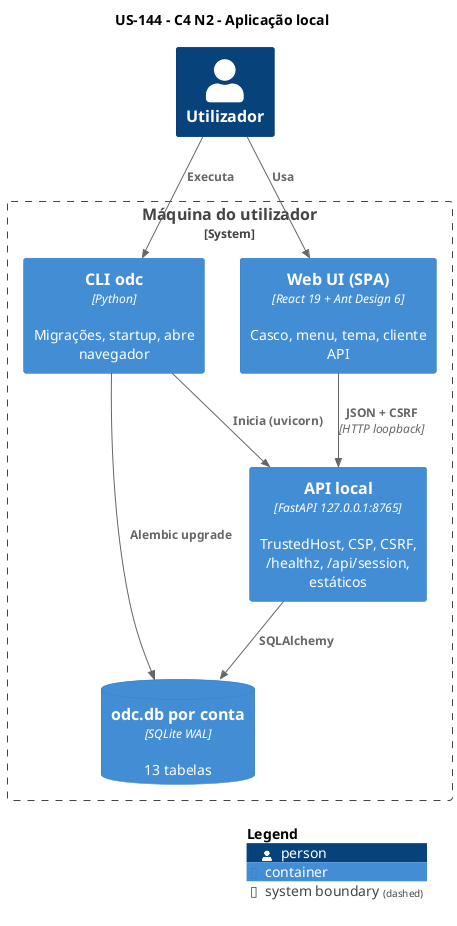

**Sequência — inicialização e requisição protegida (sucesso e falha)**

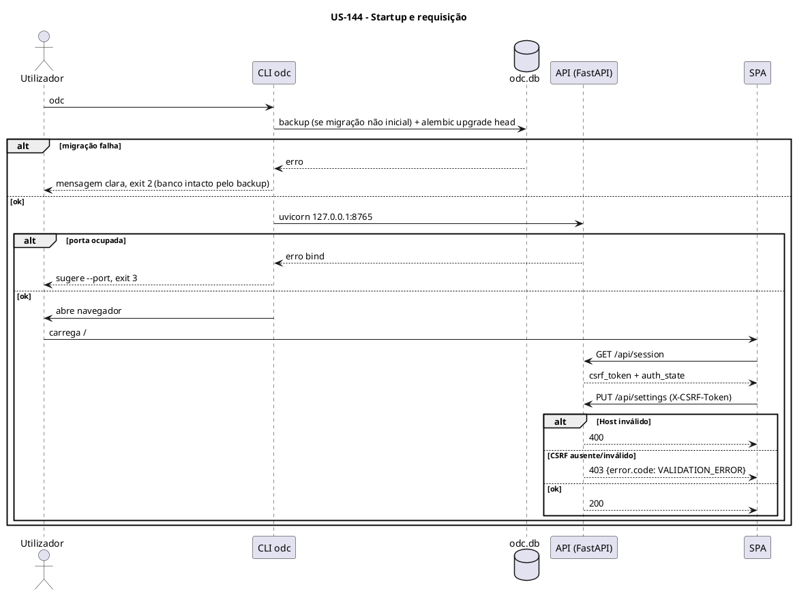

### Sequenciamento de Tarefas

| # | Tarefa | Escopo | Depende de |
|---|---|---|---|
| TF-144-01 | Configuração da aplicação e diretórios locais | Configuração | TF-143-02 |
| TF-144-02 | Schema SQLite e migração inicial | Persistência (schema) | TF-144-01 |
| TF-144-03 | Repositórios de dados por agregado | Persistência (acesso) | TF-144-02 |
| TF-144-04 | Camada web base segura e contrato OpenAPI | API | TF-144-03 |
| TF-144-05 | CLI `odc` e sequência de inicialização | Runtime | TF-144-04 |
| TF-144-06 | Casco da interface (layout, rotas, tema, cliente API) | Front | TF-144-04, TF-143-03 |

### Tarefas

#### TF-144-01: [one-drive-cleaner] Configuração da aplicação e diretórios locais

**User Story:** US-144 · **Épico:** E-ODC · **Sistema:** one-drive-cleaner · **Prioridade:** P0
**Complexidade:** C1 — Baixa · **Modelo sugerido:** Claude Haiku 5.5 (`claude-haiku-5-5`) · **Escalonar para:** Sonnet 5.5
**Justificativa:** modelos de configuração tipados e resolução de caminhos com `platformdirs`; lógica linear e testes diretos.

##### 1. Descrição e Objetivo

> **Eu como** aplicação,
> **Eu quero** uma configuração tipada (variáveis de ambiente + arquivo do usuário) e caminhos locais padronizados,
> **Para que** todos os módulos leiam parâmetros validados e gravem dados apenas nos diretórios previstos.

*Contexto Arquitetural:* plan 3.4 e 11.3 (`client_id` fora do repositório).

##### 2. Especificação Técnica

**2.1 Pontos de Interceptação**
- `src/odc/config.py` — `AppSettings` (pydantic-settings, prefixo `ODC_`, `extra="forbid"`): `client_id: str | None`, `port: int = 8765` (1024–65535), `host: Literal["127.0.0.1"]`, `open_browser: bool = True`, `log_level`, `data_dir`, `cache_dir`, `logs_dir` (derivados de `platformdirs` com `appname="OneDriveCleaner"`); leitura opcional de `<data_dir>/config.toml`.
- `src/odc/paths.py` — `account_dir(account_key)`, `db_path(account_key)`, `temp_dir()`, `models_dir()`, `logs_dir()`; cria diretórios com permissão `0o700`.
- `src/odc/account_key.py` — `account_key(ms_account_id: str) -> str` = SHA-256 hex do ID (nunca do e-mail).
- Testes: `tests/unit/test_config.py`, `tests/unit/test_paths.py`, `tests/unit/test_account_key.py`.

**2.2 Dados e Persistência:** arquivo `config.toml` opcional (não versionado).

**2.3 Contrato de Dados**
```json
{
  "client_id": "string | null — GUID; obrigatório apenas para login",
  "port": "int — 1024..65535, padrão 8765",
  "open_browser": "bool — padrão true",
  "log_level": "DEBUG | INFO | WARNING | ERROR — padrão INFO"
}
```

**2.4 Resiliência e Zero Trust**

| Cenário de Falha | Estratégia | Impacto |
|---|---|---|
| `config.toml` malformado | Fail-fast com mensagem indicando arquivo e campo | `odc` não inicia |
| Valor fora de faixa / campo desconhecido | Rejeitado pela validação (`extra="forbid"`) | `odc` não inicia |
| `client_id` ausente | Aplicação inicia; login exibe instrução de configuração | Funcionalidades de conta indisponíveis |

##### 3. Modelagem Visual
Não se aplica.

##### 4. Orientação de Execução

**4.1 Contexto de Entrada:** plan 3.4, 11.3; `pyproject.toml`.

**4.2 Passos de Implementação**
1. Adicionar dependências `pydantic`, `pydantic-settings`, `platformdirs`.
2. Implementar os 3 módulos com testes (usar `tmp_path` e `monkeypatch` para HOME/variáveis).

**4.3 Comando de Validação**
```bash
uv run pytest tests/unit/test_config.py tests/unit/test_paths.py tests/unit/test_account_key.py -q && make lint-python
```

**4.4 Restrições Negativas**
- NÃO ler variáveis de ambiente fora de `config.py`.
- NÃO aceitar `host` diferente de `127.0.0.1`.

**4.5 Skills Obrigatórias:** `test-driven-agentic-development`, `commit-message`.

**4.6 Critérios de Saída**
- [ ] Validação 4.3 verde; cobertura ≥ 90%.

##### 5. Testes de Aceitação (DoD)
- [ ] Precedência: variável de ambiente > `config.toml` > padrão.
- [ ] `ODC_PORT=80` rejeitado; campo extra no TOML rejeitado.
- [ ] Diretórios criados com permissão `0o700`.
- [ ] `account_key` determinístico e diferente para IDs diferentes.

---

#### TF-144-02: [one-drive-cleaner] Schema SQLite e migração inicial

**User Story:** US-144 · **Épico:** E-ODC · **Sistema:** one-drive-cleaner · **Prioridade:** P0
**Complexidade:** C2 — Média · **Modelo sugerido:** Claude Sonnet 5.5 (`claude-sonnet-5-5`), esforço médio · **Escalonar para:** Opus 5.5
**Justificativa:** 13 tabelas com CHECKs, índice único parcial, seeds e pragmas; exige fidelidade exata ao plan 3.1/3.2.

##### 1. Descrição e Objetivo

> **Eu como** aplicação,
> **Eu quero** o schema completo versionado em migração Alembic com backup automático,
> **Para que** todos os módulos persistam dados de forma consistente e evolutiva.

*Contexto Arquitetural:* plan 3.1, 3.2, 3.5.

##### 2. Especificação Técnica

**2.1 Pontos de Interceptação**
- `src/odc/storage/engine.py` — `create_engine_for(db_path)` com `sqlite+pysqlite`, eventos de conexão aplicando `PRAGMA journal_mode=WAL`, `foreign_keys=ON`, `synchronous=NORMAL`, `busy_timeout=5000`.
- `src/odc/storage/tables.py` — definição SQLAlchemy 2.0 (Core `Table` ou ORM declarativo tipado) das tabelas `app_meta`, `setting`, `scan_root`, `item`, `embedding_model`, `feature`, `category`, `label`, `model_version`, `prediction`, `quarantine_entry`, `journal`, `job` com campos, tipos, nulidade e FKs do plan 3.1; enums como `CHECK (col IN (...))`.
- `src/odc/storage/migrations/` — `env.py` Alembic; `versions/0001_initial.py` com tabelas, índices do plan 3.2 (incluindo `ux_model_current` parcial `WHERE status='current'`), CHECK `NOT (protected = 1 AND removable = 1)`, seed das categorias (`screenshot` "Print de tela" removível; `real_photo` "Foto real" protegida; `meme_sticker` "Meme/figurinha" removível; `document_receipt` "Documento/recibo" removível) com `zero_shot_prompts` em inglês e seed de `setting` com padrões do plan 3.1.
- `src/odc/storage/migrate.py` — `upgrade(db_path)`: backup `odc.db.bak-<versão>` antes de migração não inicial; aplica `head`.
- Testes: `tests/unit/storage/test_engine.py`, `test_tables.py`, `test_migrate.py`.

**2.2 Dados e Persistência:** todas as tabelas do plan 3.1; índices do plan 3.2. `embedding_model` não recebe seed aqui (vem da TF-150-02 via migração `0002`).

**2.3 Contrato de Dados — seed de settings**
```json
{
  "automation_mode": "evolutive",
  "auto_threshold": 0.98,
  "retrain_every": 20,
  "gate_precision": 0.98,
  "gate_min_labels": 200,
  "gate_min_support": 30,
  "temp_cap_bytes": 2147483648,
  "otel_enabled": true,
  "otel_endpoint": "http://127.0.0.1:4317"
}
```

**2.4 Resiliência e Zero Trust**

| Cenário de Falha | Estratégia | Impacto |
|---|---|---|
| Migração falha no meio | Transação da migração + backup prévio restaurável | Banco anterior preservado |
| Disco cheio | Erro `DISK_FULL` propagado; sem arquivo parcial | `odc` não inicia |
| Banco de versão futura | Abortar com mensagem (downgrade não suportado) | Sem corrupção |

##### 3. Modelagem Visual
Modelo de dados no plan 3.1 (fonte da verdade).

##### 4. Orientação de Execução

**4.1 Contexto de Entrada:** plan 3.1, 3.2, 3.3, 3.5.

**4.2 Passos de Implementação**
1. Adicionar `sqlalchemy>=2`, `alembic`.
2. Implementar engine com pragmas e teste que lê os pragmas.
3. Definir tabelas e migração `0001` com seeds.
4. Testes: migração em banco vazio cria tudo; CHECKs rejeitam valores inválidos; índice parcial impede 2 `current`; FK impede `label` órfão.

**4.3 Comando de Validação**
```bash
uv run pytest tests/unit/storage -q && make lint-python
```

**4.4 Restrições Negativas**
- NÃO usar `SELECT *` em nenhum código.
- NÃO usar pickle para BLOBs.

**4.5 Skills Obrigatórias:** `test-driven-agentic-development`, `commit-message`.

**4.6 Critérios de Saída**
- [ ] Validação 4.3 verde; cobertura ≥ 90% (migrações geradas excluídas apenas se configurado).
- [ ] `alembic check` sem diferenças entre modelos e migração.

##### 5. Testes de Aceitação (DoD)
- [ ] Inserir categoria com `protected=1, removable=1` falha.
- [ ] Dois `model_version` com `status='current'` falham.
- [ ] Seeds presentes e idempotentes (rodar `upgrade` duas vezes não duplica).
- [ ] Backup criado antes de migração não inicial.

---

#### TF-144-03: [one-drive-cleaner] Repositórios de dados por agregado

**User Story:** US-144 · **Épico:** E-ODC · **Sistema:** one-drive-cleaner · **Prioridade:** P0
**Complexidade:** C2 — Média · **Modelo sugerido:** Claude Sonnet 5.5 (`claude-sonnet-5-5`), esforço médio · **Escalonar para:** Opus 5.5
**Justificativa:** volume grande de operações de acesso a dados, porém padronizadas; atenção a transações curtas, colunas explícitas e tipos de retorno.

##### 1. Descrição e Objetivo

> **Eu como** serviço de domínio,
> **Eu quero** repositórios tipados por agregado com operações explícitas,
> **Para que** a lógica de negócio não dependa de SQL e as consultas respeitem índices e colunas definidas.

*Contexto Arquitetural:* plan 3.1, 3.2. Repositórios recebem `Session`; o controle de transação fica com o chamador (unit of work simples em `src/odc/storage/uow.py`).

##### 2. Especificação Técnica

**2.1 Pontos de Interceptação**
- `src/odc/storage/uow.py` — `UnitOfWork` (context manager; commit/rollback; uma escrita por vez via lock assíncrono do processo).
- `src/odc/storage/dto.py` — dataclasses imutáveis (`frozen=True, slots=True`) de leitura: `ItemRow`, `FeatureRow`, `CategoryRow`, `LabelRow`, `ModelVersionRow`, `PredictionRow`, `QuarantineEntryRow`, `JournalRow`, `JobRow`, `ScanRootRow`.
- `src/odc/storage/repositories/` — um módulo por agregado:
  - `items.py`: `upsert_from_delta`, `get_by_drive_id`, `set_state`, `list_ids_by_state(state, limit, after_id)`, `count_by_state`, `mark_failure`.
  - `features.py`: `save_batch`, `load_matrix(item_ids | all, embedding_model_id)` retornando arrays `numpy` (float16 → float32).
  - `categories.py`: `list_active`, `get`, `create`, `update`, `archive`.
  - `labels.py`: `add_many`, `current_by_item`, `count_since(model_version_id)`, `current_labels_dataset()`.
  - `models.py`: `create_candidate`, `promote`, `reject`, `current`, `list`.
  - `predictions.py`: `replace_all`, `review_page(category_id, order, cursor, limit)`, `auto_candidates(threshold)`.
  - `quarantine.py`, `journal.py`, `jobs.py` (operações base; semântica de claim/heartbeat na TF-148-01), `scan_roots.py`, `settings.py` (leitura/gravação JSON validada), `app_meta.py`.
- Testes espelhados em `tests/unit/storage/repositories/`.

**2.2 Dados e Persistência:** consultas com colunas explícitas; paginação por cursor (`id > after_id`) usando `ix_item_state`, `ix_pred_cat_margin`, `ix_pred_cat_conf`.

**2.3 Contrato de Dados:** cursor de paginação = string opaca base64 de `{"last_key": <valor>, "last_id": <int>}`, validada na decodificação.

**2.4 Resiliência e Zero Trust**

| Cenário de Falha | Estratégia | Impacto |
|---|---|---|
| `database is locked` | `busy_timeout` + escrita serializada pelo `UnitOfWork` | Espera curta |
| Cursor adulterado | Decodificação validada; erro `VALIDATION_ERROR` | Requisição rejeitada |
| JSON de setting inválido no banco | Validação pydantic na leitura; fallback para padrão + log WARN | Sem crash |

##### 3. Modelagem Visual
Não se aplica (acesso a dados).

##### 4. Orientação de Execução

**4.1 Contexto de Entrada:** `src/odc/storage/tables.py`, plan 3.1–3.3.

**4.2 Passos de Implementação**
1. `uow.py` e `dto.py` com testes.
2. Um repositório por vez, com testes em SQLite temporário migrado (fixture compartilhada em `tests/unit/storage/conftest.py`).
3. Teste de desempenho leve: `load_matrix` com 50 mil vetores sintéticos < 2 s.

**4.3 Comando de Validação**
```bash
uv run pytest tests/unit/storage -q && make lint-python
```

**4.4 Restrições Negativas**
- NÃO expor objetos ORM fora de `storage/` (retornar DTOs).
- NÃO abrir transações longas (nada de I/O de rede dentro de `UnitOfWork`).

**4.5 Skills Obrigatórias:** `test-driven-agentic-development`, `commit-message`.

**4.6 Critérios de Saída**
- [ ] Validação 4.3 verde; cobertura ≥ 90%.
- [ ] `import-linter`: `storage` não importa nenhum outro pacote de domínio.

**4.7 Decomposição Iterativa (mimic-loop)**

**Modo de execução:** `mimic-loop` · **Max iterações:** 20 · **Projeto saga:** `exec:one-drive-cleaner:TF-144-03`

| # | RT / iteração | Critério de Conclusão | Depende de |
|---|---|---|---|
| RT-01 | `uow.py` + `dto.py` + fixture de banco | Testes verdes | — |
| RT-02 | `items`, `scan_roots`, `app_meta`, `settings` | Testes verdes | RT-01 |
| RT-03 | `features` (incl. `load_matrix` e teste de 50 mil) | Testes verdes, < 2 s | RT-01 |
| RT-04 | `categories`, `labels`, `models`, `predictions` | Testes verdes | RT-01 |
| RT-05 | `quarantine`, `journal`, `jobs` (base) | Testes verdes | RT-01 |
| RT-06 | Cobertura e lint do pacote | Gate verde | RT-02..05 |

##### 5. Testes de Aceitação (DoD)
- [ ] `upsert_from_delta` é idempotente para o mesmo `drive_item_id`.
- [ ] `current_by_item` retorna o rótulo mais recente.
- [ ] `review_page` ordena por `margin` crescente e pagina sem repetir itens.
- [ ] `load_matrix` converte float16 → float32 preservando valores (tolerância 1e-3).

---

#### TF-144-04: [one-drive-cleaner] Camada web base segura e contrato OpenAPI

**User Story:** US-144 · **Épico:** E-ODC · **Sistema:** one-drive-cleaner · **Prioridade:** P0
**Complexidade:** C3 — Alta · **Modelo sugerido:** Claude Sonnet 5.5 (`claude-sonnet-5-5`), esforço alto · **Escalonar para:** Opus 5.5
**Justificativa:** controles de segurança (TrustedHost, CSP, CSRF, cookies) e geração de contrato consumido pelo front; erro aqui abre superfície de ataque local.

##### 1. Descrição e Objetivo

> **Eu como** utilizador,
> **Eu quero** que a API local aceite somente requisições legítimas da minha máquina e da própria interface,
> **Para que** outros sites abertos no navegador não consigam acionar ações na minha conta.

*Contexto Arquitetural:* plan 4.1 (regras gerais, erro padrão, `/api/session`, `/healthz`) e 5.2.

##### 2. Especificação Técnica

**2.1 Pontos de Interceptação**
- `src/odc/web/app.py` — `create_app(settings, services) -> FastAPI` (injeção de dependências explícita, sem globais); monta `/api`, `/auth` (placeholder), estáticos e fallback SPA.
- `src/odc/web/security.py` — `TrustedHostMiddleware(allowed_hosts=["127.0.0.1","localhost"])`; middleware de cabeçalhos (CSP do plan 5.2, `X-Content-Type-Options: nosniff`, `Referrer-Policy: no-referrer`, `X-Frame-Options: DENY`); sessão por cookie assinado (`HttpOnly`, `SameSite=Strict`, chave aleatória por processo); dependência `require_csrf` (compara `X-CSRF-Token` com o token da sessão em tempo constante).
- `src/odc/web/errors.py` — `AppError(code, message, status, details)` e handlers que produzem o erro padrão; `RequestValidationError` → `VALIDATION_ERROR` (422) sem ecoar valores enviados.
- `src/odc/web/routes/system.py` — `GET /healthz`, `GET /api/session`.
- `src/odc/web/spa.py` — serve `static/` com cache imutável para arquivos com hash e `index.html` para rotas não `/api`/`/auth`.
- `scripts/export_openapi.py` — grava `openapi.json` (versionado em `frontend/src/api/openapi.json`); `frontend/src/api/schema.gen.ts` gerado por `openapi-typescript`.
- `Makefile` — alvo `contract`: exporta OpenAPI, regenera tipos e falha se `git diff --exit-code` acusar diferença.
- Testes em `tests/unit/web/`.

**2.2 Dados e Persistência:** leitura de `setting` e verificação do banco no `/healthz`.

**2.3 Contrato de Dados**

`GET /api/session` → `{"csrf_token":"str","auth_state":"authenticated | login_required","account":{"display_name":"str"} | null}`
`GET /healthz` → `{"status":"ok","db":"ok | error","graph_auth":"ok | login_required"}`
Erro → `{"error":{"code":"...","message":"...","details":null}}`

**2.4 Resiliência e Zero Trust**

| Cenário de Falha | Estratégia | Impacto |
|---|---|---|
| DNS rebinding (`Host: evil.com`) | TrustedHost → 400 | Bloqueado |
| POST cross-site | Cookie `SameSite=Strict` + CSRF obrigatório → 403 | Bloqueado |
| Exceção não tratada | Handler genérico → `INTERNAL` sem stack trace no corpo; log com `trace_id` | Sem vazamento |
| Banco indisponível | `/healthz` retorna `db: error` (HTTP 503) | Diagnóstico claro |

##### 3. Modelagem Visual
Coberta pela sequência da US-144.

##### 4. Orientação de Execução

**4.1 Contexto de Entrada:** plan 4.1, 5.2; `src/odc/config.py`; repositório `settings`.

**4.2 Passos de Implementação**
1. Adicionar `fastapi`, `uvicorn[standard]`, `itsdangerous`, `httpx` (cliente de teste).
2. Implementar `errors.py`, `security.py`, `app.py`, rotas de sistema e SPA com testes (`TestClient`).
3. Implementar `export_openapi.py` e o alvo `contract`; adicionar `openapi-typescript` ao fluxo do front.

**4.3 Comando de Validação**
```bash
uv run pytest tests/unit/web -q && make contract && make lint-python
```

**4.4 Restrições Negativas**
- NÃO habilitar CORS.
- NÃO retornar mensagens de exceção cruas ao cliente.

**4.5 Skills Obrigatórias:** `test-driven-agentic-development`, `commit-message`.

**4.6 Critérios de Saída**
- [ ] Validação 4.3 verde; cobertura ≥ 90%.
- [ ] `schema.gen.ts` gerado e versionado; `contract` verde.

##### 5. Testes de Aceitação (DoD)
- [ ] `Host: evil.example` → 400.
- [ ] POST sem `X-CSRF-Token` → 403; com token de outra sessão → 403.
- [ ] Cabeçalhos CSP e de segurança presentes em `/` e `/api/*`.
- [ ] Rota desconhecida não-`/api` devolve `index.html`; `/api/inexistente` devolve 404 no formato padrão.

---

#### TF-144-05: [one-drive-cleaner] CLI `odc` e sequência de inicialização

**User Story:** US-144 · **Épico:** E-ODC · **Sistema:** one-drive-cleaner · **Prioridade:** P0
**Complexidade:** C1 — Baixa · **Modelo sugerido:** Claude Haiku 5.5 (`claude-haiku-5-5`) · **Escalonar para:** Sonnet 5.5
**Justificativa:** orquestração linear de passos já implementados; tratamento de 3 erros conhecidos.

##### 1. Descrição e Objetivo

> **Eu como** utilizador,
> **Eu quero** iniciar a aplicação com um único comando,
> **Para que** migrações, limpeza, reconciliação e servidor sejam preparados automaticamente.

*Contexto Arquitetural:* plan 2.1, 3.5. Ganchos de startup (`cleanup`, `reconcile`, `requeue_orphans`) são registrados por interface `StartupHook` e implementados nas US-148, US-151 e US-155 (inicialmente lista vazia).

##### 2. Especificação Técnica

**2.1 Pontos de Interceptação**
- `src/odc/cli.py` — `main()` com `argparse`: `odc` (inicia), `odc --version`, `odc --port N`, `odc --no-browser`.
- `src/odc/bootstrap.py` — `bootstrap(settings) -> Runtime`: resolve conta ativa (se houver), aplica migração, executa `StartupHook`s em ordem, cria app FastAPI; `run(runtime)` sobe uvicorn em `127.0.0.1` e abre o navegador após `/healthz` responder.
- Testes: `tests/unit/test_bootstrap.py`, `tests/unit/test_cli.py` (cli com exclusão de cobertura apenas na linha de `uvicorn.run`).

**2.2 Dados e Persistência:** migração via `storage.migrate.upgrade`.

**2.3 Contrato de Dados:** exit codes `0` ok, `2` falha de migração/config, `3` porta ocupada.

**2.4 Resiliência e Zero Trust**

| Cenário de Falha | Estratégia | Impacto |
|---|---|---|
| Porta ocupada | Mensagem com sugestão de `--port`, exit 3 | Sem servidor parcial |
| Falha de hook de startup | Log ERROR + continua (hooks não críticos) ou aborta (migração) | Disponibilidade preservada |
| Navegador não abre | Imprime URL no terminal | Acesso manual |

##### 3. Modelagem Visual
Coberta pela sequência da US-144.

##### 4. Orientação de Execução

**4.1 Contexto de Entrada:** `src/odc/config.py`, `src/odc/storage/migrate.py`, `src/odc/web/app.py`.

**4.2 Passos de Implementação**
1. Implementar `bootstrap.py` com `StartupHook` (Protocol) e testes com hooks fake.
2. Implementar `cli.py` com testes de parsing e códigos de saída.

**4.3 Comando de Validação**
```bash
uv run pytest tests/unit/test_bootstrap.py tests/unit/test_cli.py -q && uv run odc --version
```

**4.4 Restrições Negativas**
- NÃO permitir bind em `0.0.0.0`.

**4.5 Skills Obrigatórias:** `test-driven-agentic-development`, `commit-message`.

**4.6 Critérios de Saída**
- [ ] Validação 4.3 verde; `odc` sobe e `/healthz` responde 200.

##### 5. Testes de Aceitação (DoD)
- [ ] Hooks executados na ordem registrada.
- [ ] Porta ocupada → exit 3 com mensagem.
- [ ] `--no-browser` não chama `webbrowser.open`.

---

#### TF-144-06: [one-drive-cleaner] Casco da interface (layout, rotas, tema, cliente API)

**User Story:** US-144 · **Épico:** E-ODC · **Sistema:** one-drive-cleaner · **Prioridade:** P0
**Complexidade:** C2 — Média · **Modelo sugerido:** Claude Sonnet 5.5 (`claude-sonnet-5-5`), esforço médio · **Escalonar para:** Opus 5.5
**Justificativa:** fundação reutilizada por todas as telas (cliente tipado, CSRF, mapeamento de erros, tema); vários estados a testar.

##### 1. Descrição e Objetivo

> **Eu como** utilizador,
> **Eu quero** navegar entre as telas em pt-BR com tema claro ou escuro,
> **Para que** a interface seja consistente e pronta para receber as funcionalidades.

*Contexto Arquitetural:* plan 9.1, 9.3, 4.1 (`/api/session`, erro padrão).

##### 2. Especificação Técnica

**2.1 Pontos de Interceptação**
- `frontend/src/api/client.ts` — `apiFetch<T>(path, init)` tipado por `schema.gen.ts`; obtém e memoriza `csrf_token` de `/api/session`; envia `X-CSRF-Token` em métodos não GET; converte erro padrão em `ApiError(code, message, status)`.
- `frontend/src/api/queryClient.ts` — TanStack Query com retry só para erros de rede/5xx (máx. 2), nunca para 4xx.
- `frontend/src/api/useSession.ts` — hook de sessão; `LOGIN_REQUIRED` → navegação para `/login`.
- `frontend/src/app/AppProviders.tsx` — `ConfigProvider` (`locale` pt_BR, `theme.algorithm` claro/escuro conforme `prefers-color-scheme` com alternância persistida em `localStorage` protegido por try/catch), `App` do antd, `QueryClientProvider`, `BrowserRouter`.
- `frontend/src/app/AppLayout.tsx` — `Layout`, `Sider` com `Menu` (Revisão, Quarentena, Categorias, Varreduras, Métricas, Configurações), `Header` com conta, `Tag` de modo efetivo (placeholder), `Badge` de alertas (placeholder), alternância de tema.
- `frontend/src/app/routes.tsx` — rotas com páginas placeholder (`Result` "Em construção") para as 6 telas e `/login`.
- `frontend/src/app/errors.ts` — mapa `error.code` → mensagem PT-BR.
- Testes co-localizados para todos os arquivos; handlers MSW em `frontend/src/test/handlers.ts`.

**2.2 Dados e Persistência:** preferência de tema em `localStorage` (`odc.theme`).

**2.3 Contrato de Dados:** tipos de `schema.gen.ts` (TF-144-04).

**2.4 Resiliência e Zero Trust**

| Cenário de Falha | Estratégia | Impacto |
|---|---|---|
| API indisponível | `Result` de erro com botão "Tentar novamente" | Sem tela branca |
| 403 por CSRF expirado | Renovar sessão uma vez e repetir a requisição | Transparente |
| `localStorage` indisponível | try/catch; usa preferência do sistema | Sem crash |

##### 3. Modelagem Visual
Coberta pela sequência da US-144.

##### 4. Orientação de Execução

**4.1 Contexto de Entrada:** `frontend/src/api/schema.gen.ts`, plan 9.1.

**4.2 Passos de Implementação**
1. Cliente API + testes (MSW: sucesso, 403 com renovação, 422, 5xx, rede).
2. Providers, layout, rotas e alternância de tema com testes (RTL).

**4.3 Comando de Validação**
```bash
pnpm --dir frontend vitest run src/api src/app --coverage && pnpm --dir frontend lint && pnpm --dir frontend exec tsc --noEmit
```

**4.4 Restrições Negativas**
- NÃO usar `fetch` direto fora de `client.ts`.
- NÃO usar a API estática de `message`/`Modal`.

**4.5 Skills Obrigatórias:** `test-driven-agentic-development`, `expert-lsp`, `commit-message`.

**4.6 Critérios de Saída**
- [ ] Validação 4.3 verde; cobertura ≥ 90/85.

##### 5. Testes de Aceitação (DoD)
- [ ] Requisição POST inclui `X-CSRF-Token`.
- [ ] `LOGIN_REQUIRED` redireciona para `/login`.
- [ ] Menu navega para as 6 rotas; locale pt-BR aplicado (ex.: texto de paginação em português).
- [ ] Alternância de tema troca o algoritmo e persiste.

---

## US-145: Observabilidade local com OpenTelemetry

**Épico:** E-ODC — OneDrive Cleaner MVP
**Sistema:** one-drive-cleaner
**Estimativa:** 5 Story Points
**Prioridade:** P0

### Narrativa de Valor

> **Eu como** utilizador e mantenedor,
> **Eu quero** traces, métricas e logs correlacionados exportados para uma ferramenta de monitoramento local,
> **Para que** eu acompanhe e diagnostique o comportamento da aplicação sem que nenhum dado pessoal saia da máquina.

### Contexto de Negócio

Os indicadores da spec 5.4 precisam existir desde o início para que cada módulo os emita ao ser implementado. A telemetria nunca pode bloquear a aplicação (RN-25) nem conter dados sensíveis (RN-24).

### Critérios de Aceitação (Nível de Negócio)

- [ ] Com a stack local ativa, Grafana mostra traces (Tempo), métricas (Prometheus) e logs (Loki) da aplicação correlacionados por `trace_id`.
- [ ] Com a stack desligada, a aplicação funciona normalmente.
- [ ] Nenhum span, métrica ou log contém nome de arquivo, caminho, URL pré-autenticada, token ou e-mail.
- [ ] Dashboards "Operação" e "Modelo" e os 6 alertas provisionados.

### Regras de Negócio Aplicáveis

| # | Regra | Tipo |
|---|---|---|
| RN-24 | Indicadores exportados para ferramenta local, sem dados sensíveis | Obrigatória |
| RN-25 | Indisponibilidade do monitoramento não afeta a aplicação | Restritiva |

### Diagramas

**C4 N2 — Telemetria**

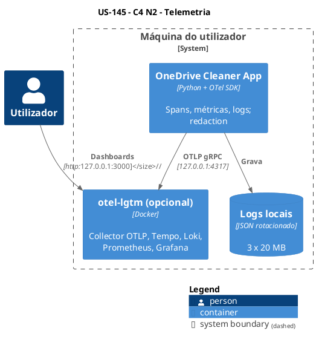

**Sequência — export com collector disponível e indisponível**

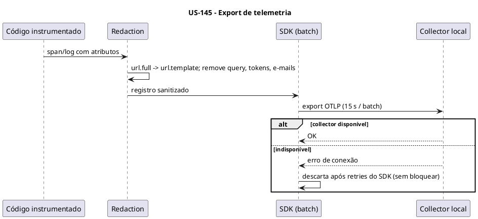

### Sequenciamento de Tarefas

| # | Tarefa | Escopo | Depende de |
|---|---|---|---|
| TF-145-01 | Bootstrap do OpenTelemetry e instrumentações automáticas | Telemetria (setup) | TF-144-05 |
| TF-145-02 | Redaction de dados sensíveis e logs estruturados | Telemetria (segurança) | TF-145-01 |
| TF-145-03 | Catálogo de métricas canônico | Telemetria (métricas) | TF-145-01 |
| TF-145-04 | Stack local, dashboards e alertas | Observabilidade (infra local) | TF-145-03 |

### Tarefas

#### TF-145-01: [one-drive-cleaner] Bootstrap do OpenTelemetry e instrumentações automáticas

**User Story:** US-145 · **Épico:** E-ODC · **Sistema:** one-drive-cleaner · **Prioridade:** P0
**Complexidade:** C2 — Média · **Modelo sugerido:** Claude Sonnet 5.5 (`claude-sonnet-5-5`), esforço médio · **Escalonar para:** Opus 5.5
**Justificativa:** configuração de 3 providers, instrumentações e comportamento não bloqueante; testes com exportadores em memória.

##### 1. Descrição e Objetivo

> **Eu como** aplicação,
> **Eu quero** inicializar traces, métricas e logs OpenTelemetry com resource e exportador OTLP local configuráveis,
> **Para que** todos os módulos instrumentem sem configurar nada por conta própria.

*Contexto Arquitetural:* plan 5.3.1 e 5.3.2.

##### 2. Especificação Técnica

**2.1 Pontos de Interceptação**
- `src/odc/telemetry/setup.py` — `init_telemetry(settings, version) -> TelemetryHandle`: resource (`service.name=onedrive-cleaner`, `service.version`, `deployment.environment=local`, `host.arch`); `TracerProvider` (BatchSpanProcessor; sampler via `OTEL_TRACES_SAMPLER`, padrão `parentbased_always_on`); `MeterProvider` (PeriodicExportingMetricReader 15 s); `LoggerProvider` (BatchLogRecordProcessor) + `LoggingHandler`; exportadores OTLP gRPC para `otel_endpoint`; `otel_enabled=false` → providers no-op; `shutdown()` com timeout de 5 s.
- `src/odc/telemetry/instrument.py` — instrumenta FastAPI (exclui `/healthz` e estáticos), httpx (hooks de redaction plugáveis da TF-145-02) e system metrics.
- `src/odc/telemetry/tracing.py` — helpers `start_job_span(name, traceparent, attributes)` (link para o span de origem) e `current_traceparent()`.
- `src/odc/bootstrap.py` — chama `init_telemetry` antes de criar o app; `shutdown` no encerramento.
- Testes `tests/unit/telemetry/` com `InMemorySpanExporter`, `InMemoryMetricReader`, `InMemoryLogExporter`.

**2.2 Dados e Persistência:** não se aplica.

**2.3 Contrato de Dados:** `otel_endpoint` validado como URL de loopback (`127.0.0.1`, `localhost`, `::1`); caso contrário rejeitado.

**2.4 Resiliência e Zero Trust**

| Cenário de Falha | Estratégia | Impacto |
|---|---|---|
| Collector fora | Export em batch, timeouts curtos (5 s), sem retry bloqueante | Nenhum |
| Endpoint não-loopback configurado | Rejeitado na validação | Telemetria não sai da máquina |
| Shutdown travado | Timeout de 5 s | Encerramento garantido |

##### 3. Modelagem Visual
Coberta pelos diagramas da US-145.

##### 4. Orientação de Execução

**4.1 Contexto de Entrada:** plan 5.3.1, 5.3.2; `src/odc/bootstrap.py`; `src/odc/web/app.py`.

**4.2 Passos de Implementação**
1. Adicionar `opentelemetry-sdk`, `opentelemetry-exporter-otlp-proto-grpc`, `opentelemetry-instrumentation-fastapi`, `-httpx`, `-logging`, `-system-metrics`.
2. Implementar `setup.py`, `instrument.py`, `tracing.py` com testes.
3. Integrar no bootstrap.

**4.3 Comando de Validação**
```bash
uv run pytest tests/unit/telemetry -q && make lint-python
```

**4.4 Restrições Negativas**
- NÃO usar exporters de console em produção.
- NÃO registrar atributos fora do catálogo.

**4.5 Skills Obrigatórias:** `test-driven-agentic-development`, `commit-message`.

**4.6 Critérios de Saída**
- [ ] Validação 4.3 verde; cobertura ≥ 90%.

##### 5. Testes de Aceitação (DoD)
- [ ] Requisição a `/api/session` gera span com `http.route`; `/healthz` não gera.
- [ ] `start_job_span` com `traceparent` cria link para o span de origem.
- [ ] Endpoint inalcançável não aumenta a latência de requisições (teste com endpoint fechado).
- [ ] `otel_enabled=false` não exporta nada.

---

#### TF-145-02: [one-drive-cleaner] Redaction de dados sensíveis e logs estruturados

**User Story:** US-145 · **Épico:** E-ODC · **Sistema:** one-drive-cleaner · **Prioridade:** P0
**Complexidade:** C3 — Alta · **Modelo sugerido:** Claude Sonnet 5.5 (`claude-sonnet-5-5`), esforço alto · **Escalonar para:** Opus 5.5
**Justificativa:** controle de privacidade (RN-24): falha aqui vaza tokens ou URLs pré-autenticadas; exige cobertura exaustiva de padrões.

##### 1. Descrição e Objetivo

> **Eu como** utilizador,
> **Eu quero** que logs e telemetria nunca contenham tokens, URLs pré-autenticadas, caminhos, nomes de arquivo ou e-mail,
> **Para que** minha privacidade seja preservada mesmo ao compartilhar logs para diagnóstico.

*Contexto Arquitetural:* plan 5.3.1 (redaction) e 5.3.4 (logs).

##### 2. Especificação Técnica

**2.1 Pontos de Interceptação**
- `src/odc/telemetry/redaction.py` — `template_graph_url(url) -> str` (substitui IDs por `{id}`, tamanhos por `{size}`, remove query; para host diferente de `graph.microsoft.com` retorna apenas o host); `scrub_text(text) -> str` (remove `Bearer …`, `access_token=…`, `refresh_token=…`, `tempauth=…`, `code=…`, e-mails, URLs com query); hooks `httpx_request_hook`/`httpx_response_hook` que ajustam atributos do span (`url.full` → removido; `url.template`, `server.address`, `odc.graph.operation`).
- `src/odc/telemetry/logging.py` — `configure_logging(settings)`: formatter JSON (`timestamp`, `level`, `event.name`, `trace_id`, `span_id`, campos extras permitidos), `RotatingFileHandler` (20 MB × 3) em `logs_dir`, `RedactionFilter` aplicando `scrub_text` em mensagem e extras; bridge OTel.
- `src/odc/telemetry/attributes.py` — allowlist de chaves de atributos (`odc.*` do plan 5.3.2/5.3.3 + semânticas padrão); atributos fora da allowlist são descartados com contador interno.
- Testes `tests/unit/telemetry/test_redaction.py`, `test_logging.py`, `test_attributes.py`.

**2.2 Dados e Persistência:** arquivos de log em `~/Library/Logs/OneDriveCleaner/`.

**2.3 Contrato de Dados — exemplos de template**

| Entrada | Saída |
|---|---|
| `https://graph.microsoft.com/v1.0/me/drive/items/ABC!123/thumbnails/0/c384x384/content` | `/me/drive/items/{id}/thumbnails/{n}/{size}/content` |
| `https://graph.microsoft.com/v1.0/me/drive/items/ABC!1/delta?token=xyz` | `/me/drive/items/{id}/delta` |
| `https://xyz.files.1drv.com/y4m...?tempauth=...` | `server.address = xyz.files.1drv.com` |

**2.4 Resiliência e Zero Trust**

| Cenário de Falha | Estratégia | Impacto |
|---|---|---|
| Novo padrão de URL não previsto | Fallback: remove path inteiro e mantém só host | Nunca vaza |
| Exceção dentro do filtro | Filtro captura e substitui a mensagem por `"[redaction_error]"` | Log preservado sem dado sensível |

##### 3. Modelagem Visual
Coberta pela sequência da US-145.

##### 4. Orientação de Execução

**4.1 Contexto de Entrada:** plan 5.3.1, 5.3.4; `src/odc/telemetry/instrument.py`.

**4.2 Passos de Implementação**
1. Testes parametrizados primeiro (≥ 30 casos: URLs Graph, CDN, tokens, e-mails, caminhos macOS `/Users/...`, nomes `IMG_1234.jpg`).
2. Implementar `redaction.py`, `attributes.py`, `logging.py`.
3. Conectar hooks no `instrument.py`.

**4.3 Comando de Validação**
```bash
uv run pytest tests/unit/telemetry -q && make lint-python
```

**4.4 Restrições Negativas**
- NÃO registrar `exc_info` com variáveis locais (sem `stack_info` com valores).
- NÃO logar corpo de requisição/resposta da Graph.

**4.5 Skills Obrigatórias:** `test-driven-agentic-development`, `commit-message`.

**4.6 Critérios de Saída**
- [ ] Validação 4.3 verde; cobertura ≥ 95% em `redaction.py`.

##### 5. Testes de Aceitação (DoD)
- [ ] Nenhum dos 30+ casos sensíveis aparece na saída.
- [ ] Log JSON contém `trace_id` quando há span ativo.
- [ ] Rotação cria no máximo 3 arquivos de 20 MB.
- [ ] Atributo fora da allowlist é descartado.

---

#### TF-145-03: [one-drive-cleaner] Catálogo de métricas canônico

**User Story:** US-145 · **Épico:** E-ODC · **Sistema:** one-drive-cleaner · **Prioridade:** P0
**Complexidade:** C2 — Média · **Modelo sugerido:** Claude Sonnet 5.5 (`claude-sonnet-5-5`), esforço médio · **Escalonar para:** Opus 5.5
**Justificativa:** ~47 instrumentos com nomes, unidades e atributos exatos; gauges observáveis com callbacks registráveis; baixa ambiguidade, alto volume.

##### 1. Descrição e Objetivo

> **Eu como** módulo de domínio,
> **Eu quero** instrumentos de métrica pré-definidos e tipados conforme o catálogo,
> **Para que** a emissão seja consistente e validável por teste.

*Contexto Arquitetural:* plan 5.3.3 (catálogo canônico).

##### 2. Especificação Técnica

**2.1 Pontos de Interceptação**
- `src/odc/telemetry/metrics.py` — classe `Metrics` criada a partir do `Meter` com um atributo por instrumento do plan 5.3.3 (nomes, tipos, unidades UCUM, descrição PT-BR); enums `GraphOperation`, `JobType`, `ItemState`, `Stage`, `ExtractFailure`, etc. para atributos; funções `record_*` tipadas que só aceitam esses enums (impede cardinalidade aberta).
- `src/odc/telemetry/observables.py` — registro de callbacks para gauges observáveis (`odc.items.by_state`, `odc.pipeline.backlog`, `odc.review.queue`, `odc.model.labels`, `odc.quarantine.items`, `odc.quarantine.bytes`, `odc.journal.pending`, `odc.disk.usage`, `odc.scan.last_success`) via interface `ObservableSource` implementada pelos módulos.
- `tests/unit/telemetry/test_metrics_catalog.py` — compara instrumentos registrados com uma tabela esperada (nome, tipo, unidade) extraída do plan 5.3.3.

**2.2 Dados e Persistência:** não se aplica (callbacks leem repositórios nas US seguintes).

**2.3 Contrato de Dados:** tabela do plan 5.3.3.

**2.4 Resiliência e Zero Trust**

| Cenário de Falha | Estratégia | Impacto |
|---|---|---|
| Callback observável lança exceção | Capturada; observação omitida; log WARN | Coleta continua |
| Callback lento (banco ocupado) | Timeout de 2 s por callback | Sem travar o reader |

##### 3. Modelagem Visual
Não se aplica.

##### 4. Orientação de Execução

**4.1 Contexto de Entrada:** plan 5.3.3; `src/odc/telemetry/setup.py`.

**4.2 Passos de Implementação**
1. Teste de catálogo com a tabela esperada.
2. Implementar `metrics.py` e `observables.py`.

**4.3 Comando de Validação**
```bash
uv run pytest tests/unit/telemetry/test_metrics_catalog.py tests/unit/telemetry/test_observables.py -q
```

**4.4 Restrições Negativas**
- NÃO aceitar `str` livre como valor de atributo de métrica.

**4.5 Skills Obrigatórias:** `test-driven-agentic-development`, `commit-message`.

**4.6 Critérios de Saída**
- [ ] Teste de catálogo verde: 100% dos instrumentos do plan 5.3.3 presentes com tipo e unidade corretos.

##### 5. Testes de Aceitação (DoD)
- [ ] `record_graph_request(operation=GraphOperation.DELTA, status_code=200, duration_s=0.3)` gera contador e histograma corretos.
- [ ] Callback com exceção não interrompe a coleta dos demais.

---

#### TF-145-04: [one-drive-cleaner] Stack local, dashboards e alertas

**User Story:** US-145 · **Épico:** E-ODC · **Sistema:** one-drive-cleaner · **Prioridade:** P2
**Complexidade:** C2 — Média · **Modelo sugerido:** Claude Sonnet 5.5 (`claude-sonnet-5-5`), esforço médio · **Escalonar para:** Opus 5.5
**Justificativa:** JSON de dashboards e regras de alerta com PromQL/LogQL corretos para os nomes OTel convertidos para Prometheus.

##### 1. Descrição e Objetivo

> **Eu como** utilizador,
> **Eu quero** subir com um comando uma stack local com dashboards e alertas prontos,
> **Para que** eu acompanhe operação e modelo visualmente.

*Contexto Arquitetural:* plan 5.3.5. A tela Métricas da aplicação (US-156) funciona sem esta stack.

##### 2. Especificação Técnica

**2.1 Pontos de Interceptação**
- `deploy/observability/docker-compose.yml` — serviço `grafana/otel-lgtm` (tag fixa), portas publicadas apenas em `127.0.0.1` (`4317`, `4318`, `3000`), volume nomeado para dados.
- `deploy/observability/grafana/dashboards/operacao.json` e `modelo.json` — painéis do plan 5.3.5 (nomes Prometheus: `odc_graph_requests_total`, `odc_graph_request_duration_seconds_bucket`, etc.).
- `deploy/observability/grafana/provisioning/` — datasources, dashboards e regras de alerta (6 alertas do plan 5.3.5).
- `Makefile` — `obs-up`, `obs-down`.
- `tests/unit/deploy/test_dashboards.py` — valida JSON (estrutura, cada métrica referenciada existe no catálogo da TF-145-03).
- `README.md` — seção "Monitoramento local".

**2.2 Dados e Persistência:** volume Docker local.

**2.3 Contrato de Dados:** regras de alerta conforme plan 5.3.5.

**2.4 Resiliência e Zero Trust**

| Cenário de Falha | Estratégia | Impacto |
|---|---|---|
| Docker indisponível | Documentado; app segue sem stack | Nenhum |
| Exposição de portas na rede | Bind explícito em `127.0.0.1` | Acesso só local |

##### 3. Modelagem Visual
Coberta pelo C4 N2 da US-145.

##### 4. Orientação de Execução

**4.1 Contexto de Entrada:** plan 5.3.3, 5.3.5; `src/odc/telemetry/metrics.py`.

**4.2 Passos de Implementação**
1. Compose com bind local.
2. Dashboards e alertas.
3. Teste que cruza métricas usadas nos painéis com o catálogo.
4. Smoke manual: `make obs-up`, `odc`, verificar painéis.

**4.3 Comando de Validação**
```bash
uv run pytest tests/unit/deploy -q && docker compose -f deploy/observability/docker-compose.yml config -q
```

**4.4 Restrições Negativas**
- NÃO publicar portas em `0.0.0.0`.

**4.5 Skills Obrigatórias:** `enable-docker-server` (se o Docker estiver parado), `expert-sre`, `commit-message`.

**4.6 Critérios de Saída**
- [ ] Validação 4.3 verde; painéis exibem dados após smoke manual.

##### 5. Testes de Aceitação (DoD)
- [ ] Toda métrica referenciada nos dashboards existe no catálogo.
- [ ] Os 6 alertas carregados no Grafana.

---

## US-146: Login com conta Microsoft pessoal

**Épico:** E-ODC — OneDrive Cleaner MVP
**Sistema:** one-drive-cleaner
**Estimativa:** 5 Story Points
**Prioridade:** P0

### Narrativa de Valor

> **Eu como** utilizador,
> **Eu quero** entrar com minha conta Microsoft pessoal e autorizar o acesso aos meus arquivos,
> **Para que** a aplicação acesse meu OneDrive sem armazenar senha nem expor tokens.

### Contexto de Negócio

Primeiro passo da J1. Somente contas pessoais (RN-01), uma conta ativa por vez com registros isolados.

### Critérios de Aceitação (Nível de Negócio)

- [ ] Login abre a página da Microsoft, retorna à aplicação e exibe o nome da conta.
- [ ] Conta corporativa é recusada com mensagem clara.
- [ ] Tokens ficam apenas no Keychain; logout remove o cache da conta.
- [ ] Token expirado é renovado sem interação; revogado leva à tela de login sem perda de progresso.

### Regras de Negócio Aplicáveis

| # | Regra | Tipo |
|---|---|---|
| RN-01 | Somente contas pessoais; uma conta ativa por vez; registros isolados | Restritiva |
| RN-24 | Tokens e e-mail nunca em logs/telemetria | Restritiva |

### Diagramas

**C4 N2 — Autenticação**

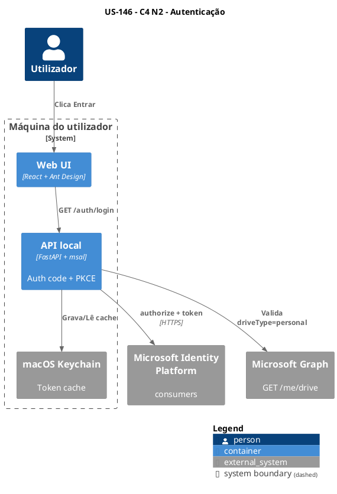

**Sequência — login, recusa e renovação**

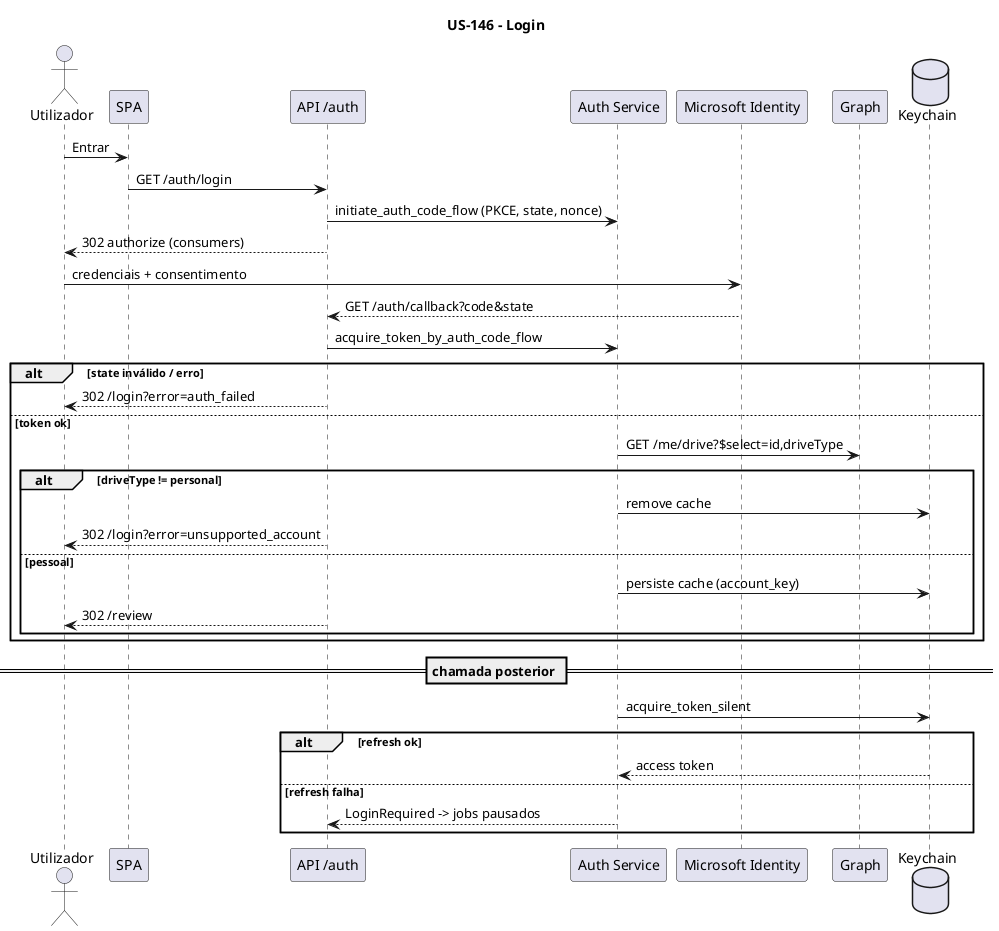

### Sequenciamento de Tarefas

| # | Tarefa | Escopo | Depende de |
|---|---|---|---|
| TF-146-01 | Serviço de autenticação MSAL com cache no Keychain | Autenticação | TF-144-01, TF-145-02 |
| TF-146-02 | Rotas de login, callback e logout | API | TF-146-01, TF-144-04 |
| TF-146-03 | Tela de login e tratamento de sessão expirada | Front | TF-146-02, TF-144-06 |

### Tarefas

#### TF-146-01: [one-drive-cleaner] Serviço de autenticação MSAL com cache no Keychain

**User Story:** US-146 · **Épico:** E-ODC · **Sistema:** one-drive-cleaner · **Prioridade:** P0
**Complexidade:** C3 — Alta · **Modelo sugerido:** Claude Sonnet 5.5 (`claude-sonnet-5-5`), esforço alto · **Escalonar para:** Opus 5.5
**Justificativa:** fluxo OAuth com PKCE, persistência segura de tokens e estados de erro; impacto direto em segurança.

##### 1. Descrição e Objetivo

> **Eu como** aplicação,
> **Eu quero** obter e renovar tokens de acesso da conta pessoal com cache seguro,
> **Para que** o cliente Graph tenha um token válido sem nunca armazenar credenciais em arquivo ou banco.

*Contexto Arquitetural:* plan 4.2 (scopes), 5.2 (autenticação, tokens), 3.4 (`account_key`).

##### 2. Especificação Técnica

**2.1 Pontos de Interceptação**
- `src/odc/auth/service.py` — `AuthService` com `PublicClientApplication(client_id, authority="https://login.microsoftonline.com/consumers", token_cache=...)`; métodos: `begin_login(redirect_uri) -> AuthFlow` (persistido em memória por `state`, TTL 10 min), `complete_login(flow_state, query_params) -> Account`, `get_access_token() -> str` (silent; lança `LoginRequired(reason)`), `logout()`, `active_account() -> Account | None`.
- `src/odc/auth/token_cache.py` — `PersistedTokenCache` com `KeychainPersistence` (`msal-extensions`), serviço `OneDriveCleaner`, conta = `account_key`.
- `src/odc/auth/models.py` — `Account(account_key: str, display_name: str)` (sem e-mail persistido).
- `src/odc/auth/drive_check.py` — após login, `GET /me/drive?$select=id,driveType` via httpx simples com timeout (5/15 s); `driveType != "personal"` → `UnsupportedAccount`.
- Métricas: `odc.auth.token_refresh{result}`, `odc.auth.login_required{reason}`.
- Testes `tests/unit/auth/` com `msal` mockado (sem rede) e persistência fake.

**2.2 Dados e Persistência:** Keychain; `app_meta.account_key` e `drive_id` gravados no banco da conta.

**2.3 Contrato de Dados**
```json
{
  "scopes": ["Files.ReadWrite", "offline_access"],
  "redirect_uri": "http://localhost:<port>/auth/callback",
  "LoginRequired.reason": "expired | revoked | missing"
}
```

**2.4 Resiliência e Zero Trust**

| Cenário de Falha | Estratégia | Impacto |
|---|---|---|
| `state` desconhecido/expirado | `AuthStateError` | Login refeito |
| Refresh token revogado | `LoginRequired("revoked")` + métrica | Jobs pausam (US-148) |
| Keychain inacessível | Erro explícito; nenhum fallback para arquivo | Login indisponível com mensagem |
| `client_id` ausente | `ConfigurationError` com instrução | Tela de login orienta configuração |

##### 3. Modelagem Visual
Coberta pelos diagramas da US-146.

##### 4. Orientação de Execução

**4.1 Contexto de Entrada:** plan 4.2, 5.2; `src/odc/config.py`; `src/odc/telemetry/metrics.py`.

**4.2 Passos de Implementação**
1. Adicionar `msal`, `msal-extensions`.
2. Testes dos fluxos (sucesso, state inválido, conta corporativa, refresh, revogação, logout).
3. Implementar módulos.

**4.3 Comando de Validação**
```bash
uv run pytest tests/unit/auth -q && make lint-python
```

**4.4 Restrições Negativas**
- NÃO persistir token, e-mail ou `id_token` em banco/log.
- NÃO usar device code flow nem client secret.

**4.5 Skills Obrigatórias:** `test-driven-agentic-development`, `commit-message`.

**4.6 Critérios de Saída**
- [ ] Validação 4.3 verde; cobertura ≥ 90%.

##### 5. Testes de Aceitação (DoD)
- [ ] PKCE e `state` presentes na URL de autorização gerada.
- [ ] Conta com `driveType=business` é recusada e o cache removido.
- [ ] `get_access_token` sem conta → `LoginRequired("missing")`.
- [ ] Nenhum log contém token (verificado com o filtro da TF-145-02 ativo).

---

#### TF-146-02: [one-drive-cleaner] Rotas de login, callback e logout

**User Story:** US-146 · **Épico:** E-ODC · **Sistema:** one-drive-cleaner · **Prioridade:** P0
**Complexidade:** C2 — Média · **Modelo sugerido:** Claude Sonnet 5.5 (`claude-sonnet-5-5`), esforço médio · **Escalonar para:** Opus 5.5
**Justificativa:** rotas finas sobre o serviço, mas com redirecionamentos e erros que precisam ser seguros (sem open redirect).

##### 1. Descrição e Objetivo

> **Eu como** utilizador,
> **Eu quero** iniciar login, voltar da Microsoft e sair pela interface,
> **Para que** o fluxo de conta funcione de ponta a ponta.

*Contexto Arquitetural:* plan 4.1 (`/auth/*`, `/api/session`).

##### 2. Especificação Técnica

**2.1 Pontos de Interceptação**
- `src/odc/web/routes/auth.py` — `GET /auth/login` (302 para Microsoft), `GET /auth/callback` (valida `state`, conclui, 302 para `/review` ou `/login?error=<code>`), `POST /auth/logout` (CSRF; 204).
- `src/odc/web/routes/system.py` — `/api/session` passa a refletir `AuthService.active_account()` e `auth_state`.
- `src/odc/web/deps.py` — dependência `require_account` (lança `AppError(LOGIN_REQUIRED, 401)`).
- Testes `tests/unit/web/test_auth_routes.py`.

**2.2 Dados e Persistência:** troca de banco ativo ao logar com outra conta (isolamento RN-01).

**2.3 Contrato de Dados:** `error` em `/login?error=` ∈ `auth_failed | unsupported_account | not_configured` (lista fechada; nunca texto livre vindo do provedor).

**2.4 Resiliência e Zero Trust**

| Cenário de Falha | Estratégia | Impacto |
|---|---|---|
| Parâmetros extras/maliciosos no callback | Ignorados; só `code`/`state`/`error` lidos | Sem injeção |
| Open redirect | Destinos fixos (`/review`, `/login`) | Bloqueado |
| Logout sem CSRF | 403 | Bloqueado |

##### 3. Modelagem Visual
Coberta pela sequência da US-146.

##### 4. Orientação de Execução

**4.1 Contexto de Entrada:** `src/odc/auth/service.py`, `src/odc/web/app.py`.

**4.2 Passos de Implementação**
1. Testes com `AuthService` fake.
2. Implementar rotas e dependência.
3. Regenerar contrato (`make contract`).

**4.3 Comando de Validação**
```bash
uv run pytest tests/unit/web/test_auth_routes.py -q && make contract
```

**4.4 Restrições Negativas**
- NÃO refletir a mensagem de erro do provedor na URL.

**4.5 Skills Obrigatórias:** `test-driven-agentic-development`, `commit-message`.

**4.6 Critérios de Saída**
- [ ] Validação 4.3 verde; cobertura ≥ 90%.

##### 5. Testes de Aceitação (DoD)
- [ ] Callback com `state` inválido → `/login?error=auth_failed`.
- [ ] Logout limpa a conta e `/api/session` retorna `login_required`.
- [ ] Rota protegida sem conta → 401 `LOGIN_REQUIRED`.

---

#### TF-146-03: [one-drive-cleaner] Tela de login e tratamento de sessão expirada

**User Story:** US-146 · **Épico:** E-ODC · **Sistema:** one-drive-cleaner · **Prioridade:** P0
**Complexidade:** C1 — Baixa · **Modelo sugerido:** Claude Haiku 5.5 (`claude-haiku-5-5`) · **Escalonar para:** Sonnet 5.5
**Justificativa:** tela simples com `Result`/`Button`/`Alert` e mapeamento de 3 erros fechados.

##### 1. Descrição e Objetivo

> **Eu como** utilizador,
> **Eu quero** uma tela de entrada clara e um aviso quando a sessão expirar,
> **Para que** eu saiba quando e como reconectar minha conta.

*Contexto Arquitetural:* plan 9.1, 9.2 (Login / primeira configuração).

##### 2. Especificação Técnica

**2.1 Pontos de Interceptação**
- `frontend/src/pages/Login/LoginPage.tsx` — `Result` com explicação de privacidade, `Button` "Entrar com conta Microsoft" (navega para `/auth/login`), `Alert` por código de `?error=` (`auth_failed`, `unsupported_account` "Somente contas pessoais", `not_configured` com instrução do `ODC_CLIENT_ID`).
- `frontend/src/app/AppLayout.tsx` — `Banner`/`Alert` global quando `auth_state = login_required` com botão "Reconectar"; menu de conta com "Sair" (`POST /auth/logout`).
- Testes co-localizados.

**2.2 Dados e Persistência:** não se aplica.

**2.3 Contrato de Dados:** `/api/session` (TF-146-02).

**2.4 Resiliência e Zero Trust**

| Cenário de Falha | Estratégia | Impacto |
|---|---|---|
| `error` desconhecido na URL | Mensagem genérica; valor não renderizado | Sem injeção de conteúdo |

##### 3. Modelagem Visual
Coberta pela sequência da US-146.

##### 4. Orientação de Execução

**4.1 Contexto de Entrada:** `frontend/src/api/useSession.ts`, `frontend/src/app/AppLayout.tsx`.

**4.2 Passos de Implementação**
1. Testes (RTL + MSW) para os 3 erros, botão e logout.
2. Implementar página e banner.

**4.3 Comando de Validação**
```bash
pnpm --dir frontend vitest run src/pages/Login src/app --coverage && pnpm --dir frontend lint
```

**4.4 Restrições Negativas**
- NÃO renderizar o valor bruto de `?error=`.

**4.5 Skills Obrigatórias:** `test-driven-agentic-development`, `expert-lsp`, `commit-message`.

**4.6 Critérios de Saída**
- [ ] Validação 4.3 verde; cobertura ≥ 90/85.

##### 5. Testes de Aceitação (DoD)
- [ ] Cada código de erro exibe a mensagem correspondente.
- [ ] Banner aparece quando a sessão vira `login_required`.
- [ ] "Sair" chama o logout e volta para `/login`.

---

## US-147: Integração resiliente com o OneDrive

**Épico:** E-ODC — OneDrive Cleaner MVP
**Sistema:** one-drive-cleaner
**Estimativa:** 8 Story Points
**Prioridade:** P0

### Narrativa de Valor

> **Eu como** utilizador com milhares de imagens,
> **Eu quero** que a aplicação converse com o OneDrive respeitando limites de uso e se recupere de falhas,
> **Para que** varreduras e ações sobre 50 mil itens concluam sem erros manuais nem bloqueios da Microsoft.

### Contexto de Negócio

Todas as jornadas dependem da Graph. Os casos de borda da spec 4 (limitação de taxa, rede, autorização, dados malformados) concentram-se aqui.

### Critérios de Aceitação (Nível de Negócio)

- [ ] Respostas 429/503 são respeitadas (`Retry-After`) e a concorrência se ajusta automaticamente.
- [ ] Falha de rede é tentada até 5 vezes com espera crescente; 4xx não é repetido.
- [ ] Respostas malformadas não derrubam o processamento (campos inválidos tratados como ausentes).
- [ ] Graph fake reproduz delta, 410, 429, 401, 404, 409 e 412 para os testes de todas as US seguintes.

### Regras de Negócio Aplicáveis

| # | Regra | Tipo |
|---|---|---|
| RN-02 | Nenhuma imagem enviada a terceiros (somente operações no OneDrive) | Restritiva |
| RN-21 | Somente mover, renomear em conflito e enviar à lixeira | Restritiva |
| spec 4 | Limitação de taxa, rede, autorização, dados malformados | Obrigatória |

### Diagramas

**C4 N2 — Integração Graph**

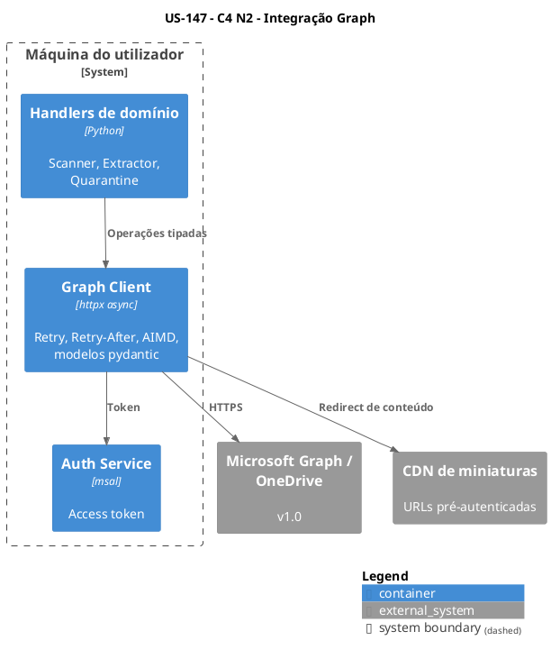

**Sequência — retry, throttling e renovação**

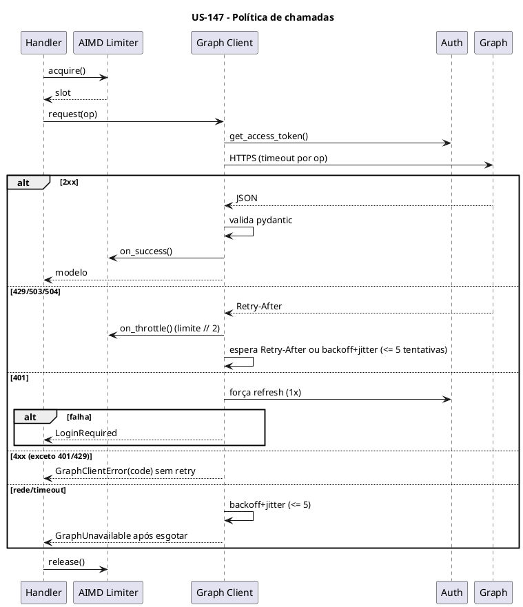

### Sequenciamento de Tarefas

| # | Tarefa | Escopo | Depende de |
|---|---|---|---|
| TF-147-01 | Modelos de resposta da Graph (Zero Trust) | Contrato | TF-143-02 |
| TF-147-02 | Política de retry, backoff e renovação de token | Resiliência HTTP | TF-147-01, TF-146-01, TF-145-03 |
| TF-147-03 | Limitador de concorrência adaptativo (AIMD) | Concorrência | TF-145-03 |
| TF-147-04 | Operações de alto nível do OneDrive | Integração | TF-147-02, TF-147-03 |
| TF-147-05 | Graph fake (in-process e servidor HTTP) | Infra de teste | TF-147-01 |

### Tarefas

#### TF-147-01: [one-drive-cleaner] Modelos de resposta da Graph (Zero Trust)

**User Story:** US-147 · **Épico:** E-ODC · **Sistema:** one-drive-cleaner · **Prioridade:** P0
**Complexidade:** C1 — Baixa · **Modelo sugerido:** Claude Haiku 5.5 (`claude-haiku-5-5`) · **Escalonar para:** Sonnet 5.5
**Justificativa:** modelos pydantic declarativos com regras de tolerância bem definidas.

##### 1. Descrição e Objetivo

> **Eu como** cliente Graph,
> **Eu quero** modelos que validem respostas e tratem campos malformados como ausentes,
> **Para que** dados externos nunca sejam usados sem validação.

*Contexto Arquitetural:* plan 4.2 (campos `$select`), spec 4 (metadados malformados).

##### 2. Especificação Técnica

**2.1 Pontos de Interceptação**
- `src/odc/graph/models.py` — `ParentReference(id, path?, drive_id?)`, `FileFacet(mime_type)`, `ImageFacet(width?, height?)`, `PhotoFacet(camera_make?, camera_model?, taken_datetime?)`, `DriveItem(id, name, size, c_tag, e_tag, created_datetime, last_modified_datetime, parent_reference, file?, folder?, image?, photo?, location_present: bool, deleted: bool)`, `DeltaPage(items, next_link?, delta_link?)`, `Drive(id, drive_type)`, `ThumbnailUrl(url)`, `BatchResponse`, `GraphErrorBody(code, message)`; aliases camelCase; `extra="ignore"`.
- Validadores: facetas com tipos inválidos → `None` (registra contador interno), dimensões ≤ 0 → `None`, `takenDateTime` inválido → `None`, `mime_type` fora de `image/*` mantém valor (filtro em RN-06 é do scanner).
- Testes `tests/unit/graph/test_models.py` com fixtures JSON em `tests/fixtures/graph/*.json`.

**2.2 Dados e Persistência:** não se aplica.

**2.3 Contrato de Dados:** campos do `$select` do plan 4.2.

**2.4 Resiliência e Zero Trust**

| Cenário de Falha | Estratégia | Impacto |
|---|---|---|
| Faceta com tipo errado | Campo vira `None` | Item processado sem a evidência |
| `id` ausente | `ValidationError` → item descartado com log WARN (sem nome) | Item ignorado |

##### 3. Modelagem Visual
Não se aplica.

##### 4. Orientação de Execução

**4.1 Contexto de Entrada:** plan 4.2; documentação pública do recurso `driveItem`.

**4.2 Passos de Implementação**
1. Fixtures JSON (válidas, malformadas, deletadas, pasta, não-imagem).
2. Testes e modelos.

**4.3 Comando de Validação**
```bash
uv run pytest tests/unit/graph/test_models.py -q
```

**4.4 Restrições Negativas**
- NÃO usar `Any` nos modelos.

**4.5 Skills Obrigatórias:** `test-driven-agentic-development`, `commit-message`.

**4.6 Critérios de Saída**
- [ ] Validação 4.3 verde; cobertura ≥ 90%.

##### 5. Testes de Aceitação (DoD)
- [ ] Item com `image.width = "abc"` vira `width=None` sem exceção.
- [ ] Item `deleted` reconhecido.
- [ ] `DeltaPage` lê `@odata.nextLink`/`@odata.deltaLink`.

---

#### TF-147-02: [one-drive-cleaner] Política de retry, backoff e renovação de token

**User Story:** US-147 · **Épico:** E-ODC · **Sistema:** one-drive-cleaner · **Prioridade:** P0
**Complexidade:** C3 — Alta · **Modelo sugerido:** Claude Sonnet 5.5 (`claude-sonnet-5-5`), esforço alto · **Escalonar para:** Opus 5.5
**Justificativa:** código assíncrono com múltiplos caminhos de erro, tempo simulado em testes e interação com autenticação e métricas.

##### 1. Descrição e Objetivo

> **Eu como** handler de domínio,
> **Eu quero** um cliente HTTP que trate throttling, falhas transitórias e expiração de token de forma uniforme,
> **Para que** nenhum handler precise reimplementar resiliência.

*Contexto Arquitetural:* plan 4.2 (política de retry e timeouts), 5.1.

##### 2. Especificação Técnica

**2.1 Pontos de Interceptação**
- `src/odc/graph/http.py` — `GraphHttp(base_url, token_provider, limiter, metrics, clock, sleep)`: `request(op: GraphOperation, method, path, *, params, json, headers, timeout: Timeout, follow_redirects) -> httpx.Response`; retry em 429/503/504 e erros de rede/timeout (máx. 5; `Retry-After` em segundos ou data HTTP; senão `min(60, 2**n) + jitter(0..1)`); 401 → refresh forçado 1x; 4xx demais → `GraphClientError(status, code)`; esgotado → `GraphUnavailable`.
- `src/odc/graph/timeouts.py` — tabela de timeouts por operação do plan 4.2.
- `src/odc/graph/errors.py` — `GraphClientError`, `GraphUnavailable`, `GraphNotFound`, `GraphConflict`, `GraphPreconditionFailed`, `GraphGone`.
- Métricas: `odc.graph.requests`, `odc.graph.request.duration`, `odc.graph.throttled`, `odc.graph.retry_after`, `odc.graph.retries`, `odc.graph.inflight`.
- Testes `tests/unit/graph/test_http.py` com `respx`, relógio e `sleep` injetados (sem esperas reais).

**2.2 Dados e Persistência:** não se aplica.

**2.3 Contrato de Dados:** mapeamento status → exceção: 404 `GraphNotFound`, 409 `GraphConflict`, 410 `GraphGone`, 412 `GraphPreconditionFailed`.

**2.4 Resiliência e Zero Trust**

| Cenário de Falha | Estratégia | Impacto |
|---|---|---|
| `Retry-After` absurdo (> 300 s) | Limitado a 300 s; métrica registra o valor real | Sem espera infinita |
| Corpo de erro não-JSON | `code="unknown"` | Sem crash |
| Redirect para host externo | Permitido só para conteúdo (thumbnail/content); sem enviar `Authorization` ao host externo | Token não vaza |

##### 3. Modelagem Visual
Coberta pela sequência da US-147.

##### 4. Orientação de Execução

**4.1 Contexto de Entrada:** plan 4.2, 5.1; `src/odc/auth/service.py`; `src/odc/telemetry/metrics.py`.

**4.2 Passos de Implementação**
1. Testes para cada ramo do diagrama (incl. 401 → refresh → sucesso e 401 → refresh falha).
2. Implementar `http.py`, `timeouts.py`, `errors.py`.

**4.3 Comando de Validação**
```bash
uv run pytest tests/unit/graph/test_http.py -q && make lint-python
```

**4.4 Restrições Negativas**
- NÃO usar `time.sleep`; usar `sleep` assíncrono injetado.
- NÃO repassar `Authorization` em redirects para hosts não-Graph.

**4.5 Skills Obrigatórias:** `test-driven-agentic-development`, `commit-message`.

**4.6 Critérios de Saída**
- [ ] Validação 4.3 verde; cobertura ≥ 95% em `http.py`.

##### 5. Testes de Aceitação (DoD)
- [ ] 429 com `Retry-After: 7` espera 7 s (relógio simulado) e repete.
- [ ] 5 falhas de rede → `GraphUnavailable`; métrica `retries{outcome=exhausted}`.
- [ ] 400 não é repetido.
- [ ] Redirect para CDN não carrega o cabeçalho `Authorization`.

---

#### TF-147-03: [one-drive-cleaner] Limitador de concorrência adaptativo (AIMD)

**User Story:** US-147 · **Épico:** E-ODC · **Sistema:** one-drive-cleaner · **Prioridade:** P0
**Complexidade:** C3 — Alta · **Modelo sugerido:** Claude Sonnet 5.5 (`claude-sonnet-5-5`), esforço alto · **Escalonar para:** Opus 5.5
**Justificativa:** primitiva de concorrência assíncrona com redução/aumento dinâmico de limite; erros causam deadlock ou rajadas.

##### 1. Descrição e Objetivo

> **Eu como** Graph Client,
> **Eu quero** um limite de requisições simultâneas que cai pela metade em throttling e sobe aos poucos em sucesso,
> **Para que** varreduras de 50 mil itens maximizem vazão sem violar limites da Microsoft.

*Contexto Arquitetural:* plan 4.2 (AIMD: inicial 4, mínimo 1, máximo 16, +1 a cada 50 sucessos consecutivos).

##### 2. Especificação Técnica

**2.1 Pontos de Interceptação**
- `src/odc/graph/limiter.py` — `AimdLimiter(initial=4, minimum=1, maximum=16, increase_after=50)`: `async with limiter.slot()`, `on_success()`, `on_throttle()`; redução não cancela requisições em andamento (novas aguardam até `inflight < limit`); métrica `odc.graph.concurrency.limit` a cada mudança.
- Testes `tests/unit/graph/test_limiter.py` (concorrência real com `asyncio`, sem rede; propriedades: nunca excede o limite vigente, nunca abaixo de 1, sem deadlock).

**2.2 Dados e Persistência:** não se aplica.

**2.3 Contrato de Dados:** não se aplica.

**2.4 Resiliência e Zero Trust**

| Cenário de Falha | Estratégia | Impacto |
|---|---|---|
| Exceção dentro do `slot` | Slot liberado em `finally` | Sem vazamento de slots |
| Cancelamento da task | Liberação garantida | Sem deadlock |

##### 3. Modelagem Visual
Coberta pela sequência da US-147.

##### 4. Orientação de Execução

**4.1 Contexto de Entrada:** plan 4.2.

**4.2 Passos de Implementação**
1. Testes de propriedade (200 tarefas concorrentes com throttles aleatórios determinísticos por seed).
2. Implementar com `asyncio.Condition`.

**4.3 Comando de Validação**
```bash
uv run pytest tests/unit/graph/test_limiter.py -q
```

**4.4 Restrições Negativas**
- NÃO usar threads; somente asyncio.

**4.5 Skills Obrigatórias:** `test-driven-agentic-development`, `commit-message`.

**4.6 Critérios de Saída**
- [ ] Validação 4.3 verde; cobertura 100% em `limiter.py`.

##### 5. Testes de Aceitação (DoD)
- [ ] Throttle com limite 8 → 4; 50 sucessos → 5.
- [ ] Nunca há mais tarefas em execução que o limite vigente.
- [ ] Cancelar tarefas não reduz a capacidade permanentemente.

---

#### TF-147-04: [one-drive-cleaner] Operações de alto nível do OneDrive

**User Story:** US-147 · **Épico:** E-ODC · **Sistema:** one-drive-cleaner · **Prioridade:** P0
**Complexidade:** C2 — Média · **Modelo sugerido:** Claude Sonnet 5.5 (`claude-sonnet-5-5`), esforço médio · **Escalonar para:** Opus 5.5
**Justificativa:** 11 operações finas sobre `GraphHttp`, com tratamento específico de 409 e `$batch`.

##### 1. Descrição e Objetivo

> **Eu como** handler de domínio,
> **Eu quero** operações tipadas para drive, pastas, delta, miniaturas, mover, criar pasta e excluir,
> **Para que** a lógica de negócio não conheça URLs nem formatos da Graph.

*Contexto Arquitetural:* plan 4.2 (tabela de chamadas).

##### 2. Especificação Técnica

**2.1 Pontos de Interceptação**
- `src/odc/graph/client.py` — `GraphClient` com: `get_drive()`, `get_camera_roll()`, `list_child_folders(parent_id)`, `iter_delta(root_id, start_link?) -> AsyncIterator[DeltaPage]`, `get_thumbnail_bytes(item_id, size) -> bytes` (limite 10 MB lido em memória), `download_content(item_id, dest_path, max_bytes=50 MB)`, `get_thumbnail_urls(item_ids ≤ 20) -> dict[str, str]` (via `$batch`; erros individuais → ausentes), `ensure_folder(parent_id, name) -> str` (POST `conflictBehavior=fail`; 409 → GET por caminho), `move(item_id, parent_id, name?) -> DriveItem` (409 → `GraphConflict` para o chamador tratar), `delete(item_id, etag)`, `get_item(item_id)`.
- Testes `tests/unit/graph/test_client.py` com `respx`.

**2.2 Dados e Persistência:** `download_content` grava somente em `temp_dir()` e remove em erro.

**2.3 Contrato de Dados:** chamadas e `$select` do plan 4.2.

**2.4 Resiliência e Zero Trust**

| Cenário de Falha | Estratégia | Impacto |
|---|---|---|
| Miniatura > 10 MB | `ThumbnailTooLarge` | Item vai para fallback/falha |
| `download_content` excede 50 MB | Aborta stream, remove arquivo, `ContentTooLarge` | Disco protegido |
| Item do `$batch` com erro | Ausente no resultado | UI refaz depois |

##### 3. Modelagem Visual
Coberta pelos diagramas da US-147.

##### 4. Orientação de Execução

**4.1 Contexto de Entrada:** `src/odc/graph/http.py`, `src/odc/graph/models.py`, plan 4.2.

**4.2 Passos de Implementação**
1. Testes por operação (sucesso + erro característico).
2. Implementar `client.py`.

**4.3 Comando de Validação**
```bash
uv run pytest tests/unit/graph/test_client.py -q && make lint-python
```

**4.4 Restrições Negativas**
- NÃO gravar arquivos fora de `temp_dir()`.
- NÃO usar `conflictBehavior=replace` em nenhuma operação.

**4.5 Skills Obrigatórias:** `test-driven-agentic-development`, `commit-message`.

**4.6 Critérios de Saída**
- [ ] Validação 4.3 verde; cobertura ≥ 90%.

##### 5. Testes de Aceitação (DoD)
- [ ] `iter_delta` percorre 3 páginas e entrega o `delta_link` final.
- [ ] `delete` envia `If-Match` com o eTag.
- [ ] `ensure_folder` com 409 retorna o ID existente.
- [ ] `download_content` acima do limite não deixa arquivo no disco.

---

#### TF-147-05: [one-drive-cleaner] Graph fake (in-process e servidor HTTP)

**User Story:** US-147 · **Épico:** E-ODC · **Sistema:** one-drive-cleaner · **Prioridade:** P0
**Complexidade:** C3 — Alta · **Modelo sugerido:** Claude Sonnet 5.5 (`claude-sonnet-5-5`), esforço alto · **Escalonar para:** Opus 5.5
**Justificativa:** simulador com estado (árvore de pastas, delta tokens, eTags, lixeira) e injeção de falhas; base de todos os testes de integração, resiliência, volumetria e E2E.

##### 1. Descrição e Objetivo

> **Eu como** suíte de testes,
> **Eu quero** um OneDrive simulado com estado e falhas configuráveis,
> **Para que** nenhum teste dependa do OneDrive real nem de fotos pessoais.

*Contexto Arquitetural:* plan 10.2, 10.5; `tests/fakes/graph_fake.py` e `graph_server.py`.

##### 2. Especificação Técnica

**2.1 Pontos de Interceptação**
- `tests/fakes/graph_state.py` — `FakeDrive`: árvore de pastas (incl. `special/cameraroll`), itens com facets, `cTag`/`eTag`, lixeira, histórico de mudanças com tokens de delta, geração de imagens sintéticas (Pillow) por tipo (`screenshot`, `photo`, `meme`, `document`) com metadados coerentes; gerador em massa (`populate(n, seed)`).
- `tests/fakes/faults.py` — injeção declarativa: `throttle(op, times, retry_after)`, `fail_network(op, times)`, `gone_delta(root)`, `expire_token()`, `not_found(item)`, `conflict_on_move(name)`, `etag_changed(item)`.
- `tests/fakes/graph_fake.py` — rotas `respx` sobre `FakeDrive` (todas as chamadas do plan 4.2, incl. `$batch` e redirect de conteúdo para host CDN fake).
- `tests/fakes/graph_server.py` — mesmo comportamento como app ASGI (FastAPI) executável em porta aleatória para E2E; endpoint de controle `/__fake__/faults` (apenas no servidor de teste).
- Testes `tests/unit/fakes/test_graph_fake.py` (o fake também é código e precisa de teste).

**2.2 Dados e Persistência:** estado em memória.

**2.3 Contrato de Dados:** idêntico às respostas reais nos campos do `$select`.

**2.4 Resiliência e Zero Trust**

| Cenário de Falha | Estratégia | Impacto |
|---|---|---|
| Divergência fake × real | Fixtures JSON reais anonimizadas (TF-147-01) usadas para validar o formato do fake | Fake fiel |
| Endpoint de controle em produção | Existe somente em `tests/` (não empacotado; validado por `verify_dist.py`) | Sem exposição |

##### 3. Modelagem Visual
Não se aplica.

##### 4. Orientação de Execução

**4.1 Contexto de Entrada:** plan 4.2, 10.2, 10.5; `src/odc/graph/models.py`.

**4.2 Passos de Implementação**
1. `FakeDrive` + testes.
2. Injeção de falhas + testes.
3. Adaptador `respx` + adaptador ASGI.
4. Teste de conformidade: modelos da TF-147-01 validam todas as respostas do fake.

**4.3 Comando de Validação**
```bash
uv run pytest tests/unit/fakes -q
```

**4.4 Restrições Negativas**
- NÃO incluir imagens reais; somente sintéticas geradas.

**4.5 Skills Obrigatórias:** `test-driven-agentic-development`, `commit-message`.

**4.6 Critérios de Saída**
- [ ] Validação 4.3 verde; `populate(50_000)` em < 30 s.

**4.7 Decomposição Iterativa (mimic-loop)**

**Modo de execução:** `mimic-loop` · **Max iterações:** 20 · **Projeto saga:** `exec:one-drive-cleaner:TF-147-05`

| # | RT / iteração | Critério de Conclusão | Depende de |
|---|---|---|---|
| RT-01 | `FakeDrive` com árvore, itens e delta tokens | Testes verdes | — |
| RT-02 | Gerador de imagens sintéticas e `populate` | 50 mil em < 30 s | RT-01 |
| RT-03 | Injeção de falhas | Testes verdes | RT-01 |
| RT-04 | Adaptador `respx` | Conformidade com modelos | RT-01, RT-03 |
| RT-05 | Servidor ASGI + controle de falhas | Teste via httpx real | RT-04 |

##### 5. Testes de Aceitação (DoD)
- [ ] Delta incremental retorna apenas mudanças após o token.
- [ ] Mover para pasta com nome existente retorna 409.
- [ ] `DELETE` com eTag desatualizado retorna 412; com eTag correto move para a lixeira.
- [ ] Falha injetada `throttle(times=2)` responde 429 duas vezes e depois 200.

---

## US-148: Processamento em segundo plano com retomada

**Épico:** E-ODC — OneDrive Cleaner MVP
**Sistema:** one-drive-cleaner
**Estimativa:** 8 Story Points
**Prioridade:** P0

### Narrativa de Valor

> **Eu como** utilizador,
> **Eu quero** que varreduras, análises e movimentações rodem em segundo plano e retomem após qualquer interrupção,
> **Para que** eu não perca progresso nem precise recomeçar trabalhos de horas.

### Contexto de Negócio

Jornada alternativa de interrupção da spec. A fila persistida desacopla a interface do processamento e permite pausa por login, rede ou teto de disco.

### Critérios de Aceitação (Nível de Negócio)

- [ ] Jobs persistidos com prioridade (ações do utilizador antes de background).
- [ ] Encerrar o processo durante um job e reiniciar → o job volta para a fila e retoma do checkpoint.
- [ ] Jobs pausados por `login_required`, `network`, `temp_cap` ou pelo utilizador; retomada automática quando a causa cessa (rede a cada 60 s).
- [ ] Falha de um job não derruba o runner.

### Regras de Negócio Aplicáveis

| # | Regra | Tipo |
|---|---|---|
| Jornada de interrupção | Retomar sem duplicar nem perder itens | Obrigatória |
| RN-03 | Pausa por teto de temporário | Condicional |

### Diagramas

**Sequência — ciclo de vida do job (sucesso, falha e queda)**

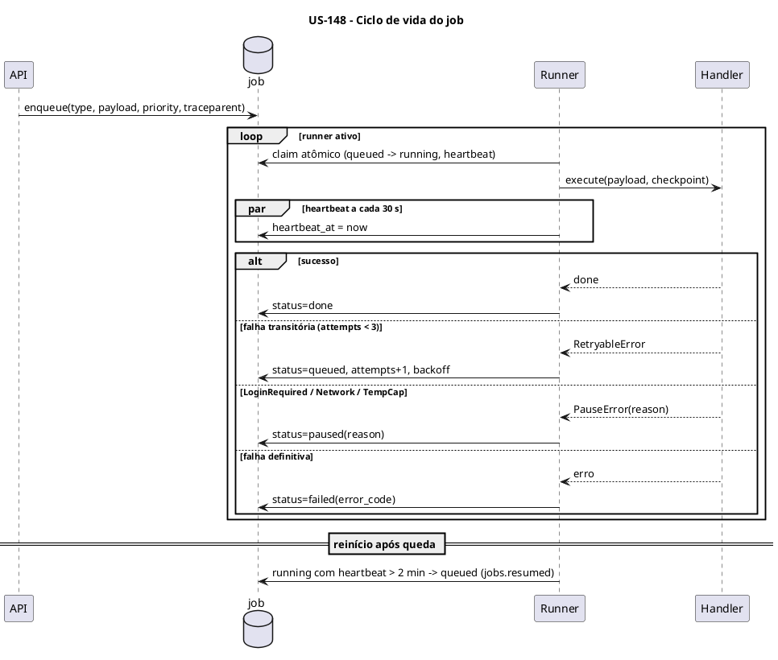

### Sequenciamento de Tarefas

| # | Tarefa | Escopo | Depende de |
|---|---|---|---|
| TF-148-01 | Fila persistida: enfileirar, claim atômico, heartbeat e payloads | Persistência da fila | TF-144-03, TF-145-01 |
| TF-148-02 | Runner assíncrono com retries, pausas e executores | Execução | TF-148-01, TF-145-03 |

### Tarefas

#### TF-148-01: [one-drive-cleaner] Fila persistida: enfileirar, claim atômico, heartbeat e payloads

**User Story:** US-148 · **Épico:** E-ODC · **Sistema:** one-drive-cleaner · **Prioridade:** P0
**Complexidade:** C3 — Alta · **Modelo sugerido:** Claude Sonnet 5.5 (`claude-sonnet-5-5`), esforço alto · **Escalonar para:** Opus 5.5
**Justificativa:** atomicidade do claim em SQLite, detecção de órfãos e validação de payload por tipo; erro gera execução duplicada.

##### 1. Descrição e Objetivo

> **Eu como** runner,
> **Eu quero** uma fila com claim atômico, heartbeat e payloads validados por tipo,
> **Para que** cada job execute uma única vez e sobreviva a quedas.

*Contexto Arquitetural:* plan 3.1 (`job`), 4.3.

##### 2. Especificação Técnica

**2.1 Pontos de Interceptação**
- `src/odc/jobs/payloads.py` — modelos pydantic por tipo (plan 4.3) e `parse_payload(type, raw) -> Payload` (`extra="forbid"`).
- `src/odc/jobs/queue.py` — `JobQueue(uow)`: `enqueue(type, payload, priority, traceparent) -> int`, `claim_next() -> ClaimedJob | None` (UPDATE condicional do plan 4.3), `heartbeat(job_id)`, `complete`, `fail(error_code)`, `retry_later(delay)`, `pause(reason)`, `resume(job_id | reason)`, `requeue_orphans(stale_after=120 s) -> int`, `save_checkpoint(job_id, data)`, `exists_active(type, key?)` (deduplicação de `scan`/`train`).
- `src/odc/jobs/startup.py` — `StartupHook` que chama `requeue_orphans` e incrementa `odc.jobs.resumed`.
- Testes `tests/unit/jobs/test_queue.py`, `test_payloads.py`.

**2.2 Dados e Persistência:** tabela `job`; índice `ix_job_claim`.

**2.3 Contrato de Dados:** payloads do plan 4.3; prioridades: `move`, `restore`, `delete` = 100; `train`, `classify`, `auto_actions` = 50; `scan`, `extract`, `cleanup` = 10.

**2.4 Resiliência e Zero Trust**

| Cenário de Falha | Estratégia | Impacto |
|---|---|---|
| Payload inválido no banco | Job `failed(INVALID_PAYLOAD)` sem executar | Sem execução com dado sujo |
| Dois claims simultâneos | UPDATE condicional por `status='queued'`; só um vence | Sem duplicidade |
| Queda durante execução | Heartbeat expirado → requeue no startup | Retomada |

##### 3. Modelagem Visual
Coberta pela sequência da US-148.

##### 4. Orientação de Execução

**4.1 Contexto de Entrada:** plan 4.3; `src/odc/storage/repositories/jobs.py`.

**4.2 Passos de Implementação**
1. Testes de payload (válido, campo extra, tipo errado).
2. Testes de claim concorrente (2 tasks + 2 conexões) e órfãos.
3. Implementar.

**4.3 Comando de Validação**
```bash
uv run pytest tests/unit/jobs/test_queue.py tests/unit/jobs/test_payloads.py -q
```

**4.4 Restrições Negativas**
- NÃO executar handler dentro desta camada.

**4.5 Skills Obrigatórias:** `test-driven-agentic-development`, `commit-message`.

**4.6 Critérios de Saída**
- [ ] Validação 4.3 verde; cobertura ≥ 95%.

##### 5. Testes de Aceitação (DoD)
- [ ] 1.000 claims concorrentes nunca retornam o mesmo job duas vezes.
- [ ] Job com heartbeat de 3 min atrás volta para `queued` no startup.
- [ ] Segundo `scan` enquanto há um ativo é deduplicado.

---

#### TF-148-02: [one-drive-cleaner] Runner assíncrono com retries, pausas e executores

**User Story:** US-148 · **Épico:** E-ODC · **Sistema:** one-drive-cleaner · **Prioridade:** P0
**Complexidade:** C4 — Muito alta · **Modelo sugerido:** Claude Opus 5.5 (`claude-opus-5-5`), esforço alto · **Escalonar para:** revisão humana
**Justificativa:** coração da execução: concorrência entre event loop, threads de CPU (embedding/treino), heartbeat, cancelamento e retomada automática; bugs aqui geram travamentos ou perda de progresso difíceis de reproduzir.

##### 1. Descrição e Objetivo

> **Eu como** aplicação,
> **Eu quero** um runner que execute jobs por prioridade, trate erros por categoria e retome pausas automaticamente,
> **Para que** o processamento seja contínuo, observável e resistente a falhas.

*Contexto Arquitetural:* plan 2.4–2.7, 4.3, 5.1. O runner vive no mesmo processo do FastAPI (lifespan).

##### 2. Especificação Técnica

**2.1 Pontos de Interceptação**
- `src/odc/jobs/runner.py` — `JobRunner(queue, handlers: Mapping[JobType, Handler], cpu_executor, metrics, tracer)`: loop `asyncio` com 1 worker de jobs pesados (`extract`, `classify`, `train`) e 1 worker de ações do utilizador (`move`, `restore`, `delete`) para não bloquear ações atrás de uma varredura longa; heartbeat a cada 30 s; `start()`/`stop(graceful_timeout=10 s)`; span `odc.job.<type>` com link ao `traceparent`; métricas `odc.jobs`, `odc.job.duration`.
- `src/odc/jobs/handler.py` — `Handler` (Protocol): `async def run(ctx: JobContext) -> None`; `JobContext` com `payload`, `checkpoint`, `save_checkpoint()`, `cpu(fn, *args)` (executa no `ThreadPoolExecutor(max_workers=1)`), `cancelled`.
- `src/odc/jobs/errors.py` — `RetryableError`, `PauseError(reason)`, `FatalJobError(error_code)`.
- `src/odc/jobs/resumer.py` — retomada: `network` a cada 60 s; `login_required` ao evento de login concluído; `temp_cap` ao evento de limpeza; `user` somente manual.
- `src/odc/web/lifespan.py` — inicia/encerra runner com a aplicação.
- Testes `tests/unit/jobs/test_runner.py`, `test_resumer.py` com handlers fake e relógio controlado.

**2.2 Dados e Persistência:** tabela `job`.

**2.3 Contrato de Dados:** `error_code` ∈ `INVALID_PAYLOAD | GRAPH_UNAVAILABLE | DISK_FULL | INTERNAL | <específicos dos handlers>`.

**2.4 Resiliência e Zero Trust**

| Cenário de Falha | Estratégia | Impacto |
|---|---|---|
| Handler lança exceção inesperada | `failed(INTERNAL)` + log ERROR; runner segue | Sem queda do runner |
| `RetryableError` | Até 3 tentativas com backoff 5/30/120 s | Recuperação automática |
| Encerramento durante job | Cancelamento cooperativo; checkpoint salvo; job volta a `queued` | Retomada no próximo start |
| CPU-bound bloqueando o loop | Sempre via `ctx.cpu()` | API responsiva |

##### 3. Modelagem Visual
Coberta pela sequência da US-148.

##### 4. Orientação de Execução

**4.1 Contexto de Entrada:** `src/odc/jobs/queue.py`, `src/odc/telemetry/tracing.py`, plan 4.3, 5.1.

**4.2 Passos de Implementação**
1. Testes do runner com handlers fake para cada ramo do diagrama.
2. Teste de responsividade: handler CPU de 2 s via `ctx.cpu` não atrasa `/healthz` > 100 ms.
3. Implementar runner, resumer, lifespan.

**4.3 Comando de Validação**
```bash
uv run pytest tests/unit/jobs -q && make lint-python
```

**4.4 Restrições Negativas**
- NÃO executar código CPU-bound no event loop.
- NÃO engolir `asyncio.CancelledError`.

**4.5 Skills Obrigatórias:** `test-driven-agentic-development`, `systematic-debugging` (em qualquer falha intermitente), `commit-message`.

**4.6 Critérios de Saída**
- [ ] Validação 4.3 verde; cobertura ≥ 95% em `runner.py`.
- [ ] Teste de responsividade verde em 20 execuções seguidas (sem flakiness).

**4.7 Decomposição Iterativa (mimic-loop)**

**Modo de execução:** `mimic-loop` · **Max iterações:** 25 · **Projeto saga:** `exec:one-drive-cleaner:TF-148-02`

| # | RT / iteração | Critério de Conclusão | Depende de |
|---|---|---|---|
| RT-01 | `handler.py`, `errors.py`, `JobContext` | Testes verdes | — |
| RT-02 | Loop com 2 workers, claim e conclusão | Testes verdes | RT-01 |
| RT-03 | Retries, pausas, falhas | Testes verdes | RT-02 |
| RT-04 | Heartbeat, cancelamento e shutdown gracioso | Testes verdes | RT-02 |
| RT-05 | Resumer e lifespan | Testes verdes | RT-03 |
| RT-06 | Responsividade e anti-flakiness (20×) | Verde 20/20 | RT-04 |

##### 5. Testes de Aceitação (DoD)
- [ ] Ação `move` executa enquanto um `extract` longo está em andamento.
- [ ] `PauseError("network")` retoma sozinho após 60 s (relógio simulado).
- [ ] `stop()` durante job salva checkpoint e devolve o job à fila.
- [ ] Span do job possui link para o span da requisição que o criou.

---

## US-149: Seleção de pastas e varredura incremental

**Épico:** E-ODC — OneDrive Cleaner MVP
**Sistema:** one-drive-cleaner
**Estimativa:** 8 Story Points
**Prioridade:** P1

### Narrativa de Valor

> **Eu como** utilizador,
> **Eu quero** escolher as pastas do meu OneDrive (padrão Camera Roll) e acompanhar o inventário das imagens,
> **Para que** o acervo a limpar fique registrado e atualizado apenas com o que mudou.

### Contexto de Negócio

Cobre J1 (passos 3–4), J2 (inventário), J7 e F8. O inventário é a base para análise e classificação.

### Critérios de Aceitação (Nível de Negócio)

- [ ] Primeira configuração mostra a árvore de pastas com Camera Roll pré-selecionada e o modo de automação (padrão Evolutivo).
- [ ] Varredura completa registra somente imagens (RN-06) das pastas escolhidas e subpastas, ignorando as pastas do app (RN-05).
- [ ] Varreduras seguintes processam só mudanças (RN-07); itens apagados/movidos fora do app mudam de estado (F8).
- [ ] Tela Varreduras mostra progresso, pausa/retomada, motivo de pausa e falhas com nova tentativa.

### Regras de Negócio Aplicáveis

| # | Regra | Tipo |
|---|---|---|
| RN-05 | Pastas escolhidas + subpastas; padrão Camera Roll; pastas do app nunca varridas | Obrigatória |
| RN-06 | Somente imagens | Restritiva |
| RN-07 | Varreduras subsequentes incrementais | Obrigatória |

### Diagramas

**C4 N2 — Varredura**

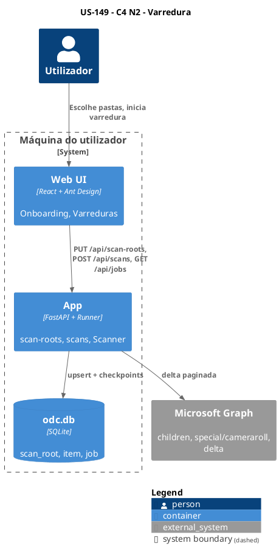

**Sequência — varredura** (detalhamento no plan 2.4, trecho "Varredura")

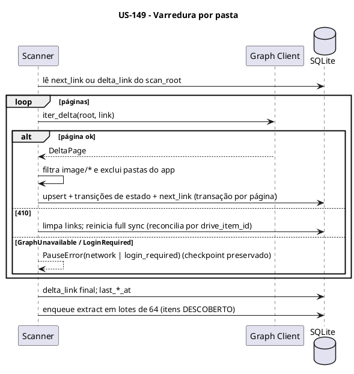

### Sequenciamento de Tarefas

| # | Tarefa | Escopo | Depende de |
|---|---|---|---|
| TF-149-01 | Pastas de varredura: padrão Camera Roll e seleção | Configuração de escopo | TF-147-04 |
| TF-149-02 | Scanner incremental com checkpoints e transições de estado | Varredura | TF-149-01, TF-148-02 |
| TF-149-03 | API de varreduras e jobs | API | TF-149-02 |
| TF-149-04 | Tela de primeira configuração (pastas e modo) | Front | TF-149-01, TF-146-03 |
| TF-149-05 | Tela de Varreduras (jobs, progresso, falhas) | Front | TF-149-03 |

### Tarefas

#### TF-149-01: [one-drive-cleaner] Pastas de varredura: padrão Camera Roll e seleção

**User Story:** US-149 · **Épico:** E-ODC · **Sistema:** one-drive-cleaner · **Prioridade:** P1
**Complexidade:** C2 — Média · **Modelo sugerido:** Claude Sonnet 5.5 (`claude-sonnet-5-5`), esforço médio · **Escalonar para:** Opus 5.5
**Justificativa:** serviço + 2 rotas com validação contra a Graph e regras de exclusão das pastas do app.

##### 1. Descrição e Objetivo

> **Eu como** utilizador,
> **Eu quero** navegar nas pastas e definir quais serão varridas,
> **Para que** o escopo da limpeza seja exatamente o que eu escolhi.

*Contexto Arquitetural:* plan 3.1 (`scan_root`), 4.1 (`GET /api/folders`, `PUT /api/scan-roots`).

##### 2. Especificação Técnica

**2.1 Pontos de Interceptação**
- `src/odc/scanning/roots.py` — `ScanRootService`: `ensure_default()` (Camera Roll, `is_default=1`, na primeira conta), `list_child_folders(parent_id)` (exclui pastas do app por ID de `app_meta`), `set_roots(folder_ids)` (valida cada ID via `get_item`, rejeita pastas do app e IDs inexistentes; guarda `display_path`; preserva `delta_link` de raízes mantidas; desabilita removidas).
- `src/odc/web/routes/folders.py` — `GET /api/folders`, `PUT /api/scan-roots` (CSRF, `require_account`).
- Testes `tests/unit/scanning/test_roots.py`, `tests/unit/web/test_folders_routes.py`.

**2.2 Dados e Persistência:** `scan_root` (`enabled`, `display_path`, `is_default`).

**2.3 Contrato de Dados:** plan 4.1: `PUT /api/scan-roots` `{"folder_ids":["str (1..50)"]}` → `{"scan_roots":[...]}`; 422 se ID inválido ou pasta do app.

**2.4 Resiliência e Zero Trust**

| Cenário de Falha | Estratégia | Impacto |
|---|---|---|
| ID de pasta forjado | Validado na Graph; `VALIDATION_ERROR` | Rejeitado |
| Pasta selecionada é ancestral de outra | Mantém somente a ancestral (evita duplicidade) | Sem varredura dupla |
| Graph indisponível | 503 `GRAPH_UNAVAILABLE` | UI permite tentar novamente |

##### 3. Modelagem Visual
Coberta pelo C4 N2 da US-149.

##### 4. Orientação de Execução

**4.1 Contexto de Entrada:** `src/odc/graph/client.py`, `src/odc/storage/repositories/scan_roots.py`.

**4.2 Passos de Implementação**
1. Testes com Graph fake (TF-147-05).
2. Implementar serviço e rotas; `make contract`.

**4.3 Comando de Validação**
```bash
uv run pytest tests/unit/scanning/test_roots.py tests/unit/web/test_folders_routes.py -q && make contract
```

**4.4 Restrições Negativas**
- NÃO aceitar caminho textual como identificador (somente IDs).

**4.5 Skills Obrigatórias:** `test-driven-agentic-development`, `commit-message`.

**4.6 Critérios de Saída**
- [ ] Validação 4.3 verde; cobertura ≥ 90%.

##### 5. Testes de Aceitação (DoD)
- [ ] Primeira conta cria Camera Roll como raiz padrão.
- [ ] Selecionar pasta e subpasta mantém só a pasta.
- [ ] Pasta do app é rejeitada.

---

#### TF-149-02: [one-drive-cleaner] Scanner incremental com checkpoints e transições de estado

**User Story:** US-149 · **Épico:** E-ODC · **Sistema:** one-drive-cleaner · **Prioridade:** P1
**Complexidade:** C4 — Muito alta · **Modelo sugerido:** Claude Opus 5.5 (`claude-opus-5-5`), esforço alto · **Escalonar para:** revisão humana
**Justificativa:** sincronização incremental com checkpoint por página, ressincronização após 410, reconciliação de itens apagados/movidos/fora de escopo e coerência com a quarentena; erro corrompe o estado do acervo.

##### 1. Descrição e Objetivo

> **Eu como** aplicação,
> **Eu quero** inventariar as pastas via delta, registrar mudanças e manter o estado de cada item coerente,
> **Para que** análise, classificação e quarentena operem sobre um acervo fiel ao OneDrive.

*Contexto Arquitetural:* plan 2.3 (estados), 2.4, 3.1 (`item`, `scan_root`), 4.2.

##### 2. Especificação Técnica

**2.1 Pontos de Interceptação**
- `src/odc/scanning/scanner.py` — `ScanHandler` (job `scan`): para cada `scan_root` habilitado, consome `iter_delta` a partir de `next_link` (retomada) ou `delta_link` (incremental) ou do início (full); por página, em uma transação: aplica `classify_change` e grava `next_link`; ao fim grava `delta_link`, `last_*_at`; enfileira `extract` em lotes de 64 itens `DESCOBERTO`.
- `src/odc/scanning/changes.py` — `classify_change(current_row | None, drive_item, scope) -> Transition` (função pura): novo imagem → `DESCOBERTO`; `cTag` mudou → `DESCOBERTO` (invalida feature/prediction); `deleted` → `REMOVIDO_EXTERNAMENTE`; saiu do escopo (parent fora das raízes e fora das pastas do app) → `REMOVIDO_EXTERNAMENTE`; item em `QUARENTENA` movido para fora da pasta de quarentena pelo utilizador → `REMOVIDO_EXTERNAMENTE` + `quarantine_entry.status=external_removed`; reaparecimento → `DESCOBERTO`; não-imagem → ignorado; pasta → ignorado.
- `src/odc/scanning/resync.py` — tratamento de `GraphGone` (410): full sync com marcação "vistos"; ao final, itens da raiz não vistos → `REMOVIDO_EXTERNAMENTE`.
- Métricas: `odc.scan.items`, `odc.scan.duration`, `odc.scan.pages`, `odc.scan.delta_resets`, `odc.scan.last_success`; span `odc.job.scan`.
- Testes `tests/unit/scanning/test_changes.py` (tabela de transições exaustiva), `test_scanner.py`, `test_resync.py`; integração `tests/integration/test_scan_flow.py` com Graph fake.

**2.2 Dados e Persistência:** `item` (upsert por `drive_item_id`), `scan_root.next_link/delta_link`, `feature`/`prediction` removidos quando `cTag` muda.

**2.3 Contrato de Dados:** payload `scan` do plan 4.3.

**2.4 Resiliência e Zero Trust**

| Cenário de Falha | Estratégia | Impacto |
|---|---|---|
| Queda no meio da paginação | `next_link` persistido por página; retomada da página seguinte | Sem reprocessar páginas confirmadas |
| 410 delta expirada | `resync.py` | Varredura completa extra, sem perda de rótulos |
| Página com item malformado | Item descartado (TF-147-01); página continua | Sem bloqueio |
| `LoginRequired`/rede | `PauseError` com checkpoint | Retomada automática |

##### 3. Modelagem Visual
Coberta pelos diagramas da US-149 e plan 2.3/2.4.

##### 4. Orientação de Execução

**4.1 Contexto de Entrada:** plan 2.3, 2.4, 4.2, 4.3; `src/odc/graph/client.py`; `src/odc/jobs/handler.py`; `src/odc/storage/repositories/items.py`.

**4.2 Passos de Implementação**
1. Tabela de transições em teste parametrizado (todas as combinações estado × evento do plan 2.3).
2. `changes.py` (pura) até 100% de cobertura.
3. `scanner.py` e `resync.py` com testes unitários (Graph fake in-process).
4. Integração: full → mudanças no fake → incremental → 410 → resync.

**4.3 Comando de Validação**
```bash
uv run pytest tests/unit/scanning tests/integration/test_scan_flow.py -q && make lint-python
```

**4.4 Restrições Negativas**
- NÃO fazer chamadas de rede dentro de transação do banco.
- NÃO apagar linhas de `item` (somente mudar estado), para preservar rótulos (RN-26).

**4.5 Skills Obrigatórias:** `test-driven-agentic-development`, `systematic-debugging`, `commit-message`.

**4.6 Critérios de Saída**
- [ ] Validação 4.3 verde; cobertura 100% em `changes.py`, ≥ 90% nos demais.

**4.7 Decomposição Iterativa (mimic-loop)**

**Modo de execução:** `mimic-loop` · **Max iterações:** 25 · **Projeto saga:** `exec:one-drive-cleaner:TF-149-02`

| # | RT / iteração | Critério de Conclusão | Depende de |
|---|---|---|---|
| RT-01 | `changes.py` + tabela de transições | 100% cobertura | — |
| RT-02 | Scanner full com checkpoint por página | Testes verdes | RT-01 |
| RT-03 | Incremental + enfileiramento de extract | Testes verdes | RT-02 |
| RT-04 | Resync 410 | Testes verdes | RT-02 |
| RT-05 | Métricas/spans + integração completa | Integração verde | RT-03, RT-04 |

##### 5. Testes de Aceitação (DoD)
- [ ] Full de 1.000 itens (fake) registra só imagens e enfileira 16 lotes.
- [ ] Interromper na página 3 de 5 e retomar não duplica itens.
- [ ] Alterar conteúdo (`cTag`) de um item o devolve a `DESCOBERTO` e remove a predição.
- [ ] Apagar item no fake → `REMOVIDO_EXTERNAMENTE` na varredura seguinte; rótulos preservados.

---

#### TF-149-03: [one-drive-cleaner] API de varreduras e jobs

**User Story:** US-149 · **Épico:** E-ODC · **Sistema:** one-drive-cleaner · **Prioridade:** P1
**Complexidade:** C1 — Baixa · **Modelo sugerido:** Claude Haiku 5.5 (`claude-haiku-5-5`) · **Escalonar para:** Sonnet 5.5
**Justificativa:** rotas finas sobre `JobQueue` com contratos já definidos.

##### 1. Descrição e Objetivo

> **Eu como** interface,
> **Eu quero** iniciar varreduras e consultar/pausar/retomar jobs,
> **Para que** o utilizador controle o processamento.

*Contexto Arquitetural:* plan 4.1 (`POST /api/scans`, `GET /api/jobs`, pause/resume).

##### 2. Especificação Técnica

**2.1 Pontos de Interceptação**
- `src/odc/web/routes/jobs.py` — `POST /api/scans` (`mode: auto|full`; 409 se já houver scan ativo), `GET /api/jobs` (filtros `status`, `type`, `limit ≤ 100`; `progress` derivado do checkpoint), `POST /api/jobs/{id}/pause`, `POST /api/jobs/{id}/resume`; `GET /api/failures` (itens `FALHA_ANALISE`, paginado) e `POST /api/failures/retry` (`{"item_ids":[int 1..500]}` → volta a `DESCOBERTO` e enfileira extract).
- Testes `tests/unit/web/test_jobs_routes.py`.

**2.2 Dados e Persistência:** `job`, `item`.

**2.3 Contrato de Dados:** plan 4.1; `GET /api/failures` → `{"items":[{"item_id":"int","failure_reason":"str","failure_count":"int"}],"next_cursor":"str|null"}`.

**2.4 Resiliência e Zero Trust**

| Cenário de Falha | Estratégia | Impacto |
|---|---|---|
| `mode=full` com scan ativo | 409 `CONFLICT` | Sem varredura duplicada |
| `item_ids` de outro estado no retry | Ignorados e contados em `skipped` | Sem efeito colateral |

##### 3. Modelagem Visual
Coberta pelo C4 N2 da US-149.

##### 4. Orientação de Execução

**4.1 Contexto de Entrada:** `src/odc/jobs/queue.py`, plan 4.1.

**4.2 Passos de Implementação**
1. Testes de rota (TestClient + fila real em SQLite temporário).
2. Implementar; `make contract`.

**4.3 Comando de Validação**
```bash
uv run pytest tests/unit/web/test_jobs_routes.py -q && make contract
```

**4.4 Restrições Negativas**
- NÃO executar o scan na requisição (somente enfileirar).

**4.5 Skills Obrigatórias:** `test-driven-agentic-development`, `commit-message`.

**4.6 Critérios de Saída**
- [ ] Validação 4.3 verde; cobertura ≥ 90%.

##### 5. Testes de Aceitação (DoD)
- [ ] `POST /api/scans` retorna 202 com `job_id` e grava `traceparent`.
- [ ] Pausar/retomar alteram o status.
- [ ] Retry de falhas re-enfileira apenas itens `FALHA_ANALISE`.

---

#### TF-149-04: [one-drive-cleaner] Tela de primeira configuração (pastas e modo)

**User Story:** US-149 · **Épico:** E-ODC · **Sistema:** one-drive-cleaner · **Prioridade:** P1
**Complexidade:** C2 — Média · **Modelo sugerido:** Claude Sonnet 5.5 (`claude-sonnet-5-5`), esforço médio · **Escalonar para:** Opus 5.5
**Justificativa:** `TreeSelect` com carga assíncrona por nível, `Steps` e persistência em duas APIs.

##### 1. Descrição e Objetivo

> **Eu como** utilizador recém-conectado,
> **Eu quero** um assistente que mostre minhas pastas com Camera Roll pré-selecionada e o modo de automação,
> **Para que** eu configure a limpeza em poucos passos.

*Contexto Arquitetural:* plan 9.2 (Login / primeira configuração).

##### 2. Especificação Técnica

**2.1 Pontos de Interceptação**
- `frontend/src/pages/Onboarding/OnboardingPage.tsx` — `Steps` (Pastas → Automação → Concluir).
- `frontend/src/components/FolderTreeSelect/FolderTreeSelect.tsx` — `TreeSelect` múltiplo com `loadData` (chama `GET /api/folders?parent_id`), Camera Roll pré-marcada, `treeCheckable`.
- `frontend/src/pages/Onboarding/AutomationStep.tsx` — `Segmented` (Manual / Automático / Evolutivo — padrão Evolutivo) com descrição de cada modo.
- `frontend/src/api/folders.ts`, `frontend/src/api/settings.ts` (hooks).
- Roteamento: se não houver `scan_root`, redirecionar para `/onboarding` após login.
- Testes co-localizados.

**2.2 Dados e Persistência:** `PUT /api/scan-roots`; `PUT /api/settings` (`automation_mode`) — rota de settings entra na TF-156-01; até lá o passo 2 usa o valor padrão e grava quando a rota existir (feature flag de rota ausente → passo oculto).

**2.3 Contrato de Dados:** plan 4.1.

**2.4 Resiliência e Zero Trust**

| Cenário de Falha | Estratégia | Impacto |
|---|---|---|
| Falha ao carregar nível da árvore | Nó exibe erro e permite expandir novamente | Sem travar o assistente |
| Nenhuma pasta selecionada | Botão "Avançar" desabilitado | Escopo nunca vazio |

##### 3. Modelagem Visual
Coberta pelo C4 N2 da US-149.

##### 4. Orientação de Execução

**4.1 Contexto de Entrada:** `frontend/src/api/client.ts`, `schema.gen.ts`, plan 9.2.

**4.2 Passos de Implementação**
1. Handlers MSW para pastas em 3 níveis.
2. Testes do `FolderTreeSelect` (carga lazy, pré-seleção, erro) e do assistente.
3. Implementar.

**4.3 Comando de Validação**
```bash
pnpm --dir frontend vitest run src/pages/Onboarding src/components/FolderTreeSelect --coverage && pnpm --dir frontend lint
```

**4.4 Restrições Negativas**
- NÃO carregar a árvore inteira de uma vez.

**4.5 Skills Obrigatórias:** `test-driven-agentic-development`, `expert-lsp`, `commit-message`.

**4.6 Critérios de Saída**
- [ ] Validação 4.3 verde; cobertura ≥ 90/85.

##### 5. Testes de Aceitação (DoD)
- [ ] Expandir nó chama `GET /api/folders?parent_id=<id>` uma única vez.
- [ ] Camera Roll vem marcada.
- [ ] Concluir envia `PUT /api/scan-roots` com os IDs marcados e inicia a primeira varredura.

---

#### TF-149-05: [one-drive-cleaner] Tela de Varreduras (jobs, progresso, falhas)

**User Story:** US-149 · **Épico:** E-ODC · **Sistema:** one-drive-cleaner · **Prioridade:** P1
**Complexidade:** C2 — Média · **Modelo sugerido:** Claude Sonnet 5.5 (`claude-sonnet-5-5`), esforço médio · **Escalonar para:** Opus 5.5
**Justificativa:** polling condicional, vários estados de job e lista de falhas com ação em lote.

##### 1. Descrição e Objetivo

> **Eu como** utilizador,
> **Eu quero** ver o progresso das varreduras e análises, pausar/retomar e reprocessar falhas,
> **Para que** eu acompanhe e controle o processamento.

*Contexto Arquitetural:* plan 9.2 (Varreduras).

##### 2. Especificação Técnica

**2.1 Pontos de Interceptação**
- `frontend/src/pages/Scans/ScansPage.tsx` — `Descriptions` (última varredura), `Button` "Varrer agora" / "Varredura completa", `Table` de jobs com `Progress`, `Tag` de status, ações pausar/retomar, `Alert` por `pause_reason` (texto por motivo).
- `frontend/src/pages/Scans/FailuresList.tsx` — `List` paginada de falhas com seleção e "Tentar novamente".
- `frontend/src/api/jobs.ts` — hooks com polling de 2 s apenas enquanto houver job `running`/`queued`.
- Testes co-localizados.

**2.2 Dados e Persistência:** não se aplica.

**2.3 Contrato de Dados:** TF-149-03.

**2.4 Resiliência e Zero Trust**

| Cenário de Falha | Estratégia | Impacto |
|---|---|---|
| 409 ao iniciar varredura | `message.info` "Varredura já em andamento" | Sem duplicidade |
| Polling com API fora | Para após 3 erros e mostra `Alert` com "Tentar novamente" | Sem loop infinito |

##### 3. Modelagem Visual
Coberta pelo C4 N2 da US-149.

##### 4. Orientação de Execução

**4.1 Contexto de Entrada:** `frontend/src/api/client.ts`, plan 9.2.

**4.2 Passos de Implementação**
1. Testes com timers falsos (polling liga/desliga).
2. Implementar página e lista.

**4.3 Comando de Validação**
```bash
pnpm --dir frontend vitest run src/pages/Scans src/api/jobs --coverage && pnpm --dir frontend lint
```

**4.4 Restrições Negativas**
- NÃO fazer polling sem job ativo.

**4.5 Skills Obrigatórias:** `test-driven-agentic-development`, `expert-lsp`, `commit-message`.

**4.6 Critérios de Saída**
- [ ] Validação 4.3 verde; cobertura ≥ 90/85.

##### 5. Testes de Aceitação (DoD)
- [ ] Polling para quando não há job ativo.
- [ ] Cada `pause_reason` exibe texto específico.
- [ ] "Tentar novamente" envia os IDs selecionados.

---

## US-150: Escolha do modelo de visão por benchmark

**Épico:** E-ODC — OneDrive Cleaner MVP
**Sistema:** one-drive-cleaner
**Estimativa:** 5 Story Points
**Prioridade:** P1

### Narrativa de Valor

> **Eu como** utilizador,
> **Eu quero** que o modelo de análise seja escolhido com base em medição real nas minhas imagens e na minha máquina,
> **Para que** a classificação seja precisa e o tempo e o disco fiquem dentro das metas.

### Contexto de Negócio

Pré-requisito da análise (plan 7). A amostra real fica somente na máquina do utilizador (fora do repositório).

### Critérios de Aceitação (Nível de Negócio)

- [ ] Relatório comparando CLIP ViT-B-32 e SigLIP so400m: `removable_precision`, acurácia, tempo projetado para 5 mil imagens, memória, disco e licença dos pesos.
- [ ] Decisão registrada (modelo + tamanho de miniatura) e aplicada por migração.
- [ ] Amostra estratificada baixada automaticamente do OneDrive (somente leitura), anonimizada e pré-organizada por categoria para revisão.
- [ ] Nenhuma imagem da amostra versionada; dados locais removidos após a decisão.

### Regras de Negócio Aplicáveis

| # | Regra | Tipo |
|---|---|---|
| RN-02 | Análise local | Restritiva |
| RN-03 | Disco final ≤ 500 MB sem pesos | Obrigatória |
| spec 5.2 | Análise inicial de 5 mil ≤ 30 min | Obrigatória |
| RN-21 | Coleta somente leitura: nenhum arquivo do OneDrive é alterado | Restritiva |

### Diagramas

**C4 N2 — Coleta da amostra e benchmark**

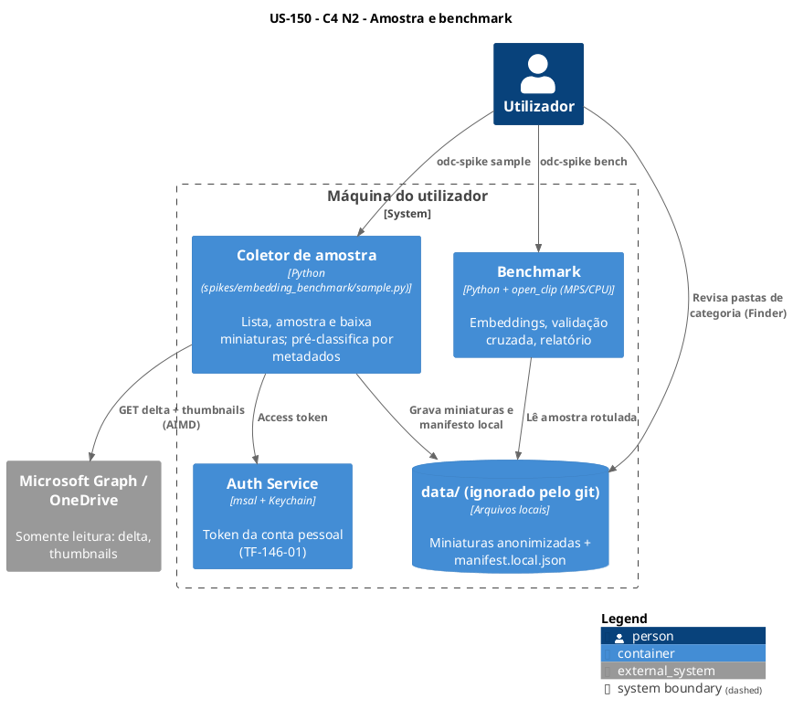

**Sequência — coleta, rotulagem, benchmark e limpeza (sucesso e falha)**

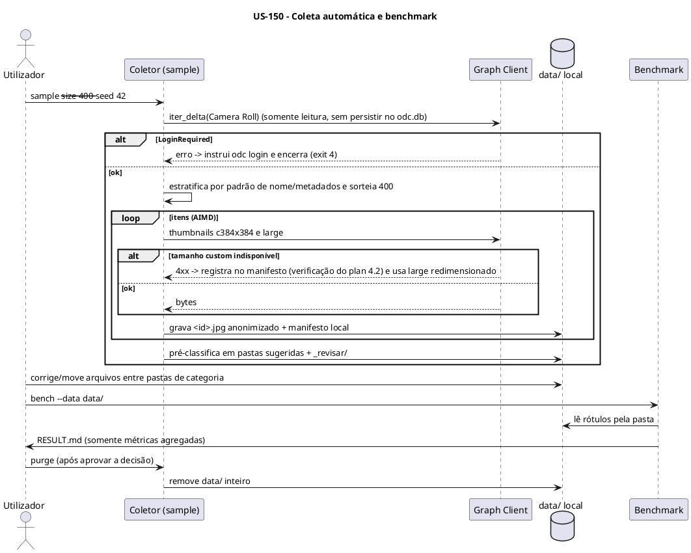

### Sequenciamento de Tarefas

| # | Tarefa | Escopo | Depende de |
|---|---|---|---|
| TF-150-01 | Script de benchmark de modelos de visão | Spike (ferramenta) | TF-143-02 |
| TF-150-02 | Coleta automática da amostra no OneDrive, execução, decisão e migração do modelo escolhido | Spike (amostra + decisão) | TF-150-01, TF-144-02, TF-146-01, TF-147-04 |

### Tarefas

#### TF-150-01: [one-drive-cleaner] Script de benchmark de modelos de visão

**User Story:** US-150 · **Épico:** E-ODC · **Sistema:** one-drive-cleaner · **Prioridade:** P1
**Complexidade:** C3 — Alta · **Modelo sugerido:** Claude Sonnet 5.5 (`claude-sonnet-5-5`), esforço alto · **Escalonar para:** Opus 5.5
**Justificativa:** pipeline de ML com medição de tempo/memória em MPS, validação cruzada e relatório reprodutível.

##### 1. Descrição e Objetivo

> **Eu como** mantenedor,
> **Eu quero** um script que compare modelos de visão sobre uma amostra rotulada local,
> **Para que** a escolha do modelo seja objetiva e repetível.

*Contexto Arquitetural:* plan 7.

##### 2. Especificação Técnica

**2.1 Pontos de Interceptação**
- `spikes/embedding_benchmark/__main__.py` — CLI com subcomandos (`bench` nesta TF; `sample` e `purge` na TF-150-02). `bench`: `--data <dir>` (subpastas `screenshot/`, `real_photo/`, `meme_sticker/`, `document_receipt/`), `--models`, `--sizes 384,800`, `--device auto|mps|cpu`, `--out RESULT.md`.
- `spikes/embedding_benchmark/bench.py` — carrega modelos `open_clip` (`ViT-B-32`/`laion2b_s34b_b79k`, `ViT-SO400M-14-SigLIP-384`/`webli`), redimensiona imagens para o tamanho de miniatura simulado, mede tempo por lote, pico de memória (`torch.mps.current_allocated_memory` / `tracemalloc`), dim do vetor, tamanho dos pesos em disco; regressão logística 5-fold estratificada com métricas do plan 6 (`removable_precision` com limiar 0,98 e suporte, acurácia, macro-F1); projeção de tempo para 5 mil e 50 mil; licença dos pesos (metadado do `open_clip`/model card).
- `spikes/embedding_benchmark/report.py` — gera `RESULT.md` com tabela e recomendação pelo critério do plan 7.
- `tests/unit/spikes/test_bench.py`, `test_report.py` — com modelo fake (vetores determinísticos) e imagens sintéticas.
- `pyproject.toml` — dependências do grupo `ml`: `torch`, `open_clip_torch`, `scikit-learn`, `numpy`, `pillow`, `pillow-heif`.

**2.2 Dados e Persistência:** amostra em `spikes/embedding_benchmark/data/` (ignorado pelo git).

**2.3 Contrato de Dados — linha do relatório**

| Campo | Tipo |
|---|---|
| modelo, tamanho | str |
| removable_precision@0.98, suporte | float, int |
| acurácia, macro-F1 | float |
| s/img (MPS), projeção 5 mil / 50 mil | float, min |
| pico de memória, pesos (MB), vetor 50 mil (MB) | float |
| licença dos pesos | str |

**2.4 Resiliência e Zero Trust**

| Cenário de Falha | Estratégia | Impacto |
|---|---|---|
| MPS indisponível | Fallback CPU; relatório indica o dispositivo | Tempo maior, registrado |
| Imagem corrompida na amostra | Ignorada e contada no relatório | Sem abortar |
| Licença não comercial | Modelo marcado "inelegível" | Excluído da recomendação |

##### 3. Modelagem Visual
Coberta pela sequência da US-150.

##### 4. Orientação de Execução

**4.1 Contexto de Entrada:** plan 6, 7.

**4.2 Passos de Implementação**
1. Testes com modelo fake.
2. Implementar `bench.py`, `report.py`, CLI.
3. Executar localmente com 20 imagens sintéticas para smoke.

**4.3 Comando de Validação**
```bash
uv run pytest tests/unit/spikes -q && uv run python -m spikes.embedding_benchmark bench --help
```

**4.4 Restrições Negativas**
- NÃO versionar imagens nem `RESULT.md` com nomes de arquivos da amostra.

**4.5 Skills Obrigatórias:** `test-driven-agentic-development`, `commit-message`.

**4.6 Critérios de Saída**
- [ ] Validação 4.3 verde; smoke gera `RESULT.md`.

##### 5. Testes de Aceitação (DoD)
- [ ] Relatório contém todas as colunas de 2.3.
- [ ] Critério de desempate (≤ 1 p.p. → menor tempo/disco) aplicado corretamente no teste.

---

#### TF-150-02: [one-drive-cleaner] Coleta automática da amostra no OneDrive, execução, decisão e migração do modelo escolhido

**User Story:** US-150 · **Épico:** E-ODC · **Sistema:** one-drive-cleaner · **Prioridade:** P1
**Complexidade:** C3 — Alta · **Modelo sugerido:** Claude Sonnet 5.5 (`claude-sonnet-5-5`), esforço alto · **Escalonar para:** Opus 5.5
**Justificativa:** integração autenticada com a Graph (somente leitura), amostragem estratificada reprodutível, anonimização e limpeza de dados pessoais em disco, além da condução da decisão com o utilizador e de uma migração.

##### 1. Descrição e Objetivo

> **Eu como** utilizador,
> **Eu quero** que a amostra de imagens do benchmark seja baixada automaticamente do meu OneDrive e pré-organizada por categoria,
> **Para que** eu apenas revise a organização, rode o benchmark e aprove o modelo, sem copiar imagens manualmente.

*Contexto Arquitetural:* plan 7 (amostra, medições, saída), 4.2 (delta, thumbnails, tamanhos custom a verificar), 3.1 (`embedding_model`). Reutiliza `AuthService` (TF-146-01) e `GraphClient` + `AimdLimiter` (TF-147-04/03). A coleta é **somente leitura**: nenhuma chamada de escrita na Graph e nenhuma gravação no `odc.db`.

##### 2. Especificação Técnica

**2.1 Pontos de Interceptação**
- `spikes/embedding_benchmark/sample.py` — subcomando `sample`:
  - Parâmetros: `--size 400` (padrão; margem sobre as ~300 necessárias), `--seed 42`, `--folder-id` (padrão: Camera Roll via `get_camera_roll()`), `--sizes c384x384,large`, `--out spikes/embedding_benchmark/data/`.
  - Autenticação: usa a conta ativa do `AuthService`; sem conta → mensagem "execute `odc` e faça login" e exit 4.
  - Listagem: `iter_delta(folder_id)` completa em memória (sem persistir `deltaLink`), filtrando `image/*` (RN-06).
  - Amostragem estratificada reprodutível (`random.Random(seed)`): estratos por sinal de metadados (`name_screenshot`, `name_whatsapp`, `has_camera`, demais), cota proporcional com mínimo de 60 itens por estrato quando disponível, para garantir representatividade das 4 categorias.
  - Download: para cada item e tamanho em `--sizes`, `get_thumbnail_bytes` com o limiter AIMD; grava `data/_thumbs/<size>/<seq>.jpg` com nome sequencial anonimizado (`000001.jpg`); se o tamanho custom retornar 4xx, registra `custom_size_supported=false` no manifesto e gera a versão `c384x384` redimensionando a `large` localmente (resultado da verificação pendente do plan 4.2).
  - Pré-classificação sugerida (copia a versão `large` para `data/<categoria>/<seq>.jpg`): `name_screenshot` ou proporção de tela sem câmera → `screenshot/`; `has_camera` e `has_taken_at` → `real_photo/`; demais (incluindo `-WA`) → `_revisar/`. A pré-classificação é apenas sugestão; o rótulo final é a pasta onde o utilizador deixar o arquivo.
  - Manifesto local `data/manifest.local.json`: por `seq`, `drive_item_id`, MIME, dimensões, dados de câmera, `taken_at`, flags de nome (sem o nome original), tamanhos baixados, sugestão aplicada.
  - Subcomando `purge`: remove `data/` inteiro (com confirmação interativa e `--yes`), validando que o caminho resolvido está dentro de `spikes/embedding_benchmark/`.
- `spikes/embedding_benchmark/bench.py` (ajuste da TF-150-01) — quando existir `data/_thumbs/<size>/`, usa a miniatura real da Graph para o tamanho correspondente em vez de redimensionar; features de metadados lidas do `manifest.local.json` para avaliar também o modelo com metadados (embedding + meta), como em produção; arquivos em `_revisar/` são ignorados e contados no relatório.
- `spikes/embedding_benchmark/RESULT.md` — versionado somente com métricas agregadas, distribuição por categoria e `custom_size_supported` (sem nomes, IDs ou caminhos).
- `src/odc/storage/migrations/versions/0002_embedding_model.py` — seed de `embedding_model` (nome, `dim`, `thumb_size`, `is_active=1`) conforme a decisão.
- `docs/specs/onedrive-cleaner/plan.md` — seção 7 com o resultado e seção 4.2 com a confirmação (ou não) do tamanho de miniatura custom.
- Testes: `tests/unit/spikes/test_sample.py` (Graph fake TF-147-05 + `FakeAuthService`: estratificação e cotas, reprodutibilidade por seed, anonimização, fallback de tamanho custom, `LoginRequired`, ausência de chamadas de escrita, `purge` restrito ao diretório), `tests/unit/storage/test_migration_0002.py`.

**2.2 Dados e Persistência**
- `spikes/embedding_benchmark/data/` (já no `.gitignore`): `_thumbs/<size>/`, pastas por categoria, `_revisar/`, `manifest.local.json`. Volume estimado: 400 × (~30 KB + ~120 KB) ≈ 60 MB.
- `embedding_model` via migração `0002`.

**2.3 Contrato de Dados — `manifest.local.json` (local, nunca versionado)**
```json
{
  "seed": 42,
  "folder": "camera_roll | <folder-id>",
  "custom_size_supported": "bool",
  "items": [
    {
      "seq": "string — 6 dígitos",
      "drive_item_id": "string",
      "mime_type": "string",
      "width": "int | null",
      "height": "int | null",
      "has_camera": "bool",
      "has_taken_at": "bool",
      "name_flags": ["screenshot | whatsapp | camera"],
      "sizes": ["c384x384", "large"],
      "suggested": "screenshot | real_photo | _revisar"
    }
  ]
}
```

**2.4 Resiliência e Zero Trust**

| Cenário de Falha | Estratégia | Impacto |
|---|---|---|
| Throttling/rede durante o download | Política do `GraphHttp` (Retry-After, backoff, AIMD); item que esgotar tentativas é pulado e registrado | Amostra segue com os demais |
| Interrupção da coleta | Reexecução com o mesmo `--seed` pula itens já baixados (verifica arquivo + manifesto) | Retomada sem duplicar |
| Conta sem login/expirada | Exit 4 com instrução | Nenhum arquivo parcial |
| Pasta com menos de 400 imagens | Baixa todas e alerta no relatório | Benchmark com amostra menor sinalizada |
| Dado pessoal no repositório | `data/` ignorado; nomes anonimizados; `RESULT.md` só agregado; hook bloqueia imagens fora de assets (TF-143-04) | Nada sensível versionado |
| Dados locais após a decisão | `purge` obrigatório no DoD | Disco limpo (RN-03) |
| Nenhum modelo atinge 0,98 na amostra | Registrar no relatório e escalar ao utilizador (rever amostra/categorias ou aceitar menor precisão com Automático desabilitado) | Decisão explícita |
| Amostra desbalanceada (< 30 por categoria após revisão) | Relatório alerta; utilizador roda `sample` com `--size` maior ou novo `--seed` | Métrica confiável |

##### 3. Modelagem Visual
Coberta pelo C4 N2 e pela sequência da US-150.

##### 4. Orientação de Execução

**4.1 Contexto de Entrada:** plan 4.2, 6, 7; `spikes/embedding_benchmark/`; `src/odc/auth/service.py`; `src/odc/graph/client.py`; `src/odc/features/meta.py` (padrões de nome e proporção de tela, se já implementado; senão reimplementação local mínima no spike); `tests/fakes/`.

**4.2 Passos de Implementação**
1. Testes do `sample` com Graph fake e `FakeAuthService`.
2. Implementar `sample` e `purge`; ajustar o loader do `bench`.
3. Executar `sample` na conta real do utilizador (somente leitura) e informar a distribuição sugerida.
4. Utilizador revisa as pastas de categoria e esvazia `_revisar/` (move para a categoria correta ou apaga).
5. Executar `bench`; apresentar `RESULT.md`; obter **aprovação explícita** do modelo e do tamanho de miniatura.
6. Criar migração `0002` e teste; atualizar plan 4.2 e 7.
7. Executar `purge` e confirmar remoção.

**4.3 Comando de Validação**
```bash
uv run pytest tests/unit/spikes/test_sample.py tests/unit/storage/test_migration_0002.py -q \
  && uv run python -m spikes.embedding_benchmark sample --help \
  && git status --porcelain --ignored spikes/embedding_benchmark/ | grep -v '^!!' ; test ! -d spikes/embedding_benchmark/data
```

**4.4 Restrições Negativas**
- NÃO chamar operações de escrita da Graph (`move`, `delete`, `ensure_folder`) no coletor.
- NÃO gravar no `odc.db` nem alterar `scan_root`/`deltaLink` da aplicação.
- NÃO usar nomes originais dos arquivos em disco, manifesto versionado ou relatório.
- NÃO escolher o modelo sem aprovação do utilizador.
- NÃO versionar `data/`.

**4.5 Skills Obrigatórias:** `test-driven-agentic-development`, `commit-message`.

**4.6 Critérios de Saída**
- [ ] Testes verdes; cobertura ≥ 90% em `sample.py`.
- [ ] Amostra real coletada, revisada pelo utilizador e benchmark executado.
- [ ] Decisão aprovada; migração `0002` aplicada; plan 4.2 e 7 atualizados.
- [ ] `data/` removido após a decisão.

**4.7 Decomposição Iterativa (mimic-loop)**

**Modo de execução:** `mimic-loop` · **Max iterações:** 20 · **Projeto saga:** `exec:one-drive-cleaner:TF-150-02`

| # | RT / iteração | Critério de Conclusão | Depende de |
|---|---|---|---|
| RT-01 | `sample` (listagem, estratificação, download, anonimização, manifesto) com Graph fake | Testes verdes | — |
| RT-02 | Pré-classificação sugerida, retomada por seed e `purge` | Testes verdes | RT-01 |
| RT-03 | Ajuste do loader do `bench` (miniaturas reais + metadados do manifesto) | Testes verdes | RT-01 |
| RT-04 | Coleta real + revisão do utilizador (humano no loop) | `_revisar/` vazio, ≥ 30 por categoria | RT-02 |
| RT-05 | Benchmark real, aprovação, migração `0002`, atualização do plan | Decisão aprovada, teste da migração verde | RT-03, RT-04 |
| RT-06 | `purge` e verificação final | `data/` inexistente | RT-05 |

##### 5. Testes de Aceitação (DoD)
- [ ] Mesmo `--seed` produz a mesma seleção de itens; reexecução não baixa novamente o que já existe.
- [ ] Cada estrato disponível tem ao menos 60 itens na amostra (ou todos, se houver menos).
- [ ] Nenhum arquivo em `data/` usa o nome original; nenhuma chamada de escrita registrada no Graph fake.
- [ ] `custom_size_supported` registrado no relatório e no plan 4.2.
- [ ] `embedding_model` ativo único após a migração; plan 7 contém resultado e licença dos pesos.
- [ ] `purge` recusa caminho fora de `spikes/embedding_benchmark/`.

---

## US-151: Análise local das imagens

**Épico:** E-ODC — OneDrive Cleaner MVP
**Sistema:** one-drive-cleaner
**Estimativa:** 8 Story Points
**Prioridade:** P1

### Narrativa de Valor

> **Eu como** utilizador preocupado com privacidade e espaço em disco,
> **Eu quero** que cada imagem seja analisada na minha máquina e a cópia temporária descartada logo em seguida,
> **Para que** nenhuma foto saia do meu controle e o disco não fique ocupado.

### Contexto de Negócio

Cobre J2 (passo 3) e RN-02/RN-03. Produz o vetor de imagem e as features de metadados consumidos pela classificação.

### Critérios de Aceitação (Nível de Negócio)

- [ ] Itens `DESCOBERTO` viram `ANALISADO` com vetor e features persistidos; falhas viram `FALHA_ANALISE` com motivo.
- [ ] Miniaturas processadas em memória; arquivo temporário só no fallback e removido imediatamente.
- [ ] Ao fim de cada job e no startup, o diretório temporário está vazio; uso de disco por componente visível.
- [ ] Teto de 2 GB pausa a análise até a limpeza.

### Regras de Negócio Aplicáveis

| # | Regra | Tipo |
|---|---|---|
| RN-02 | Análise exclusivamente local | Restritiva |
| RN-03 | Temporários removidos; teto 2 GB; ≤ 500 MB ao final (sem pesos) | Obrigatória |
| RN-10 | Nome/origem como sinal auxiliar | Restritiva |

### Diagramas

**C4 N2 — Análise**

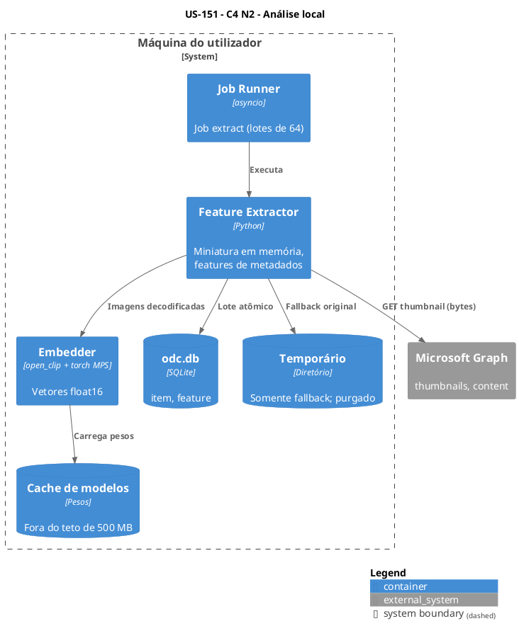

**Sequência — extração de um lote** (detalhe no plan 2.4, trecho "Extração")

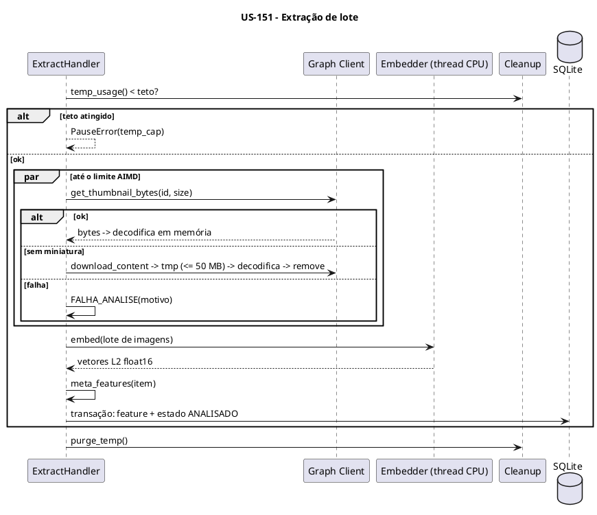

### Sequenciamento de Tarefas

| # | Tarefa | Escopo | Depende de |
|---|---|---|---|
| TF-151-01 | Extrator de features de metadados | Features (metadados) | TF-147-01 |
| TF-151-02 | Embedder local de imagem e texto | Modelo de visão | TF-150-02 |
| TF-151-03 | Embedder fake determinístico | Infra de teste | TF-151-02 |
| TF-151-04 | Handler de extração em lote | Pipeline de análise | TF-151-01, TF-151-03, TF-148-02, TF-147-04 |
| TF-151-05 | Serviço de limpeza e uso de disco | Recursos locais | TF-144-05, TF-145-03 |

### Tarefas

#### TF-151-01: [one-drive-cleaner] Extrator de features de metadados

**User Story:** US-151 · **Épico:** E-ODC · **Sistema:** one-drive-cleaner · **Prioridade:** P1
**Complexidade:** C1 — Baixa · **Modelo sugerido:** Claude Haiku 5.5 (`claude-haiku-5-5`) · **Escalonar para:** Sonnet 5.5
**Justificativa:** funções puras e determinísticas com lista fechada de features e padrões de nome.

##### 1. Descrição e Objetivo

> **Eu como** classificador,
> **Eu quero** um vetor numérico de metadados por item,
> **Para que** sinais como proporção de tela, ausência de câmera e padrão de nome contribuam para a classificação sem serem decisivos sozinhos.

*Contexto Arquitetural:* plan 3.1 (`meta_version=1`).

##### 2. Especificação Técnica

**2.1 Pontos de Interceptação**
- `src/odc/features/meta.py` — `META_VERSION = 1`; `FEATURE_NAMES` (ordem fixa): `is_png`, `is_heic`, `has_camera`, `has_taken_at`, `has_location`, `log_width`, `log_height`, `aspect_ratio`, `matches_phone_screen_ratio`, `name_screenshot`, `name_whatsapp`, `name_camera`, `log_size_bytes`, `bytes_per_pixel`; `extract(item: ItemRow) -> np.ndarray[float32]` (valores ausentes = 0 e flag correspondente 0).
- `src/odc/features/screen_ratios.py` — tabela de proporções de tela de celulares comuns (ex.: 19.5:9, 20:9, 19:9, 16:9, 4:3 para tablets) com tolerância de 1%, considerando retrato/paisagem.
- `src/odc/features/name_patterns.py` — regex: screenshot (`Screenshot`, `Screen Shot`, `Captura de Tela`, `Captura de pantalla`, `SCR-`), whatsapp (`-WA\d{4}`), câmera (`^IMG_\d`, `^PXL_`, `^DSC`, `^DCIM`).
- Testes `tests/unit/features/test_meta.py`, `test_screen_ratios.py`, `test_name_patterns.py`.

**2.2 Dados e Persistência:** resultado gravado em `feature.meta_features` pela TF-151-04.

**2.3 Contrato de Dados:** vetor float32 de 14 posições na ordem de `FEATURE_NAMES`.

**2.4 Resiliência e Zero Trust**

| Cenário de Falha | Estratégia | Impacto |
|---|---|---|
| Dimensões ausentes | `log_width/height=0`, `aspect_ratio=0`, ratio=0 | Sem exceção |
| Nome com caracteres Unicode | Regex Unicode-aware | Padrões detectados |

##### 3. Modelagem Visual
Não se aplica.

##### 4. Orientação de Execução

**4.1 Contexto de Entrada:** `src/odc/storage/dto.py` (`ItemRow`), plan 3.1.

**4.2 Passos de Implementação**
1. Testes parametrizados (≥ 40 casos: iPhone/Android screenshots, fotos de câmera, WhatsApp, HEIC, sem metadados).
2. Implementar módulos.

**4.3 Comando de Validação**
```bash
uv run pytest tests/unit/features/test_meta.py tests/unit/features/test_screen_ratios.py tests/unit/features/test_name_patterns.py -q
```

**4.4 Restrições Negativas**
- NÃO acessar rede ou disco.

**4.5 Skills Obrigatórias:** `test-driven-agentic-development`, `commit-message`.

**4.6 Critérios de Saída**
- [ ] Validação 4.3 verde; cobertura 100%.

##### 5. Testes de Aceitação (DoD)
- [ ] 1170×2532 PNG sem câmera → `matches_phone_screen_ratio=1`, `is_png=1`, `has_camera=0`.
- [ ] `IMG-20240101-WA0001.jpg` → `name_whatsapp=1`.
- [ ] Ordem e tamanho do vetor estáveis.

---

#### TF-151-02: [one-drive-cleaner] Embedder local de imagem e texto

**User Story:** US-151 · **Épico:** E-ODC · **Sistema:** one-drive-cleaner · **Prioridade:** P1
**Complexidade:** C3 — Alta · **Modelo sugerido:** Claude Sonnet 5.5 (`claude-sonnet-5-5`), esforço alto · **Escalonar para:** Opus 5.5
**Justificativa:** gestão de dispositivo (MPS/CPU), memória, cache de pesos e equivalência numérica; testes com o modelo real.

##### 1. Descrição e Objetivo

> **Eu como** pipeline de análise,
> **Eu quero** gerar vetores normalizados de imagens e de textos com o modelo escolhido no benchmark,
> **Para que** a classificação zero-shot e supervisionada tenha entradas consistentes.

*Contexto Arquitetural:* plan 6, 7; `embedding_model` ativo (TF-150-02).

##### 2. Especificação Técnica

**2.1 Pontos de Interceptação**
- `src/odc/features/embedder.py` — `Embedder` (Protocol: `dim`, `embed_images(list[PIL.Image]) -> np.ndarray[float16]`, `embed_texts(list[str]) -> np.ndarray[float32]`, `logit_scale`); `OpenClipEmbedder(model_name, pretrained, device="auto")`: carrega pesos em `models_dir()`, `device` auto (MPS se disponível, senão CPU; fallback para CPU em erro de MPS com métrica `device=cpu`), `torch.inference_mode`, pré-processamento oficial do modelo, lotes de até 32, normalização L2; carregamento lazy e thread-safe.
- `src/odc/features/model_registry.py` — resolve o `embedding_model` ativo e instancia o embedder.
- Métricas: `odc.embedding.duration{device}`, `odc.embedding.items{device}`.
- Testes: unitários com embedder fake (contrato); `tests/model/test_embedder_contract.py` (marcador `model`): dimensão, norma L2 = 1 ± 1e-3, determinismo (cosseno ≥ 0,9999), lote × individual (cosseno ≥ 0,999), MPS × CPU (cosseno ≥ 0,999; `skip` sem MPS).

**2.2 Dados e Persistência:** pesos em `~/Library/Caches/OneDriveCleaner/models/`.

**2.3 Contrato de Dados:** vetor float16 de `dim` posições, L2 = 1.

**2.4 Resiliência e Zero Trust**

| Cenário de Falha | Estratégia | Impacto |
|---|---|---|
| Download dos pesos falha | `RetryableError` (job extract reexecuta) | Análise adiada |
| Erro de MPS em runtime | Recarrega em CPU e continua | Mais lento |
| Imagem em modo de cor incomum (CMYK, P, LA) | Conversão para RGB antes do pré-processamento | Sem exceção |

##### 3. Modelagem Visual
Coberta pelos diagramas da US-151.

##### 4. Orientação de Execução

**4.1 Contexto de Entrada:** plan 6, 7; `spikes/embedding_benchmark/RESULT.md`.

**4.2 Passos de Implementação**
1. Testes de contrato (fake e real).
2. Implementar `embedder.py` e `model_registry.py`.

**4.3 Comando de Validação**
```bash
uv run pytest tests/unit/features/test_embedder.py -q && uv run pytest tests/model/test_embedder_contract.py -m model -q
```

**4.4 Restrições Negativas**
- NÃO chamar o embedder no event loop (sempre via `ctx.cpu`).
- NÃO baixar pesos de fontes diferentes da definida no `open_clip`.

**4.5 Skills Obrigatórias:** `test-driven-agentic-development`, `commit-message`.

**4.6 Critérios de Saída**
- [ ] Validação 4.3 verde; cobertura ≥ 90% (excluindo ramos MPS quando indisponível, declarados).

##### 5. Testes de Aceitação (DoD)
- [ ] Contratos de dimensão, norma, determinismo e equivalências verdes.
- [ ] Imagem CMYK processada.
- [ ] Fallback MPS → CPU testado por injeção de erro.

---

#### TF-151-03: [one-drive-cleaner] Embedder fake determinístico

**User Story:** US-151 · **Épico:** E-ODC · **Sistema:** one-drive-cleaner · **Prioridade:** P1
**Complexidade:** C1 — Baixa · **Modelo sugerido:** Claude Haiku 5.5 (`claude-haiku-5-5`) · **Escalonar para:** Sonnet 5.5
**Justificativa:** implementação do Protocol com vetores derivados de hash e do tipo sintético da imagem.

##### 1. Descrição e Objetivo

> **Eu como** suíte de integração/E2E,
> **Eu quero** um embedder rápido e determinístico que separe categorias sintéticas,
> **Para que** fluxos completos rodem sem pesos de modelo e com resultados previsíveis.

*Contexto Arquitetural:* plan 10.5 (embedder determinístico).

##### 2. Especificação Técnica

**2.1 Pontos de Interceptação**
- `tests/fakes/embedder_fake.py` — `FakeEmbedder(dim=64)`: lê um marcador de categoria embutido nos pixels das imagens sintéticas do Graph fake (TF-147-05) e gera vetor = centróide da categoria + ruído determinístico por hash; `embed_texts` mapeia prompts das categorias seed para os centróides; parâmetro `separation` para calibrar a precisão (usado no cenário E2E do gate Evolutivo).
- `tests/unit/fakes/test_embedder_fake.py`.

**2.2 Dados e Persistência:** não se aplica.

**2.3 Contrato de Dados:** Protocol `Embedder` (TF-151-02).

**2.4 Resiliência e Zero Trust:** não se aplica (código de teste, não empacotado).

##### 3. Modelagem Visual
Não se aplica.

##### 4. Orientação de Execução

**4.1 Contexto de Entrada:** `src/odc/features/embedder.py`, `tests/fakes/graph_state.py`.

**4.2 Passos de Implementação**
1. Testes: determinismo, separação por categoria, calibragem por `separation`.
2. Implementar.

**4.3 Comando de Validação**
```bash
uv run pytest tests/unit/fakes/test_embedder_fake.py -q
```

**4.4 Restrições Negativas**
- NÃO importar `torch`.

**4.5 Skills Obrigatórias:** `test-driven-agentic-development`, `commit-message`.

**4.6 Critérios de Saída**
- [ ] Validação 4.3 verde.

##### 5. Testes de Aceitação (DoD)
- [ ] Mesma imagem → mesmo vetor.
- [ ] Com `separation` alto, regressão logística atinge ≥ 0,99 de precisão nas categorias sintéticas.

---

#### TF-151-04: [one-drive-cleaner] Handler de extração em lote

**User Story:** US-151 · **Épico:** E-ODC · **Sistema:** one-drive-cleaner · **Prioridade:** P1
**Complexidade:** C3 — Alta · **Modelo sugerido:** Claude Sonnet 5.5 (`claude-sonnet-5-5`), esforço alto · **Escalonar para:** Opus 5.5
**Justificativa:** concorrência de downloads com AIMD, CPU em thread, fallback com disco, atomicidade do lote e isolamento de falhas por item.

##### 1. Descrição e Objetivo

> **Eu como** aplicação,
> **Eu quero** analisar lotes de itens descobertos com downloads paralelos e gravação atômica,
> **Para que** o acervo seja analisado rapidamente, sem deixar arquivos e sem perder o lote em caso de queda.

*Contexto Arquitetural:* plan 2.4 (extração), 3.1 (`feature`), 4.2 (thumbnails, fallback), 5.1.

##### 2. Especificação Técnica

**2.1 Pontos de Interceptação**
- `src/odc/features/extract_handler.py` — `ExtractHandler` (job `extract`): verifica teto de temporário; baixa miniaturas (`thumb_size` do `embedding_model`) em paralelo com o limiter; decodifica em memória (Pillow; `pillow-heif` registrado); fallback `download_content` (≤ 50 MB) para itens sem miniatura com remoção em `finally`; embedding via `ctx.cpu`; `meta.extract`; transação única por lote (`feature` + `item.state=ANALISADO`); falhas por item → `FALHA_ANALISE` + `failure_reason`; itens que mudaram de estado desde o enfileiramento são ignorados; ao final enfileira `classify` se backlog de extração = 0.
- `src/odc/features/decode.py` — `decode_image(bytes) -> PIL.Image` com limite de pixels (`Image.MAX_IMAGE_PIXELS` = 100 MP) e conversão RGB.
- Métricas: `odc.extract.items{result,failure_reason}`, `odc.extract.batch.duration`, `odc.extract.thumbnail.size{source}`; span `odc.job.extract.batch` com evento `item.failed`.
- Testes unitários e `tests/integration/test_extract_flow.py` (Graph fake + embedder fake).

**2.2 Dados e Persistência:** `feature` (embedding float16, `meta_features`, `meta_version`, `source_ctag`), `item.state`, `failure_*`.

**2.3 Contrato de Dados:** payload `extract` `{ "item_ids": [int 1..64] }`.

**2.4 Resiliência e Zero Trust**

| Cenário de Falha | Estratégia | Impacto |
|---|---|---|
| Imagem-bomba (dimensões gigantes) | Limite de pixels → `FALHA_ANALISE(decode_error)` | Sem estouro de memória |
| Queda no meio do lote | Nada commitado; lote reexecutado | No máximo 1 lote refeito |
| Teto de temporário | `PauseError(temp_cap)` antes de baixar | Retoma após limpeza |
| Graph indisponível | Propaga `PauseError(network)` | Retomada automática |

##### 3. Modelagem Visual
Coberta pelos diagramas da US-151.

##### 4. Orientação de Execução

**4.1 Contexto de Entrada:** plan 2.4, 4.2; `src/odc/graph/client.py`; `src/odc/features/embedder.py`; `src/odc/jobs/handler.py`.

**4.2 Passos de Implementação**
1. Testes de `decode.py` (JPEG, PNG, HEIC sintético, corrompido, bomba).
2. Testes do handler (sucesso, sem miniatura → fallback, falha por item, teto, queda simulada antes do commit).
3. Implementar; integração com fakes.

**4.3 Comando de Validação**
```bash
uv run pytest tests/unit/features tests/integration/test_extract_flow.py -q && make lint-python
```

**4.4 Restrições Negativas**
- NÃO gravar miniaturas em disco no caminho principal.
- NÃO commitar itens individualmente.

**4.5 Skills Obrigatórias:** `test-driven-agentic-development`, `commit-message`.

**4.6 Critérios de Saída**
- [ ] Validação 4.3 verde; cobertura ≥ 90%.
- [ ] Após a integração, `temp_dir()` vazio.

##### 5. Testes de Aceitação (DoD)
- [ ] Lote de 64 com 2 falhas → 62 `ANALISADO`, 2 `FALHA_ANALISE` com motivo.
- [ ] Exceção simulada antes do commit → 0 itens alterados.
- [ ] Fallback remove o arquivo mesmo com erro de decodificação.

---

#### TF-151-05: [one-drive-cleaner] Serviço de limpeza e uso de disco

**User Story:** US-151 · **Épico:** E-ODC · **Sistema:** one-drive-cleaner · **Prioridade:** P1
**Complexidade:** C2 — Média · **Modelo sugerido:** Claude Sonnet 5.5 (`claude-sonnet-5-5`), esforço médio · **Escalonar para:** Opus 5.5
**Justificativa:** operações de sistema de arquivos com segurança (nunca apagar fora dos diretórios do app), VACUUM e métricas observáveis.

##### 1. Descrição e Objetivo

> **Eu como** utilizador,
> **Eu quero** que a aplicação limpe temporários e informe quanto espaço usa,
> **Para que** o disco fique dentro da meta de 500 MB (sem pesos) ao final de cada execução.

*Contexto Arquitetural:* plan 3.3, 3.4, 5.3.3 (`odc.disk.*`).

##### 2. Especificação Técnica

**2.1 Pontos de Interceptação**
- `src/odc/cleanup/service.py` — `CleanupService`: `purge_temp() -> int` (somente dentro de `temp_dir()`, sem seguir symlinks), `disk_usage() -> dict[component, bytes]` (`temp`, `db` incl. WAL/SHM, `model`, `logs`), `maybe_vacuum()` (quando `freelist_count/page_count > 0,2` e sem job ativo), `temp_usage()`.
- `src/odc/cleanup/handler.py` — job `cleanup` (`trigger: job_end|startup`); `StartupHook` de limpeza; o runner enfileira `cleanup(job_end)` ao concluir `extract`.
- `ObservableSource` para `odc.disk.usage`; métricas `odc.disk.cleanup.freed`, `odc.disk.temp_cap.pauses`.
- Testes `tests/unit/cleanup/`.

**2.2 Dados e Persistência:** `PRAGMA freelist_count`, `page_count`; `VACUUM`.

**2.3 Contrato de Dados:** `disk_usage` → `{"temp": int, "db": int, "model": int, "logs": int}` em bytes.

**2.4 Resiliência e Zero Trust**

| Cenário de Falha | Estratégia | Impacto |
|---|---|---|
| Symlink apontando para fora | Ignorado (nunca seguido nem removido) | Nenhum arquivo externo apagado |
| Arquivo em uso | Ignorado e tentado na próxima limpeza | Sem erro fatal |
| VACUUM com job ativo | Adiado | Sem lock prolongado |

##### 3. Modelagem Visual
Coberta pela sequência da US-151.

##### 4. Orientação de Execução

**4.1 Contexto de Entrada:** `src/odc/paths.py`, plan 3.3, 3.4.

**4.2 Passos de Implementação**
1. Testes com `tmp_path` (arquivos, subpastas, symlink externo).
2. Implementar serviço, handler e hook.

**4.3 Comando de Validação**
```bash
uv run pytest tests/unit/cleanup -q
```

**4.4 Restrições Negativas**
- NÃO usar `shutil.rmtree` sem validar que o alvo está dentro de `temp_dir()` (caminho resolvido).

**4.5 Skills Obrigatórias:** `test-driven-agentic-development`, `commit-message`.

**4.6 Critérios de Saída**
- [ ] Validação 4.3 verde; cobertura ≥ 95%.

##### 5. Testes de Aceitação (DoD)
- [ ] Symlink para arquivo externo não é removido.
- [ ] `disk_usage` soma corretamente WAL e SHM no componente `db`.
- [ ] Startup remove resíduos de execução anterior.

---

## US-152: Classificação com aprendizado a partir do utilizador

**Épico:** E-ODC — OneDrive Cleaner MVP
**Sistema:** one-drive-cleaner
**Estimativa:** 13 Story Points
**Prioridade:** P1

### Narrativa de Valor

> **Eu como** utilizador,
> **Eu quero** que o sistema sugira uma categoria para cada imagem e melhore a cada correção minha, com precisão medida,
> **Para que** a automação só aconteça quando o sistema for comprovadamente confiável.

### Contexto de Negócio

Núcleo de ML (plan 6). As métricas de holdout governam promoção de modelos e liberação do modo Automático; erro aqui pode mover fotos reais.

### Critérios de Aceitação (Nível de Negócio)

- [ ] Sem rótulos, todas as imagens recebem sugestão zero-shot com confiança.
- [ ] Com ≥ 5 rótulos em ≥ 2 categorias, o retreino gera modelo supervisionado avaliado em holdout fixo.
- [ ] Modelo candidato só substitui o vigente se `removable_precision` não cair (RN-13).
- [ ] Gate Evolutivo calculado (≥ 0,98, ≥ 200 rótulos, suporte ≥ 30) e exposto.
- [ ] Suíte de testes do modelo (qualidade, robustez, RN-10, desempenho, regressão) verde.

### Regras de Negócio Aplicáveis

| # | Regra | Tipo |
|---|---|---|
| RN-10 | Nome/origem nunca decidem sozinhos | Restritiva |
| RN-11 | Rótulo do utilizador prevalece | Obrigatória |
| RN-12 | Retreino a cada 20 rótulos ou sob comando | Condicional |
| RN-13 | Promoção só sem piora | Restritiva |
| RN-15 | Gate Evolutivo | Condicional |

### Diagramas

**Sequência — retreino e promoção** (versão completa no plan 2.6)

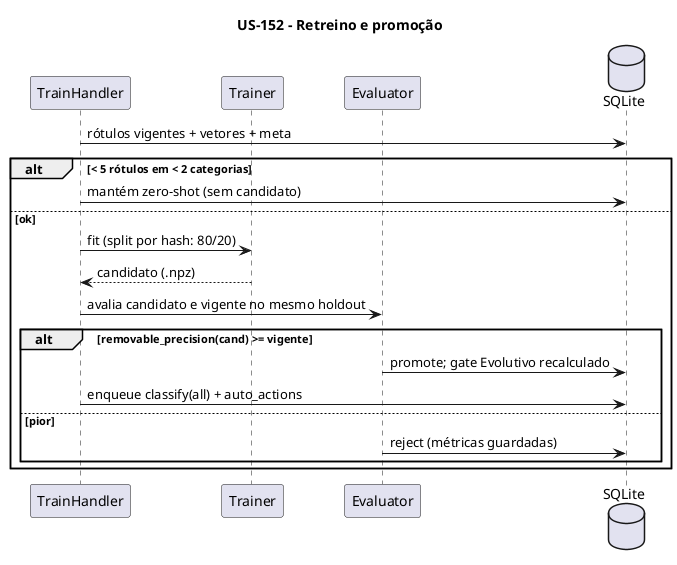

### Sequenciamento de Tarefas

| # | Tarefa | Escopo | Depende de |
|---|---|---|---|
| TF-152-01 | Classificador zero-shot | ML (bootstrap) | TF-151-02, TF-144-03 |
| TF-152-02 | Treinador supervisionado e serialização segura | ML (treino) | TF-151-04 |
| TF-152-03 | Avaliação em holdout, promoção e gate Evolutivo | ML (governança) | TF-152-02 |
| TF-152-04 | Handlers de treino e classificação | Pipeline ML | TF-152-01, TF-152-03, TF-148-02 |
| TF-152-05 | Suíte de testes de qualidade do modelo | Testes de ML | TF-152-04 |

### Tarefas

#### TF-152-01: [one-drive-cleaner] Classificador zero-shot

**User Story:** US-152 · **Épico:** E-ODC · **Sistema:** one-drive-cleaner · **Prioridade:** P1
**Complexidade:** C2 — Média · **Modelo sugerido:** Claude Sonnet 5.5 (`claude-sonnet-5-5`), esforço médio · **Escalonar para:** Opus 5.5
**Justificativa:** cálculo de similaridade e softmax com escala do modelo, cache de embeddings de texto por categoria e regra de bootstrap.

##### 1. Descrição e Objetivo

> **Eu como** sistema sem rótulos,
> **Eu quero** sugerir categorias comparando imagens a descrições textuais,
> **Para que** o utilizador tenha sugestões úteis desde a primeira varredura.

*Contexto Arquitetural:* plan 6 (zero-shot).

##### 2. Especificação Técnica

**2.1 Pontos de Interceptação**
- `src/odc/ml/zero_shot.py` — `ZeroShotClassifier(embedder)`: `prepare(categories)` (média dos embeddings dos `zero_shot_prompts` por categoria ativa; cache invalidado quando categorias mudam), `predict(embeddings) -> (category_ids, probs)` com softmax(`logit_scale` × cosseno); `should_bootstrap(label_counts) -> bool` (< 5 rótulos ou < 2 categorias com ≥ 5).
- `src/odc/ml/types.py` — `Prediction(category_id, confidence, margin)`; `margin = p1 - p2`.
- Testes `tests/unit/ml/test_zero_shot.py` (embedder fake).

**2.2 Dados e Persistência:** leitura de `category`; `model_version` com `strategy=zero_shot` criado como `current` no primeiro uso (`trigger=bootstrap`).

**2.3 Contrato de Dados:** `confidence ∈ [0,1]`, soma das probabilidades = 1 ± 1e-6.

**2.4 Resiliência e Zero Trust**

| Cenário de Falha | Estratégia | Impacto |
|---|---|---|
| Categoria sem prompts | Usa `description` como prompt | Sem exceção |
| Somente 1 categoria ativa | Confiança 1,0 com margem 1,0, sinalizada | Comportamento definido |

##### 3. Modelagem Visual
Coberta pela sequência da US-152.

##### 4. Orientação de Execução

**4.1 Contexto de Entrada:** plan 6; `src/odc/features/embedder.py`.

**4.2 Passos de Implementação**
1. Testes (probabilidades, margem, cache, bootstrap).
2. Implementar.

**4.3 Comando de Validação**
```bash
uv run pytest tests/unit/ml/test_zero_shot.py -q
```

**4.4 Restrições Negativas**
- NÃO usar metadados no zero-shot.

**4.5 Skills Obrigatórias:** `test-driven-agentic-development`, `commit-message`.

**4.6 Critérios de Saída**
- [ ] Validação 4.3 verde; cobertura ≥ 95%.

##### 5. Testes de Aceitação (DoD)
- [ ] Imagem sintética de screenshot classificada como `screenshot` com o fake.
- [ ] Nova categoria entra no zero-shot após `prepare`.

---

#### TF-152-02: [one-drive-cleaner] Treinador supervisionado e serialização segura

**User Story:** US-152 · **Épico:** E-ODC · **Sistema:** one-drive-cleaner · **Prioridade:** P1
**Complexidade:** C3 — Alta · **Modelo sugerido:** Claude Sonnet 5.5 (`claude-sonnet-5-5`), esforço alto · **Escalonar para:** Opus 5.5
**Justificativa:** montagem do dataset a partir de rótulos vigentes, padronização, busca de hiperparâmetro, determinismo e serialização sem pickle com equivalência de predição.

##### 1. Descrição e Objetivo

> **Eu como** sistema,
> **Eu quero** treinar um classificador com vetores e metadados a partir dos rótulos do utilizador,
> **Para que** as sugestões passem a refletir as preferências reais dele.

*Contexto Arquitetural:* plan 6 (treino supervisionado), 3.1 (`model_version.params`).

##### 2. Especificação Técnica

**2.1 Pontos de Interceptação**
- `src/odc/ml/dataset.py` — `build_dataset(labels, features, categories) -> Dataset(X, y, item_keys, split)`; usa rótulo vigente por item; exclui categorias arquivadas e com < 5 rótulos; `split` por `sha256(drive_item_id) mod 5 == 0` → holdout.
- `src/odc/ml/trainer.py` — `train(dataset, seed=42) -> TrainedModel`: `StandardScaler` apenas nas colunas de metadados; `LogisticRegression(multinomial, class_weight="balanced", max_iter=2000)`; `C ∈ {0.1, 1, 10}` escolhido por validação 3-fold dentro do conjunto de treino.
- `src/odc/ml/serialization.py` — `to_npz(model) -> bytes` (`coef`, `intercept`, `classes`, `scaler_mean`, `scaler_scale`, `meta_version`, `embedding_model_id`) e `from_npz(bytes) -> LinearModel` com `predict_proba` próprio em numpy (sem pickle; `allow_pickle=False`).
- Testes `tests/unit/ml/test_dataset.py`, `test_trainer.py`, `test_serialization.py`.

**2.2 Dados e Persistência:** leitura de `label`, `feature`, `category`; saída em `model_version.params`.

**2.3 Contrato de Dados:** `.npz` com as chaves listadas; `allow_pickle=False` obrigatório.

**2.4 Resiliência e Zero Trust**

| Cenário de Falha | Estratégia | Impacto |
|---|---|---|
| Feature de versão diferente (`meta_version`) | Itens excluídos do treino e reenfileirados para extração | Dataset consistente |
| Classe única no treino | `InsufficientLabels`; mantém modelo vigente | Sem modelo degenerado |
| `.npz` adulterado | Validação de chaves/shapes ao carregar → erro explícito | Sem execução arbitrária |

##### 3. Modelagem Visual
Coberta pela sequência da US-152.

##### 4. Orientação de Execução

**4.1 Contexto de Entrada:** plan 6; `src/odc/storage/repositories/features.py`, `labels.py`.

**4.2 Passos de Implementação**
1. Testes com dados sintéticos (separáveis e ruidosos).
2. Implementar dataset, trainer, serialização.
3. Teste de equivalência: `predict_proba` do sklearn × numpy do `.npz` (diferença ≤ 1e-6).

**4.3 Comando de Validação**
```bash
uv run pytest tests/unit/ml/test_dataset.py tests/unit/ml/test_trainer.py tests/unit/ml/test_serialization.py -q
```

**4.4 Restrições Negativas**
- NÃO usar `joblib`/pickle.
- NÃO incluir itens do holdout no treino.

**4.5 Skills Obrigatórias:** `test-driven-agentic-development`, `commit-message`.

**4.6 Critérios de Saída**
- [ ] Validação 4.3 verde; cobertura ≥ 95%.

##### 5. Testes de Aceitação (DoD)
- [ ] Mesmo dataset + seed → mesmo `.npz` (bytes idênticos).
- [ ] Item do holdout nunca aparece em `X_train`.
- [ ] Predições sklearn × numpy equivalentes.

---

#### TF-152-03: [one-drive-cleaner] Avaliação em holdout, promoção e gate Evolutivo

**User Story:** US-152 · **Épico:** E-ODC · **Sistema:** one-drive-cleaner · **Prioridade:** P1
**Complexidade:** C4 — Muito alta · **Modelo sugerido:** Claude Opus 5.5 (`claude-opus-5-5`), esforço alto · **Escalonar para:** revisão humana
**Justificativa:** as métricas decidem promoção e liberam movimentações automáticas de arquivos do utilizador; um erro de definição (limiar, suporte, holdout) causa falsos positivos em massa.

##### 1. Descrição e Objetivo

> **Eu como** utilizador,
> **Eu quero** que cada nova versão do aprendizado seja comparada de forma justa com a vigente e que o modo Automático só seja liberado com precisão comprovada,
> **Para que** fotos reais não sejam movidas por um modelo pior.

*Contexto Arquitetural:* plan 6 (`removable_precision`, gate, promoção), 2.6.

##### 2. Especificação Técnica

**2.1 Pontos de Interceptação**
- `src/odc/ml/metrics.py` — `per_category_precision_recall(y_true, y_pred)`; `removable_precision(y_true, probs, classes, removable_ids, threshold) -> (value | None, support)` (entre predições removíveis com confiança ≥ limiar, fração com rótulo removível; `None` se suporte < `gate_min_support`); `macro_f1`; `confusion_matrix`.
- `src/odc/ml/evaluator.py` — `evaluate(model, holdout) -> ModelMetrics` (JSON do plan 3.1); `compare(candidate, current) -> Decision(promote: bool, reason)`: promove se `rp(cand) >= rp(cur)`; com suporte insuficiente nos dois, promove se `macro_f1(cand) >= macro_f1(cur)`; vigente zero-shot é avaliado no mesmo holdout.
- `src/odc/ml/gate.py` — `auto_eligible(current_metrics, total_labels, settings) -> bool` (≥ `gate_precision`, ≥ `gate_min_labels`, suporte ≥ `gate_min_support`); `effective_mode(settings.automation_mode, eligible)` (`evolutive` → `auto` se elegível, senão `manual`).
- `src/odc/ml/registry.py` — `ModelRegistry`: `register_candidate`, `promote` (transação: vigente → `retired`, candidato → `current`), `reject`.
- Métricas: `odc.model.precision`, `odc.model.recall`, `odc.model.removable_precision`, `odc.model.auto_mode_eligible`, `odc.model.trainings`, `odc.automation.mode_effective`.
- Testes `tests/unit/ml/test_metrics.py`, `test_evaluator.py`, `test_gate.py`, `test_registry.py` com casos numéricos calculados à mão.

**2.2 Dados e Persistência:** `model_version.status`, `metrics`; índice único parcial garante 1 `current`.

**2.3 Contrato de Dados — `metrics` (JSON)**
```json
{
  "per_category": {"<category_id>": {"precision": "float", "recall": "float", "support": "int"}},
  "removable_precision": "float | null",
  "removable_support": "int",
  "macro_f1": "float",
  "confusion": [["int"]],
  "holdout_size": "int",
  "threshold": "float"
}
```

**2.4 Resiliência e Zero Trust**

| Cenário de Falha | Estratégia | Impacto |
|---|---|---|
| Holdout sem itens removíveis | `removable_precision=None`; gate falso | Automático nunca liberado sem evidência |
| Falha no meio da promoção | Transação única | Nunca 0 ou 2 `current` |
| Precisão do vigente cai abaixo de 0,98 após novos rótulos | `effective_mode` volta a `manual` (RN-15) | Automação suspensa |

##### 3. Modelagem Visual
Coberta pela sequência da US-152 e plan 2.6.

##### 4. Orientação de Execução

**4.1 Contexto de Entrada:** plan 6, 2.6, 3.1; `spec.md` RN-13, RN-15.

**4.2 Passos de Implementação**
1. Casos de teste numéricos à mão (matrizes pequenas) para cada métrica e borda (suporte 29/30, limiar exato 0,98).
2. Implementar métricas, avaliador, gate, registry.
3. Revisão do raciocínio por `multi-spec-review` (lentes QA e testing) antes do PR.

**4.3 Comando de Validação**
```bash
uv run pytest tests/unit/ml/test_metrics.py tests/unit/ml/test_evaluator.py tests/unit/ml/test_gate.py tests/unit/ml/test_registry.py -q
```

**4.4 Restrições Negativas**
- NÃO avaliar candidato e vigente em conjuntos diferentes.
- NÃO liberar Automático com `removable_precision=None`.

**4.5 Skills Obrigatórias:** `test-driven-agentic-development`, `multi-spec-review`, `commit-message`.

**4.6 Critérios de Saída**
- [ ] Validação 4.3 verde; cobertura 100% em `metrics.py` e `gate.py`.
- [ ] Revisão multi-spec sem achado crítico.

##### 5. Testes de Aceitação (DoD)
- [ ] Suporte 29 → `None`; suporte 30 com 30/30 corretos → 1,0.
- [ ] Candidato com 0,97 contra vigente 0,98 → rejeitado.
- [ ] `evolutive` + elegível → `auto`; perda de elegibilidade → `manual`.
- [ ] Promoção concorrente simulada mantém exatamente 1 `current`.

---

#### TF-152-04: [one-drive-cleaner] Handlers de treino e classificação

**User Story:** US-152 · **Épico:** E-ODC · **Sistema:** one-drive-cleaner · **Prioridade:** P1
**Complexidade:** C2 — Média · **Modelo sugerido:** Claude Sonnet 5.5 (`claude-sonnet-5-5`), esforço médio · **Escalonar para:** Opus 5.5
**Justificativa:** orquestração de componentes já testados em jobs, com gatilho por contagem de rótulos e cálculo em lote.

##### 1. Descrição e Objetivo

> **Eu como** sistema,
> **Eu quero** jobs que treinem ao atingir o número configurado de rótulos e reclassifiquem o acervo,
> **Para que** as sugestões fiquem sempre atualizadas sem ação manual.

*Contexto Arquitetural:* plan 2.4 (classificação), 2.6, 4.3 (`train`, `classify`).

##### 2. Especificação Técnica

**2.1 Pontos de Interceptação**
- `src/odc/ml/train_handler.py` — job `train`: monta dataset; se bootstrap → garante zero-shot `current`; senão treina (`ctx.cpu`), avalia, promove/rejeita; se promovido, enfileira `classify(all)` e `auto_actions(model_version_id)`.
- `src/odc/ml/classify_handler.py` — job `classify`: carrega matriz de features em blocos de 10 mil, prediz com o modelo `current` (zero-shot ou linear), grava `prediction` (`confidence`, `margin`) e `item.state=SUGERIDO` para `ANALISADO`/`RESTAURADO`; métricas `odc.predictions`, `odc.prediction.confidence`; span `odc.job.classify`.
- `src/odc/ml/triggers.py` — `maybe_enqueue_train(new_labels_since_current) -> job_id | None` (≥ `retrain_every`; deduplicado).
- Testes unitários + `tests/integration/test_ml_flow.py` (fakes).

**2.2 Dados e Persistência:** `prediction` (substituição completa por bloco), `item.state`, `model_version`.

**2.3 Contrato de Dados:** payloads `train`, `classify`, `auto_actions` do plan 4.3.

**2.4 Resiliência e Zero Trust**

| Cenário de Falha | Estratégia | Impacto |
|---|---|---|
| Queda no meio da reclassificação | Checkpoint por bloco (`last_item_id`) | Retoma do bloco seguinte |
| Modelo `current` de outro `embedding_model` | Classificação abortada com `FatalJobError(MODEL_MISMATCH)` + reextração exigida | Sem predição incoerente |

##### 3. Modelagem Visual
Coberta pela sequência da US-152.

##### 4. Orientação de Execução

**4.1 Contexto de Entrada:** `src/odc/ml/*`, `src/odc/jobs/handler.py`, plan 2.6, 4.3.

**4.2 Passos de Implementação**
1. Testes dos handlers com repositórios reais (SQLite temporário) e embedder fake.
2. Integração: 200 itens sintéticos → zero-shot → 25 rótulos → treino → promoção → reclassificação.

**4.3 Comando de Validação**
```bash
uv run pytest tests/unit/ml tests/integration/test_ml_flow.py -q
```

**4.4 Restrições Negativas**
- NÃO carregar todos os vetores de 50 mil em uma única cópia float32 além do necessário (blocos de 10 mil).

**4.5 Skills Obrigatórias:** `test-driven-agentic-development`, `commit-message`.

**4.6 Critérios de Saída**
- [ ] Validação 4.3 verde; cobertura ≥ 90%.

##### 5. Testes de Aceitação (DoD)
- [ ] 20º rótulo enfileira `train` uma única vez.
- [ ] Reclassificação de 50 mil vetores sintéticos ≤ 10 s (marcador `perf`).
- [ ] Item com rótulo do utilizador mantém predição gravada, mas a UI usa o rótulo (RN-11).

---

#### TF-152-05: [one-drive-cleaner] Suíte de testes de qualidade do modelo

**User Story:** US-152 · **Épico:** E-ODC · **Sistema:** one-drive-cleaner · **Prioridade:** P1
**Complexidade:** C4 — Muito alta · **Modelo sugerido:** Claude Opus 5.5 (`claude-opus-5-5`), esforço alto · **Escalonar para:** revisão humana
**Justificativa:** desenho de conjunto de referência sem fotos pessoais (geração sintética realista de prints + fotos CC0 com licença verificada), testes metamórficos e limiares que não sejam frágeis nem permissivos.

##### 1. Descrição e Objetivo

> **Eu como** mantenedor,
> **Eu quero** testes que comprovem qualidade, robustez e desempenho do modelo em dados públicos,
> **Para que** regressões de precisão sejam detectadas antes de chegar ao utilizador.

*Contexto Arquitetural:* plan 10.3.

##### 2. Especificação Técnica

**2.1 Pontos de Interceptação**
- `tests/model/data_gen/screenshots.py` — gerador de prints sintéticos (Pillow): telas de chat (balões, barra de status, teclado), telas de apps (listas, cards), em resoluções de celular reais; ≥ 150 imagens determinísticas por seed.
- `tests/model/data_gen/photos_manifest.json` + `tests/model/data_gen/download.py` — ≥ 150 fotos CC0 (pessoas, animais, paisagens) e ≥ 50 documentos/memes CC0 com URL, SHA-256 e licença; download para `tests/model/data/` (ignorado), verificação de hash.
- `tests/model/test_quality.py` — zero-shot print × foto ≥ 90% de acurácia; supervisionado (treino em 70%) `removable_precision` ≥ 0,98 no restante.
- `tests/model/test_metamorphic.py` — redimensionar 50%, JPEG q=60, recorte 10% → mesma classe em ≥ 95%; renomear foto real para `IMG-20240101-WA0001.jpg` e `Screenshot_...png` → nunca removível (RN-10).
- `tests/model/test_perf.py` (marcador `perf`) — treino com 50 mil vetores sintéticos ≤ 30 s; reclassificação ≤ 10 s.
- `tests/model/test_regression.py` + `tests/model/golden_metrics.json` — falha se precisão de qualquer categoria cair > 2 p.p.; atualização do golden só via flag explícita `--update-golden` com justificativa no PR.

**2.2 Dados e Persistência:** `tests/model/data/` local/cache do CI (não versionado).

**2.3 Contrato de Dados:** `photos_manifest.json`: `[{"url":"str","sha256":"str","license":"CC0-1.0","category":"real_photo|meme_sticker|document_receipt"}]`.

**2.4 Resiliência e Zero Trust**

| Cenário de Falha | Estratégia | Impacto |
|---|---|---|
| Hash divergente no download | Arquivo descartado; teste falha com mensagem | Dataset íntegro |
| URL indisponível | Retry 3×; persistindo, teste marcado `xfail` com aviso no CI semanal | Sem falso verde silencioso |
| Licença diferente de CC0 no manifesto | Teste de manifesto falha | Conformidade GPL/CC0 |

##### 3. Modelagem Visual
Não se aplica.

##### 4. Orientação de Execução

**4.1 Contexto de Entrada:** plan 10.3; `src/odc/ml/*`; `src/odc/features/*`.

**4.2 Passos de Implementação**
1. Gerador de prints + teste de determinismo.
2. Curadoria do manifesto CC0 (verificar licença de cada item) + downloader.
3. Testes de qualidade, metamórficos, desempenho, regressão; gerar golden inicial.
4. Integrar ao `ci-model.yml`.

**4.3 Comando de Validação**
```bash
uv run python tests/model/data_gen/download.py && uv run pytest tests/model -m "model or perf" -q
```

**4.4 Restrições Negativas**
- NÃO versionar imagens baixadas.
- NÃO usar imagens com licença diferente de CC0.

**4.5 Skills Obrigatórias:** `test-driven-agentic-development`, `commit-message`.

**4.6 Critérios de Saída**
- [ ] Validação 4.3 verde localmente e no `ci-model.yml`.

**4.7 Decomposição Iterativa (mimic-loop)**

**Modo de execução:** `mimic-loop` · **Max iterações:** 25 · **Projeto saga:** `exec:one-drive-cleaner:TF-152-05`

| # | RT / iteração | Critério de Conclusão | Depende de |
|---|---|---|---|
| RT-01 | Gerador de prints sintéticos | Determinístico, ≥ 150 imagens | — |
| RT-02 | Manifesto CC0 + downloader | Hashes verificados | — |
| RT-03 | Testes de qualidade | Verdes | RT-01, RT-02 |
| RT-04 | Testes metamórficos e RN-10 | Verdes | RT-03 |
| RT-05 | Desempenho e regressão (golden) | Verdes | RT-03 |
| RT-06 | Integração no CI de modelo | Workflow verde | RT-04, RT-05 |

##### 5. Testes de Aceitação (DoD)
- [ ] Todas as metas do plan 10.3 atendidas.
- [ ] Renomear foto real para padrão WhatsApp/print nunca a torna removível.
- [ ] Golden só muda com `--update-golden`.

---

## US-153: Revisão e classificação pelo utilizador

**Épico:** E-ODC — OneDrive Cleaner MVP
**Sistema:** one-drive-cleaner
**Estimativa:** 5 Story Points
**Prioridade:** P1

### Narrativa de Valor

> **Eu como** utilizador,
> **Eu quero** revisar primeiro as imagens em que o sistema tem menos certeza e confirmar ou corrigir a categoria em lote,
> **Para que** eu ensine o sistema com o menor esforço possível.

### Contexto de Negócio

J3 (active learning). Cada confirmação/correção vira rótulo (RN-11); o 20º rótulo dispara retreino (RN-12).

### Critérios de Aceitação (Nível de Negócio)

- [ ] Grade de miniaturas com sugestão e confiança, ordenada por incerteza, paginada (100 itens ≤ 2 s).
- [ ] Seleção múltipla, confirmação/correção em lote e atalhos de teclado.
- [ ] Progresso até o próximo retreino e distância até o gate do Automático visíveis.
- [ ] Miniaturas exibidas sem passar pelo disco; expiração tratada automaticamente.

### Regras de Negócio Aplicáveis

| # | Regra | Tipo |
|---|---|---|
| RN-11 | Classificação do utilizador vira aprendizado e prevalece | Obrigatória |
| RN-12 | Retreino a cada 20 rótulos ou sob comando | Condicional |
| RN-02 | Miniaturas exibidas direto do OneDrive, sem cópia local | Restritiva |

### Diagramas

**C4 N2 — Revisão**

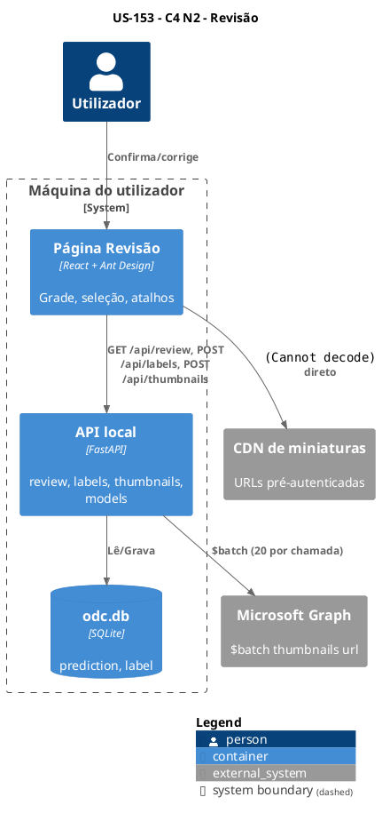

**Sequência — revisão e rotulagem**

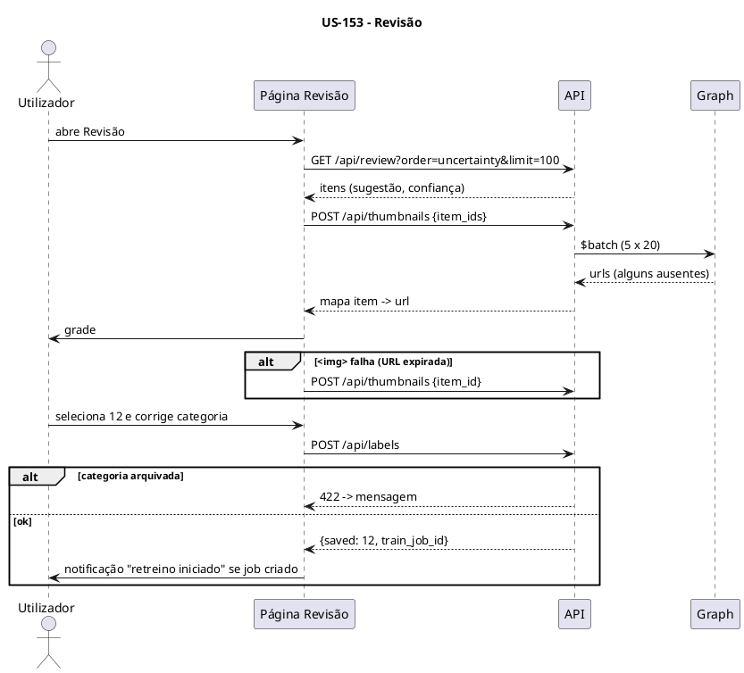

### Sequenciamento de Tarefas

| # | Tarefa | Escopo | Depende de |
|---|---|---|---|
| TF-153-01 | API de revisão, rótulos, miniaturas e modelos | API | TF-152-04, TF-147-04 |
| TF-153-02 | Página de Revisão | Front | TF-153-01, TF-144-06 |

### Tarefas

#### TF-153-01: [one-drive-cleaner] API de revisão, rótulos, miniaturas e modelos

**User Story:** US-153 · **Épico:** E-ODC · **Sistema:** one-drive-cleaner · **Prioridade:** P1
**Complexidade:** C2 — Média · **Modelo sugerido:** Claude Sonnet 5.5 (`claude-sonnet-5-5`), esforço médio · **Escalonar para:** Opus 5.5
**Justificativa:** 5 rotas com paginação por cursor, cache de URLs com TTL e gatilho de retreino; contratos já definidos.

##### 1. Descrição e Objetivo

> **Eu como** página de Revisão,
> **Eu quero** listar sugestões por incerteza, obter URLs de miniaturas e gravar rótulos,
> **Para que** o utilizador revise e ensine o sistema.

*Contexto Arquitetural:* plan 4.1 (`/api/review`, `/api/thumbnails`, `/api/labels`, `/api/models`, `/api/models/train`), 6 (ordem por margem).

##### 2. Especificação Técnica

**2.1 Pontos de Interceptação**
- `src/odc/web/routes/review.py` — `GET /api/review` (itens `SUGERIDO` sem rótulo vigente por padrão; filtro `category_id`; `order=uncertainty|confidence`; cursor), `POST /api/labels` (1..500; valida item e categoria ativa; grava `source=review`; métrica `odc.review.decisions`; chama `maybe_enqueue_train`).
- `src/odc/web/routes/thumbnails.py` — `POST /api/thumbnails` (1..100 IDs internos → `drive_item_id` → `$batch` em grupos de 20); cache em memória por item com TTL 30 min (LRU 5.000 entradas).
- `src/odc/web/routes/models.py` — `GET /api/models` (vigente, candidatos recentes, `auto_eligible`, `gate` com valores e metas), `POST /api/models/train` (409 se já houver).
- Testes `tests/unit/web/test_review_routes.py`, `test_thumbnails_routes.py`, `test_models_routes.py`.

**2.2 Dados e Persistência:** `prediction` (`ix_pred_cat_margin`), `label`.

**2.3 Contrato de Dados:** plan 4.1; `POST /api/labels` → `{"saved":"int","train_job_id":"int|null"}`.

**2.4 Resiliência e Zero Trust**

| Cenário de Falha | Estratégia | Impacto |
|---|---|---|
| ID de item inexistente/alheio | 422 com IDs inválidos em `details` | Nada gravado (tudo-ou-nada) |
| Graph indisponível no `$batch` | Retorna mapa parcial/vazio (200) | UI mostra placeholder e tenta depois |
| URLs no log | Nunca registradas (redaction) | Privacidade |

##### 3. Modelagem Visual
Coberta pelos diagramas da US-153.

##### 4. Orientação de Execução

**4.1 Contexto de Entrada:** `src/odc/storage/repositories/predictions.py`, `labels.py`, `src/odc/ml/triggers.py`, plan 4.1.

**4.2 Passos de Implementação**
1. Testes de rota (TestClient + Graph fake in-process).
2. Implementar; `make contract`.

**4.3 Comando de Validação**
```bash
uv run pytest tests/unit/web/test_review_routes.py tests/unit/web/test_thumbnails_routes.py tests/unit/web/test_models_routes.py -q && make contract
```

**4.4 Restrições Negativas**
- NÃO aceitar `drive_item_id` vindo do cliente.

**4.5 Skills Obrigatórias:** `test-driven-agentic-development`, `commit-message`.

**4.6 Critérios de Saída**
- [ ] Validação 4.3 verde; cobertura ≥ 90%.

##### 5. Testes de Aceitação (DoD)
- [ ] Página 1 e 2 sem sobreposição; ordenação por margem crescente.
- [ ] 100 IDs → 5 chamadas `$batch`; segunda requisição usa cache.
- [ ] 20º rótulo retorna `train_job_id`.

---

#### TF-153-02: [one-drive-cleaner] Página de Revisão

**User Story:** US-153 · **Épico:** E-ODC · **Sistema:** one-drive-cleaner · **Prioridade:** P1
**Complexidade:** C3 — Alta · **Modelo sugerido:** Claude Sonnet 5.5 (`claude-sonnet-5-5`), esforço alto · **Escalonar para:** Opus 5.5
**Justificativa:** interface rica (grade responsiva, seleção múltipla, atalhos, ações em lote, recuperação de imagem expirada) com acessibilidade e vários estados.

##### 1. Descrição e Objetivo

> **Eu como** utilizador,
> **Eu quero** uma grade de miniaturas com sugestões, seleção em lote e atalhos,
> **Para que** eu classifique centenas de imagens rapidamente.

*Contexto Arquitetural:* plan 9.2 (Revisão), 9.3 (acessibilidade).

##### 2. Especificação Técnica

**2.1 Pontos de Interceptação**
- `frontend/src/pages/Review/ReviewPage.tsx` — filtros (`Select` de categoria, `Segmented` incerteza/confiança), `Pagination`, barra de ações em lote (`Affix`) com "Confirmar sugestão" e "Classificar como…" (`Select`), `Progress` até o próximo retreino, `Statistic` do gate (rótulos, precisão vs 0,98).
- `frontend/src/components/ThumbnailGrid/ThumbnailGrid.tsx` — `Row`/`Col` responsivo de `Card` com `Image` (preview), `Checkbox`, `Tag` da categoria sugerida, `Progress type="circle"` (confiança), `onError` → refetch da URL (máx. 1 vez por item) e depois placeholder; `Skeleton` no carregamento; `Empty` sem itens.
- `frontend/src/components/ThumbnailGrid/useThumbnails.ts` — busca URLs em lote para a página atual.
- `frontend/src/pages/Review/useReviewShortcuts.ts` — teclas: setas (foco), espaço (selecionar), `Enter` (confirmar sugestão do focado), `1..9` (categoria por índice), `a` (selecionar página); `aria-keyshortcuts`.
- `frontend/src/api/review.ts`, `labels.ts`, `models.ts`.
- Testes co-localizados (RTL + MSW + user-event).

**2.2 Dados e Persistência:** não se aplica.

**2.3 Contrato de Dados:** TF-153-01.

**2.4 Resiliência e Zero Trust**

| Cenário de Falha | Estratégia | Impacto |
|---|---|---|
| URL expirada | Refetch único e placeholder | Sem loop |
| Falha ao salvar rótulos | Seleção mantida + `message.error` + "Tentar novamente" | Sem perda do trabalho |
| Página fica vazia após rotular | Avança automaticamente para a próxima página válida | Fluxo contínuo |

##### 3. Modelagem Visual
Coberta pelos diagramas da US-153.

##### 4. Orientação de Execução

**4.1 Contexto de Entrada:** `frontend/src/api/client.ts`, `schema.gen.ts`, plan 9.2, 9.3.

**4.2 Passos de Implementação**
1. Handlers MSW com 250 itens e URLs fake.
2. Testes do grid (seleção, erro de imagem, estados) e da página (lote, atalhos, paginação, progresso de retreino).
3. Implementar.

**4.3 Comando de Validação**
```bash
pnpm --dir frontend vitest run src/pages/Review src/components/ThumbnailGrid --coverage && pnpm --dir frontend lint
```

**4.4 Restrições Negativas**
- NÃO usar `dangerouslySetInnerHTML`.
- NÃO baixar imagens via `fetch` (somente ``).

**4.5 Skills Obrigatórias:** `test-driven-agentic-development`, `expert-lsp`, `commit-message`.

**4.6 Critérios de Saída**
- [ ] Validação 4.3 verde; cobertura ≥ 90/85.

**4.7 Decomposição Iterativa (mimic-loop)**

**Modo de execução:** `mimic-loop` · **Max iterações:** 20 · **Projeto saga:** `exec:one-drive-cleaner:TF-153-02`

| # | RT / iteração | Critério de Conclusão | Depende de |
|---|---|---|---|
| RT-01 | Hooks de API e handlers MSW | Testes verdes | — |
| RT-02 | `ThumbnailGrid` + `useThumbnails` | Testes verdes | RT-01 |
| RT-03 | Página com filtros, paginação e lote | Testes verdes | RT-02 |
| RT-04 | Atalhos e acessibilidade | Testes verdes | RT-03 |

##### 5. Testes de Aceitação (DoD)
- [ ] Selecionar 3 e "Classificar como Print de tela" envia 3 rótulos.
- [ ] Tecla `Enter` confirma a sugestão do card focado.
- [ ] Imagem com erro tenta nova URL uma vez.
- [ ] Notificação de retreino ao receber `train_job_id`.

---

## US-154: Categorias extensíveis

**Épico:** E-ODC — OneDrive Cleaner MVP
**Sistema:** one-drive-cleaner
**Estimativa:** 3 Story Points
**Prioridade:** P2

### Narrativa de Valor

> **Eu como** utilizador,
> **Eu quero** criar categorias próprias e definir se elas podem ir para a quarentena,
> **Para que** a limpeza reflita meus tipos de imagem descartáveis, sem nunca arriscar fotos reais.

### Contexto de Negócio

J6; RN-08 e RN-09 ("Foto real" protegida).

### Critérios de Aceitação (Nível de Negócio)

- [ ] Criar categoria com nome, descrição e "removível"; ela passa a ser sugerida (zero-shot imediato; supervisionado com ≥ 5 rótulos).
- [ ] Renomear, alterar "removível" e arquivar categorias; "Foto real" bloqueada para essas ações.
- [ ] Nomes duplicados rejeitados.

### Regras de Negócio Aplicáveis

| # | Regra | Tipo |
|---|---|---|
| RN-08 | Categorias iniciais e extensíveis com atributo "removível" | Obrigatória |
| RN-09 | "Foto real" protegida | Restritiva |

### Diagramas

**Sequência — gestão de categoria** (US de fluxo único: um container, sem mensageria)

```plantuml
@startuml
title US-154 - Categorias
actor Utilizador as U
participant "Página Categorias" as P
participant "API" as A
participant "CategoryService" as C
database "SQLite" as DB
U -> P : cria "Cupom fiscal" (removível)
P -> A : POST /api/categories
A -> C : create
alt nome duplicado
  C --> A : 409 CONFLICT
else ok
  C -> DB : insert (prompts a partir da descrição)
  C -> C : invalida cache zero-shot
  A --> P : 201
end
U -> P : tenta arquivar "Foto real"
P -> A : PATCH /api/categories/{id} {archived:true}
A -> C : update
C --> A : 422 PROTECTED_CATEGORY
@enduml
```

### Sequenciamento de Tarefas

| # | Tarefa | Escopo | Depende de |
|---|---|---|---|
| TF-154-01 | Serviço e API de categorias | Domínio + API | TF-152-01 |
| TF-154-02 | Página de Categorias | Front | TF-154-01 |

### Tarefas

#### TF-154-01: [one-drive-cleaner] Serviço e API de categorias

**User Story:** US-154 · **Épico:** E-ODC · **Sistema:** one-drive-cleaner · **Prioridade:** P2
**Complexidade:** C2 — Média · **Modelo sugerido:** Claude Sonnet 5.5 (`claude-sonnet-5-5`), esforço médio · **Escalonar para:** Opus 5.5
**Justificativa:** regras de proteção, unicidade, geração de prompts e efeitos colaterais (cache zero-shot, quarentena de itens de categoria que deixa de ser removível).

##### 1. Descrição e Objetivo

> **Eu como** utilizador,
> **Eu quero** gerir categorias respeitando a proteção de "Foto real",
> **Para que** o vocabulário de classificação evolua com segurança.

*Contexto Arquitetural:* plan 3.1 (`category`), 4.1 (`/api/categories`), 6 (nova categoria).

##### 2. Especificação Técnica

**2.1 Pontos de Interceptação**
- `src/odc/ml/categories.py` — `CategoryService`: `create(name, description, removable)` (slug normalizado; prompts = `["a photo of {description_en?}", description]` — descrição usada como prompt textual direto); `update` (bloqueia `protected`); `archive` (bloqueia `protected`; categoria arquivada sai de sugestões e do treino); ao tornar uma categoria não removível, itens dela em quarentena sem rótulo removível são restaurados via `auto_actions` (RN-17).
- `src/odc/web/routes/categories.py` — `GET`, `POST`, `PATCH /api/categories/{id}`.
- Testes `tests/unit/ml/test_categories.py`, `tests/unit/web/test_categories_routes.py`.

**2.2 Dados e Persistência:** `category`; CHECK de proteção no banco (TF-144-02) como segunda barreira.

**2.3 Contrato de Dados:** plan 4.1 (`name` 1..60, `description` 1..300).

**2.4 Resiliência e Zero Trust**

| Cenário de Falha | Estratégia | Impacto |
|---|---|---|
| Ação em categoria protegida | 422 `PROTECTED_CATEGORY` | Bloqueado |
| Nome duplicado (case-insensitive) | 409 | Bloqueado |
| HTML/script no nome | Armazenado como texto; React escapa | Sem XSS |

##### 3. Modelagem Visual
Coberta pela sequência da US-154.

##### 4. Orientação de Execução

**4.1 Contexto de Entrada:** `src/odc/storage/repositories/categories.py`, `src/odc/ml/zero_shot.py`.

**4.2 Passos de Implementação**
1. Testes de serviço e rota.
2. Implementar; `make contract`.

**4.3 Comando de Validação**
```bash
uv run pytest tests/unit/ml/test_categories.py tests/unit/web/test_categories_routes.py -q && make contract
```

**4.4 Restrições Negativas**
- NÃO permitir excluir categorias (somente arquivar; rótulos históricos preservados).

**4.5 Skills Obrigatórias:** `test-driven-agentic-development`, `commit-message`.

**4.6 Critérios de Saída**
- [ ] Validação 4.3 verde; cobertura ≥ 90%.

##### 5. Testes de Aceitação (DoD)
- [ ] Renomear/arquivar/tornar removível "Foto real" → 422.
- [ ] "Cupom" e "cupom" → 409.
- [ ] Categoria nova aparece no zero-shot após criação.

---

#### TF-154-02: [one-drive-cleaner] Página de Categorias

**User Story:** US-154 · **Épico:** E-ODC · **Sistema:** one-drive-cleaner · **Prioridade:** P2
**Complexidade:** C1 — Baixa · **Modelo sugerido:** Claude Haiku 5.5 (`claude-haiku-5-5`) · **Escalonar para:** Sonnet 5.5
**Justificativa:** CRUD visual padrão com `Table`, `Drawer` e `Form`.

##### 1. Descrição e Objetivo

> **Eu como** utilizador,
> **Eu quero** uma tela para listar, criar, editar e arquivar categorias,
> **Para que** eu gerencie o vocabulário de classificação.

*Contexto Arquitetural:* plan 9.2 (Categorias).

##### 2. Especificação Técnica

**2.1 Pontos de Interceptação**
- `frontend/src/pages/Categories/CategoriesPage.tsx` — `Table` (nome, removível, protegida, rótulos, arquivada), `Button` "Nova categoria".
- `frontend/src/pages/Categories/CategoryDrawer.tsx` — `Drawer` + `Form` (`Input`, `Input.TextArea`, `Switch` removível) com validação espelhando a API.
- Ações: editar, `Popconfirm` arquivar; linha "Foto real" com ações desabilitadas e `Tooltip` explicando RN-09.
- `frontend/src/api/categories.ts`; testes co-localizados.

**2.2 Dados e Persistência:** não se aplica.

**2.3 Contrato de Dados:** TF-154-01.

**2.4 Resiliência e Zero Trust**

| Cenário de Falha | Estratégia | Impacto |
|---|---|---|
| 409 nome duplicado | Erro no campo do formulário | Correção imediata |

##### 3. Modelagem Visual
Coberta pela sequência da US-154.

##### 4. Orientação de Execução

**4.1 Contexto de Entrada:** `frontend/src/api/client.ts`, plan 9.2.

**4.2 Passos de Implementação**
1. Testes (lista, criar, duplicado, arquivar, protegida desabilitada).
2. Implementar.

**4.3 Comando de Validação**
```bash
pnpm --dir frontend vitest run src/pages/Categories --coverage && pnpm --dir frontend lint
```

**4.4 Restrições Negativas**
- NÃO esconder "Foto real" da lista.

**4.5 Skills Obrigatórias:** `test-driven-agentic-development`, `expert-lsp`, `commit-message`.

**4.6 Critérios de Saída**
- [ ] Validação 4.3 verde; cobertura ≥ 90/85.

##### 5. Testes de Aceitação (DoD)
- [ ] Criar categoria fecha o `Drawer` e atualiza a tabela.
- [ ] Ações de "Foto real" desabilitadas com `Tooltip`.

---

## US-155: Quarentena reversível e exclusão segura

**Épico:** E-ODC — OneDrive Cleaner MVP
**Sistema:** one-drive-cleaner
**Estimativa:** 13 Story Points
**Prioridade:** P1

### Narrativa de Valor

> **Eu como** utilizador,
> **Eu quero** mover imagens não-foto para uma quarentena no OneDrive, restaurá-las quando houver engano e enviá-las à lixeira só com confirmação,
> **Para que** eu libere espaço sem nunca perder uma foto real.

### Contexto de Negócio

J4 e J5; RN-14 a RN-22. É a única US que altera arquivos do utilizador: toda operação é registrada em diário e reconciliável.

### Critérios de Aceitação (Nível de Negócio)

- [ ] Pastas `/OneDrive Cleaner/Quarentena` e `/Restaurados` criadas e recriadas se apagadas.
- [ ] Mover manual respeita categorias removíveis e bloqueia "Foto real"; Automático/Evolutivo movem conforme limiar e gate.
- [ ] Restaurar devolve à pasta e nome originais (com fallback); restauração automática após retreino (RN-17).
- [ ] Excluir somente da quarentena, com confirmação de quantidade e volume; vai para a lixeira.
- [ ] Interrupção em qualquer operação é reconciliada no reinício sem item órfão.

### Regras de Negócio Aplicáveis

| # | Regra | Tipo |
|---|---|---|
| RN-09 | "Foto real" nunca vai para a quarentena | Restritiva |
| RN-14, RN-15, RN-16 | Modos Manual/Automático/Evolutivo; limiar 0,98; gate | Obrigatória/Condicional |
| RN-17 | Restauração automática após reclassificação não removível | Obrigatória |
| RN-27 | Rodada automática move no máximo 30% do acervo ativo | Restritiva |
| RN-18, RN-19 | Quarentena com origem registrada; restauração com fallback | Obrigatória |
| RN-20 | Exclusão só da quarentena, confirmada, para a lixeira, nunca automática | Restritiva |
| RN-21 | Nunca alterar conteúdo de arquivos | Restritiva |
| RN-22 | Diário antes e depois de cada operação | Obrigatória |

### Diagramas

**C4 N2 — Quarentena**

```plantuml
@startuml
!include <C4/C4_Container>
title US-155 - C4 N2 - Quarentena
Person(user, "Utilizador")
System_Boundary(local, "Máquina do utilizador") {
  Container(spa, "Páginas Quarentena/Revisão", "React + Ant Design", "Mover, restaurar, excluir")
  Container(api, "API local", "FastAPI", "Políticas e confirmação")
  Container(runner, "Runner", "asyncio", "Jobs move/restore/delete/auto_actions/reconcile")
  Container(qsvc, "Quarantine Service + Journal", "Python", "Intenção -> operação -> resultado")
  ContainerDb(db, "odc.db", "SQLite", "quarantine_entry, journal, item")
}
System_Ext(graph, "Microsoft Graph / OneDrive", "PATCH, DELETE, GET, POST children")
Rel(user, spa, "Ações")
Rel(spa, api, "POST moves/restores/deletions")
Rel(api, runner, "Enfileira")
Rel(runner, qsvc, "Executa")
Rel(qsvc, graph, "Operações")
Rel(qsvc, db, "Diário e estados")
SHOW_LEGEND()
@enduml
```

**Sequência — mover com diário e reconciliação** (versão completa: plan 2.5)

```plantuml
@startuml
title US-155 - Operação com diário
participant "Quarantine Service" as Q
participant "Journal" as J
participant "Graph" as G
database "SQLite" as DB
Q -> J : intent(op_id, item, origem, destino)
J -> DB : phase=intent (commit)
Q -> G : PATCH/DELETE
alt sucesso
  G --> Q : 200/204
  Q -> DB : estado + quarantine_entry (commit)
  Q -> J : done
else 409 nome existente
  Q -> G : PATCH com " (n)"
else 404
  Q -> DB : REMOVIDO_EXTERNAMENTE; J failed
else erro transitório esgotado
  Q -> J : failed(erro)
end
== reinício com intent pendente ==
J -> G : GET item (parentReference, eTag)
alt já no destino
  J -> DB : aplica efeito + reconciled(done)
else ainda na origem
  J -> DB : reconciled(failed) e reenfileira se ação do utilizador
end
@enduml
```

### Sequenciamento de Tarefas

| # | Tarefa | Escopo | Depende de |
|---|---|---|---|
| TF-155-01 | Pastas da aplicação no OneDrive | Estrutura no OneDrive | TF-147-04 |
| TF-155-02 | Diário de operações e reconciliação | Consistência | TF-144-03, TF-147-04 |
| TF-155-03 | Mover para a quarentena | Operação: mover | TF-155-01, TF-155-02 |
| TF-155-04 | Restaurar da quarentena | Operação: restaurar | TF-155-01, TF-155-02 |
| TF-155-05 | Exclusão com confirmação para a lixeira | Operação: excluir | TF-155-02 |
| TF-155-06 | Política de automação e restauração automática | Regras de automação | TF-155-03, TF-155-04, TF-152-03 |
| TF-155-07 | API de quarentena | API | TF-155-03..06 |
| TF-155-08 | Página de Quarentena e ação de mover na Revisão | Front | TF-155-07, TF-153-02 |

### Tarefas

#### TF-155-01: [one-drive-cleaner] Pastas da aplicação no OneDrive

**User Story:** US-155 · **Épico:** E-ODC · **Sistema:** one-drive-cleaner · **Prioridade:** P1
**Complexidade:** C2 — Média · **Modelo sugerido:** Claude Sonnet 5.5 (`claude-sonnet-5-5`), esforço médio · **Escalonar para:** Opus 5.5
**Justificativa:** idempotência de criação, detecção de pasta apagada/renomeada e atualização de IDs persistidos.

##### 1. Descrição e Objetivo

> **Eu como** aplicação,
> **Eu quero** garantir a existência das pastas Quarentena e Restaurados,
> **Para que** movimentações e restaurações sempre tenham destino válido.

*Contexto Arquitetural:* plan 3.1 (`app_meta`), 4.2 (pastas do app), spec 4 (pasta de quarentena apagada).

##### 2. Especificação Técnica

**2.1 Pontos de Interceptação**
- `src/odc/quarantine/folders.py` — `AppFolders.ensure() -> AppFolderIds` (`/OneDrive Cleaner`, `/OneDrive Cleaner/Quarentena`, `/OneDrive Cleaner/Restaurados`); valida IDs de `app_meta` com `get_item` (404/`deleted` → recria e atualiza; renomeada/movida → aceita pelo ID e atualiza `display`); chamado no login (J1 passo 5), antes de cada job de ação e no startup.
- Testes `tests/unit/quarantine/test_folders.py`.

**2.2 Dados e Persistência:** `app_meta` (`app_root_folder_id`, `quarantine_folder_id`, `restored_folder_id`).

**2.3 Contrato de Dados:** não se aplica.

**2.4 Resiliência e Zero Trust**

| Cenário de Falha | Estratégia | Impacto |
|---|---|---|
| Pasta apagada pelo utilizador | Recriada; itens que estavam nela tratados pela varredura (F8) | Quarentena volta a funcionar |
| Corrida de criação (409) | Busca por caminho e usa o existente | Idempotente |

##### 3. Modelagem Visual
Coberta pelo C4 N2 da US-155.

##### 4. Orientação de Execução

**4.1 Contexto de Entrada:** `src/odc/graph/client.py` (`ensure_folder`, `get_item`).

**4.2 Passos de Implementação**
1. Testes com Graph fake (inexistente, existente, apagada, 409).
2. Implementar e registrar chamadas (login, startup, pré-ação).

**4.3 Comando de Validação**
```bash
uv run pytest tests/unit/quarantine/test_folders.py -q
```

**4.4 Restrições Negativas**
- NÃO localizar pastas por nome quando há ID válido.

**4.5 Skills Obrigatórias:** `test-driven-agentic-development`, `commit-message`.

**4.6 Critérios de Saída**
- [ ] Validação 4.3 verde; cobertura ≥ 95%.

##### 5. Testes de Aceitação (DoD)
- [ ] Chamadas repetidas não criam pastas duplicadas.
- [ ] Pasta apagada é recriada e o novo ID persistido.

---

#### TF-155-02: [one-drive-cleaner] Diário de operações e reconciliação

**User Story:** US-155 · **Épico:** E-ODC · **Sistema:** one-drive-cleaner · **Prioridade:** P0
**Complexidade:** C4 — Muito alta · **Modelo sugerido:** Claude Opus 5.5 (`claude-opus-5-5`), esforço alto · **Escalonar para:** revisão humana
**Justificativa:** garantia de consistência entre banco local e OneDrive após falhas em qualquer ponto; erros deixam itens sem origem registrada ou com estado divergente.

##### 1. Descrição e Objetivo

> **Eu como** utilizador,
> **Eu quero** que toda movimentação, restauração e exclusão seja registrada antes e depois e reconciliada após qualquer interrupção,
> **Para que** nenhum item fique perdido entre a quarentena e a pasta original.

*Contexto Arquitetural:* plan 2.5 (retomada), 3.1 (`journal`), RN-22.

##### 2. Especificação Técnica

**2.1 Pontos de Interceptação**
- `src/odc/quarantine/journal.py` — `Journal`: `intent(operation, item_id, from_parent, to_parent, from_name, to_name) -> op_id` (commit imediato, antes da chamada externa), `done(op_id, effects)`, `failed(op_id, error_code)`; `effects` aplicados na mesma transação de `done` (estado do item, `quarantine_entry`).
- `src/odc/quarantine/reconciler.py` — `Reconciler.run()`: para cada `intent` sem resultado, `get_item` e decide: `move` → item no destino? aplica efeito `done` (`reconciled`), na origem? `failed` + reenfileira se `mode=manual`; `restore` análogo; `delete` → 404/`deleted` = `done`, existente = `failed`; `ensure_folder` → reexecuta `ensure`. Job `reconcile` + `StartupHook`.
- Métricas `odc.journal.pending` (observável), `odc.journal.reconciled{outcome}`; span `odc.journal.reconcile`.
- Testes `tests/unit/quarantine/test_journal.py`, `test_reconciler.py` + `tests/resilience/test_journal_crash.py` (falhas injetadas entre intent e chamada, entre chamada e done).

**2.2 Dados e Persistência:** `journal`, `quarantine_entry`, `item`.

**2.3 Contrato de Dados:** `journal.phase` ∈ `intent | done | failed | reconciled`; `op_id` UUID v4.

**2.4 Resiliência e Zero Trust**

| Cenário de Falha | Estratégia | Impacto |
|---|---|---|
| Queda após a chamada e antes do `done` | Reconciler consulta estado real e aplica efeito | Estado convergente |
| Queda antes da chamada | Item ainda na origem → `failed`; ação manual reenfileirada | Nada perdido |
| Graph indisponível na reconciliação | Mantém `intent`; nova tentativa no próximo ciclo; alerta `journal.pending > 0` por 5 min | Visível ao utilizador |

##### 3. Modelagem Visual
Coberta pela sequência da US-155.

##### 4. Orientação de Execução

**4.1 Contexto de Entrada:** plan 2.5, 3.1; `src/odc/storage/repositories/journal.py`, `quarantine.py`.

**4.2 Passos de Implementação**
1. Matriz de cenários (operação × ponto de falha × estado real) como teste parametrizado.
2. Implementar `journal.py` e `reconciler.py`.
3. Teste de resiliência com falhas injetadas.

**4.3 Comando de Validação**
```bash
uv run pytest tests/unit/quarantine/test_journal.py tests/unit/quarantine/test_reconciler.py tests/resilience/test_journal_crash.py -q
```

**4.4 Restrições Negativas**
- NÃO chamar a Graph dentro da transação do `intent`.
- NÃO apagar entradas do diário.

**4.5 Skills Obrigatórias:** `test-driven-agentic-development`, `systematic-debugging`, `multi-spec-review`, `commit-message`.

**4.6 Critérios de Saída**
- [ ] Validação 4.3 verde; cobertura 100% em `reconciler.py`.
- [ ] Revisão multi-spec sem achado crítico.

##### 5. Testes de Aceitação (DoD)
- [ ] Todos os cenários da matriz convergem para estado coerente com o OneDrive fake.
- [ ] `journal.pending` volta a 0 após reconciliação.
- [ ] Nenhum `quarantine_entry` ativo sem `original_parent_id`.

---

#### TF-155-03: [one-drive-cleaner] Mover para a quarentena

**User Story:** US-155 · **Épico:** E-ODC · **Sistema:** one-drive-cleaner · **Prioridade:** P1
**Complexidade:** C3 — Alta · **Modelo sugerido:** Claude Sonnet 5.5 (`claude-sonnet-5-5`), esforço alto · **Escalonar para:** Opus 5.5
**Justificativa:** política de proteção aplicada no serviço, tratamento de conflito de nome e isolamento por item com diário.

##### 1. Descrição e Objetivo

> **Eu como** utilizador,
> **Eu quero** mover itens não-foto para a quarentena registrando a origem,
> **Para que** eles saiam do acervo de forma reversível.

*Contexto Arquitetural:* plan 2.5 (mover), RN-09, RN-18, RN-21.

##### 2. Especificação Técnica

**2.1 Pontos de Interceptação**
- `src/odc/quarantine/policy.py` — `can_quarantine(item, current_label, prediction, categories) -> Decision` (função pura): estado `SUGERIDO`/`RESTAURADO`; categoria efetiva (rótulo vigente, senão predição) removível; nunca se rótulo vigente for protegido (RN-09); motivo de bloqueio enumerado.
- `src/odc/quarantine/move.py` — `MoveHandler` (job `move`, `mode=manual|auto`): `AppFolders.ensure`; por item: política → `intent` → `move(item, quarantine_id)`; 409 → tenta `"<base> (n).<ext>"` até n=20; sucesso → `quarantine_entry` (`original_parent_id`, `original_parent_path`, `original_name`, `quarantined_name`, `mode`) + `QUARENTENA` + `done`; 404 → `REMOVIDO_EXTERNAMENTE` + `failed`.
- Métricas `odc.quarantine.moves{mode,result}`; span `odc.quarantine.move`.
- Testes `tests/unit/quarantine/test_policy.py`, `test_move.py`; integração `tests/integration/test_quarantine_flow.py` (parte mover).

**2.2 Dados e Persistência:** `quarantine_entry`, `item`, `journal`.

**2.3 Contrato de Dados:** payload `move` do plan 4.3.

**2.4 Resiliência e Zero Trust**

| Cenário de Falha | Estratégia | Impacto |
|---|---|---|
| Item mudou de categoria entre o pedido e a execução | Política reavaliada na execução | Bloqueado se não removível |
| 20 conflitos de nome | `failed(NAME_CONFLICT)` | Item permanece na origem |
| Item alterado (cTag) desde a análise | Não move; volta a `DESCOBERTO` | Reanálise |

##### 3. Modelagem Visual
Coberta pelos diagramas da US-155 e plan 2.5.

##### 4. Orientação de Execução

**4.1 Contexto de Entrada:** plan 2.5; `src/odc/quarantine/journal.py`, `folders.py`; `src/odc/graph/client.py`.

**4.2 Passos de Implementação**
1. Testes da política (tabela verdade completa).
2. Testes do handler (sucesso, 409, 404, bloqueio, cTag mudado).
3. Implementar.

**4.3 Comando de Validação**
```bash
uv run pytest tests/unit/quarantine/test_policy.py tests/unit/quarantine/test_move.py -q
```

**4.4 Restrições Negativas**
- NÃO confiar na validação feita pela API (reavaliar no handler).

**4.5 Skills Obrigatórias:** `test-driven-agentic-development`, `commit-message`.

**4.6 Critérios de Saída**
- [ ] Validação 4.3 verde; cobertura 100% em `policy.py`.

##### 5. Testes de Aceitação (DoD)
- [ ] Item com rótulo "Foto real" nunca é movido, mesmo com predição removível 0,99.
- [ ] Conflito de nome grava `quarantined_name` diferente de `original_name`.
- [ ] Cada item movido tem `journal` `intent` → `done`.

---

#### TF-155-04: [one-drive-cleaner] Restaurar da quarentena

**User Story:** US-155 · **Épico:** E-ODC · **Sistema:** one-drive-cleaner · **Prioridade:** P1
**Complexidade:** C3 — Alta · **Modelo sugerido:** Claude Sonnet 5.5 (`claude-sonnet-5-5`), esforço alto · **Escalonar para:** Opus 5.5
**Justificativa:** recriação de caminho original, fallback, restauração de nome e registro de rótulo de correção.

##### 1. Descrição e Objetivo

> **Eu como** utilizador,
> **Eu quero** devolver itens da quarentena à pasta e ao nome originais,
> **Para que** enganos sejam desfeitos por completo.

*Contexto Arquitetural:* plan 2.5 (restaurar), RN-11, RN-19.

##### 2. Especificação Técnica

**2.1 Pontos de Interceptação**
- `src/odc/quarantine/restore.py` — `RestoreHandler` (job `restore`, `reason=false_positive|reclassified|manual`): por item `QUARENTENA`: `intent` → `move(item, original_parent_id, original_name)`; 404 da pasta → recria `original_parent_path` segmento a segmento via `ensure_folder` a partir da raiz e tenta de novo; falha → move para `Restaurados` (`restore_fallback=1`); 409 de nome → sufixo `" (restaurado n)"`; sucesso → `RESTAURADO`, `quarantine_entry.status=restored`, `restore_reason`; enfileira `classify(item_ids)`.
- O rótulo de correção (`source=quarantine_restore`) é gravado pela API (TF-155-07) antes do job.
- Métricas `odc.quarantine.restores{reason,result,fallback}`; span `odc.quarantine.restore`.
- Testes `tests/unit/quarantine/test_restore.py` + integração.

**2.2 Dados e Persistência:** `quarantine_entry`, `item`, `journal`.

**2.3 Contrato de Dados:** payload `restore` do plan 4.3.

**2.4 Resiliência e Zero Trust**

| Cenário de Falha | Estratégia | Impacto |
|---|---|---|
| Pasta original apagada | Recria caminho | Restauração completa |
| Recriação impossível | Fallback `Restaurados` + aviso | Item não fica na quarentena |
| Item não está mais na quarentena | Ignorado com `failed(NOT_IN_QUARANTINE)` | Sem efeito |

##### 3. Modelagem Visual
Coberta pelos diagramas da US-155 e plan 2.5.

##### 4. Orientação de Execução

**4.1 Contexto de Entrada:** plan 2.5; `src/odc/quarantine/journal.py`, `folders.py`.

**4.2 Passos de Implementação**
1. Testes: sucesso, pasta apagada (recriação), recriação falha (fallback), conflito de nome, item fora da quarentena.
2. Implementar.

**4.3 Comando de Validação**
```bash
uv run pytest tests/unit/quarantine/test_restore.py tests/integration/test_quarantine_flow.py -q
```

**4.4 Restrições Negativas**
- NÃO restaurar para pasta diferente da original sem marcar `restore_fallback`.

**4.5 Skills Obrigatórias:** `test-driven-agentic-development`, `commit-message`.

**4.6 Critérios de Saída**
- [ ] Validação 4.3 verde; cobertura ≥ 95%.

##### 5. Testes de Aceitação (DoD)
- [ ] Item volta com o nome original mesmo quando renomeado na quarentena.
- [ ] Caminho `/Imagens/Camera Roll/2024` recriado quando apagado.
- [ ] Fallback marcado e exposto na API.

---

#### TF-155-05: [one-drive-cleaner] Exclusão com confirmação para a lixeira

**User Story:** US-155 · **Épico:** E-ODC · **Sistema:** one-drive-cleaner · **Prioridade:** P1
**Complexidade:** C3 — Alta · **Modelo sugerido:** Claude Sonnet 5.5 (`claude-sonnet-5-5`), esforço alto · **Escalonar para:** Opus 5.5
**Justificativa:** operação destrutiva: token de confirmação de uso único vinculado ao conjunto, precondição por eTag e proibição de exclusão automática.

##### 1. Descrição e Objetivo

> **Eu como** utilizador,
> **Eu quero** enviar itens da quarentena para a lixeira somente após confirmar quantidade e volume,
> **Para que** nenhuma exclusão aconteça por engano ou automaticamente.

*Contexto Arquitetural:* plan 2.5 (excluir), 4.1 (preview/confirm), RN-20.

##### 2. Especificação Técnica

**2.1 Pontos de Interceptação**
- `src/odc/quarantine/confirmation.py` — `ConfirmationStore`: `issue(item_ids) -> (token, count, total_bytes, expires_at)` (somente itens `QUARENTENA`; token aleatório 256 bits; TTL 5 min; vinculado ao hash do conjunto ordenado de IDs e à sessão); `consume(token, item_ids, session) -> bool` (uso único; conjunto idêntico).
- `src/odc/quarantine/delete.py` — `DeleteHandler` (job `delete`): exige `confirmation_id` consumido; por item: confirma estado `QUARENTENA` → `intent` → `delete(item, etag)`; 204 → `EXCLUIDO`, `deleted_at`; 412 → `failed(ETAG_CHANGED)` e item volta a exigir revisão; 404 → `done` (já não existe).
- Garantia RN-20: `DeleteHandler` só é enfileirado pela rota de confirmação; `auto_actions` não tem caminho para `delete` (teste de arquitetura com import-linter/grep).
- Métricas `odc.quarantine.deletes{result}`.
- Testes `tests/unit/quarantine/test_confirmation.py`, `test_delete.py`.

**2.2 Dados e Persistência:** `item.state=EXCLUIDO`; metadados e rótulos preservados (RN-26).

**2.3 Contrato de Dados:** plan 4.1 (`deletions/preview`, `deletions`).

**2.4 Resiliência e Zero Trust**

| Cenário de Falha | Estratégia | Impacto |
|---|---|---|
| Token expirado/reutilizado/conjunto diferente | `INVALID_CONFIRMATION` | Nada excluído |
| Item restaurado entre preview e confirmação | Ignorado na execução (estado ≠ `QUARENTENA`) | Sem exclusão indevida |
| eTag mudou | 412 → não exclui | Conteúdo novo preservado |

##### 3. Modelagem Visual
Coberta pelos diagramas da US-155 e plan 2.5.

##### 4. Orientação de Execução

**4.1 Contexto de Entrada:** plan 2.5, 4.1; `src/odc/graph/client.py` (`delete`).

**4.2 Passos de Implementação**
1. Testes do token (TTL com relógio injetado, uso único, conjunto, sessão).
2. Testes do handler e teste de arquitetura (nenhum caminho automático para delete).
3. Implementar.

**4.3 Comando de Validação**
```bash
uv run pytest tests/unit/quarantine/test_confirmation.py tests/unit/quarantine/test_delete.py -q
```

**4.4 Restrições Negativas**
- NÃO excluir permanentemente (sem chamadas à lixeira para "esvaziar").
- NÃO aceitar exclusão de item fora da quarentena.

**4.5 Skills Obrigatórias:** `test-driven-agentic-development`, `commit-message`.

**4.6 Critérios de Saída**
- [ ] Validação 4.3 verde; cobertura 100% em `confirmation.py`.

##### 5. Testes de Aceitação (DoD)
- [ ] Token usado duas vezes → segunda falha.
- [ ] Token de 5 min + 1 s → falha.
- [ ] Item `SUGERIDO` nunca é excluído, mesmo com token válido para outro conjunto.

---

#### TF-155-06: [one-drive-cleaner] Política de automação e restauração automática

**User Story:** US-155 · **Épico:** E-ODC · **Sistema:** one-drive-cleaner · **Prioridade:** P1
**Complexidade:** C4 — Muito alta · **Modelo sugerido:** Claude Opus 5.5 (`claude-opus-5-5`), esforço alto · **Escalonar para:** revisão humana
**Justificativa:** decide movimentações automáticas de arquivos do utilizador combinando modo, gate, limiar, rótulos e categorias; erro move fotos reais em massa.

##### 1. Descrição e Objetivo

> **Eu como** utilizador que confia no modo Evolutivo,
> **Eu quero** que a aplicação mova automaticamente apenas o que atingir o limiar com modelo aprovado e devolva o que deixou de ser removível,
> **Para que** a limpeza aconteça sozinha sem risco desproporcional.

*Contexto Arquitetural:* plan 2.6, 6 (RN-17), RN-14..RN-17.

##### 2. Especificação Técnica

**2.1 Pontos de Interceptação**
- `src/odc/quarantine/automation.py` — `select_auto_moves(predictions, labels, categories, threshold) -> list[item_id]` (pura): `SUGERIDO`, sem rótulo vigente, categoria prevista removível, `confidence ≥ threshold`, sem rótulo protegido; `select_auto_restores(entries, labels, predictions, categories) -> list[item_id]` (pura): `QUARENTENA` cujo rótulo vigente é não removível, **ou** sem rótulo e predição atual não removível; nunca itens com rótulo vigente removível (RN-11).
- `src/odc/quarantine/auto_actions_handler.py` — job `auto_actions(model_version_id)`: ignora se o modelo não é mais o `current`; restaura (RN-17, qualquer modo, `reason=reclassified`); calcula `effective_mode` (TF-152-03); se `auto` → enfileira `move(mode=auto)` com a seleção; span `odc.job.auto_actions` (`mode_effective`, `moved`, `restored`).
- Testes `tests/unit/quarantine/test_automation.py` (tabela verdade completa) e `test_auto_actions_handler.py`.

**2.2 Dados e Persistência:** leitura de `prediction`, `label`, `category`, `quarantine_entry`, `setting`.

**2.3 Contrato de Dados:** payload `auto_actions` do plan 4.3.

**2.4 Resiliência e Zero Trust**

| Cenário de Falha | Estratégia | Impacto |
|---|---|---|
| Modelo trocado entre enfileirar e executar | Job ignorado (outro `auto_actions` virá) | Sem ação com modelo antigo |
| Gate perdido no meio | `effective_mode` reavaliado na execução | Sem movimentação |
| Volume anormal (> 30% do acervo em uma rodada) | Limite de segurança (RN-27): move no máximo 30% do acervo ativo por rodada, registra o alerta `AUTO_MOVE_CAPPED`; o restante aguarda revisão | Contém erro sistemático |

##### 3. Modelagem Visual
Coberta pelo plan 2.6.

##### 4. Orientação de Execução

**4.1 Contexto de Entrada:** plan 2.6, 6; `src/odc/ml/gate.py`; `src/odc/quarantine/policy.py`.

**4.2 Passos de Implementação**
1. Tabela verdade (modo × elegibilidade × confiança × rótulo × categoria × estado) em teste parametrizado.
2. Implementar funções puras e handler.
3. Revisão via `multi-spec-review` (QA, testing, ethics) antes do PR.

**4.3 Comando de Validação**
```bash
uv run pytest tests/unit/quarantine/test_automation.py tests/unit/quarantine/test_auto_actions_handler.py -q
```

**4.4 Restrições Negativas**
- NÃO enfileirar `delete` a partir deste módulo.
- NÃO mover item com rótulo do utilizador.

**4.5 Skills Obrigatórias:** `test-driven-agentic-development`, `multi-spec-review`, `commit-message`.

**4.6 Critérios de Saída**
- [ ] Validação 4.3 verde; cobertura 100% em `automation.py`.
- [ ] Revisão multi-spec sem achado crítico.

##### 5. Testes de Aceitação (DoD)
- [ ] Manual: nenhuma movimentação automática; restaurações RN-17 executadas.
- [ ] Evolutivo não elegível: idem Manual; elegível: move só `confidence ≥ 0,98`.
- [ ] Item em quarentena com rótulo removível nunca restaurado pelo modelo.
- [ ] Limite de 30% (RN-27) aplicado e alerta `AUTO_MOVE_CAPPED` registrado.

---

#### TF-155-07: [one-drive-cleaner] API de quarentena

**User Story:** US-155 · **Épico:** E-ODC · **Sistema:** one-drive-cleaner · **Prioridade:** P1
**Complexidade:** C2 — Média · **Modelo sugerido:** Claude Sonnet 5.5 (`claude-sonnet-5-5`), esforço médio · **Escalonar para:** Opus 5.5
**Justificativa:** 5 rotas com validação de política na borda, gravação de rótulos de correção e fluxo preview/confirm.

##### 1. Descrição e Objetivo

> **Eu como** interface,
> **Eu quero** rotas para mover, listar, restaurar e excluir com confirmação,
> **Para que** o utilizador opere a quarentena.

*Contexto Arquitetural:* plan 4.1 (rotas `/api/quarantine/*`).

##### 2. Especificação Técnica

**2.1 Pontos de Interceptação**
- `src/odc/web/routes/quarantine.py` — `POST /api/quarantine/moves` (valida política para feedback imediato; 422 `PROTECTED_CATEGORY` com IDs; enfileira `move(manual)`), `GET /api/quarantine` (filtro categoria, cursor, `total_bytes`, `restore_fallback` recentes), `POST /api/quarantine/restores` (grava rótulos `source=quarantine_restore` + enfileira `restore(false_positive)`), `POST /api/quarantine/deletions/preview`, `POST /api/quarantine/deletions` (consome token; enfileira `delete`).
- Testes `tests/unit/web/test_quarantine_routes.py`.

**2.2 Dados e Persistência:** `label`, `job`, `quarantine_entry` (leitura).

**2.3 Contrato de Dados:** plan 4.1.

**2.4 Resiliência e Zero Trust**

| Cenário de Falha | Estratégia | Impacto |
|---|---|---|
| Lista mista (válidos + protegidos) | 422 tudo-ou-nada com IDs bloqueados em `details` | Utilizador decide |
| `restores` de item fora da quarentena | 422 `NOT_IN_QUARANTINE` | Nada gravado |

##### 3. Modelagem Visual
Coberta pelos diagramas da US-155.

##### 4. Orientação de Execução

**4.1 Contexto de Entrada:** `src/odc/quarantine/*`, plan 4.1.

**4.2 Passos de Implementação**
1. Testes de rota.
2. Implementar; `make contract`.

**4.3 Comando de Validação**
```bash
uv run pytest tests/unit/web/test_quarantine_routes.py -q && make contract
```

**4.4 Restrições Negativas**
- NÃO executar operações Graph na requisição.

**4.5 Skills Obrigatórias:** `test-driven-agentic-development`, `commit-message`.

**4.6 Critérios de Saída**
- [ ] Validação 4.3 verde; cobertura ≥ 90%.

##### 5. Testes de Aceitação (DoD)
- [ ] Restore grava rótulo e enfileira job em uma transação.
- [ ] Deletion sem preview → 422 `INVALID_CONFIRMATION`.

---

#### TF-155-08: [one-drive-cleaner] Página de Quarentena e ação de mover na Revisão

**User Story:** US-155 · **Épico:** E-ODC · **Sistema:** one-drive-cleaner · **Prioridade:** P1
**Complexidade:** C3 — Alta · **Modelo sugerido:** Claude Sonnet 5.5 (`claude-sonnet-5-5`), esforço alto · **Escalonar para:** Opus 5.5
**Justificativa:** fluxo destrutivo na UI (modal com digitação da quantidade), restauração com escolha de categoria, avisos de fallback e integração com a página de Revisão.

##### 1. Descrição e Objetivo

> **Eu como** utilizador,
> **Eu quero** ver a quarentena, restaurar enganos e excluir com confirmação explícita,
> **Para que** eu decida com segurança o destino de cada item.

*Contexto Arquitetural:* plan 9.2 (Quarentena), RN-20.

##### 2. Especificação Técnica

**2.1 Pontos de Interceptação**
- `frontend/src/pages/Quarantine/QuarantinePage.tsx` — `Statistic` (itens, volume), filtro por categoria, `Table` com seleção (miniatura, categoria `Tag`, `mode`, `moved_at`), ações "Restaurar" e "Excluir".
- `frontend/src/pages/Quarantine/RestoreModal.tsx` — `Modal` com `Select` da categoria correta (obrigatório).
- `frontend/src/components/DeleteConfirmModal/DeleteConfirmModal.tsx` — chama preview; mostra quantidade e volume; `Input` exige digitar a quantidade exata para habilitar "Enviar para a lixeira"; trata token expirado (refaz preview).
- `frontend/src/pages/Quarantine/FallbackAlerts.tsx` — `Alert` listando restaurações em `Restaurados`.
- `frontend/src/pages/Review/ReviewPage.tsx` — ação em lote "Mover para quarentena" (desabilitada se seleção contiver "Foto real"; exibe IDs bloqueados retornados em 422).
- `frontend/src/api/quarantine.ts`; testes co-localizados.

**2.2 Dados e Persistência:** não se aplica.

**2.3 Contrato de Dados:** TF-155-07.

**2.4 Resiliência e Zero Trust**

| Cenário de Falha | Estratégia | Impacto |
|---|---|---|
| Token expirado no confirm | Modal refaz preview e pede nova confirmação | Sem exclusão com dados antigos |
| Duplo clique em excluir | Botão bloqueado durante a requisição | Sem jobs duplicados |

##### 3. Modelagem Visual
Coberta pelos diagramas da US-155.

##### 4. Orientação de Execução

**4.1 Contexto de Entrada:** `frontend/src/api/client.ts`, `frontend/src/pages/Review/ReviewPage.tsx`, plan 9.2.

**4.2 Passos de Implementação**
1. Testes do `DeleteConfirmModal` (quantidade errada/certa, expiração, duplo clique).
2. Testes da página e do `RestoreModal`; teste da ação de mover na Revisão.
3. Implementar.

**4.3 Comando de Validação**
```bash
pnpm --dir frontend vitest run src/pages/Quarantine src/components/DeleteConfirmModal src/pages/Review --coverage && pnpm --dir frontend lint
```

**4.4 Restrições Negativas**
- NÃO oferecer "Excluir" fora da tela de Quarentena.

**4.5 Skills Obrigatórias:** `test-driven-agentic-development`, `expert-lsp`, `commit-message`.

**4.6 Critérios de Saída**
- [ ] Validação 4.3 verde; cobertura ≥ 90/85.

##### 5. Testes de Aceitação (DoD)
- [ ] "Enviar para a lixeira" só habilita com a quantidade exata digitada.
- [ ] Restaurar exige categoria e envia `restores`.
- [ ] Mover com "Foto real" selecionada fica desabilitado.

---

## US-156: Configurações e painel de métricas

**Épico:** E-ODC — OneDrive Cleaner MVP
**Sistema:** one-drive-cleaner
**Estimativa:** 5 Story Points
**Prioridade:** P2

### Narrativa de Valor

> **Eu como** utilizador,
> **Eu quero** ajustar a automação e acompanhar precisão, quarentena, disco e alertas em uma tela,
> **Para que** eu decida com base em números quando confiar na automação.

### Contexto de Negócio

J8 e configurações de RN-12, RN-14, RN-16, RN-03 (teto). A tela de Métricas funciona sem a stack de monitoramento (plan 5.3.5).

### Critérios de Aceitação (Nível de Negócio)

- [ ] Configurações: modo, limiar, frequência de retreino, teto de temporário, telemetria (endpoint loopback) e logout.
- [ ] Métricas: itens por estado, backlog, precisão por versão, gate vs 0,98, quarentena por categoria, taxa de falso positivo, disco vs 500 MB e alertas ativos.

### Regras de Negócio Aplicáveis

| # | Regra | Tipo |
|---|---|---|
| RN-12, RN-14, RN-16 | Parâmetros configuráveis de retreino, modo e limiar | Condicional |
| RN-03 | Teto de temporário configurável; meta de disco final | Obrigatória |
| spec 5.4 | Indicadores e alertas | Obrigatória |

### Diagramas

**Sequência — leitura de métricas e alteração de configuração** (US de fluxo único)

```plantuml
@startuml
title US-156 - Configurações e métricas
actor Utilizador as U
participant "SPA" as S
participant "API" as A
database "SQLite" as DB
U -> S : abre Métricas
S -> A : GET /api/metrics/summary
A -> DB : agregações (estados, quarentena, rótulos, diário, disco)
A --> S : resumo + alertas
U -> S : altera limiar para 0,99
S -> A : PUT /api/settings
alt fora da faixa / endpoint não-loopback
  A --> S : 422 (campo inválido)
else ok
  A -> DB : grava
  A --> S : 200
end
@enduml
```

### Sequenciamento de Tarefas

| # | Tarefa | Escopo | Depende de |
|---|---|---|---|
| TF-156-01 | Serviço e API de configurações | Configuração | TF-144-03 |
| TF-156-02 | Serviço e API de resumo de métricas e alertas | Indicadores | TF-155-06, TF-151-05 |
| TF-156-03 | Página de Configurações | Front | TF-156-01 |
| TF-156-04 | Página de Métricas | Front | TF-156-02 |

### Tarefas

#### TF-156-01: [one-drive-cleaner] Serviço e API de configurações

**User Story:** US-156 · **Épico:** E-ODC · **Sistema:** one-drive-cleaner · **Prioridade:** P2
**Complexidade:** C1 — Baixa · **Modelo sugerido:** Claude Haiku 5.5 (`claude-haiku-5-5`) · **Escalonar para:** Sonnet 5.5
**Justificativa:** leitura/gravação validada de um conjunto fechado de parâmetros.

##### 1. Descrição e Objetivo

> **Eu como** utilizador,
> **Eu quero** ler e alterar parâmetros de automação e telemetria com validação,
> **Para que** a aplicação se comporte conforme minha preferência sem aceitar valores perigosos.

*Contexto Arquitetural:* plan 3.1 (`setting`), 4.1 (`/api/settings`).

##### 2. Especificação Técnica

**2.1 Pontos de Interceptação**
- `src/odc/settings/service.py` — `SettingsService.get()`, `update(patch)` (validação pydantic: `automation_mode`, `auto_threshold` 0,5–0,999, `retrain_every` 5–500, `temp_cap_bytes ≥ 256 MiB`, `otel_enabled`, `otel_endpoint` loopback); alteração de `otel_*` aplicada no próximo início (informado na resposta `restart_required: true`); alteração de modo/limiar enfileira `auto_actions` com o modelo vigente.
- `src/odc/web/routes/settings.py` — `GET`/`PUT /api/settings`.
- Testes `tests/unit/settings/test_service.py`, `tests/unit/web/test_settings_routes.py`.

**2.2 Dados e Persistência:** `setting`.

**2.3 Contrato de Dados:** plan 4.1 + `restart_required: bool` na resposta.

**2.4 Resiliência e Zero Trust**

| Cenário de Falha | Estratégia | Impacto |
|---|---|---|
| Endpoint OTel externo | 422 | Telemetria permanece local |
| Gate (`gate_*`) enviado pelo cliente | Rejeitado (`extra="forbid"`; metas fixas da spec) | Meta não alterável pela UI |

##### 3. Modelagem Visual
Coberta pela sequência da US-156.

##### 4. Orientação de Execução

**4.1 Contexto de Entrada:** `src/odc/storage/repositories/settings.py`, plan 4.1.

**4.2 Passos de Implementação**
1. Testes de validação e efeitos.
2. Implementar; `make contract`.

**4.3 Comando de Validação**
```bash
uv run pytest tests/unit/settings tests/unit/web/test_settings_routes.py -q && make contract
```

**4.4 Restrições Negativas**
- NÃO permitir alterar `gate_precision`, `gate_min_labels`, `gate_min_support` pela API.

**4.5 Skills Obrigatórias:** `test-driven-agentic-development`, `commit-message`.

**4.6 Critérios de Saída**
- [ ] Validação 4.3 verde; cobertura ≥ 95%.

##### 5. Testes de Aceitação (DoD)
- [ ] `auto_threshold=1.0` → 422.
- [ ] Mudar modo para `auto` enfileira `auto_actions`.
- [ ] Mudar endpoint OTel retorna `restart_required: true`.

---

#### TF-156-02: [one-drive-cleaner] Serviço e API de resumo de métricas e alertas

**User Story:** US-156 · **Épico:** E-ODC · **Sistema:** one-drive-cleaner · **Prioridade:** P2
**Complexidade:** C2 — Média · **Modelo sugerido:** Claude Sonnet 5.5 (`claude-sonnet-5-5`), esforço médio · **Escalonar para:** Opus 5.5
**Justificativa:** agregações eficientes sobre 50 mil itens e reprodução local das regras de alerta do plan 5.3.5.

##### 1. Descrição e Objetivo

> **Eu como** utilizador sem a stack de monitoramento,
> **Eu quero** os indicadores e alertas calculados pela própria aplicação,
> **Para que** eu acompanhe o essencial apenas com a interface.

*Contexto Arquitetural:* plan 4.1 (`/api/metrics/summary`), 5.3.5 (alertas).

##### 2. Especificação Técnica

**2.1 Pontos de Interceptação**
- `src/odc/metrics_summary/service.py` — `summary()`: `by_state` (`count_by_state`), `backlog` (extract/classify/review), `quarantine` (itens e bytes por categoria), `false_positive_rate` (restaurações `false_positive` ÷ movidos, janela 7 dias e total), `disk` (`CleanupService.disk_usage` + meta 500 MB), `models` (precisão por versão das últimas 10), `alerts` (journal pendente > 5 min; FP > 2% com Automático efetivo; temporário ≥ 90% do teto; `login_required` ativo; disco sem pesos > 500 MB; rodada automática limitada pela RN-27 nas últimas 24 h).
- `src/odc/web/routes/metrics.py` — `GET /api/metrics/summary`.
- Testes `tests/unit/metrics_summary/test_service.py`, `tests/unit/web/test_metrics_routes.py` + teste de desempenho (50 mil itens sintéticos ≤ 300 ms).

**2.2 Dados e Persistência:** consultas agregadas com índices existentes (`ix_item_state`, `ix_qe_status`, `ix_journal_phase`).

**2.3 Contrato de Dados**
```json
{
  "by_state": {"<estado>": "int"},
  "backlog": {"extract": "int", "classify": "int", "review": "int"},
  "quarantine": {"items": "int", "bytes": "int", "by_category": {"<category_id>": "int"}},
  "false_positive_rate": {"last_7d": "float | null", "total": "float | null"},
  "disk": {"temp": "int", "db": "int", "model": "int", "logs": "int", "budget_bytes": 524288000},
  "models": [{"id": "int", "status": "str", "removable_precision": "float | null", "created_at": "str"}],
  "alerts": [{"code": "JOURNAL_PENDING | HIGH_FALSE_POSITIVE | TEMP_NEAR_CAP | LOGIN_REQUIRED | DISK_OVER_BUDGET | AUTO_MOVE_CAPPED", "since": "str"}]
}
```

**2.4 Resiliência e Zero Trust**

| Cenário de Falha | Estratégia | Impacto |
|---|---|---|
| Divisão por zero (nenhum movido) | `null` | Exibido como "—" |
| Consulta lenta | Cache de 5 s em memória | UI responsiva |

##### 3. Modelagem Visual
Coberta pela sequência da US-156.

##### 4. Orientação de Execução

**4.1 Contexto de Entrada:** plan 4.1, 5.3.5; repositórios; `src/odc/cleanup/service.py`.

**4.2 Passos de Implementação**
1. Testes com dados semeados para cada alerta.
2. Implementar; `make contract`.

**4.3 Comando de Validação**
```bash
uv run pytest tests/unit/metrics_summary tests/unit/web/test_metrics_routes.py -q && make contract
```

**4.4 Restrições Negativas**
- NÃO incluir nomes/caminhos de itens no resumo.

**4.5 Skills Obrigatórias:** `test-driven-agentic-development`, `commit-message`.

**4.6 Critérios de Saída**
- [ ] Validação 4.3 verde; cobertura ≥ 90%; desempenho ≤ 300 ms.

##### 5. Testes de Aceitação (DoD)
- [ ] Cada um dos 6 alertas é disparado pelo cenário semeado correspondente.
- [ ] `false_positive_rate` correto com 50 movidos e 1 restaurado (0,02).

---

#### TF-156-03: [one-drive-cleaner] Página de Configurações

**User Story:** US-156 · **Épico:** E-ODC · **Sistema:** one-drive-cleaner · **Prioridade:** P2
**Complexidade:** C1 — Baixa · **Modelo sugerido:** Claude Haiku 5.5 (`claude-haiku-5-5`) · **Escalonar para:** Sonnet 5.5
**Justificativa:** formulário padrão do Ant Design com limites espelhados da API.

##### 1. Descrição e Objetivo

> **Eu como** utilizador,
> **Eu quero** um formulário para ajustar automação e telemetria,
> **Para que** eu controle o comportamento da aplicação.

*Contexto Arquitetural:* plan 9.2 (Configurações).

##### 2. Especificação Técnica

**2.1 Pontos de Interceptação**
- `frontend/src/pages/Settings/SettingsPage.tsx` — `Form` com `Segmented` (modo, com descrição do Evolutivo e estado atual do gate), `Slider` + `InputNumber` (limiar 0,5–0,999; retreino 5–500), `InputNumber` de teto (MB), `Switch` (telemetria), `Input` (endpoint, validação loopback), `Alert` quando `restart_required`, `Button` "Sair da conta".
- `frontend/src/api/settings.ts`; testes co-localizados.

**2.2 Dados e Persistência:** não se aplica.

**2.3 Contrato de Dados:** TF-156-01.

**2.4 Resiliência e Zero Trust**

| Cenário de Falha | Estratégia | Impacto |
|---|---|---|
| 422 da API | Erro mapeado para o campo | Correção guiada |

##### 3. Modelagem Visual
Coberta pela sequência da US-156.

##### 4. Orientação de Execução

**4.1 Contexto de Entrada:** `frontend/src/api/client.ts`, plan 9.2.

**4.2 Passos de Implementação**
1. Testes (limites, envio, erro por campo, aviso de reinício).
2. Implementar.

**4.3 Comando de Validação**
```bash
pnpm --dir frontend vitest run src/pages/Settings --coverage && pnpm --dir frontend lint
```

**4.4 Restrições Negativas**
- NÃO exibir campos do gate como editáveis.

**4.5 Skills Obrigatórias:** `test-driven-agentic-development`, `expert-lsp`, `commit-message`.

**4.6 Critérios de Saída**
- [ ] Validação 4.3 verde; cobertura ≥ 90/85.

##### 5. Testes de Aceitação (DoD)
- [ ] Endpoint `http://10.0.0.5:4317` bloqueado no formulário.
- [ ] Salvar exibe confirmação e `Alert` quando reinício é necessário.

---

#### TF-156-04: [one-drive-cleaner] Página de Métricas

**User Story:** US-156 · **Épico:** E-ODC · **Sistema:** one-drive-cleaner · **Prioridade:** P2
**Complexidade:** C2 — Média · **Modelo sugerido:** Claude Sonnet 5.5 (`claude-sonnet-5-5`), esforço médio · **Escalonar para:** Opus 5.5
**Justificativa:** composição de gráficos (`@ant-design/charts`) testáveis em jsdom, estatísticas e alertas.

##### 1. Descrição e Objetivo

> **Eu como** utilizador,
> **Eu quero** visualizar acervo, modelo, quarentena, disco e alertas,
> **Para que** eu saiba se posso confiar na automação e quanto espaço liberei.

*Contexto Arquitetural:* plan 9.2 (Métricas).

##### 2. Especificação Técnica

**2.1 Pontos de Interceptação**
- `frontend/src/pages/Metrics/MetricsPage.tsx` — `Statistic` (itens, quarentena, volume liberável, FP), `Column` (itens por estado), `Line` (precisão removível por versão com linha de meta 0,98), `Gauge` (precisão vigente vs 0,98), `Pie` (quarentena por categoria), `Progress` (disco vs 500 MB), `Alert` por alerta ativo (texto por código).
- `frontend/src/pages/Metrics/charts/*.tsx` — wrappers finos dos gráficos (carregamento lazy de `@ant-design/charts`).
- `frontend/src/api/metrics.ts` (refetch a cada 15 s com a página visível).
- Testes: componentes com mock do módulo de gráficos (verifica dados/config passados), página completa com MSW.
- `frontend/package.json` — dependência `@ant-design/charts@2`.

**2.2 Dados e Persistência:** não se aplica.

**2.3 Contrato de Dados:** TF-156-02.

**2.4 Resiliência e Zero Trust**

| Cenário de Falha | Estratégia | Impacto |
|---|---|---|
| Métrica `null` | Exibe "—" e oculta o gráfico correspondente com `Empty` | Sem erro de renderização |
| Falha da API | `Alert` + "Tentar novamente"; refetch pausado | Sem loop |

##### 3. Modelagem Visual
Coberta pela sequência da US-156.

##### 4. Orientação de Execução

**4.1 Contexto de Entrada:** `frontend/src/api/client.ts`, plan 9.2.

**4.2 Passos de Implementação**
1. Testes dos wrappers (dados transformados) e da página (estados).
2. Implementar.

**4.3 Comando de Validação**
```bash
pnpm --dir frontend vitest run src/pages/Metrics --coverage && pnpm --dir frontend lint
```

**4.4 Restrições Negativas**
- NÃO importar `@ant-design/charts` no bundle inicial (lazy).

**4.5 Skills Obrigatórias:** `test-driven-agentic-development`, `expert-lsp`, `dataviz`, `commit-message`.

**4.6 Critérios de Saída**
- [ ] Validação 4.3 verde; cobertura ≥ 90/85.

##### 5. Testes de Aceitação (DoD)
- [ ] Cada código de alerta exibe texto específico.
- [ ] Linha de meta 0,98 presente no gráfico de precisão.
- [ ] `false_positive_rate = null` exibe "—".

---

## US-157: Validação ponta a ponta, resiliência e volumetria

**Épico:** E-ODC — OneDrive Cleaner MVP
**Sistema:** one-drive-cleaner
**Estimativa:** 8 Story Points
**Prioridade:** P1

### Narrativa de Valor

> **Eu como** mantenedor,
> **Eu quero** comprovar automaticamente as jornadas, a retomada após falhas, os SLAs e a ausência de dados sensíveis,
> **Para que** a primeira release seja publicada com evidência de que cumpre a spec.

### Contexto de Negócio

Fecha os critérios de sucesso da spec 5.1, 5.2 e 5.5 (plan 10.2, 10.5).

### Critérios de Aceitação (Nível de Negócio)

- [ ] 14 cenários E2E (plan 10.5) verdes em Chromium e WebKit, incluindo acessibilidade.
- [ ] Kill-and-resume em varredura, extração e movimentação sem duplicação/perda.
- [ ] Volumetria de 50 mil itens dentro dos SLAs e metas de disco.
- [ ] Varredura de telemetria nos fluxos completos sem dados sensíveis.

### Regras de Negócio Aplicáveis

| # | Regra | Tipo |
|---|---|---|
| spec 5.1 | Critérios funcionais (J1–J8, interrupção) | Obrigatória |
| spec 5.2 | SLAs de desempenho | Obrigatória |
| RN-24 | Sem dados sensíveis na telemetria | Restritiva |

### Diagramas

**C4 N2 — Ambiente E2E**

```plantuml
@startuml
!include <C4/C4_Container>
title US-157 - C4 N2 - Ambiente E2E
System_Boundary(test, "Runner de testes (local/CI)") {
  Container(pw, "Playwright", "Chromium + WebKit", "Specs J1..J8, a11y")
  Container(launcher, "Launcher E2E", "Python (tests/)", "Injeta fakes, banco temporário")
  Container(app, "odc (modo E2E)", "FastAPI + Runner", "Aplicação real")
  Container(gfake, "Graph fake", "ASGI", "Estado + falhas")
  Container(idfake, "Identidade fake", "Python", "Tokens FAKE-")
  Container(efake, "Embedder fake", "Python", "Vetores determinísticos")
}
Rel(pw, launcher, "Fixture")
Rel(launcher, app, "Sobe com dependências fake")
Rel(pw, app, "UI http://127.0.0.1:<porta>")
Rel(app, gfake, "Graph")
Rel(app, idfake, "Auth")
Rel(app, efake, "Embeddings")
Rel(pw, gfake, "/__fake__/faults")
SHOW_LEGEND()
@enduml
```

**Sequência — cenário de interrupção**

```plantuml
@startuml
title US-157 - Kill-and-resume
participant "Teste" as T
participant "odc" as O
participant "Graph fake" as G
database "odc.db" as DB
T -> O : inicia move de 100 itens
O -> G : PATCH (itens 1..40)
T -> O : SIGKILL após 40 operações
T -> O : reinicia
O -> DB : requeue_orphans + reconcile (journal intent)
O -> G : GET itens pendentes
O -> DB : converge estados
O -> G : PATCH itens restantes
T -> G : verifica 100 itens na quarentena, 0 duplicados
T -> DB : verifica 100 quarantine_entry ativos, journal sem intent
@enduml
```

### Sequenciamento de Tarefas

| # | Tarefa | Escopo | Depende de |
|---|---|---|---|
| TF-157-01 | Harness E2E (launcher, fakes, Playwright) | Infra de teste E2E | TF-147-05, TF-151-03, TF-146-01 |
| TF-157-02 | Cenários E2E das jornadas e acessibilidade | Testes E2E | TF-157-01, US-149..US-156 |
| TF-157-03 | Testes de resiliência kill-and-resume | Testes de resiliência | TF-155-02, TF-149-02, TF-151-04 |
| TF-157-04 | Teste de volumetria e SLAs | Testes de volumetria | TF-152-04, TF-151-05 |
| TF-157-05 | Varredura de privacidade da telemetria ponta a ponta | Testes de telemetria | TF-145-02, TF-157-01 |

### Tarefas

#### TF-157-01: [one-drive-cleaner] Harness E2E (launcher, fakes, Playwright)

**User Story:** US-157 · **Épico:** E-ODC · **Sistema:** one-drive-cleaner · **Prioridade:** P1
**Complexidade:** C3 — Alta · **Modelo sugerido:** Claude Sonnet 5.5 (`claude-sonnet-5-5`), esforço alto · **Escalonar para:** Opus 5.5
**Justificativa:** orquestração de processos, portas aleatórias, injeção de dependências sem expor modo de teste no pacote e fixtures estáveis para dois navegadores.

##### 1. Descrição e Objetivo

> **Eu como** suíte E2E,
> **Eu quero** subir a aplicação real com OneDrive, identidade e embedder simulados,
> **Para que** jornadas completas sejam testadas sem conta real nem fotos pessoais.

*Contexto Arquitetural:* plan 10.5.

##### 2. Especificação Técnica

**2.1 Pontos de Interceptação**
- `tests/fakes/identity_fake.py` — `FakeAuthService` (mesma interface do `AuthService`; tokens `FAKE-`; controle de expiração/revogação).
- `tests/e2e_launcher/launch.py` — sobe Graph fake (porta aleatória) e `odc` via `create_app` com dependências fake e banco/diretórios temporários; imprime URLs em JSON; encerra tudo ao sair.
- `e2e/playwright.config.ts` — projetos `chromium` e `webkit`; `webServer` chamando o launcher; `retries: 1` só no CI; trace em falha.
- `e2e/fixtures/app.ts` — fixtures: `app` (URLs), `fakeGraph` (seed, falhas via `/__fake__/faults`), `login()`.
- `e2e/specs/smoke.spec.ts` — abre, loga, vê o menu.
- `Makefile` — `test-e2e` real; job `e2e` no CI deixa de ser no-op.
- `scripts/verify_dist.py` — confirma que `tests/` e `e2e/` não entram no wheel (já coberto; adicionar caso).

**2.2 Dados e Persistência:** diretórios temporários por execução.

**2.3 Contrato de Dados:** saída do launcher `{"app_url":"str","graph_url":"str"}`.

**2.4 Resiliência e Zero Trust**

| Cenário de Falha | Estratégia | Impacto |
|---|---|---|
| Processo órfão após falha do teste | Launcher registra `atexit` + grupo de processos | CI limpo |
| Porta em uso | Porta aleatória livre | Sem colisão |

##### 3. Modelagem Visual
Coberta pelo C4 N2 da US-157.

##### 4. Orientação de Execução

**4.1 Contexto de Entrada:** `tests/fakes/*`, `src/odc/web/app.py` (`create_app`), plan 10.5.

**4.2 Passos de Implementação**
1. `identity_fake.py` + testes.
2. Launcher + teste que sobe e derruba.
3. Configuração Playwright, fixtures e smoke.

**4.3 Comando de Validação**
```bash
uv run pytest tests/unit/fakes -q && make test-e2e
```

**4.4 Restrições Negativas**
- NÃO adicionar flags de modo de teste em `src/odc/`.

**4.5 Skills Obrigatórias:** `test-driven-agentic-development`, `commit-message`.

**4.6 Critérios de Saída**
- [ ] Smoke verde em Chromium e WebKit localmente e no CI.

##### 5. Testes de Aceitação (DoD)
- [ ] Nenhum processo restante após a suíte.
- [ ] Wheel não contém `tests/` nem `e2e/`.

---

#### TF-157-02: [one-drive-cleaner] Cenários E2E das jornadas e acessibilidade

**User Story:** US-157 · **Épico:** E-ODC · **Sistema:** one-drive-cleaner · **Prioridade:** P1
**Complexidade:** C3 — Alta · **Modelo sugerido:** Claude Sonnet 5.5 (`claude-sonnet-5-5`), esforço alto · **Escalonar para:** Opus 5.5
**Justificativa:** 14 cenários com estados assíncronos (jobs), injeção de falhas e asserções de acessibilidade; exigem esperas determinísticas para evitar flakiness.

##### 1. Descrição e Objetivo

> **Eu como** mantenedor,
> **Eu quero** cenários E2E cobrindo J1–J8, interrupção, throttling e acessibilidade,
> **Para que** a experiência completa seja validada a cada PR.

*Contexto Arquitetural:* plan 10.5 (tabela de cenários).

##### 2. Especificação Técnica

**2.1 Pontos de Interceptação**
- `e2e/specs/j1-onboarding.spec.ts`, `j2-scan.spec.ts`, `j3-review-retrain.spec.ts`, `j4-move-manual.spec.ts`, `j4-auto-gate.spec.ts`, `j5-restore.spec.ts`, `j5-restore-fallback.spec.ts`, `rn17-auto-restore.spec.ts`, `j5-delete.spec.ts`, `j6-categories.spec.ts`, `j7-incremental.spec.ts`, `j8-metrics.spec.ts`, `edge-throttling.spec.ts`, `a11y.spec.ts` (axe em todas as telas: zero `serious`/`critical`).
- `e2e/support/waits.ts` — esperas por estado de job via API (`GET /api/jobs`), nunca `waitForTimeout`.
- Seletores por papel/rótulo acessível (`getByRole`, `getByLabel`); `data-testid` apenas onde não houver papel.

**2.2 Dados e Persistência:** Graph fake semeado por cenário.

**2.3 Contrato de Dados:** não se aplica.

**2.4 Resiliência e Zero Trust**

| Cenário de Falha | Estratégia | Impacto |
|---|---|---|
| Flakiness por tempo | Esperas por estado; proibido `waitForTimeout` (regra ESLint `playwright/no-wait-for-timeout`) | Suíte estável |
| Cenário dependente de outro | Cada spec semeia seu próprio estado | Isolamento |

##### 3. Modelagem Visual
Coberta pelos diagramas da US-157.

##### 4. Orientação de Execução

**4.1 Contexto de Entrada:** `e2e/fixtures/*`, `spec.md` (J1–J8), plan 10.5.

**4.2 Passos de Implementação**
1. `waits.ts` e helpers de seed.
2. Um spec por vez, na ordem da tabela.
3. Rodar 5× seguidas para detectar flakiness.

**4.3 Comando de Validação**
```bash
make test-e2e && pnpm --dir e2e exec playwright test --repeat-each=5 --project=chromium
```

**4.4 Restrições Negativas**
- NÃO usar `waitForTimeout` nem seletores CSS frágeis.

**4.5 Skills Obrigatórias:** `test-driven-agentic-development`, `systematic-debugging`, `commit-message`.

**4.6 Critérios de Saída**
- [ ] 14 cenários verdes em Chromium e WebKit; 5 repetições sem falha.

**4.7 Decomposição Iterativa (mimic-loop)**

**Modo de execução:** `mimic-loop` · **Max iterações:** 30 · **Projeto saga:** `exec:one-drive-cleaner:TF-157-02`

| # | RT / iteração | Critério de Conclusão | Depende de |
|---|---|---|---|
| RT-01 | `waits.ts`, seeds | Testes verdes | — |
| RT-02 | J1, J2, J7 | Verdes | RT-01 |
| RT-03 | J3, J6, gate Automático | Verdes | RT-01 |
| RT-04 | J4, J5, RN-17, exclusão | Verdes | RT-01 |
| RT-05 | J8, throttling | Verdes | RT-01 |
| RT-06 | Acessibilidade + estabilidade 5× | Verde | RT-02..05 |

##### 5. Testes de Aceitação (DoD)
- [ ] Todos os cenários do plan 10.5 implementados.
- [ ] Zero violações `serious`/`critical` de acessibilidade.

---

#### TF-157-03: [one-drive-cleaner] Testes de resiliência kill-and-resume

**User Story:** US-157 · **Épico:** E-ODC · **Sistema:** one-drive-cleaner · **Prioridade:** P1
**Complexidade:** C3 — Alta · **Modelo sugerido:** Claude Sonnet 5.5 (`claude-sonnet-5-5`), esforço alto · **Escalonar para:** Opus 5.5
**Justificativa:** controle de processos com SIGKILL em pontos precisos e verificação de convergência de estado em três fluxos.

##### 1. Descrição e Objetivo

> **Eu como** mantenedor,
> **Eu quero** matar a aplicação no meio de varredura, extração e movimentação e verificar a retomada,
> **Para que** a jornada de interrupção esteja comprovada.

*Contexto Arquitetural:* plan 10.2 (resiliência).

##### 2. Especificação Técnica

**2.1 Pontos de Interceptação**
- `tests/resilience/conftest.py` — inicia `odc` (launcher E2E sem navegador) em subprocesso; gatilho de kill após N operações observadas no Graph fake (contador exposto em `/__fake__/stats`).
- `tests/resilience/test_kill_scan.py` — kill na página 3 de 10; reinício; nenhum item duplicado; `delta_link` final presente.
- `tests/resilience/test_kill_extract.py` — kill no meio de um lote; reinício; lote reprocessado; `temp_dir()` vazio.
- `tests/resilience/test_kill_move.py` — cenário da sequência da US-157.

**2.2 Dados e Persistência:** banco temporário inspecionado após cada cenário.

**2.3 Contrato de Dados:** não se aplica.

**2.4 Resiliência e Zero Trust**

| Cenário de Falha | Estratégia | Impacto |
|---|---|---|
| Kill em momento não determinístico | Gatilho por contagem de operações no fake | Reprodutível |

##### 3. Modelagem Visual
Coberta pela sequência da US-157.

##### 4. Orientação de Execução

**4.1 Contexto de Entrada:** `tests/e2e_launcher/launch.py`, `tests/fakes/graph_server.py`.

**4.2 Passos de Implementação**
1. Endpoint `/__fake__/stats` no fake (com teste).
2. Fixture de subprocesso e kill.
3. Três cenários.

**4.3 Comando de Validação**
```bash
uv run pytest tests/resilience -m resilience -q
```

**4.4 Restrições Negativas**
- NÃO usar `sleep` para aguardar o ponto de kill.

**4.5 Skills Obrigatórias:** `test-driven-agentic-development`, `systematic-debugging`, `commit-message`.

**4.6 Critérios de Saída**
- [ ] Três cenários verdes em 5 execuções seguidas.

##### 5. Testes de Aceitação (DoD)
- [ ] Nenhum item duplicado ou perdido nos três fluxos.
- [ ] `journal` sem `intent` pendente após reinício.

---

#### TF-157-04: [one-drive-cleaner] Teste de volumetria e SLAs

**User Story:** US-157 · **Épico:** E-ODC · **Sistema:** one-drive-cleaner · **Prioridade:** P1
**Complexidade:** C2 — Média · **Modelo sugerido:** Claude Sonnet 5.5 (`claude-sonnet-5-5`), esforço médio · **Escalonar para:** Opus 5.5
**Justificativa:** medição de tempo e disco em cenário de 50 mil itens com fakes; asserções de SLA e relatório.

##### 1. Descrição e Objetivo

> **Eu como** mantenedor,
> **Eu quero** medir varredura, reclassificação, carregamento de revisão e disco com 50 mil itens,
> **Para que** os SLAs da spec 5.2 estejam comprovados.

*Contexto Arquitetural:* plan 10.2 (volumetria), spec 5.2.

##### 2. Especificação Técnica

**2.1 Pontos de Interceptação**
- `tests/volume/test_volume_50k.py` (marcador `volume`) — `FakeDrive.populate(50_000)`; mede: varredura full e incremental sem mudanças (≤ 1 min), extração com embedder fake (pico de temporário ≤ 2 GB), treino com 5 mil rótulos (≤ 30 s), reclassificação (≤ 10 s), `GET /api/review` (100 itens ≤ 2 s no servidor), `GET /api/metrics/summary` (≤ 300 ms), disco final sem pesos (≤ 500 MB).
- `tests/volume/report.py` — grava `volume-report.json` (artefato do CI semanal).
- `.github/workflows/ci-model.yml` — job semanal `volume`.

**2.2 Dados e Persistência:** banco temporário de 50 mil itens.

**2.3 Contrato de Dados:** `volume-report.json` com cada métrica, valor e meta.

**2.4 Resiliência e Zero Trust**

| Cenário de Falha | Estratégia | Impacto |
|---|---|---|
| Variação de máquina do CI | Metas absolutas da spec; relatório com hardware | Rastreável |

##### 3. Modelagem Visual
Não se aplica.

##### 4. Orientação de Execução

**4.1 Contexto de Entrada:** spec 5.2; `tests/fakes/graph_state.py`.

**4.2 Passos de Implementação**
1. Cenário e medições.
2. Relatório e job semanal.

**4.3 Comando de Validação**
```bash
uv run pytest tests/volume -m volume -q
```

**4.4 Restrições Negativas**
- NÃO rodar no CI de PR (somente semanal/manual).

**4.5 Skills Obrigatórias:** `test-driven-agentic-development`, `commit-message`.

**4.6 Critérios de Saída**
- [ ] Todas as metas atendidas localmente (M3) e relatório gerado.

##### 5. Testes de Aceitação (DoD)
- [ ] Relatório com todas as métricas e metas.
- [ ] Teste falha se qualquer meta for ultrapassada.

---

#### TF-157-05: [one-drive-cleaner] Varredura de privacidade da telemetria ponta a ponta

**User Story:** US-157 · **Épico:** E-ODC · **Sistema:** one-drive-cleaner · **Prioridade:** P1
**Complexidade:** C2 — Média · **Modelo sugerido:** Claude Sonnet 5.5 (`claude-sonnet-5-5`), esforço médio · **Escalonar para:** Opus 5.5
**Justificativa:** captura em memória de toda a telemetria em fluxos completos e busca por padrões sensíveis conhecidos do cenário semeado.

##### 1. Descrição e Objetivo

> **Eu como** utilizador,
> **Eu quero** a prova de que nenhum dado sensível aparece em spans, métricas ou logs durante o uso real,
> **Para que** a promessa de privacidade (RN-24) seja verificada continuamente.

*Contexto Arquitetural:* plan 5.3.1, 10.2 (telemetria).

##### 2. Especificação Técnica

**2.1 Pontos de Interceptação**
- `tests/telemetry/test_privacy_e2e.py` — executa login fake → varredura → extração → treino → mover → restaurar → excluir com exportadores em memória e arquivo de log temporário; procura: todos os nomes de arquivo e caminhos semeados, `drive_item_id`s, tokens `FAKE-`, URLs com `tempauth`, e-mail da conta fake.
- `tests/telemetry/test_catalog_e2e.py` — toda métrica emitida pertence ao catálogo (nome, unidade e chaves de atributo).

**2.2 Dados e Persistência:** não se aplica.

**2.3 Contrato de Dados:** catálogo do plan 5.3.3.

**2.4 Resiliência e Zero Trust**

| Cenário de Falha | Estratégia | Impacto |
|---|---|---|
| Novo módulo emite atributo sensível | Teste falha indicando a origem do span/log | Bloqueio no CI |

##### 3. Modelagem Visual
Não se aplica.

##### 4. Orientação de Execução

**4.1 Contexto de Entrada:** `src/odc/telemetry/*`, `tests/fakes/*`.

**4.2 Passos de Implementação**
1. Fixture de exportadores em memória para o app completo.
2. Fluxo completo e asserções.

**4.3 Comando de Validação**
```bash
uv run pytest tests/telemetry -q
```

**4.4 Restrições Negativas**
- NÃO enfraquecer a lista de padrões para fazer o teste passar.

**4.5 Skills Obrigatórias:** `test-driven-agentic-development`, `commit-message`.

**4.6 Critérios de Saída**
- [ ] Validação 4.3 verde e incluída no job `test-backend`.

##### 5. Testes de Aceitação (DoD)
- [ ] Zero ocorrências de dados sensíveis em spans, métricas e logs.
- [ ] 100% das métricas emitidas pertencem ao catálogo.

---

## Resumo de Complexidade e Modelos

| Complexidade | Modelo sugerido | Quantidade de TF | Tarefas |
|---|---|---|---|
| C1 — Baixa | Claude Haiku 5.5 | 12 | TF-143-01, TF-143-04, TF-144-01, TF-144-05, TF-146-03, TF-147-01, TF-149-03, TF-151-01, TF-151-03, TF-154-02, TF-156-01, TF-156-03 |
| C2 — Média | Claude Sonnet 5.5 (médio) | 26 | TF-143-02, TF-143-03, TF-143-06, TF-143-08, TF-144-02, TF-144-03, TF-144-06, TF-145-01, TF-145-03, TF-145-04, TF-146-02, TF-147-04, TF-149-01, TF-149-04, TF-149-05, TF-151-05, TF-152-01, TF-152-04, TF-153-01, TF-154-01, TF-155-01, TF-155-07, TF-156-02, TF-156-04, TF-157-04, TF-157-05 |
| C3 — Alta | Claude Sonnet 5.5 (alto) | 22 | TF-143-05, TF-143-07, TF-144-04, TF-145-02, TF-146-01, TF-147-02, TF-147-03, TF-147-05, TF-148-01, TF-150-01, TF-150-02, TF-151-02, TF-151-04, TF-152-02, TF-153-02, TF-155-03, TF-155-04, TF-155-05, TF-155-08, TF-157-01, TF-157-02, TF-157-03 |
| C4 — Muito alta | Claude Opus 5.5 | 6 | TF-148-02, TF-149-02, TF-152-03, TF-152-05, TF-155-02, TF-155-06 |
